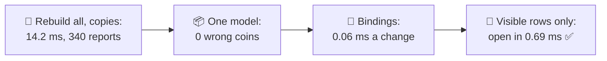
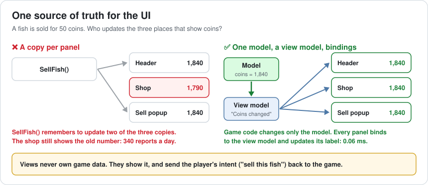
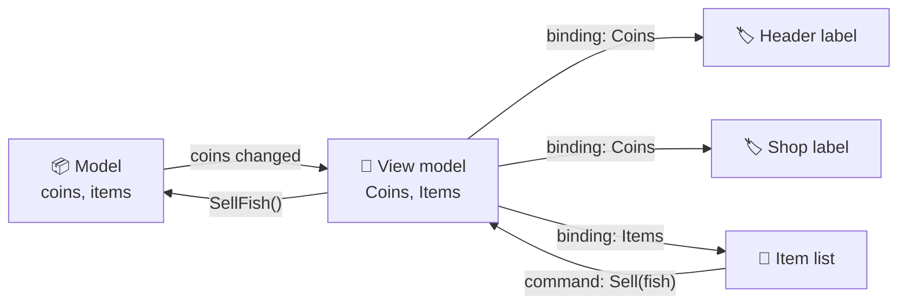
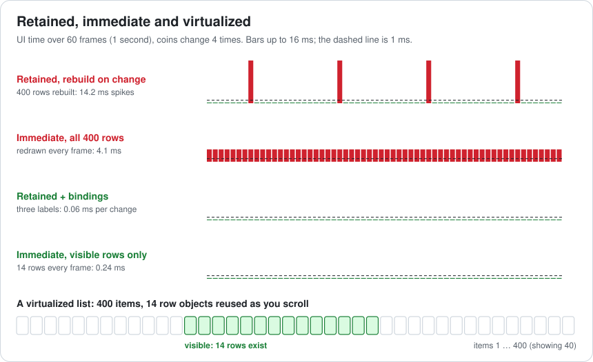
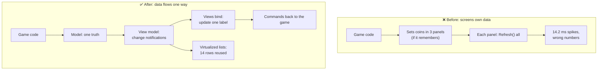

# Lesson 051 — UI Architecture: MVVM, Retained vs Immediate Mode: The Tackle Box That Stuttered

> Module 5 · Systems at scale · ~15 min read · 2026-11-01

**Today's goal:** structure game UI so that it shows one truth and does only the work that changed: data in one model, a view model that announces changes, views that bind to it, lists that only build what is visible, and a clear choice between retained and immediate-mode UI.

### TL;DR
- The tackle box screen shows **400 items**. On every coin change it calls `Refresh()` and rebuilds all of them: **14.2 ms**, **4 times a second** while selling fish. And the shop panel keeps its own copy of the coins: **340** "wrong coins" reports a day.
- **One model** for the coins ends the wrong numbers. **Bindings** (MVVM: model, view model, view) turn a coin change into 3 label updates: **0.06 ms**. **Immediate mode** is never stale but costs **4.1 ms every frame** with 400 rows.
- A **virtualized list** builds only the **14** visible rows and reuses them: opening the screen drops from **14.2 ms** to **0.69 ms** ✅.

> 🎮 **Play with it: [UI Lab](https://yimo691.github.io/GameArchitect/demos/051-ui-lab/)** — choose where coins live, how the UI reacts to a change and how many rows exist, and watch the open time, change spikes, wrong coins and garbage. Tap **Set up** on the steps to replay the lesson.



---

## 1. The problem

During the festival, players sell fish non-stop, and coins change about **4 times a second**. With the tackle box open, the game stutters on every sale. The profiler (Lesson 003):

```
Frame 1,207 · 30.9 ms (budget 16.7)
  TackleBoxScreen.Refresh()        14.2 ms
    Destroy 400 rows                 
    Instantiate 400 ItemRow          
    Layout rebuild                   
  GC.Alloc                         120 KB
```

And support has a second complaint, 340 times a day: "I sold a fish and the shop still shows my old coins". The header says 1,840, the shop says 1,790, the sell popup says 1,840.

Both bugs come from the same design: **every screen owns a copy of the game's data and redraws itself whenever anyone remembers to tell it**.

---

## 2. Step 1 — One source of truth

Analogy: a scoreboard in a stadium. If three people keep the score on three notepads, sooner or later one misses a goal. There is **one** scoreboard, and everyone reads it.

The code before:

```csharp
void SellFish(Fish f) {
    coins += f.price;
    header.SetCoins(coins);
    sellPopup.SetCoins(coins);
    // forgot shopPanel: it keeps its own "coins" field
}
```

Every new panel that shows coins is one more line someone must remember. Instead, coins live in **one model**, and the UI reads from it. Game code changes the model; it never touches a label.



Wrong coins: **0**. But the stutter remains: each change still rebuilds 400 rows.

---

## 3. Step 2 — MVVM: update what changed

**MVVM** splits UI into three parts:

- **Model**: the game's data (coins, items). Knows nothing about screens.
- **View model**: the data shaped for one screen, plus **change notifications** ("Coins changed", "Item 52 changed").
- **View**: the labels, rows and buttons. It **binds** to view model properties and updates only what a notification names. It sends the player's intent (a "sell" tap) back as a command.



A coin change now touches **3 labels**: `3 × 0.02 ms = ` **0.06 ms**, and no garbage. The rows are untouched.

Unity's UI Toolkit has runtime data binding; uGUI needs a small binding helper or events. The pattern matters more than the library.

---

## 4. Step 3 — Retained or immediate mode?

Two families of UI:

- **Retained mode**: UI objects (rows, labels) exist and stay between frames. You change them when data changes. uGUI, UI Toolkit, HTML.
- **Immediate mode**: no UI objects are kept. Every frame, code draws the UI from the data: `if (Button("Sell")) Sell();`. Unity's IMGUI, Dear ImGui.

Immediate mode is **never stale**: it reads the model every frame, so the three numbers always agree. But it pays every frame: 400 rows × 0.01 ms + 0.1 ms for the panels = **4.1 ms every frame**, even when nothing changes.



| | Retained + bindings | Immediate |
|---|---|---|
| Cost when nothing changes | ~0 | Every frame |
| Stale data | Possible if bindings are missing | Never |
| Code | More structure (view models, bindings) | Very short |
| Best for | Player-facing screens, animation, styling | Debug tools, editors (Lesson 054) |

The Reef keeps retained UI with bindings for players, and immediate mode for its debug overlays.

---

## 5. Step 4 — Build only what is visible

Bindings fixed the coin change, but **opening** the tackle box still builds 400 rows: `400 × 0.035 + 0.2 = ` **14.2 ms**, one dropped frame every time a player opens it.

Only **14** rows fit on screen. A **virtualized list** (also called a recycling list) creates 14 row objects and, as you scroll, reuses the one that left the top for the item entering at the bottom, rebinding it to new data.

- Open: `14 × 0.035 + 0.2 = ` **0.69 ms**.
- Coin change: **0.06 ms**. Wrong coins: **0**. Garbage: **0** ✅.

The same trick works for immediate mode: drawing only the 14 visible rows costs 0.24 ms a frame. Both pass; the architecture choice is about stale data and code style, not raw speed.

---

## 6. The architect's view

The junior asks "why does the shop show 1,790?". The optimizer would ask how to make `Refresh()` faster. The architect asks: **who owns the data, and how does a change reach exactly the pixels that show it?**



The architect's rules for the Reef's UI:

1. **The UI never owns game data.** It shows the model and sends intents back.
2. **Changes are named.** "Coins changed" updates the coin labels, not the screen.
3. **No `Refresh()` that rebuilds everything** on gameplay events. Full rebuilds only when a screen opens.
4. **Lists longer than a screen are virtualized.**
5. **Retained for players, immediate for tools**, and both draw only what is visible.

### Trade-offs

| Lever | Cost | Benefit | When to use |
|---|---|---|---|
| One model | Discipline: no data in views | No wrong numbers | Always |
| MVVM / bindings | View models and binding code | Updates touch only what changed | Screens that change while open |
| Rebuild on open | One-time cost | Simple, always correct | Static screens, small lists |
| Immediate mode | Cost every frame | Never stale, short code | Debug tools, editors |
| Virtualized lists | Rows must be rebindable; variable heights are harder | Cost follows the screen, not the data | Lists longer than a screen |
| Batching changes | Changes shown a frame later | 10 changes in one frame cost one update | Fast-changing values |

---

## 7. Common mistakes

- **Copies of game data in views.** Every copy is a future "wrong number" bug.
- **`Refresh()` everything** on every event. Fine at 10 items, a stutter at 400.
- **Creating and destroying rows** while scrolling. Reuse them.
- **Formatting strings every frame** for labels that didn't change (Lesson 042).
- **Immediate mode for big player screens**: paying every frame for nothing.
- **Game logic inside button handlers.** The view sends "sell this fish"; the game decides what happens.

---

## 8. Quiz — think about it on the lift 🎿🎣

**Q1.** Why did the shop show 1,790 when the header showed 1,840?

<details><summary>Answer</summary>

The shop panel kept its own copy of the coins, and `SellFish()` updated the header and the popup but not the shop. With one model, there is nothing to forget: every panel reads or binds to the same number.
</details>

**Q2.** With "rebuild on change", how much UI time is spent in one second of selling, and how much garbage?

<details><summary>Answer</summary>

`4 × 14.2 = 56.8 ms` a second, which is about `0.95 ms` a frame on average, but delivered as four 14.2 ms spikes. Garbage: `400 × 0.3 KB × 4 = 480 KB` a second.
</details>

**Q3.** Immediate mode with 400 rows costs 4.1 ms a frame. Why is that worse than four 14.2 ms spikes in some ways, and better in others?

<details><summary>Answer</summary>

Worse: `4.1 × 60 = 246 ms` a second, four times the total cost, and it's paid even when nothing changes. Better: it never spikes and never shows stale data. Drawing only visible rows fixes the cost: 0.24 ms.
</details>

**Q4.** A list of 10,000 leaderboard entries must open in under 1 ms. What's the plan?

<details><summary>Answer</summary>

Virtualize: build only the visible rows (say 14) and reuse them while scrolling; load entries in pages from the server. The cost then follows the screen size, not the 10,000 entries.
</details>

---

## 9. Back at the desk (≈45 min) — one screen, cleaned

> No desk today? Do it in the [UI Lab](https://yimo691.github.io/GameArchitect/demos/051-ui-lab/): predict open time, change spikes and wrong coins for each step, then tap.

In your own project:

1. **Pick the busiest screen** (inventory, shop, leaderboard). Profile opening it and one data change.
2. **Find copies**: which game values are stored in UI scripts?
3. **Move one value** (coins, health) into a model with a "changed" event; bind its labels.
4. **Find the longest list**. How many rows exist? How many are visible?
5. **Virtualize it** or write down what stops you (variable heights, nested lists).
6. Save `journal/051-ui.md`:

| Question | Before | After |
|---|---|---|
| Open time (ms) | | |
| One data change (ms) | | |
| Values copied into UI scripts | | |
| Rows built vs visible | | |
| Retained or immediate, and why | | |

One question for your journal: which UI script in your project would be hardest to move to "the view never owns data", and why?

---

## 10. Vocabulary

| Term | Meaning | 中文 |
|---|---|---|
| Model | The game's data, independent of any screen | 模型 |
| View | The UI elements the player sees | 视图 |
| View model | Data shaped for one view, with change notifications | 视图模型 |
| MVVM | Model–View–ViewModel, a UI architecture pattern | MVVM 模式 |
| Data binding | Connecting a view property to a view model property | 数据绑定 |
| Change notification | A message that one named value changed | 变更通知 |
| Retained mode | UI objects persist and are updated | 保留模式 |
| Immediate mode | UI is drawn from data every frame, nothing kept | 立即模式 |
| Virtualized list | A list that only creates visible rows and reuses them | 虚拟化列表 / 循环列表 |
| Single source of truth | Each fact stored in exactly one place | 单一数据源 |

---

## 11. Further reading

- **Unity Manual — "UI Toolkit: Runtime data binding"**: binding UI elements to data sources and change tracking.
- **Unity Manual — "Comparison of UI systems in Unity"**: UI Toolkit, uGUI and IMGUI, and when to use each.
- **Microsoft Learn — "The Model-View-ViewModel pattern"** (.NET MAUI / WPF docs): the original MVVM description with bindings and commands.
- **Omar Cornut — Dear ImGui README and FAQ** (github.com/ocornut/imgui): what immediate-mode UI is and why tools love it.
- **Casey Muratori — "Immediate-Mode Graphical User Interfaces"** (2005 video and notes): the talk that named the idea.

---

**Tomorrow — Lesson 052: Audio system budgets.** During the festival's fireworks finale, 180 sounds try to play at once: splashes, bangs, cheers, music. The audio crackles, and sound uses 220 MB of the phone's memory. We set voice limits, priorities and memory budgets for sound, and choose how each sound is loaded.
