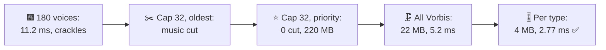
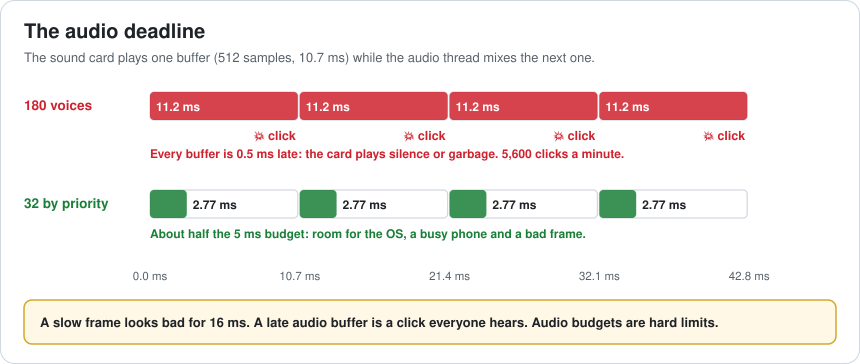
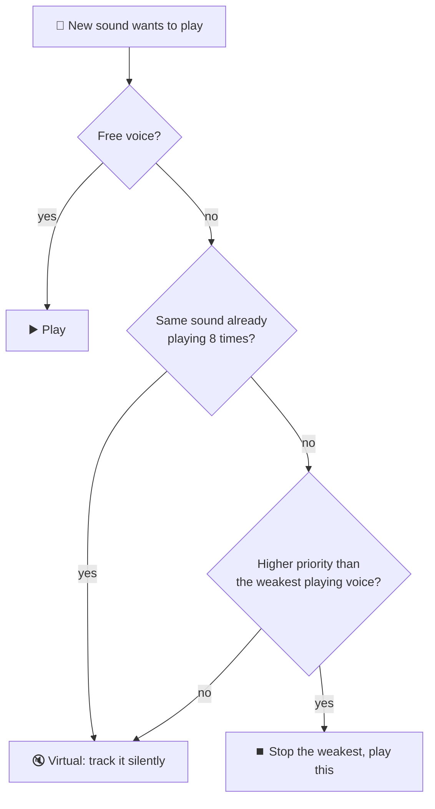
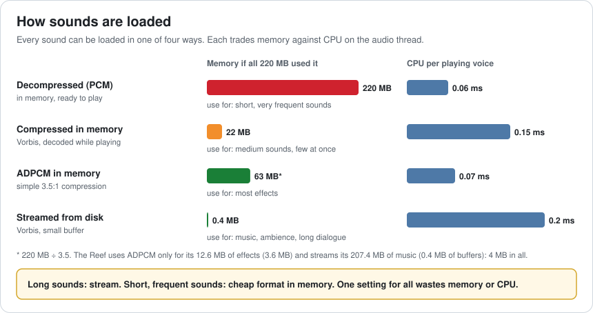
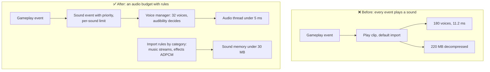

# Lesson 052 — Audio System Budgets: 180 Sounds at the Finale

> Module 5 · Systems at scale · ~15 min read · 2026-11-01

**Today's goal:** give sound a budget like graphics has: a hard deadline for the audio thread, a voice limit with priorities, and a memory budget met by choosing how each kind of sound is loaded.

### TL;DR
- Audio has a **hard deadline**: the sound card needs a new buffer every **10.7 ms**. At the fireworks finale, **180** sounds play at once: 180 × 0.06 ms + 0.4 ms = **11.2 ms**, late every time: **5,600 crackles a minute**. And all sound is decompressed in memory: **220 MB**.
- A **voice cap of 32** fixes the thread (2.32 ms), but "steal the oldest" stops the **music, your reel and the announcer** at the climax. **Priorities** keep what matters: 0 important sounds cut.
- **Compressing everything** saves memory (22 MB) but costs CPU (5.2 ms, over the 5 ms budget). **Choosing per type** (stream music, ADPCM effects): **4 MB** and **2.77 ms** ✅.

> 🎮 **Play with it: [Audio Lab](https://yimo691.github.io/GameArchitect/demos/052-audio-lab/)** — choose the voice limit and how sounds are loaded, and watch the audio thread, crackles, important sounds cut and sound memory. Tap **Set up** on the steps to replay the lesson.



---

## 1. The problem

The festival ends with fireworks over the Grand Lake. In the play test, the finale sounds awful:

```
Play test · festival finale · mid-range phone
"crackling and popping during the fireworks"
"music cut out right at the end"
Crash reports on 2 GB phones: out of memory   (audio: 220 MB)
Sounds asked to play at the peak:  180
  1 music · 1 reel loop · 1 announcer
  120 firework bangs · 40 splashes · 17 cheers
```

The audio was built the way sound designers usually start: every sound plays when its event happens, and every clip uses the default import settings: **decompressed on load**.

Graphics has had budgets since Lesson 002. Audio had none.

---

## 2. Step 1 — The audio deadline

Analogy: a conveyor belt that never stops. Every 10.7 ms, an empty box arrives, and it must be filled before it reaches the end. If it's not ready, the belt sends an empty box: the player hears a **click**.

The sound card plays audio in **buffers**. Here: 512 samples at 48,000 samples a second = **10.7 ms**. While one buffer plays, the **audio thread** mixes the next: for every playing **voice** it reads the samples, decodes them if compressed, applies volume, 3D panning and effects, and adds them up.

At the finale: 180 voices × 0.06 ms + 0.4 ms of mixing = **11.2 ms** per buffer. 0.5 ms late, every time: 60,000 ÷ 10.7 ≈ **5,600** late buffers a minute.



A slow frame looks bad for one frame; a late audio buffer is a click everyone hears. So the Reef sets the audio thread budget at **5 ms** of each 10.7 ms buffer: about half, leaving room for a busy phone.

---

## 3. Step 2 — Voices: a cap and priorities

Nobody can hear 120 separate firework bangs. Past a few dozen sounds, the mix just gets louder and muddier. So audio engines have a **voice limit**: at most N sounds actually play, and the rest are **virtual** (tracked, silent, cheap) or dropped.

With a cap of **32**: `32 × 0.06 + 0.4 = ` **2.32 ms**. No crackles.

But which 32? The first rule people try is "steal the oldest": when a new sound needs a voice, stop the one that has played longest. At the finale, the oldest sounds are the ones that started first: **the music, your reel and the announcer**. The music stops at the climax.

**Priorities** fix it. Each sound gets one:

| Sound | Priority | Playing at the finale |
|---|---|---|
| Music, your reel, announcer | Must play | 3 of 3 |
| Firework bangs | Nearest and loudest | 18 of 120 |
| Splashes | A few are enough | 8 of 40 |
| Cheers | A few are enough | 3 of 17 |



Important sounds cut: **0**. Two more rules from the diagram help a lot: a **limit per sound** (no more than 8 of the same splash), and judging "weakest" by **audibility** (priority × volume at the listener), so a far-away bang loses to a near one.

---

## 4. Step 3 — Memory: choose how each sound is loaded

The thread is fine. Memory is not: **220 MB**, which crashes 2 GB phones. Where does it go?

- 6 music tracks, 3 minutes each, stereo, 48 kHz, 16-bit: `180 s × 48,000 × 2 × 2 bytes = 34.6 MB` each, **207.4 MB** in all.
- 900 short effects: **12.6 MB**.

Every sound has a **load type** and a **format**:



First idea: **compress everything** (Vorbis, about 10:1): **22 MB**. But now every playing voice decodes Vorbis: `32 × 0.15 + 0.4 = ` **5.2 ms**, over the 5 ms budget.

Better: **choose per type**.

- **Music**: only one track plays at a time and it's long. **Stream** it from disk: a small buffer, 0.4 MB, about 0.2 ms of CPU.
- **Effects**: short, frequent, many at once. Keep them **in memory as ADPCM** (3.5:1, very cheap to decode): 12.6 MB ÷ 3.5 = 3.6 MB, 0.07 ms a voice.

Total: **4 MB**, and `0.2 + 31 × 0.07 + 0.4 = ` **2.77 ms** ✅.

---

## 5. The architect's view

The junior asks "why does it crackle?". The optimizer would ask which sound is expensive. The architect asks: **what is the audio budget, and what system makes every new sound fit it automatically?**



The architect's rules for the Reef's sound:

1. **Audio has a budget**: thread time per buffer, voices, and memory, per platform.
2. **Gameplay raises sound events, not clips.** The event carries a category and priority; the sound system decides what plays.
3. **One voice manager** with a cap, per-sound limits and audibility-based stealing.
4. **Import settings come from categories**, checked by the asset pipeline (Lesson 045), not chosen clip by clip.
5. **Test the loudest moment** (finale, boss fight), not the menu.

### Trade-offs

| Lever | Cost | Benefit | When to use |
|---|---|---|---|
| Voice cap | Some sounds don't play | Bounded audio thread time | Always |
| Priorities / audibility | Tagging every sound | The right sounds survive | Always |
| Per-sound limits | A setting per event | No wall of identical splashes | Frequent effects |
| Decompressed in memory | Lots of memory | Cheapest to play | Very short, very frequent sounds |
| ADPCM in memory | Some quality loss | 3.5× smaller, cheap to decode | Most effects |
| Vorbis in memory | CPU per voice | ~10× smaller | Medium sounds that rarely overlap |
| Streaming | Disk reads, a little latency to start | Almost no memory | Music, ambience, dialogue |
| Bigger buffer | More latency (sound later than the action) | More time per buffer | Only when the thread can't fit |

---

## 6. Common mistakes

- **No voice limit.** The busiest moment sets the cost, and it's always the one you didn't test.
- **"Steal the oldest" alone.** Music and loops are always the oldest.
- **Default import settings for everything.** Music decompressed in memory is the classic 200 MB mistake.
- **Compressing everything.** Saves memory, then the audio thread runs out of time.
- **Doing heavy work on the audio thread** (allocations, locks, file reads). It can't wait for anything.
- **Raising the buffer size to hide crackles.** Sound starts later after every action.

---

## 7. Quiz — think about it on the lift 🎿🎣

**Q1.** Why is 11.2 ms a disaster while a 17 ms game frame is only a small stutter?

<details><summary>Answer</summary>

The sound card needs a buffer every 10.7 ms. If it isn't ready, the card plays silence or old data, which is a click. A late game frame just shows the old picture a little longer. Audio's deadline is hard; a frame's is soft.
</details>

**Q2.** With priorities, the cap is raised to 48 voices, all decompressed. What does the audio thread cost?

<details><summary>Answer</summary>

`48 × 0.06 + 0.4 = 3.28 ms`, inside the 5 ms budget. With the per-type setup (1 streamed + 47 ADPCM): `0.2 + 47 × 0.07 + 0.4 = 3.89 ms`, also inside.
</details>

**Q3.** Why stream the music but not the splashes?

<details><summary>Answer</summary>

Only one music track plays at a time and it is long, so a small streaming buffer replaces 34.6 MB per track. Splashes are short and many play at once; streaming each would mean many disk reads and a delay before each one starts. Keeping them in memory as ADPCM costs only 3.6 MB for all effects.
</details>

**Q4.** A designer adds a 2-minute ambient lake loop, imported with default settings. What happens, and what rule catches it?

<details><summary>Answer</summary>

Decompressed stereo: `120 s × 48,000 × 2 × 2 = 23 MB` more memory. The category rule ("ambience streams") in the asset pipeline should flag or fix the import before it reaches a build.
</details>

---

## 8. Back at the desk (≈45 min) — your sound budget

> No desk today? Do it in the [Audio Lab](https://yimo691.github.io/GameArchitect/demos/052-audio-lab/): predict thread time, crackles, cut sounds and memory for each step, then tap.

In your own project:

1. **Find the loudest moment** and count the sounds asked to play there.
2. **Profile the audio thread** at that moment (Unity Profiler: Audio module; or your engine's audio stats).
3. **Check the voice limit** and how voices are stolen. Which sounds could be cut?
4. **List the 10 largest audio assets** in memory with their load type and format.
5. **Write category rules**: music, ambience, dialogue, UI, effects → load type, format, priority.
6. Save `journal/052-audio.md`:

| Question | Before | After |
|---|---|---|
| Sounds asked to play at the peak | | |
| Voice cap and stealing rule | | |
| Audio thread at the peak (ms per buffer) | | |
| Sound memory (MB) | | |
| Largest clip and its load type | | |

One question for your journal: which sound in your game must never be cut, and does your current setup guarantee it?

---

## 9. Vocabulary

| Term | Meaning | 中文 |
|---|---|---|
| Audio buffer | A short block of samples the sound card plays | 音频缓冲区 |
| Audio thread | The thread that mixes sounds into each buffer | 音频线程 |
| Buffer underrun | The buffer wasn't ready in time; heard as a click | 缓冲区欠载 |
| Voice | One sound currently playing | 发声数 / 声部 |
| Voice limit | The most voices allowed at once | 最大发声数 |
| Virtual voice | A sound tracked silently while over the limit | 虚拟声部 |
| Voice stealing | Stopping one voice to play another | 声部抢占 |
| Audibility | How loud a sound is at the listener, times its priority | 可闻度 |
| Load type | How a clip is kept: decompressed, compressed, streamed | 加载类型 |
| ADPCM / Vorbis | Cheap 3.5:1 / stronger ~10:1 audio compression formats | ADPCM / Vorbis 压缩格式 |

---

## 10. Further reading

- **Unity Manual — "Audio Clip" import settings**: Load Type (Decompress On Load, Compressed In Memory, Streaming) and compression formats.
- **Unity Manual — "Audio Profiler module"**: playing and virtual voices, audio CPU and memory.
- **FMOD documentation — "Virtual Voice System"**: voice limits, audibility and virtual voices.
- **Audiokinetic Wwise documentation — "Managing priority" and "Playback limit"**: priorities and per-sound limits.
- **Ross Bencina — "Real-time audio programming 101: time waits for nothing"** (rossbencina.com): why the audio thread must never wait.

---

**Tomorrow — Lesson 053: AI at scale: time slicing and AI LOD.** Back to the zombie horde from Lesson 001: the 5,000 zombies now have brains. Each one picks a target and a path every frame, and AI alone takes 15 ms. We spread thinking over several frames and let far-away zombies think less often, and measure what players notice.
