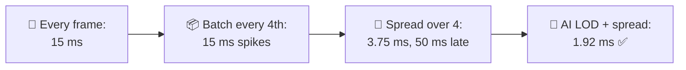
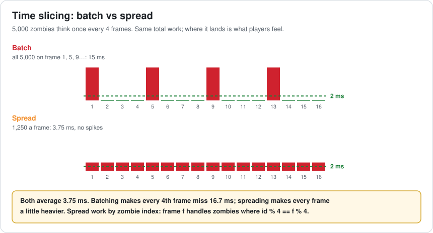
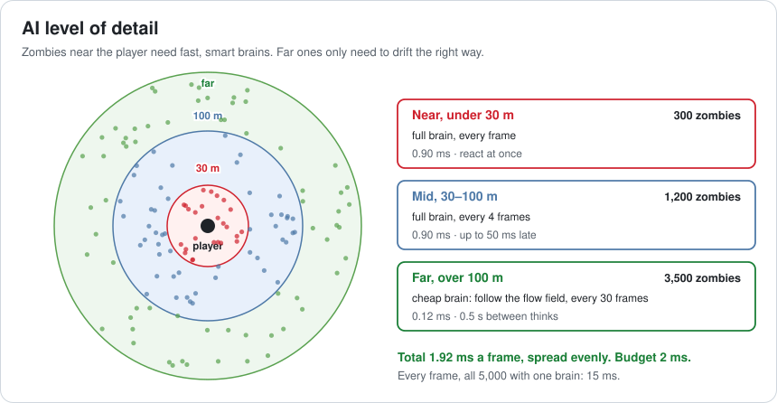
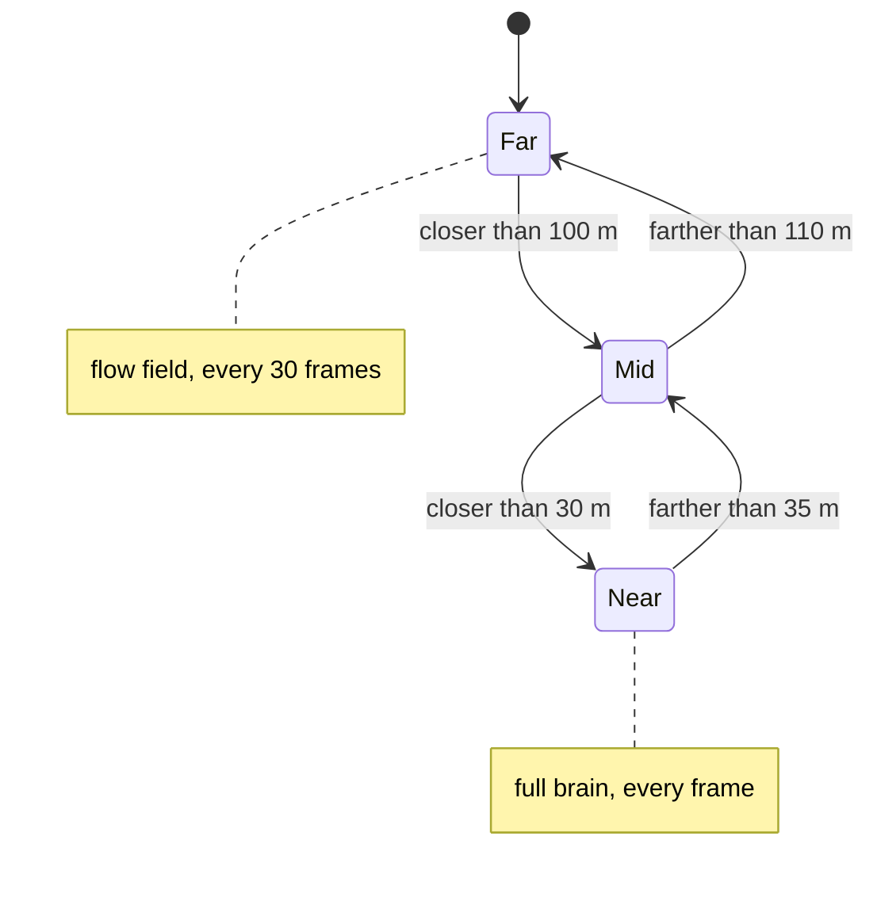
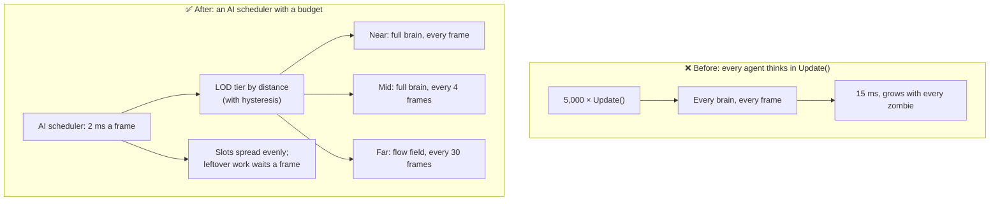

# Lesson 053 — AI at Scale: Time Slicing and AI LOD: 5,000 Zombies Need Brains

> Module 5 · Systems at scale · ~15 min read · 2026-11-01

**Today's goal:** fit thousands of AI agents into a small, steady budget: spread their thinking evenly over frames (time slicing), and give each agent only as much brain as the player can notice (AI level of detail).

### TL;DR
- The 5,000 zombies from Lesson 001 now have **brains**: each picks a target and asks for a path, **0.003 ms** a think. Every zombie, every frame: **15 ms** of AI. Budget: **2 ms**.
- **Thinking every 4th frame, all at once** averages 3.75 ms but makes **15 ms spikes**. **Spreading** a quarter of the zombies over each frame gives **3.75 ms** every frame, no spikes, but zombies next to the player react up to **50 ms** late.
- **AI LOD**: near zombies think every frame, mid ones every 4 frames, far ones use a **cheap brain** every 30 frames: **1.92 ms**, and near zombies react at once ✅. Batched instead of spread, the same LOD still spikes to **8 ms**.

> 🎮 **Play with it: [Zombie Horde Lab](https://yimo691.github.io/GameArchitect/demos/001-zombie-horde/)** — scroll to **Zombie brains**, choose when zombies think and whether AI LOD is on, and watch the worst frame, the average, near reactions and far update gaps. Tap **Set up** on the Lesson 053 steps.



---

## 1. The problem

Lesson 001 made 5,000 zombies move apart cheaply with a grid. Lesson 037 found them in a city. Now the designers want them to **behave**: choose who to chase (the player, a noise, a screamer), ask the pathfinder for a route, decide whether to attack.

The first version puts the brain in `Update()`:

```csharp
void Update() {
    target = ChooseTarget();          // looks at noises, the player, screamers
    if (target != lastTarget) path = Pathfinder.Request(target);
    if (InRange(target)) Attack();
}
```

The profiler:

```
Frame 4,312 · 31.2 ms (budget 16.67)
  ZombieBrain.Update × 5,000   15.0 ms   (0.003 ms each)
  Separation (grid)             1.6 ms
  Rendering                    12.4 ms
```

AI alone takes 15 ms, almost a whole frame. The AI budget the team agreed on is **2 ms**.

---

## 2. Step 1 — Does every zombie need to think every frame?

Analogy: a teacher with 5,000 students can't talk to every one every minute. They walk the rows, a few students at a time, and spend longer with the ones at the front.

A zombie's decision rarely changes in 16 ms. The target is the same, the path is the same. Thinking 4 times less often costs almost nothing in behaviour.

The first try: think **every 4th frame**, with one counter for everyone:

```csharp
if (Time.frameCount % 4 == 0) foreach (var z in zombies) z.Think();
```

The average is now `15 ÷ 4 = ` **3.75 ms**. But all 5,000 still think on the **same** frame: frames 1, 5, 9… take **15 ms** of AI, and frames between take 0. Players feel the worst frame, not the average: the game stutters 15 times a second.

---

## 3. Step 2 — Time slicing: spread the work

Give each zombie its own slot. Frame `f` runs only the zombies with `id % 4 == f % 4`:

```csharp
int slot = Time.frameCount % 4;
for (int i = slot; i < zombies.Count; i += 4) zombies[i].Think();
```



1,250 zombies a frame: **3.75 ms every frame**, no spikes. This is **time slicing**: a fixed amount of work per frame, with each agent served in turn. A more general version is a **budgeted queue**: run agents from a queue until 2 ms are used, and continue next frame.

Two problems are left:

- 3.75 ms is still almost twice the 2 ms budget.
- A zombie **next to the player** may think up to 3 frames late: **50 ms**. When you dodge, it still swings at where you were.

---

## 4. Step 3 — AI level of detail

Graphics uses LOD: far objects get fewer triangles (Lesson 028). AI can do the same. What the player notices depends on **distance**:

| Tier | Zombies | Brain | Thinks every | Cost a frame |
|---|---|---|---|---|
| Near, under 30 m | 300 | Full | 1 frame | 300 × 0.003 = **0.90 ms** |
| Mid, 30–100 m | 1,200 | Full | 4 frames | 300 × 0.003 = **0.90 ms** |
| Far, over 100 m | 3,500 | Cheap: follow the horde's flow field | 30 frames | ~117 × 0.001 = **0.12 ms** |



Total: **1.92 ms** in every frame ✅. Near zombies react **at once**. Far zombies update every **0.5 s**, which nobody 100 m away can see. The cheap brain doesn't choose targets or request paths: it reads one shared **flow field** (a grid of "go this way" arrows toward the player, computed once for everyone).

Tiers must be **spread** too. With the same tiers but each tier thinking all at once, frames where mid and far coincide take `0.9 + 3.6 + 3.5 = ` **8.0 ms**.



The gaps between 30 and 35 m and between 100 and 110 m (**hysteresis**) stop a zombie at the border from switching tiers every frame.

---

## 5. The architect's view

The junior asks "why is AI 15 ms?". The optimizer would make `ChooseTarget()` faster. The architect asks: **who decides when each agent thinks, and how much thinking does the player actually see?**



The architect's rules for the horde:

1. **Agents don't own their update.** One AI scheduler decides who thinks this frame, within a fixed budget.
2. **Budget the worst frame, not the average.** Spread work by slot or queue; never "everyone on frame N".
3. **Spend brains where the player looks.** Tiers by distance (and on screen or not), with hysteresis.
4. **Share what agents have in common.** One flow field for 3,500 zombies instead of 3,500 paths.
5. **Events can promote an agent.** A zombie hit by the player jumps to the near tier at once.

### Trade-offs

| Lever | Cost | Benefit | When to use |
|---|---|---|---|
| Think every N frames (spread) | Up to N − 1 frames of delay | Work ÷ N, no spikes | Decisions that change slowly |
| Budgeted queue | Delay grows when overloaded | A hard cap on AI time | Big, changing crowds |
| AI LOD tiers | Tier logic, hysteresis, testing each tier | Brains where the player looks | Any crowd larger than the screen |
| Cheap far brain / flow field | Less individual behaviour far away | 3× cheaper, shared work | Hordes, herds, traffic |
| Event-driven promotion | More code paths | Instant reactions when it matters | Combat, being shot, noises |
| Jobs / threads (Lesson 008) | Data must be laid out for it | More cores, same budget | After the work itself is small |

---

## 6. Common mistakes

- **One global "every Nth frame" check.** Same total work, now as spikes.
- **Measuring the average.** The player feels the worst frame.
- **The same delay for everyone.** The zombie biting you must not be 50 ms late.
- **No hysteresis.** Zombies on a border flip tiers every frame, and their behaviour jitters.
- **Expensive work in the cheap tier.** If the far brain still requests paths, LOD saves nothing.
- **Forgetting off-screen.** A near zombie behind a wall can often think as a mid one.

---

## 7. Quiz — think about it on the lift 🎿🎣

**Q1.** Why does "every 4th frame, all at once" feel worse than "every frame" sometimes, although it does less work?

<details><summary>Answer</summary>

It averages 3.75 ms, but every 4th frame has all 15 ms. That frame misses the 16.67 ms budget and the player sees a stutter 15 times a second. Steady work is better than less work in bursts.
</details>

**Q2.** The horde grows to 10,000, with the same share in each tier (600 near, 2,400 mid, 7,000 far). What's the AI cost per frame?

<details><summary>Answer</summary>

Near: `600 × 0.003 = 1.80 ms`. Mid: `2,400 ÷ 4 × 0.003 = 1.80 ms`. Far: `7,000 ÷ 30 × 0.001 ≈ 0.23 ms`. Total ≈ **3.83 ms**, over 2. Options: shrink the near radius, think mid zombies every 8 frames, or move near zombies' brains to jobs.
</details>

**Q3.** Why does the far tier use a flow field instead of thinking less often with the full brain?

<details><summary>Answer</summary>

Even every 30 frames, 3,500 full brains each request their own path. A flow field is computed once and read by all: each far zombie just looks up "which way" in its cell, which is cheap and gives believable horde movement at a distance.
</details>

**Q4.** A far zombie hears a gunshot 5 m away (the player shot past it). What should happen?

<details><summary>Answer</summary>

Promote it to the near tier at once (an event, not waiting for the next distance check), so it reacts in the next frame. Tiers are a default; events that matter to the player override them.
</details>

---

## 8. Back at the desk (≈45 min) — your AI budget

> No desk today? Do it in the [Zombie Horde Lab](https://yimo691.github.io/GameArchitect/demos/001-zombie-horde/), Lesson 053 section: predict the worst frame and near delay for each step, then tap.

In your own project (any game with many agents: enemies, NPCs, animals, cars):

1. **Profile AI** with the most agents you'll ever have. Note the worst frame, not the average.
2. **Find who calls `Think()`**: every agent's own `Update()`, or a scheduler?
3. **Write tiers**: what does a far agent need to do? What can it skip?
4. **Spread one system** by slot (`id % N`) and measure the worst frame again.
5. **List events that promote** an agent (being hit, seeing the player, a noise).
6. Save `journal/053-ai.md`:

| Question | Before | After |
|---|---|---|
| Agents at peak | | |
| AI worst frame (ms) | | |
| AI average (ms) | | |
| Near reaction delay (ms) | | |
| Tiers and their rates | | |

One question for your journal: which agent in your game would a player notice first if it thought 4 times less often?

---

## 9. Vocabulary

| Term | Meaning | 中文 |
|---|---|---|
| Time slicing | Spreading work over several frames in small slices | 时间分片 |
| AI scheduler | One system that decides which agents think this frame | AI 调度器 |
| Budgeted queue | Run tasks until the time budget is used, continue next frame | 预算队列 |
| AI LOD | Less AI work for agents the player notices less | AI 细节层次 |
| Tier | A group of agents with the same update rate and brain | 层级 |
| Hysteresis | Different thresholds for going in and out, to avoid flipping | 迟滞 / 滞回 |
| Flow field | A grid of directions toward a goal, shared by many agents | 流场 |
| Promotion | Moving an agent to a more detailed tier because of an event | 提升层级 |
| Worst frame | The slowest frame in a period; what players feel | 最差帧 |
| Spike | One frame much slower than the others | 尖峰 / 卡顿 |

---

## 10. Further reading

- **"Game AI Pro" series** (free online at gameaipro.com): several chapters on scheduling AI work and level of detail for large numbers of agents.
- **Elijah Emerson — "Crowd Pathfinding and Steering Using Flow Field Tiles"**, Game AI Pro (Supreme Commander 2): flow fields for large armies.
- **Unity Learn / DOTS samples — "Boids" and the ECS samples**: many agents updated in jobs.
- **Unreal Engine documentation — "Mass Entity" and "Mass AI" LOD**: AI LOD tiers for crowds in a shipping engine.
- **Lesson 001 and Lesson 037** of this course: the separation grid and spatial structures this horde already uses.

---

**Tomorrow — Lesson 054: Tools and editor architecture.** Back at the Reef, the designers place 2,400 fishing spots by hand, the lake editor takes 40 seconds to open, and every new fish type needs a programmer. We design tools around data, with undo, validation and fast loading, so designers can work without waiting for code.
