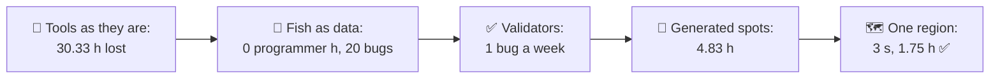
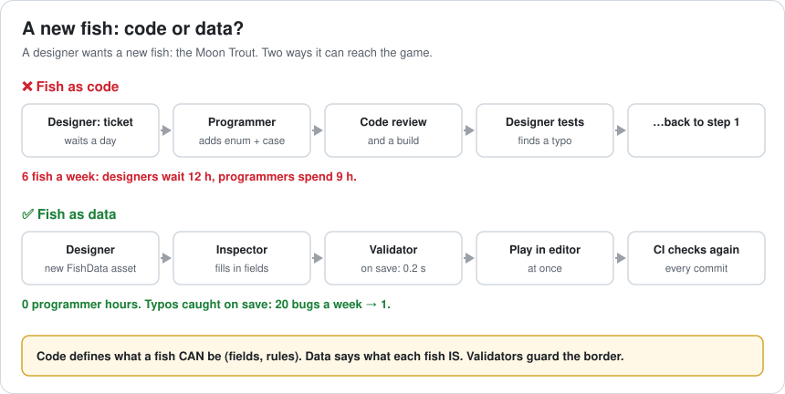
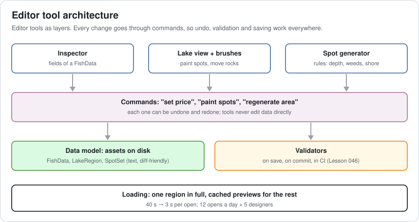
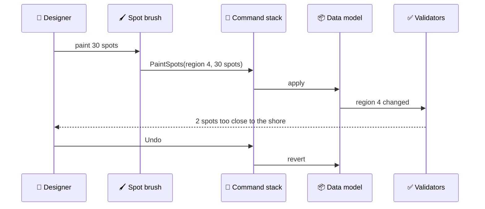
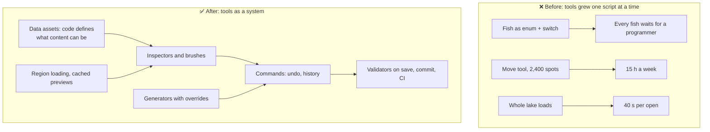

# Lesson 054 — Tools and Editor Architecture: Five Designers, Thirty Lost Hours

> Module 5 · Systems at scale · ~15 min read · 2026-11-01

**Today's goal:** design editor tools as a system: content as data that designers own, validators that act as their compiler, commands that make every change undoable, generators instead of hand placement, and loading fast enough that nobody waits.

### TL;DR
- Five designers build the Reef's lakes. Each week they lose **30.33 hours** to tools: waiting **40 s** for the editor 12 times a day, waiting for programmers to code **6** new fish, and placing **2,400** fishing spots by hand. Programmers spend **9 h** a week on fish code, and **14** data bugs a week reach builds.
- **Fish as data** removes programmer time (0 h) but raises data bugs to **20**; **validators** on save and in CI bring them to **1**.
- **Generated spots** (rules, then 240 hand tweaks) and **loading one region** (3 s) bring lost time to **1.75 h** a week ✅.

> 🎮 **Play with it: [Tools Lab](https://yimo691.github.io/GameArchitect/demos/054-tools-lab/)** — choose how fish are defined, how data is checked, how spots are placed and how the editor loads, and watch designer hours, programmer hours, data bugs and editor open time. Tap **Set up** on the steps to replay the lesson.



---

## 1. The problem

The Reef has five level designers. Their week, measured for two weeks with a simple time log:

```
Designer time lost to tools, team of 5, per week
  Opening the lake editor (40 s × 12 a day)         3.33 h
  Waiting for a programmer to add a fish            12.00 h
  Placing fishing spots by hand (2,400, monthly)    15.00 h
                                          total     30.33 h
Programmer time on fish requests                     9.00 h
Data bugs found in play tests                       14 a week
```

Nobody planned for this. The editor grew one script at a time: a fish is an `enum` and a `switch`, spots are placed with the move tool, and the lake scene holds every object. Each choice was fine for 20 fish and 100 spots.

Tools are part of the game's architecture. They just ship to a different customer: the team.

---

## 2. Step 1 — Content is data

Analogy: a restaurant where every new dish needs the owner to rewrite the menu printer's software. Better: the printer reads a menu file, and the chef edits the file.

Before, adding the Moon Trout meant code:

```csharp
enum FishType { Carp, Pike, GoldenCarp, /* … */ MoonTrout }
float Price(FishType t) => t switch { FishType.Carp => 12, /* … */ FishType.MoonTrout => 340, _ => 0 };
```

After, a fish is a **data asset**:

```csharp
[CreateAssetMenu] class FishData : ScriptableObject {
    public string id; public GameObject model; public int price;
    public HabitatData habitat; public float rarity;
}
```

The game loads every `FishData` it finds. A designer makes a new asset, fills in an inspector, and plays. Programmers define **what a fish can be**; designers decide **what each fish is**.



Programmer hours on fish: **0**. Designer waiting: **0**. But a surprise: data bugs go **up**, from 14 to **20** a week. A missing model, a price of 0, a habitat that was renamed. The compiler used to catch some of these; now nothing does.

---

## 3. Step 2 — Validators: a compiler for data

Designers need what programmers have: something that says "this is wrong" **before** anyone plays.

A **validator** is a small function that checks one kind of asset:

```csharp
[Validator] // our own attribute: the validation tool finds these methods
static IEnumerable<string> CheckFish(FishData f) {
    if (f.model == null) yield return $"{f.id}: no model";
    if (f.price <= 0)    yield return $"{f.id}: price must be above 0";
    if (f.habitat == null) yield return $"{f.id}: habitat missing";
}
```

Validators run in three places:

- **On save**, in the editor: the designer sees the error at once, next to the field.
- **On commit**, before the change is shared.
- **In CI** (Lesson 046), on every asset, so nothing slips through.

Data bugs reaching builds: **1** a week (the ones no rule describes yet; each one becomes a new rule).

---

## 4. Step 3 — Commands, undo and generators

Every editing tool (inspector, brush, generator) changes data through **commands**: small objects that know how to do and undo one change. That gives every tool undo/redo, a history, and one place to validate and mark data as changed.



With commands in place, the spot problem becomes a tool, not a chore. Placing 2,400 spots at 1.5 min each takes **60 hours**, every time the lake layout changes (about once a month): **15 h** a week.

A **generator** places spots by rules (water depth, weed beds, distance from the shore, minimum gap between spots). Designers then tweak about 10% by hand: `240 × 1.5 min = 6 h` a month, **1.5 h** a week. Because "regenerate this area" is one command, it can be undone like any brush stroke, and hand tweaks are kept as overrides on top of the rules.



---

## 5. Step 4 — Tools have performance budgets

The lake editor opens in **40 s**, because it loads every object in the lake. Each designer opens it about 12 times a day: `40 s × 12 × 5 designers × 5 days = ` **3.33 h** a week, and that only counts the waiting, not the lost focus.

The fix is the same as in the game (Lesson 043): **load what you're working on**. The editor loads one region in full and shows the others as cached previews (low-detail meshes, baked once by the asset pipeline). Open time: **3 s**: **0.25 h** a week.

Total designer time lost: `0.25 + 0 + 1.5 = ` **1.75 h** a week ✅. Programmer time: **0**. Data bugs: **1**.

---

## 6. The architect's view

The junior asks "why is adding a fish so slow?". The optimizer would speed up the editor's load. The architect asks: **who are the users of our tools, and what does every change they make go through?**



The architect's rules for the Reef's tools:

1. **Content is data.** If a designer needs a programmer to add content, the tool is missing.
2. **Data has a compiler.** Every asset type has validators, run on save and in CI.
3. **All edits are commands.** Undo, history and validation come for free to every tool.
4. **Generate, then tweak.** Rules do the bulk; designers keep control through overrides.
5. **Tools have budgets.** Editor open time, save time and iteration time are measured like frame time.

### Trade-offs

| Lever | Cost | Benefit | When to use |
|---|---|---|---|
| Content as data assets | A data schema to design and version (Lesson 047) | Designers add content themselves | Anything there are many of |
| Validators | Writing and keeping rules | Bugs found on save, not in play tests | Every data type |
| Command pattern for edits | Each tool writes do/undo | Undo, history, one place to hook | Every editing tool |
| Generators + overrides | Rules to design; overrides to store | Hours of hand work become minutes | Repetitive placement |
| Region loading / previews | Preview baking in the pipeline | Fast opens on big worlds | Large levels |
| Immediate-mode tool UI (Lesson 051) | Redraw cost | Very fast to write | Debug and internal tools |

---

## 7. Common mistakes

- **Hard-coding content.** Every `enum` of content is a queue in front of a programmer.
- **Data without validators.** Moving content to data moves bugs to data.
- **Tools that edit data directly.** No undo, no history, no single place to validate.
- **Generators that throw away hand edits.** Designers stop trusting them after the first time.
- **Never measuring tool speed.** A 40 s load paid 300 times a week is a team-sized cost.
- **Building tools nobody asked for.** Watch the designers work for a day first.

---

## 8. Quiz — think about it on the lift 🎿🎣

**Q1.** Why did data bugs go up from 14 to 20 when fish became data?

<details><summary>Answer</summary>

In code, the compiler and the programmer's review caught some mistakes (a missing case, a wrong type). As data, designers edit more, faster, with nothing checking. The fix isn't to go back to code; it's to add validators that do for data what the compiler did for code.
</details>

**Q2.** The team grows to 8 designers. With the whole lake loading, how many hours a week are lost to opening the editor? With region loading?

<details><summary>Answer</summary>

`40 s × 12 × 8 × 5 = 19,200 s = 5.33 h`. With region loading: `3 s × 12 × 8 × 5 = 1,440 s = 0.4 h`. Tool costs grow with the team.
</details>

**Q3.** A designer regenerates an area and loses 50 hand-placed spots. What went wrong in the design?

<details><summary>Answer</summary>

Hand edits were written into the same data the generator overwrites. Store them as **overrides** (added, moved, removed spots) on top of the rules, and reapply them after each regeneration. And regeneration should be a command, so it can be undone.
</details>

**Q4.** Why should every edit go through a command, even simple ones like changing a price?

<details><summary>Answer</summary>

So every tool gets undo/redo and history for free, every change can be validated and marked as changed in one place, and tools can't leave data half-edited. A tool that writes fields directly skips all of it.
</details>

---

## 9. Back at the desk (≈45 min) — one tool audit

> No desk today? Do it in the [Tools Lab](https://yimo691.github.io/GameArchitect/demos/054-tools-lab/): predict designer hours, programmer hours and data bugs for each step, then tap.

In your own project:

1. **Shadow a designer** (or yourself as one) for an hour. Write down every wait and every repeated action.
2. **Find content in code**: enums, switches or lists of content that only programmers can change.
3. **Write three validators** for your most common data type. Run them over all assets. How many fail?
4. **Time the editor**: open, save, enter play mode. Multiply by how often each happens.
5. **Find one repetitive placement task** and sketch the rules a generator would use.
6. Save `journal/054-tools.md`:

| Question | Answer |
|---|---|
| Biggest weekly time loss in tools | |
| Content that needs a programmer to add | |
| Validators written / assets failing | |
| Editor open / save / play times | |
| A generator candidate and its rules | |

One question for your journal: which tool in your project would designers miss most if it disappeared, and which would they cheer?

---

## 10. Vocabulary

| Term | Meaning | 中文 |
|---|---|---|
| Data-driven | Behaviour and content set by data, not code | 数据驱动 |
| Data asset | A file holding one piece of content, edited in the editor | 数据资源 |
| Inspector | The editor panel that shows and edits an asset's fields | 检视面板 |
| Validator | A check that reports problems in data | 校验器 |
| Command pattern | Each change is an object that can do and undo itself | 命令模式 |
| Undo stack | The history of commands for undo and redo | 撤销栈 |
| Procedural generation | Creating content from rules | 程序化生成 |
| Override | A hand edit kept on top of generated content | 覆盖 / 手工修正 |
| Iteration time | Time from a change to seeing its result | 迭代时间 |
| Editor extension | Code that adds tools to the engine's editor | 编辑器扩展 |

---

## 11. Further reading

- **Unity Manual — "ScriptableObject"**: data assets that live outside scenes.
- **Unity Manual — "Editor scripting", `Undo` class and "Custom Editors"**: inspectors and undo for your own tools.
- **Robert Nystrom — "Game Programming Patterns", chapters "Command" and "Type Object"** (gameprogrammingpatterns.com): undoable edits and content defined as data.
- **Unreal Engine documentation — "Data Assets" and "Data Validation"**: the same ideas in another engine.
- **Unity Manual — "Search" and "Presets"**: finding and setting up many assets quickly.

---

**Tomorrow — Lesson 055: Telemetry and live-ops architecture.** The festival weekend ends and nobody can say why 18% of new players quit on day 2. The game sends one web request per event, drains batteries, and changing a fish's price needs a store update. We design telemetry that answers questions, and remote config that changes the game without a new build.
