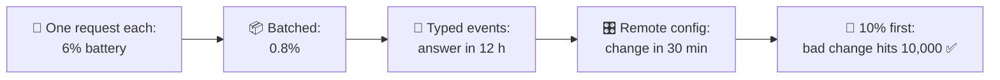
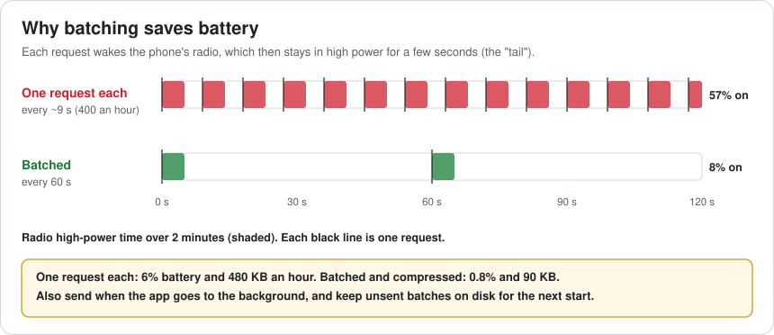
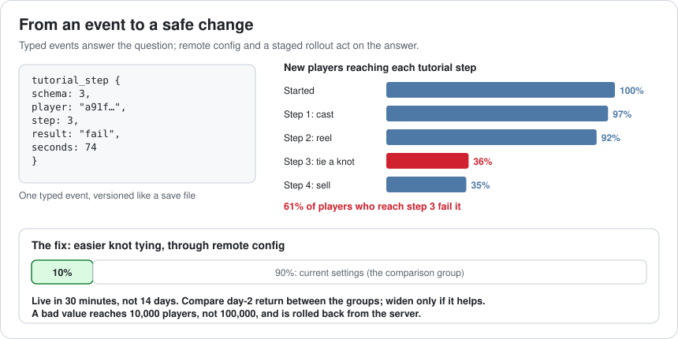
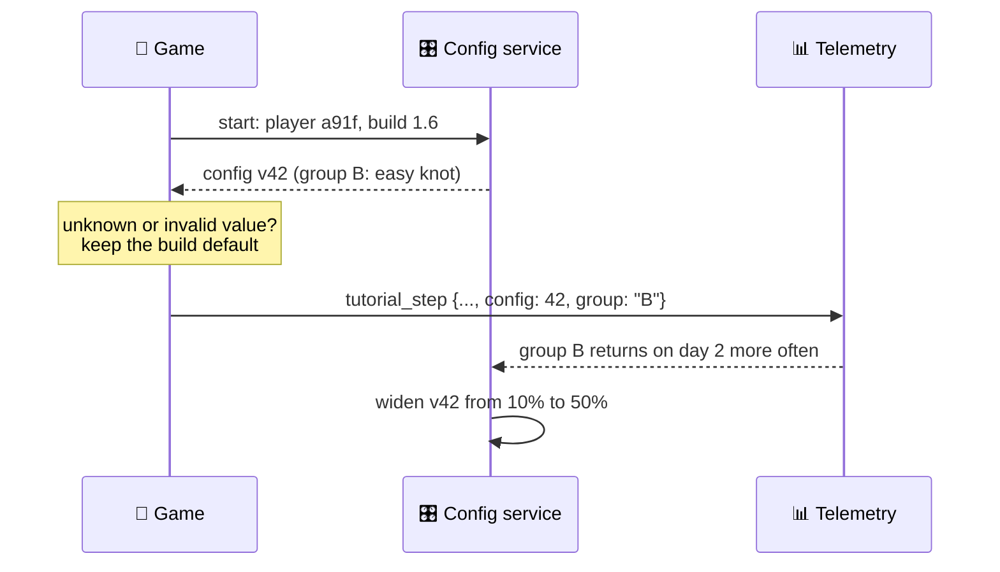
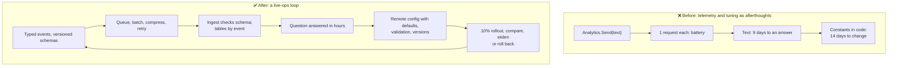

# Lesson 055 — Telemetry and Live-Ops Architecture: Why 18% Quit on Day 2

> Module 5 · Systems at scale · ~15 min read · 2026-11-01

**Today's goal:** build the loop that lets a live game learn and change: events that are cheap to send and easy to ask questions of, tuning that changes without a store update, and rollouts that keep a mistake small.

### TL;DR
- After the festival, **18%** of new players quit on day 2. The game sends **one web request per event** (400 an hour: **6%** battery, **480 KB**), its events are **log lines** (**9 days** to answer "why?"), and a price change needs a **14-day** store update.
- **Batching** events every 60 s: **0.8%** battery, **90 KB**. **Typed events with a schema**: one query in **12 hours** shows **61%** of players fail the knot-tying tutorial at step 3.
- **Remote config** ships the fix in **30 minutes**, and a **10% staged rollout** means a bad value reaches **10,000** players, not 100,000 ✅.

> 🎮 **Play with it: [Live-ops Lab](https://yimo691.github.io/GameArchitect/demos/055-liveops-lab/)** — choose how events are sent and shaped, where tuning lives and how changes roll out, and watch battery, data, time to an answer, time to a change and players hit by a mistake. Tap **Set up** on the steps to replay the lesson.



---

## 1. The problem

The festival brought 100,000 new players. A week later the dashboard shows one number that matters:

```
New players, festival week
  Came back on day 2:        82%
  Quit on day 2:             18%    (other launches: 9%)
Question from the producer:  why?
```

The team can't answer. Telemetry was added late, one line at a time:

```csharp
Analytics.Send("player tied knot fail step " + step + " t=" + seconds);
```

- Each `Send` makes its **own web request**. 400 events an hour keep the phone's radio awake: **6%** battery an hour, **480 KB** of mobile data. Players have noticed.
- The events are **text**. The wording changed three times since launch. A data analyst needs **9 days** to export, parse and clean the lines.
- Even with an answer, the knot tutorial's difficulty is a constant in the code. Changing it means a build, store review and players updating: **14 days**.

The game is live, but it can't learn and it can't change.

---

## 2. Step 1 — Send events in batches

Analogy: posting letters. Driving to the post office for each letter wastes most of the trip. You collect letters and go once a day.

On a phone, the costly part of a request isn't the bytes: it's **waking the radio**, which then stays in high-power mode for a few seconds (the "tail"). 400 requests an hour means the radio is almost never asleep.



The fix: events go into a **queue** on the phone. Every 60 s (and when the app goes to the background) the queue is compressed and sent in **one** request. Unsent batches are saved to disk and sent on the next start, so nothing is lost when the phone is offline.

- Battery: **6% → 0.8%** an hour.
- Data: **480 → 90 KB** an hour.

---

## 3. Step 2 — Events designed for questions

Log lines are for programmers reading one session. Questions like "why do players quit on day 2?" need **all** sessions, grouped and compared. That needs **typed events**:

```csharp
Telemetry.Track(new TutorialStep { step = 3, result = Result.Fail, seconds = 74 });
// sent as { "event": "tutorial_step", "schema": 3, "step": 3, "result": "fail", "seconds": 74, ... }
```

Every event type has a **schema**: named fields with types, and a **version**, like a save file (Lesson 047). The ingest service checks each event against its schema and stores it in a table for that event. Every event also carries common fields: player id, session, build version, config version, country, device.

With that, the question is **one query**: for players who quit on day 2, what was the last thing they did?



Answer in **12 hours**: of new players, 92% reach step 3 of the tutorial (tie a knot), and **61%** of those fail it. Many try 4 or 5 times and close the game.

---

## 4. Step 3 — Remote config: change without a build

The fix is simple: make the knot easier (a slower line, a wider "good" zone). But the values live in the code.

**Remote config** moves tuning out of the build:

1. The build contains **defaults** for every tunable value (so the game works offline).
2. At start, the game fetches a small config file from a server, checks it, and uses its values.
3. The config has a **version**, sent with every event, so the team can compare players on different configs.

Knot difficulty, fish prices, festival dates, drop rates: all become remote values. A change reaches players in **30 minutes** instead of 14 days.



Remote config is powerful, so it needs the same care as code: values are **validated** (Lesson 054) before they go live, and every change is recorded.

---

## 5. Step 4 — Roll out to 10% first

A remote change reaches everyone in minutes, and so does a mistake. One typo in a price (a rod for 12 coins instead of 1,200) would reach all **100,000** players before anyone notices.

A **staged rollout** sends each change to **10%** of players first, compares them with the other 90% (day-2 return, purchases, crashes), and only then widens to 50% and 100%. If the numbers look wrong, the change is **rolled back** from the server.

- A bad change reaches **10,000** players, not 100,000, and is undone in minutes ✅.
- The same mechanism is an **A/B test**: two versions, chosen at random, compared on one metric.

The knot fix: the 10% with the easier knot come back on day 2 at 89% instead of 82%. It goes to everyone.

---

## 6. The architect's view

The junior asks "how do we know why they quit?". The optimizer would ask how to make the analytics call faster. The architect asks: **what is the loop from a player's action to a decision and back to the game, and how fast and safe is each step?**



The architect's rules for the Reef's live ops:

1. **Events are an API.** Typed, versioned, documented, reviewed like code.
2. **The client batches.** One queue, compressed batches, saved to disk when offline. Gameplay code never makes a request.
3. **Every event carries context**: build, config version, rollout group, session.
4. **Tuning is remote, with safe defaults.** The game works offline and with a broken config.
5. **Every change rolls out in stages**, with a metric to watch and a rollback button.
6. **Collect what you need, no more.** Player privacy and local laws decide what may be sent; ask for consent where required.

### Trade-offs

| Lever | Cost | Benefit | When to use |
|---|---|---|---|
| Batching | Events arrive up to a minute later | Battery and data drop sharply | Always on mobile |
| Typed events + schema | Designing and versioning events | Questions answered in hours | Every live game |
| Free-text logs | Hard to aggregate | Great for debugging one session | Crash and debug logs only |
| Remote config | A service to run; validation needed | Changes in minutes, not weeks | Anything tuned after launch |
| Staged rollout / A/B | Slower full release; enough players for a fair comparison | Mistakes stay small; decisions use data | Every live change |
| Real-time dashboards | More infrastructure | See problems in minutes | Launches, events, sales |

---

## 7. Common mistakes

- **One request per event.** The radio never sleeps.
- **Strings as events.** Every wording change breaks the analysis.
- **No context on events.** Without build and config version, you can't tell which change caused what.
- **Remote config with no defaults.** The game breaks when the config server is slow or down.
- **Changing everyone at once.** A typo becomes an incident.
- **Collecting everything "just in case".** It costs battery, money and privacy, and nobody reads it.

---

## 8. Quiz — think about it on the lift 🎿🎣

**Q1.** Why does batching save so much battery when the number of bytes barely changes?

<details><summary>Answer</summary>

Most of the cost is waking the radio and its high-power "tail" after each request. 400 requests an hour keep it nearly always on; 60 batches an hour let it sleep most of the time. Compression then also cuts the bytes, from 480 to 90 KB an hour.
</details>

**Q2.** With log lines the answer took 9 days; with typed events, 12 hours. What exactly was slow about log lines?

<details><summary>Answer</summary>

The text had to be exported, parsed with patterns, and cleaned, and the wording had changed three times, so each version needed its own parser and some lines couldn't be read. Typed events land in tables with known fields, so the question is one query.
</details>

**Q3.** The config server is down when a player starts the game on a plane. What should happen?

<details><summary>Answer</summary>

The game uses the last config it saved, or the defaults built into the game, and keeps working. Remote config must never be required to play. Events are queued on disk and sent later.
</details>

**Q4.** A 10% rollout of a new fish price shows 3% more purchases but 2% fewer players returning on day 7. What do you do?

<details><summary>Answer</summary>

Don't widen it on the first number alone. Decide before the test which metric matters most (here, long-term return probably matters more than short-term sales), check the sample is large enough, and roll back or adjust. Staged rollouts give you the data; the team still decides.
</details>

---

## 9. Back at the desk (≈45 min) — one question, end to end

> No desk today? Do it in the [Live-ops Lab](https://yimo691.github.io/GameArchitect/demos/055-liveops-lab/): predict battery, time to an answer and players hit by a mistake for each step, then tap.

For a game you work on (live or not yet):

1. **Write one question** you'll need to answer after launch ("where do new players quit?").
2. **Design the events** that answer it: names, fields, types, a schema version.
3. **Check how events are sent today**: per event or batched? What happens offline?
4. **List 5 values** you'd want to change without a build, and their safe defaults.
5. **Plan one rollout**: who gets it first, which metric decides, how to roll back.
6. Save `journal/055-liveops.md`:

| Question | Answer |
|---|---|
| The question to answer | |
| Events and fields that answer it | |
| Sending: per event or batched; offline behaviour | |
| Five remote values and defaults | |
| Rollout: first group, metric, rollback | |

One question for your journal: what is one thing about your players you're guessing today that one well-designed event would tell you?

---

## 10. Vocabulary

| Term | Meaning | 中文 |
|---|---|---|
| Telemetry | Data the game sends about how it is played | 遥测 / 埋点数据 |
| Event | One recorded action with named fields | 事件 |
| Schema | The fields and types an event must have | 模式 / 数据结构 |
| Batching | Sending many events in one request | 批量发送 |
| Funnel | How many players reach each step of a flow | 漏斗 |
| Retention | The share of players who come back after N days | 留存率 |
| Remote config | Game settings fetched from a server at runtime | 远程配置 |
| Staged rollout | Releasing a change to a small group first | 分阶段发布 / 灰度发布 |
| A/B test | Comparing two versions on randomly chosen groups | A/B 测试 |
| Rollback | Undoing a change | 回滚 |

---

## 11. Further reading

- **Android Developers — "Optimize network access" / "Reduce network battery drain"**: the radio state machine and why batching saves power.
- **Unity Gaming Services documentation — "Analytics: custom events" and "Remote Config"**: typed events and remote settings in one engine's services.
- **Firebase documentation — "Remote Config: rollouts and A/B Testing"**: staged rollouts with defaults on the client.
- **Ron Kohavi, Diane Tang, Ya Xu — "Trustworthy Online Controlled Experiments"** (Cambridge University Press, 2020): how to run A/B tests that don't lie.
- **Lesson 047** of this course: versioning, which event schemas need just like save files.

---

**Tomorrow — Lesson 056: Review of Module 5.** No new idea: one page that connects the whole module, from asset pipelines and CI to servers, UI, audio, AI, tools and live ops, a 10-question quiz, and challenge steps in the module's labs that mix what you learned.
