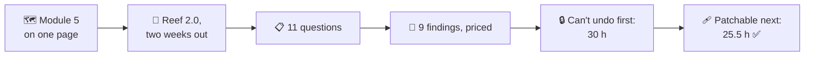
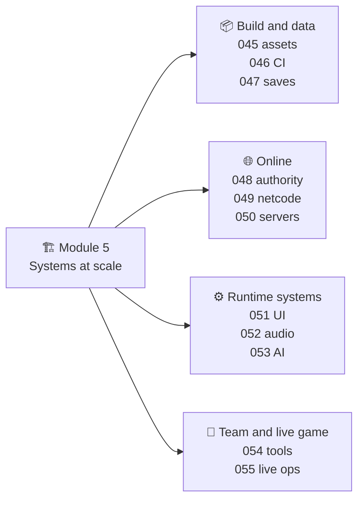
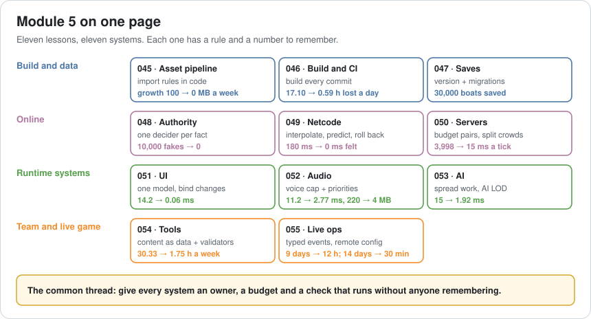
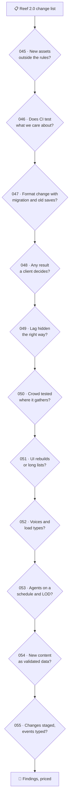
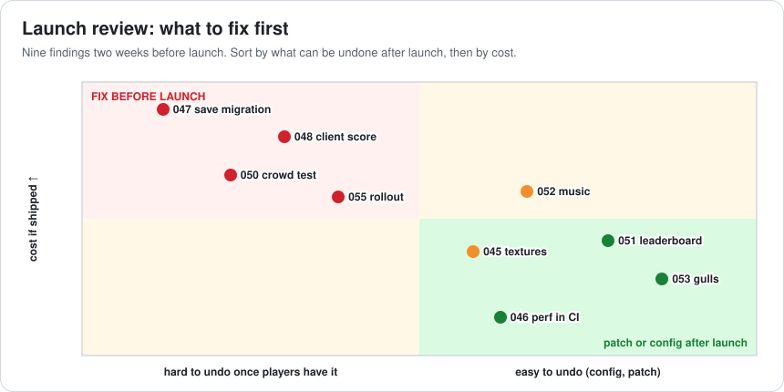
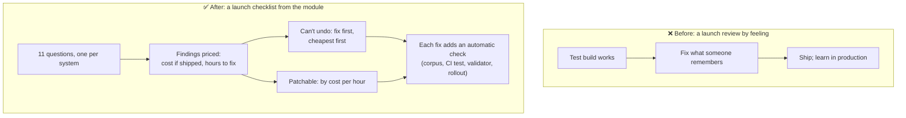

# Lesson 056 — Review: Module 5 + Launch Review Exercise: Two Weeks Before the Grand Lake

> Module 5 · Systems at scale · ~20 min read · 2026-11-01

**Today's goal:** put the eleven Module 5 lessons on one page, then use them as a launch checklist on one update: find every risk in Reef 2.0, price each one, and sort the work by what can't be undone after players have it.

### TL;DR
- Every Module 5 lesson gives you **one rule and one number**: version every save (30,000 boats, 047), one decider per fact (10,000 fakes → 0, 048), budget pairs not players (3,998 → 15 ms, 050), bind changes (14.2 → 0.06 ms, 051), cap voices with priorities (11.2 → 2.77 ms, 052), spread work and use AI LOD (15 → 1.92 ms, 053), and so on.
- Today's case: **Reef 2.0**, the Grand Lake festival update, two weeks before launch. Eleven questions find **nine findings** and two clean answers.
- Sorting matters more than speed. Four findings **can't be undone** once players have the update (a save migration, a client-sent score, an untested crowd, a festival config with no staged rollout): **30 hours**, fixed first. The other five can be patched or reconfigured later: **25.5 hours**, in order of cost.

> 🎮 **Play with it:** the [Server Lab](https://yimo691.github.io/GameArchitect/demos/050-server-lab/), [UI Lab](https://yimo691.github.io/GameArchitect/demos/051-ui-lab/), [Audio Lab](https://yimo691.github.io/GameArchitect/demos/052-audio-lab/) and [Live-ops Lab](https://yimo691.github.io/GameArchitect/demos/055-liveops-lab/) each have a new **Lesson 056 · Challenge** group: read the step, predict the numbers, then tap **Set up** and check.



---

## 1. Module 5 on one page

Module 4 was about one frame on one thread. Module 5 was about **systems**: the pipelines that build the game, the servers and networks that connect players, the runtime systems that grow with content, and the tools and data that keep a live game changing.





| Lesson | Story | Rule | Number |
|---|---|---|---|
| 045 | The fish that made the build 300 MB bigger | Import rules live in code, checked on import | Growth 100 → 0 MB a week |
| 046 | The nightly build nobody could blame | Build and test every commit | 17.10 → 0.59 h lost a day |
| 047 | The update that sank 30,000 boats | Version + migrations + real old saves in CI | 30,000 → 0 lost |
| 048 | Two players, one fish | One decider per fact; clients send intents | 3,600 duplicates, 10,000 fakes → 0 |
| 049 | Fishing from Sydney | Interpolate others, predict yourself, roll back | Line 180 → 0 ms late |
| 050 | 2,000 players, one lake | Budget pairs; interest management; split hot zones | 3,998 → 15 ms a tick |
| 051 | The tackle box that stuttered | One model, bind changes, virtualize lists | 14.2 → 0.06 ms a change |
| 052 | 180 sounds at the finale | Voice cap with priorities; load type per category | 11.2 → 2.77 ms, 220 → 4 MB |
| 053 | 5,000 zombies need brains | Spread work; AI LOD by distance | 15 → 1.92 ms |
| 054 | Five designers, thirty lost hours | Content as data, validators, commands | 30.33 → 1.75 h a week |
| 055 | Why 18% quit on day 2 | Batched typed events; remote config; staged rollouts | 9 days → 12 h to answer |

The common thread: **every system has an owner, a budget, and a check that runs without anyone remembering.**

---

## 2. The case: Reef 2.0, two weeks out

Reef 2.0 is the festival update: the Grand Lake for 2,000 players, a festival leaderboard, new music, festival tickets saved in the player's file, 800 gulls over Festival Island, and an event calendar.

**Lena**, the producer: "Everything works in the test build. Can we ship in two weeks?" The team has **60 programmer-hours** left before the launch build.

The facts the review finds, one per lesson:

```
Reef 2.0 launch review · facts
045  12 new lake textures skipped the import rules        build +36 MB
046  CI builds every commit; no frame-time test           a 4 ms regression shipped in 1.6
047  Save format 7 adds festival tickets                   corpus has formats 1–5, no 6 (Reef 1.5)
048  Festival leaderboard: client sends "score": 9800      1 player in 200 runs a modified app
049  Interpolation 100 ms, reel prediction with rollback   unchanged since 049
050  Grand Lake load test: 2,000 bots spread evenly        39.8 ms a tick; nobody tested the stage
051  Festival leaderboard list: 5,000 rows built on open   no virtualization
052  Festival music: Decompress On Load                    +34.6 MB
053  800 gulls on Festival Island think every frame        0.003 ms each
054  Festival stalls are data assets with validators       unchanged since 054
055  Festival calendar is remote config                    goes to 100% of players at once
```

---

## 3. Step 1 — Walk the checklist

Each lesson becomes one question. Ask **all eleven**, and write down the "no" answers too: they're proof the review happened.



| # | Finding | Cost if shipped | Fix | Hours |
|---|---|---|---|---|
| A · 047 | No format-6 saves in the corpus; `Migrate_6_to_7` never ran on a real 1.5 save | Silent loss of tickets or worse for everyone who last played 1.5 | Add 60 real 1.5 saves; run the chain in CI | 4 |
| B · 048 | Client sends its own score | Leaderboard top filled by modified apps on day 1; can't be un-seen | Server sums the catches it already decides | 16 |
| C · 050 | Crowd never tested at the stage | 1,200 at showtime: the stage zone splits for the first time live | Bot test with 60% at the stage; check the split and hand-off | 8 |
| D · 055 | Festival calendar goes to everyone at once | One wrong date or reward reaches 100,000 players | 10% stage with a metric and rollback | 2 |
| E · 045 | 12 textures outside the rules | +36 MB download | Add the folder to the rules; re-import | 1 |
| F · 052 | Music decompressed in memory | +34.6 MB; out-of-memory risk on 2 GB phones | Stream it | 0.5 |
| G · 051 | 5,000 leaderboard rows on open | `5,000 × 0.035 + 0.2 = 175.2 ms` hitch | Virtualize: 14 rows, 0.69 ms | 6 |
| H · 053 | 800 gulls think every frame | `800 × 0.003 = 2.4 ms`, over the 2 ms AI budget | Spread + LOD (100 near, 300 mid, 400 far): 0.54 ms | 6 |
| I · 046 | No frame-time test in CI | The next 4 ms regression ships too | Add a performance test (Lesson 063) | 12 |

Two "no" answers: 049's netcode and 054's festival stalls are fine. Writing that down costs a line and saves a meeting.

---

## 4. Step 2 — Sort by what can't be undone

Module 4 sorted fixes by **ms per hour**. That works when every fix can ship next week. Module 5's findings are different: some **can't be undone** once players have the update.

- A save written in a broken format stays broken on 100,000 phones.
- A leaderboard full of fake scores has already been seen.
- A server that falls over at the festival's peak fails at the one moment that matters.
- A config pushed to everyone at once has already reached everyone.



So the order is:

1. **Can't undo, before launch**: A (4 h), D (2 h), C (8 h), B (16 h) = **30 h**. Cheapest first, so if something slips, the most findings are already closed.
2. **Patchable, by cost to players per hour of work**: F (0.5 h, crash risk), E (1 h, download size), G (6 h, a 175 ms hitch), H (6 h, 0.4 ms over budget), I (12 h, protects the future) = **25.5 h**.

Total: **55.5 h** of the 60 available ✅. If the estimate is wrong by 20%, what slips is I, the one finding that doesn't affect this launch's players.

---

## 5. The architect's view

The junior asks "does everything work?". The optimizer would ask which system is slowest. The architect asks: **what in this update can't be taken back, and does each system have an owner, a budget and an automatic check?**



### Trade-offs

| Choice | Cost | Benefit | When to use |
|---|---|---|---|
| Fix irreversible risks first | Visible problems wait | No permanent damage | Every launch |
| Fix cheapest first within a group | Big fixes start later | Most risks closed if time slips | Fixed deadlines |
| Add a check with every fix | A few more hours | The finding can't come back | Always |
| Write down "no" answers | A line each | Proof the review was complete | Every review |
| Delay the launch | Marketing, momentum | Time for irreversible fixes | When group 1 doesn't fit |

---

## 6. Common mistakes

- **Reviewing only what changed in code.** Saves, configs and assets change too.
- **Sorting by what's visible.** A 175 ms hitch is noticed in play tests; a broken migration isn't, until it's too late.
- **Fixing without adding a check.** The same finding returns in 2.1.
- **Load testing the average.** Crowds gather at the stage, not evenly.
- **Trusting "it's only a leaderboard".** Rankings make players compete, and competition attracts modified apps.
- **Skipping the "no" answers.** Then nobody knows if 049 was checked or forgotten.

---

## 7. Quiz — ten questions on the lift 🎿🎣

**Q1 (045).** Why do import rules belong in code that runs on import, not in a wiki page?

<details><summary>Answer</summary>

A wiki depends on everyone remembering. Code on import applies the rule to every new asset automatically; finding E happened because a new folder was outside the rules, which the pipeline should also report.
</details>

**Q2 (046).** CI builds every commit, yet a 4 ms regression shipped. What was missing?

<details><summary>Answer</summary>

CI checked that the game builds and the tests pass, not how fast it runs. A frame-time test on fixed scenes, with a budget that fails the build, is what catches performance regressions (Lesson 063).
</details>

**Q3 (047).** Why must the corpus contain real saves from every shipped format, not just the oldest and newest?

<details><summary>Answer</summary>

Each migration step only runs for saves at that version. `Migrate_6_to_7` is only exercised by format-6 saves; without them, a bug there is found by players.
</details>

**Q4 (048).** The leaderboard score comes from the client. Why isn't "check that the score is below 20,000" enough?

<details><summary>Answer</summary>

A modified app can send any plausible number, like 9,800. The server already decides every catch (Lesson 048), so it should compute the score itself. Clients send intents; servers decide results.
</details>

**Q5 (049).** Other boats are drawn 100 ms in the past. Why doesn't anybody notice?

<details><summary>Answer</summary>

You don't control other boats, so you have no input to compare them with. Your own line is predicted at 0 ms, which is where delay would be felt.
</details>

**Q6 (050).** 2,000 bots spread evenly gave 39.8 ms a tick per 200-player zone. What happens at the stage with 1,200 players, nearest 50, and no splitting?

<details><summary>Answer</summary>

`1,200 × 50 × 1 µs = 60 ms`, over the 50 ms budget. With splitting into 4 processes of 300: `300 × 50 = 15 ms`. The test must put the crowd where it will gather.
</details>

**Q7 (051).** The leaderboard has 5,000 rows. Open time with all rows, and with a 14-row virtualized list?

<details><summary>Answer</summary>

`5,000 × 0.035 + 0.2 = 175.2 ms`, and `14 × 0.035 + 0.2 = 0.69 ms`. The cost follows the screen, not the data.
</details>

**Q8 (052).** Why is "stream the music" a 0.5-hour fix but still worth doing before launch?

<details><summary>Answer</summary>

It removes 34.6 MB of memory on phones where out-of-memory crashes are a real risk, for almost no work. Cheap fixes with crash risk go first in the patchable group.
</details>

**Q9 (053).** With 100 near gulls every frame, 300 mid every 4 frames and 400 far with a cheap brain every 30 frames, what's the AI cost?

<details><summary>Answer</summary>

`100 × 0.003 = 0.30`, `300 ÷ 4 × 0.003 = 0.225`, `400 ÷ 30 × 0.001 ≈ 0.013`: about **0.54 ms**, down from 2.4 ms.
</details>

**Q10 (055).** Why does the festival calendar need a staged rollout if it's "only dates"?

<details><summary>Answer</summary>

A wrong date or reward reaches everyone within minutes of a remote change, and players act on it (log in, spend, plan). A 10% stage limits the damage to 10,000 players and gives a metric to check before widening.
</details>

---

## 8. Back at the desk (≈60–90 min) — review your own launch

> No desk today? Do the **Lesson 056 · Challenge** steps in the Server, UI, Audio and Live-ops Labs: predict every number before you tap.

For your next release (or the last one you shipped):

1. **List what changes**: code, assets, save format, server, config, events.
2. **Ask the eleven questions** from section 3. Write every answer, including "no".
3. **Price each finding**: cost if shipped, hours to fix.
4. **Split them**: can't undo after launch, or patchable.
5. **Order** each group (cheapest first for "can't undo"; cost per hour for "patchable") and check it fits your hours.
6. For each fix, **name the automatic check** that stops it coming back.
7. Save `journal/056-launch-review.md`:

| # | Finding | Can't undo? | Cost if shipped | Hours | Check added |
|---|---|---|---|---|---|
| | | | | | |
| | | | | | |
| | | | | | |

One question for your journal: which of the eleven questions would your team most likely forget, and how could you make it automatic?

---

## 9. Vocabulary

| Term | Meaning | 中文 |
|---|---|---|
| Launch review | A structured check of a release before it ships | 上线评审 |
| Irreversible change | A change that can't be undone once players have it | 不可逆变更 |
| Finding | One problem found in a review, with cost and fix | 发现项 |
| Checklist | A fixed list of questions asked every time | 检查清单 |
| Load test | Running many fake players to measure server limits | 压力测试 |
| Regression | Something that worked (or was fast) and got worse | 回归 |
| Corpus | A collection of real data used for tests | 样本库 |
| Owner | The person or team responsible for a system | 负责人 |
| Guardrail | An automatic check that stops a known mistake | 护栏 / 防线 |
| Go / no-go | The final decision to ship or wait | 上线决策 |

---

## 10. Further reading

- **Atul Gawande — "The Checklist Manifesto"** (2009): why short checklists catch what experts forget.
- **Google — "Site Reliability Engineering"** (sre.google/books), chapter "Release Engineering" and "Launch Coordination Engineering": launch checklists for live services.
- **Lessons 045–055** of this course: each "architect's view" section is one entry of today's checklist.

---

**Tomorrow — Lesson 057: Memory budgets per platform.** Module 6 begins. Reef 2.0 runs on a 2 GB Android phone, a 4 GB iPhone and a handheld console, and the same build is killed by the system on one and fine on the others. We split memory into budgets per platform and per system, and learn what the OS takes before your game gets anything.
