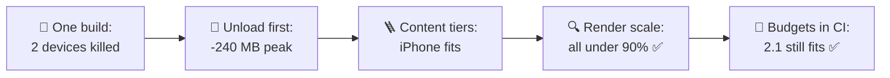
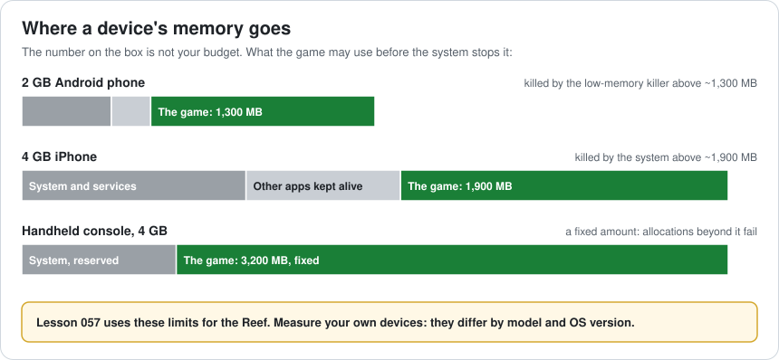
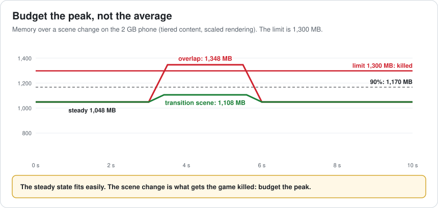
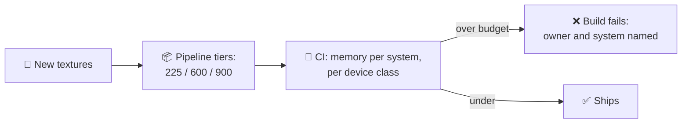
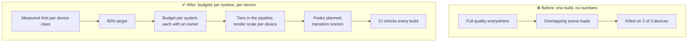

# Lesson 057 — Memory Budgets per Platform: The Build That Died on Two Phones

> Module 6 · Platform & production performance · ~15 min read · 2026-11-01

**Today's goal:** turn "use less memory" into numbers: what each device really lets the game use, a budget for every system on every device class, a plan for the peak and not only the steady state, and a CI check that keeps new content inside the budget.

### TL;DR
- Reef 2.0 is one build for three devices. At full quality it needs **1,730 MB** steady plus render targets, plus **300 MB** while two scenes overlap. The 2 GB Android phone allows **1,300 MB** and the 4 GB iPhone **1,900 MB** before the system kills the game: both die at the first scene change.
- **Unloading before loading** saves 240 MB of peak. **Texture and mesh tiers** per device class (225 / 600 / 900 MB of textures) and a **render scale** per device bring every device under **90%**: Android 1,108 MB (85%), iPhone 1,591 (84%), handheld 1,843 (58%) ✅.
- Update 2.1 adds **150 MB** of textures. Without a budget check, two devices go over 90% again; with **budgets in CI** the new textures go through the tiers (38 / 100 / 150 MB) and everything fits.

> 🎮 **Play with it: [Memory Budget Lab](https://yimo691.github.io/GameArchitect/demos/057-memory-budget-lab/)** — choose how scenes change, how content is tiered, the render resolution and how update 2.1 is added, and watch each device's peak against its limit. Tap **Set up** on the steps to replay the lesson.



---

## 1. The problem

Module 6 starts where games meet real hardware. Reef 2.0's test build ran perfectly on the team's development kits. Then QA tried the cheapest devices on the support list:

```
QA · Reef 2.0 · first sail to the Grand Lake
2 GB Android phone      app closed during loading (no crash report)
4 GB iPhone             app closed during loading (no crash report)
Handheld console        fine
Development PC          fine (uses 2.1 GB)
```

No crash report, because there was no crash. The **operating system** stopped the game for using too much memory. On Android the low-memory killer does it; on iOS the system's memory watchdog does it. The game gets no warning it can act on in time.

---

## 2. Step 1 — What does the device really allow?

Analogy: a flat with 2 rooms is not 2 rooms for you. The landlord keeps one locked for storage, and your flatmate uses half of the other.

A 2 GB phone doesn't give the game 2 GB. The system, its services, the graphics driver and other apps kept alive take their share first. What's left before the system steps in is the game's **real limit**, and it differs by device, OS version and even what else is running.



For the Reef, the team measured on its support list (by allocating until the system stopped the test app):

| Device class | RAM | Game's limit | 90% target |
|---|---|---|---|
| 2 GB Android phone | 2,048 MB | ~1,300 MB | 1,170 MB |
| 4 GB iPhone | 4,096 MB | ~1,900 MB | 1,710 MB |
| Handheld console | 4,096 MB | 3,200 MB, fixed | 2,880 MB |

The **90% target** leaves headroom for fragmentation, a burst of effects, and the OS changing its mind. Consoles give a fixed amount: allocations beyond it simply fail, which is easier to plan for but no more forgiving.

---

## 3. Step 2 — Budget the peak, not the steady state

Reef 2.0's memory at full quality:

| System | MB |
|---|---|
| Textures | 900 |
| Engine and code | 220 |
| Meshes | 180 |
| Managed heap | 160 |
| Animation | 90 |
| Streaming buffers | 80 |
| UI and fonts | 60 |
| Audio (after Lesson 052) | 40 |
| **Steady state, without render targets** | **1,730** |
| Render targets (native resolution) | 120 / 140 / 53 |

And one more line that's easy to miss: when sailing to the Grand Lake, the old scene stays loaded while the new one loads (Lesson 043's async loading): **+300 MB** for a few seconds.

On the 2 GB phone: `1,730 + 120 + 300 = ` **2,150 MB**, of 1,300 allowed.

The first fix is free: load a tiny **transition scene** (the boat on open water) and unload the old scene **before** loading the new one. The peak adds only **60 MB**. Android: 1,910 MB. iPhone: 1,930 MB. Still killed, but the peak is now under control.



---

## 4. Step 3 — Tiers per device class

Textures are the biggest line, and the easiest to scale. The asset pipeline (Lesson 045) builds **tiers**:

| | 2 GB Android | 4 GB iPhone | Handheld |
|---|---|---|---|
| Textures | 225 MB (top mip dropped) | 600 MB (top mip dropped on scenery) | 900 MB |
| Meshes | 120 MB (no LOD0 on scenery) | 180 MB | 180 MB |
| Render scale | 67% (render targets 53 MB) | 85% (101 MB) | 100% (53 MB) |

Dropping a texture's top mip divides its memory by 4, and on a 6-inch phone screen the difference is hard to see. Rendering at 67% and upscaling the image (Lesson 031) cuts the render targets with them.

With tiers and render scale:

- Android: `220 + 225 + 120 + 90 + 40 + 160 + 53 + 60 + 80 + 60 = ` **1,108 MB** (85%)
- iPhone: **1,591 MB** (84%)
- Handheld: **1,843 MB** (58%) ✅

---

## 5. Step 4 — Budgets that stay true

Two months later, update 2.1 adds **150 MB** of festival textures. An artist imports them at full size, the build passes every test, and Android is at **1,258 MB** (97%) and iPhone at **1,741 MB** (92%).

A budget written in a document stops being true the day someone adds content. So the budget becomes **data that CI checks**:

```
memory_budgets.json  (MB, per device class)
                 android_2gb  iphone_4gb  handheld
textures              260        700        1,100
meshes                130        200          250
render_targets         60        110           60
...
peak_total          1,170      1,710        2,880
```

Each build, CI loads the heaviest scenes on each device class (or computes asset sizes per tier from the build report) and fails if any system or the peak goes over. The 2.1 textures then go through the same tiers: **38 / 100 / 150 MB**. Android 1,146 MB (88%), iPhone 1,691 MB (89%) ✅.



---

## 6. The architect's view

The junior asks "why did it close on the phone?". The optimizer would look for the biggest texture. The architect asks: **what does each device allow, who owns each part of it, and what stops the next update from breaking it?**



The architect's rules for memory:

1. **Measure each device class's real limit**, and re-measure when OS versions change.
2. **Budget the peak**, with 10% headroom.
3. **Every system has a number and an owner** on every device class.
4. **Quality scales by tier**, produced by the pipeline, not by hand.
5. **Budgets are data that CI checks.** A document is a wish.

### Trade-offs

| Lever | Cost | Benefit | When to use |
|---|---|---|---|
| Transition scene / unload first | A short loading moment | Peak drops by a whole scene | Big scene changes |
| Texture tiers (drop a mip) | Slightly softer on small screens | ÷4 memory per texture | Low-memory devices |
| Mesh tiers | Less detail up close | Less memory and vertex work | Low-memory devices |
| Render scale | A softer image, upscaling cost | Smaller render targets, faster GPU | Phones with high-resolution screens |
| Memory budgets in CI | Building and keeping the check | Regressions found per commit | Any multi-platform game |
| Dropping a device | Fewer players | Simpler budgets | When a device class costs more than it earns |

---

## 7. Common mistakes

- **Budgeting the RAM on the box.** The game gets a share, not the total.
- **Testing on development kits only.** They have more memory than any player's device.
- **Measuring the steady state.** Scene changes, effects bursts and the first load are where games die.
- **One quality level for every device.** Either the low end dies or the high end looks bad.
- **Budgets in a document.** Content keeps arriving; only a check keeps up.
- **Ignoring memory warnings.** iOS and Android send them; free caches when they arrive.

---

## 8. Quiz — think about it on the lift 🎿🎣

**Q1.** Why did the phones close without a crash report?

<details><summary>Answer</summary>

The game didn't crash: the operating system stopped it for using too much memory (the low-memory killer on Android, the system's memory limit on iOS). From the game's side the process just ends, so the crash reporter never runs.
</details>

**Q2.** With tiers and render scale, but scenes still overlapping, what's the Android peak?

<details><summary>Answer</summary>

Steady with tiers and scale: `1,108 − 60 = 1,048 MB`. With a 300 MB overlap: `1,348 MB`, over the 1,300 MB limit. Tiers alone aren't enough; the peak must be planned too.
</details>

**Q3.** Dropping a texture's top mip divides its memory by 4. Why?

<details><summary>Answer</summary>

The top mip has twice the width and twice the height of the next one: 4× the pixels. The whole mip chain is about 4/3 of the top level, so removing the top leaves about a quarter of the memory.
</details>

**Q4.** Update 2.1 passed every test and still broke two devices. What test was missing?

<details><summary>Answer</summary>

A memory budget check per device class: building (or loading) the heaviest scenes on each tier and failing when a system or the peak goes over its budget. Functional tests don't measure memory.
</details>

---

## 9. Back at the desk (≈45 min) — your memory budget

> No desk today? Do it in the [Memory Budget Lab](https://yimo691.github.io/GameArchitect/demos/057-memory-budget-lab/): predict each device's peak for every step, then tap.

In your own project:

1. **Pick your lowest device** and find its real limit (a test app that allocates until it's stopped, or the platform's documentation).
2. **Capture memory** in your heaviest scene with the Memory Profiler, grouped by system.
3. **Capture the peak** during your biggest scene change.
4. **Write a budget table**: system × device class, with a 90% total.
5. **Pick one tier lever** (texture mip, render scale) and calculate what it saves.
6. Save `journal/057-memory.md`:

| System | Measured (MB) | Budget low device | Budget high device | Owner |
|---|---|---|---|---|
| Textures | | | | |
| Meshes | | | | |
| Render targets | | | | |
| Scene change peak | | | | |
| Total peak | | | | |

One question for your journal: which system in your game grows with every content update, and who would notice first if it went over?

---

## 10. Vocabulary

| Term | Meaning | 中文 |
|---|---|---|
| Memory budget | The memory each system may use on a device | 内存预算 |
| Low-memory killer | The Android system part that stops apps when memory is low | 低内存终止机制 |
| Memory limit | The most memory the system lets the game use | 内存上限 |
| Peak memory | The highest memory use during a session | 峰值内存 |
| Steady state | Memory use while nothing is loading | 稳态 |
| Headroom | Space kept free under the limit | 余量 |
| Device tier | A group of devices that get the same quality settings | 设备档位 |
| Mip level | One of a texture's smaller copies | Mip 层级 |
| Render scale | Rendering below screen resolution and upscaling | 渲染缩放 |
| Memory warning | A message from the OS that memory is low | 内存警告 |

---

## 11. Further reading

- **Unity Manual — "Memory Profiler"** package documentation: snapshots grouped by type and system.
- **Android Developers — "Manage your app's memory"** and **"Memory allocation among processes"**: the low-memory killer and how Android decides what to stop.
- **Apple Developer Documentation — "Reducing your app's memory use"** and **"Responding to low-memory warnings"**.
- **Unity Manual — "Texture Import Settings"**: Max Size and mipmap settings per platform override.

---

**Tomorrow — Lesson 058: Mobile thermal throttling and battery.** On a mid-range phone the Reef runs at 60 fps for the first 8 minutes, then drops to 38 fps and stays there, and the phone gets hot in the hand. We learn why phones slow down when they get warm, and design for the speed a phone can keep, not the speed it starts at.
