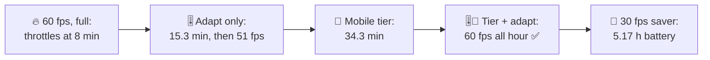
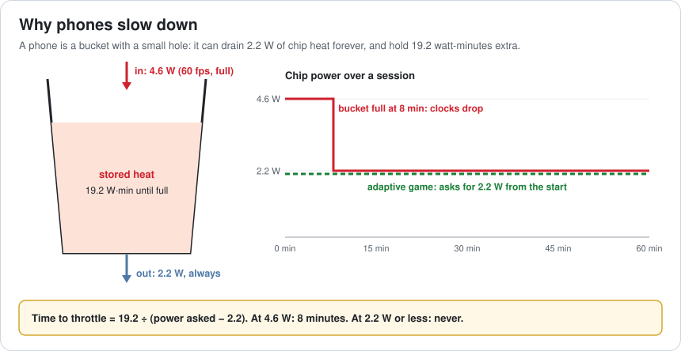
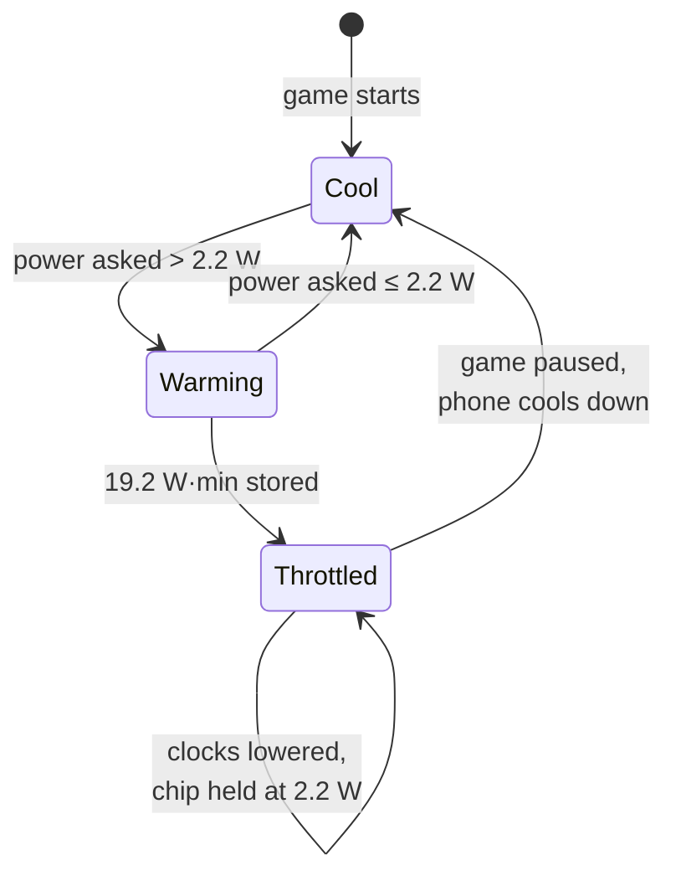
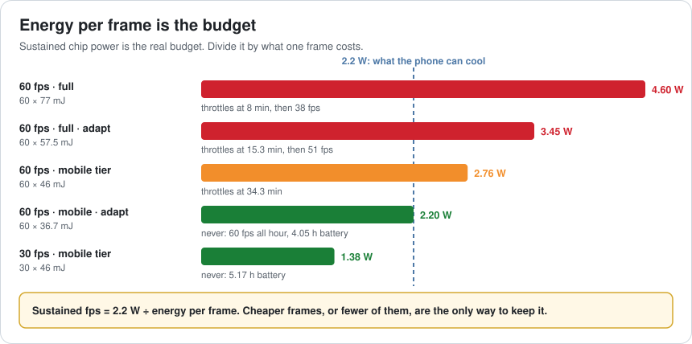
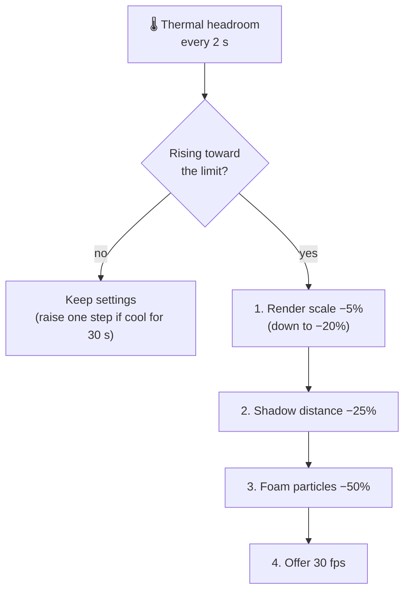
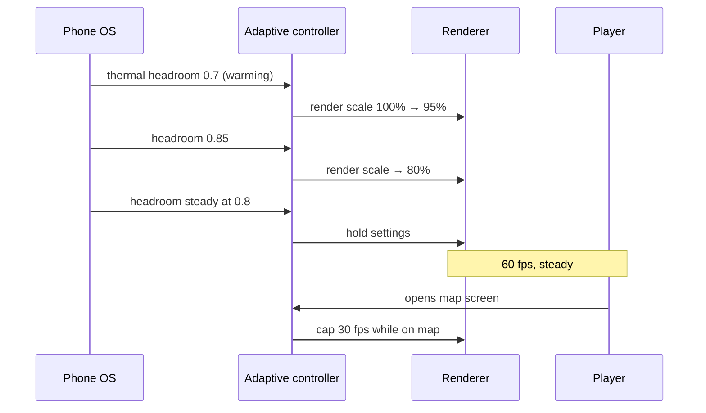
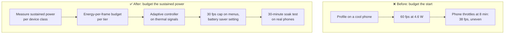

# Lesson 058 — Mobile Thermal Throttling and Battery: The Phone That Got Slow After 8 Minutes

> Module 6 · Platform & production performance · ~15 min read · 2026-11-01

**Today's goal:** understand why a phone runs a game fast for a few minutes and then slows down, turn "energy per frame" into the real mobile budget, and design a game that asks for the speed a phone can keep, not the speed it starts at.

### TL;DR
- On a mid-range phone the Reef runs at **60 fps** for **8 minutes**, then drops to **38 fps** for the rest of the session. Nothing is broken: the chip asks for **4.6 W**, the phone can only cool **2.2 W** for long, and it holds **19.2 watt-minutes** of extra heat before it lowers its clocks.
- The real budget is **energy per frame**: sustained fps = 2.2 W ÷ energy per frame. Full quality costs **77 mJ** a frame, so 60 fps needs 4.6 W. The **mobile tier** costs **46 mJ** (2.76 W), and throttling moves to **34.3 minutes**.
- Adding **adaptive quality** (trim render scale by 20% using the phone's thermal signal) makes the game ask for exactly 2.2 W: **60 fps for the whole hour, never throttled**. A **30 fps battery saver** (1.38 W) stretches the battery from **3.97 h to 5.17 h**.

> 🎮 **Play with it: [Thermal Lab](https://yimo691.github.io/GameArchitect/demos/058-thermal-lab/)** — choose the frame rate, the quality tier and whether the game adapts to heat, and watch the frame rate, chip power and battery over one hour. Tap **Set up** on the steps to replay the lesson.



---

## 1. The problem

Yesterday the Reef learned to fit in a phone's memory. Today QA plays a full session on the same mid-range phone:

```
QA · Reef 2.0 · 60-minute play session · mid-range Android phone
00:00   60 fps, smooth
08:00   frame rate drops to ~38 fps, frames uneven
08:00+  38 fps for the rest of the session
60:00   phone hot in the hand, battery down 25%
Profiler: no new work after 8:00. CPU and GPU frame work unchanged.
```

The game does the same work at minute 9 as at minute 7. What changed is the phone: it got warm, so it lowered its own clock speeds. The same work now takes longer, and the frame rate falls.

This is **thermal throttling**. It is not a bug in the game, and no profiler capture from the first 5 minutes will show it.

---

## 2. Step 1 — A phone is a bucket with a small hole

Analogy: a bucket under a tap. The hole at the bottom drains a little water forever. If the tap runs faster than the hole drains, the bucket fills, and when it's full the house turns the tap down for you.

A phone has no fan. It can move a small, steady amount of heat out through its case: for this phone, about **2.2 W** of chip power, for as long as you like. Above that, the extra heat is stored in the chip, the battery and the case. Once it holds **19.2 watt-minutes** of extra heat, the system lowers clocks to protect the chip and the player's hand.



So the time until throttling is:

```
time to throttle = stored heat ÷ (power asked − power the phone can cool)
                 = 19.2 W·min ÷ (4.6 W − 2.2 W)
                 = 8 minutes
```

At 2.2 W or less the bucket never fills. That number, not the chip's top speed, is what the phone can really give a game.



---

## 3. Step 2 — Energy per frame is the budget

On a PC we budget **time** per frame: 16.7 ms for 60 fps. On a phone that's not enough, because a fast frame at a high clock can still cost too much **energy**. The budget that lasts is:

```
sustained fps = power the phone can cool ÷ energy one frame costs
```

| Setup | Energy per frame | Chip power at 60 fps | Throttles at | After 60 min |
|---|---|---|---|---|
| Full quality | 77 mJ | 4.60 W | 8.0 min | 38 fps |
| Full + adapt to heat | up to 25% less | 3.45 W | 15.3 min | 51 fps |
| Mobile tier | 46 mJ | 2.76 W | 34.3 min | 60 fps, clocks changing |
| Mobile + adapt | 36.7 mJ | 2.20 W | never | 60 fps |
| Mobile at 30 fps | 46 mJ | 1.38 W | never | 30 fps |

Why does full quality end at 38 fps? When throttled, the phone holds the chip at 2.2 W, and the lower clocks are more efficient: each frame costs about 25% less energy (57.5 mJ). `2.2 W ÷ 57.5 mJ = 38 fps`. The phone keeps the work and drops the frames.

Where the 77 mJ goes on this phone, measured with the GPU profiler's power counters: shading at full resolution, full-screen effects (bloom, depth of field), shadow maps and overdraw from water and foam. The **mobile tier** from Lesson 057's pipeline already lowers some of these. Making it a full tier for energy, not only memory, brings a frame to **46 mJ**: simpler water shader, no depth of field, one shadow cascade, render scale 67%.



The mobile tier alone isn't enough: at 2.76 W the bucket still fills, just later (`19.2 ÷ 0.56 = 34.3 min`). The lowered clocks can still just about make 60 fps, but from then on the phone is hot in the hand and keeps switching clocks up and down, so frame times jitter. A player who sails for 40 minutes feels it.

---

## 4. Step 3 — Adapt before the phone does

Waiting for the phone to throttle is the worst choice. The phone lowers clocks in big steps, often unevenly between CPU and GPU, and frame times start to jump. The game knows better what to trade: a little render scale is nearly invisible on a 6-inch screen; a stuttering frame rate is not.

Both platforms tell the game how warm it is:

- **Android**: `PowerManager` thermal status and the **thermal headroom** forecast (Android Dynamic Performance Framework), which estimates how close the device is to throttling.
- **iOS**: `ProcessInfo.thermalState` (nominal, fair, serious, critical) and a notification when it changes.
- **Unity**: the **Adaptive Performance** package wraps these into one API with quality "scalers".

The Reef's adaptive controller watches the headroom and trims a frame's cost with a small ladder, cheapest to see first:



On the mobile tier, the controller settles at a render scale **20% lower**: `46 mJ × 0.8 = 36.7 mJ`, `× 60 = 2.2 W`. The phone never throttles, and the player sees a slightly softer image and **60 fps for the whole hour**.

Full quality plus adapting isn't enough (step 2 in the lab): adapting can cut at most 25%, and full quality needs 52% less to fit. Adaptation fine-tunes a tier; it doesn't replace one.

---

## 5. Step 4 — Battery is the same budget, seen from the other side

The battery is **15.4 Wh**. The display, radio and audio use **1.6 W** whatever the game does. The chip uses the rest:

| Setup | Total power (after warm-up) | Battery life |
|---|---|---|
| 60 fps, full (throttled) | 1.6 + 2.2 = 3.8 W, plus the first 8 min at 6.2 W | 3.97 h |
| Mobile + adapt | 1.6 + 2.2 = 3.8 W | 4.05 h |
| 30 fps, mobile | 1.6 + 1.38 = 2.98 W | 5.17 h |

Look at the first two rows: the throttled phone and the adaptive game get almost the **same battery life**. The phone was going to hold the chip at 2.2 W anyway. The difference is who chose what to give up: the phone chose uneven 38 fps, the game chose a 20% softer image at a steady 60.

The only way to a much longer battery is less energy per second: fewer frames or cheaper ones. So the Reef adds a **Battery saver** setting (30 fps, mobile tier), and caps menus and the map screen at 30 fps always. Nobody needs 60 fps on a pause menu.



---

## 6. The architect's view

The junior asks "why is it slow after 8 minutes?". The optimizer would profile the first minute and find nothing. The architect asks: **what can this phone sustain, what does one frame cost in energy, and who decides what to give up when the phone gets warm?**



The architect's rules for mobile performance:

1. **Budget the speed a phone can keep**, measured after 20–30 minutes, not in the first minute.
2. **Energy per frame is a budget line** next to milliseconds and megabytes.
3. **The game adapts before the OS throttles**, using the platform's thermal signals, with a ladder of cheap-to-see cuts.
4. **Don't render frames nobody needs**: cap menus, maps and pause screens.
5. **Test with soak runs** on real phones, in a warm room, in a hand or a case.

### Trade-offs

| Lever | Cost | Benefit | When to use |
|---|---|---|---|
| Mobile quality tier | Less detail, simpler effects | Lower energy per frame on every phone | Every mobile build |
| Adaptive render scale | Softer image when warm | Steady fps instead of throttling | Long sessions on phones |
| 30 fps cap on menus | None the player notices | Cooler phone, longer battery | Always |
| 30 fps battery saver | Less smooth gameplay | +30% battery life | As a player setting |
| Frame rate locked at 30 for all | Less smooth everywhere | Simplest, coolest | Slow-paced games, low-end phones |
| Ignoring heat | None today | None | Never: players notice by minute 10 |

---

## 7. Common mistakes

- **Profiling only the first minutes.** A cool phone is a faster phone; the problem appears later.
- **Testing on a phone on a desk with a fan.** Players hold it, put it in a case, play in the sun.
- **Budgeting only milliseconds.** A frame can fit in 16.7 ms and still use too much energy.
- **Letting the OS throttle for you.** You get uneven clocks and frames instead of a choice you made.
- **Adapting too fast.** Changing quality every frame makes the image pulse; use steps and wait a few seconds.
- **Rendering menus at 60 fps or more.** Pure heat and battery for nothing.

---

## 8. Quiz — think about it on the lift 🎿🎣

**Q1.** A frame costs 50 mJ. What frame rate can this phone keep forever?

<details><summary>Answer</summary>

`2.2 W ÷ 0.050 J = 44 fps`. It can show 60 fps for a while (at 3.0 W the bucket fills in `19.2 ÷ 0.8 = 24 minutes`), but 44 fps is what it can sustain.
</details>

**Q2.** The throttled phone and the adaptive game both run the chip at 2.2 W. Why is the adaptive game better?

<details><summary>Answer</summary>

Same energy, different choice. The phone lowers clocks and keeps all the work, so frames get slower and uneven (38 fps). The game removes work the player barely sees (20% render scale), so frames stay at a steady 60 fps.
</details>

**Q3.** Why didn't "full quality + adapt" reach the goal?

<details><summary>Answer</summary>

Full quality needs 4.6 W at 60 fps; fitting into 2.2 W needs a 52% cut. The adaptive ladder only cuts up to 25%, so the phone still throttles, at 15.3 minutes. Adaptation fine-tunes a tier; it can't replace a mobile tier.
</details>

**Q4.** QA reports "no problems" after testing every level for 5 minutes on a phone in a cooling stand. What should the test plan add?

<details><summary>Answer</summary>

A soak test: 30 minutes or more of continuous play, on a real phone held or in a case, at room temperature or warmer, logging frame rate, thermal state and battery drop over time.
</details>

---

## 9. Back at the desk (≈45 min) — your sustained budget

> No desk today? Do it in the [Thermal Lab](https://yimo691.github.io/GameArchitect/demos/058-thermal-lab/): predict when each setup throttles and its battery life, then tap.

In your own project:

1. **Run a 30-minute soak** on your lowest phone and log fps every 10 seconds. When does it drop, and to what?
2. **Read the thermal signal** (`ProcessInfo.thermalState`, Android thermal headroom, or Unity Adaptive Performance) and log it next to fps.
3. **Estimate energy per frame** from the battery drop over the session: `(battery Wh used ÷ hours − screen and radio power) ÷ fps`.
4. **List three cuts** for an adaptive ladder, cheapest to see first.
5. **Cap one screen** (menu, map, pause) at 30 fps and measure the difference.
6. Save `journal/058-thermal.md`:

| Setup | Start fps | Time to drop | fps after 30 min | Battery used in 30 min | Thermal state at end |
|---|---|---|---|---|---|
| Current | | | | | |
| With mobile tier | | | | | |
| With adaptive ladder | | | | | |
| 30 fps cap | | | | | |

One question for your journal: if your game had to give up one thing when the phone gets warm, what would players miss least?

---

## 10. Vocabulary

| Term | Meaning | 中文 |
|---|---|---|
| Thermal throttling | The device lowering its clocks because it's too hot | 热降频 |
| Sustained performance | The speed a device can keep for a long time | 持续性能 |
| Thermal headroom | How far the device is from throttling | 热余量 |
| Thermal state | The OS's report of how hot the device is | 热状态 |
| Energy per frame | The energy the chip uses to make one frame | 每帧能耗 |
| Watt (W) | Energy per second | 瓦特 |
| Watt-hour (Wh) | Energy: one watt for one hour; battery size | 瓦时 |
| Adaptive quality | Quality the game changes while running | 自适应画质 |
| Frame rate cap | A fixed maximum frame rate | 帧率上限 |
| Soak test | A long test that runs until slow problems appear | 浸泡测试（长时间测试） |

---

## 11. Further reading

- **Android Developers — "Android Dynamic Performance Framework (ADPF)"** and its **Thermal API** guide: thermal status and headroom forecasts for games.
- **Apple Developer Documentation — `ProcessInfo.ThermalState`** and **"Energy Efficiency Guide for iOS Apps"**.
- **Unity Manual — "Adaptive Performance"** package documentation: thermal events, scalers and providers.
- **Arm Developer — "Mali GPU Best Practices Guide"**: bandwidth, overdraw and shader cost on mobile GPUs.

---

**Tomorrow — Lesson 059: Frame pacing and stutter.** The Reef's PC build shows a steady "60 fps" in the counter, yet players say it feels choppy when the camera turns. We look at the time between frames, not the average, and learn why 60 frames in a second can still look worse than 60 evenly spaced ones.
