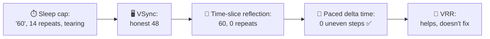
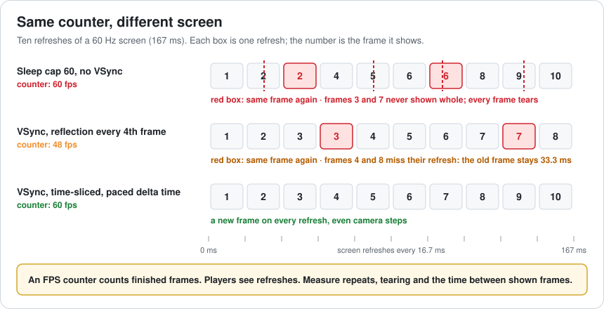
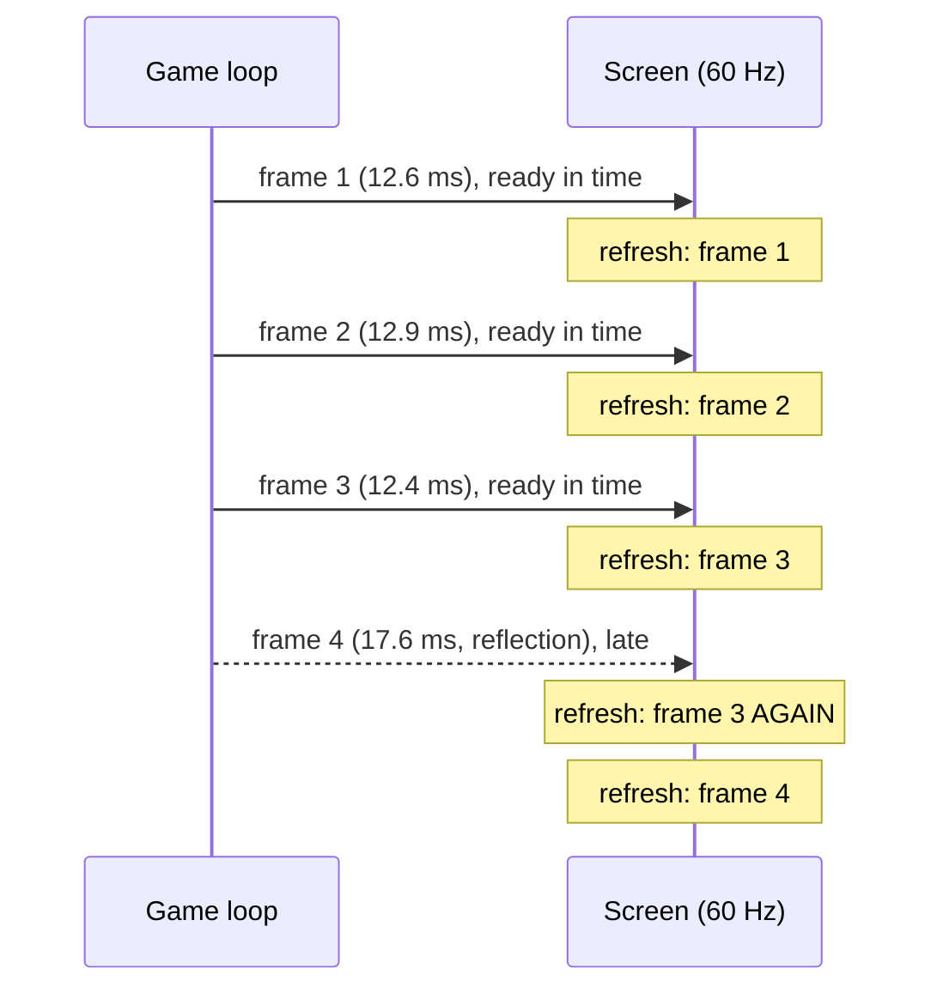
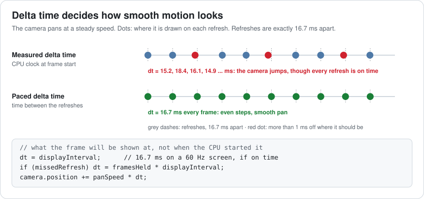
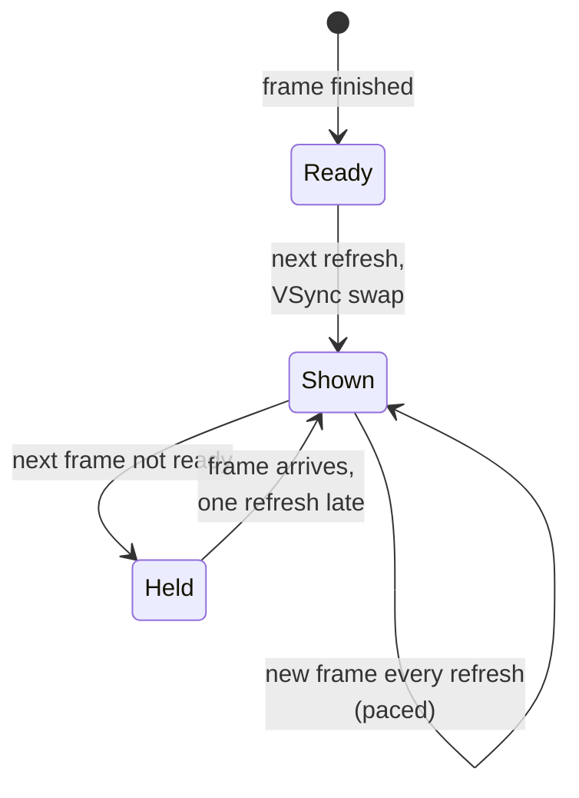
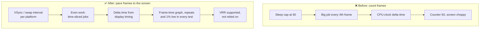

# Lesson 059 — Frame Pacing and Stutter: The "60 fps" That Felt Choppy

> Module 6 · Platform & production performance · ~15 min read · 2026-11-01

**Today's goal:** learn why a game can show "60 fps" in its counter and still feel choppy, measure what the screen really shows instead of what the game loop finishes, and fix the three usual causes: frames that don't line up with the refresh, a frame that misses its refresh, and a delta time that doesn't match the screen.

### TL;DR
- The Reef's PC build caps itself at 60 with a **sleep timer** and VSync off. The counter says **60 fps**, but in one second of a camera turn the screen **repeats the old frame 14 times**, **14 frames are never shown whole**, and **every frame tears**.
- Turning **VSync** on makes the counter honest: **48 fps**. Every 4th frame updates the water reflection (+5 ms), misses its refresh, and the old frame stays on screen **33.3 ms**. **Time-slicing** the reflection (+1.25 ms on every frame) gives **60 new frames, 0 repeats**.
- The last judder comes from **delta time**: the camera moves by the CPU clock, which wakes 0–2.5 ms late, while the screen shows frames exactly 16.7 ms apart (**25 uneven steps** a second). Moving the camera by the **refresh it will be shown on** brings that to **0**. A **VRR** monitor hides a missed refresh (18.1 ms instead of 33.3) but doesn't make work even.

> 🎮 **Play with it: [Frame Pipeline Lab, Lesson 059 section](https://yimo691.github.io/GameArchitect/demos/002-frame-pipeline/)** — choose how frames reach the screen, how the water reflection is updated and which delta time the camera uses, then watch the game loop, every refresh and every camera step. Tap **Set up** on the Lesson 059 steps to replay the lesson.



---

## 1. The problem

The Reef's PC build passed every performance check: the in-game counter showed 60 fps on the test PCs. Then the reviews came in:

```
Player reports · Reef PC · week 1
"Says 60 fps but the camera feels choppy when I turn"
"Horizontal lines flicker across the water"
"Smooth on my G-Sync monitor, bad on my TV"
Counter (average over 1 s): 60 fps
```

The counter isn't lying about what it counts: the game loop really finishes 60 frames a second. But a player doesn't see the game loop. A player sees the **screen**, which refreshes every 16.7 ms and shows whatever frame is ready at that moment. **Frame pacing** is about whether a new frame is ready for each refresh, and whether each one moves the world by the right amount.

---

## 2. Step 1 — Frames that don't line up with the refresh

Analogy: a train leaves the station every 16.7 minutes exactly. You send one parcel roughly every 16.7 minutes, but your clock wakes you a bit late each time. Some trains leave with no new parcel (the old one again), and some leave with two (one gets lost).

The Reef capped its frame rate the simple way: finish the frame, **sleep** until 16.7 ms have passed, start the next one. With VSync off, each frame goes to the screen the moment it's done. Two things go wrong:

- **The timer wakes late**, by 0 to 2.5 ms. Frames reach the screen at uneven times, not lined up with the refresh. In one second: **14 refreshes repeat the old frame** and **14 frames are never shown whole**.
- **Every frame tears.** The screen is in the middle of drawing when the new frame arrives, so the top shows one frame and the bottom another: those were the "horizontal lines across the water".



**VSync** fixes both: the finished frame waits and is swapped in only between two refreshes. No tearing, and the game loop now runs in step with the screen. In Unity terms: use `QualitySettings.vSyncCount = 1` on PC instead of `Application.targetFrameRate = 60` with VSync off.

And now the counter tells the truth: **48 fps**.

---

## 3. Step 2 — A frame that misses its refresh is shown twice

Why 48? The water reflection is re-rendered on **every 4th frame**, adding **5 ms**. Normal frames take 12–13 ms of work and fit easily in 16.7 ms. Every 4th frame takes **17–18 ms**, misses its refresh, and the screen shows the previous frame again. That frame stays on screen **33.3 ms**: 4 frames use 5 refreshes, so `60 × 4 ÷ 5 = 48` new frames a second.



This is the difference between **average** and **pacing**. "12–13 ms most frames, 18 ms sometimes" averages 13.8 ms, which looks like 72 fps of headroom. With VSync, what matters is the **worst frame**: anything over 16.7 ms costs a whole extra refresh.

The fix is the one from Lesson 053 for AI: **time-slicing**. Update a quarter of the reflection each frame: **+1.25 ms on every frame** instead of +5 ms on one. Every frame now takes 13.3–14.3 ms. **60 new frames, 0 repeats.** Same total work, spread evenly.

The **frame-time graph** shows this at once, and an average never will. Track:

| Number | What it tells you | Reef before → after |
|---|---|---|
| Average fps | How much work the game does | 48 → 60 |
| Repeated refreshes per second | Visible hitches at a fixed refresh | 12 → 0 |
| Longest frame on screen | The worst hitch | 33.3 → 16.7 ms |
| 1% low (fps of the slowest 1% of frames) | How bad the bad moments are | 30 → 60 |

---

## 4. Step 3 — Delta time must match the screen

60 new frames, no repeats, no tearing. And still, on a slow camera pan, testers feel a faint wobble.

The camera moves by `panSpeed × deltaTime`. The game measured `deltaTime` the usual way: the CPU clock at the start of this frame minus the start of the last one. But after a VSync wait, the game loop wakes up **0–2.5 ms late**, by a different amount each time. So the measured times are 15.2, 18.4, 16.1, 14.9 ms... while the screen shows the frames **exactly 16.7 ms apart**. The camera moves a little too far on one refresh and too little on the next: **25 uneven steps a second, up to 2.3 ms off**.



The fix: move the world by **the time between the refreshes the frames will be shown on**, not by when the CPU happened to start. On a 60 Hz screen with frames on time, that's 16.7 ms every frame. If a frame does miss, use the number of refreshes it was held for. **0 uneven steps.**

Engines do this for you if you let them. Unity 2020.2 changed `Time.deltaTime` to use the time between presented frames on most platforms. Android's **Frame Pacing library** (Swappy) and console present APIs give the display timing to the game. Remember Lesson 011: the game loop's clock should follow the thing the player sees.

---

## 5. Step 4 — 30 fps, VRR, and who gets what

**30 fps needs pacing too.** On a 60 Hz phone or TV, a steady 30 means every frame stays exactly **2 refreshes** (33.3 ms). A sloppy 30 cap gives 1, 3, 2, 2, 1, 3 refreshes: the counter says 30, and it looks worse than a steady 25. Use the platform's swap interval (2 on a 60 Hz screen) or Android's Frame Pacing library, never a sleep timer.



**VRR** (variable refresh rate: G-Sync, FreeSync, HDMI VRR) flips the rule: the screen **waits for the frame**. In the lab, the Reef's old every-4th-frame reflection on a VRR monitor gives no repeats and no tearing, and the slow frame shows for **18.1 ms instead of 33.3**. That's why one player said "smooth on my G-Sync monitor". But frame times still jump between 13 and 18 ms, so **35 camera steps a second are still uneven**. And the TV, the Steam Deck in some modes, and most phones don't have VRR.

The architect's conclusion: **support VRR, but pace for a fixed refresh**. Even work per frame is the fix; VRR is a bonus for players who have it.

---

## 6. The architect's view

The junior reads the counter. The optimizer looks at the average frame time. The architect asks: **what does the screen show on every refresh, how far does the world move on each one, and which frames take longer than one refresh?**



The architect's rules for frame pacing:

1. **Measure what the screen shows**: repeated refreshes, longest frame on screen, 1% low. Not the average.
2. **Let the display set the rhythm**: VSync or the platform's swap interval, not a sleep timer.
3. **Budget the worst frame**, not the average: a periodic job must fit inside the frame it runs on, or be time-sliced.
4. **Delta time comes from display timing**, so motion matches the refreshes.
5. **Pace for a fixed refresh, enjoy VRR**: the fix must work on the players' worst screen.

### Trade-offs

| Lever | Cost | Benefit | When to use |
|---|---|---|---|
| VSync | Up to one refresh of extra input latency | No tearing, frames in step with the screen | Default on fixed-refresh screens |
| VSync off, uncapped | Tearing, uneven pacing | Lowest latency | Competitive players who choose it |
| Time-slicing periodic jobs | Slightly staler data (reflection a few frames old) | Even frame times | Reflections, AI, probes, streaming |
| Display-paced delta time | Engine or platform support needed | Smooth motion | Always, when available |
| 30 fps with swap interval 2 | Less smooth than 60 | Steady, cool, long battery | Phones, low-end, quality modes |
| Relying on VRR | Fails on screens without it | Hides misses | Never on its own |

---

## 7. Common mistakes

- **Trusting an average FPS counter.** It counts finished frames, not refreshes, and it averages the hitches away.
- **Capping with a sleep timer.** Timers wake late and don't know where the refresh is.
- **One big job every N frames.** It sets the worst frame time, and that's the one players feel.
- **Delta time from the CPU clock under VSync.** Motion wobbles even when every frame is on time.
- **Testing only on VRR monitors.** Most of the team's screens may hide the problem.
- **A "30 fps" mode without swap interval 2.** Uneven 30 looks worse than a steady lower rate.

---

## 8. Quiz — think about it on the lift 🎿🎣

**Q1.** The counter says 60 fps and the screen is 60 Hz. How can a refresh show the same frame twice?

<details><summary>Answer</summary>

Without VSync, frames reach the screen whenever they're done. If one arrives just after a refresh and the next arrives just before the following one, the first refresh repeats the old frame and the second gets two new frames, one of which is never shown whole. 60 finished frames, but not one per refresh.
</details>

**Q2.** With VSync, a job adds 5 ms to every 4th frame of a 12.5 ms game. What fps do players get, and what if the job is spread over 4 frames?

<details><summary>Answer</summary>

Every 4th frame takes 17.5 ms, misses its refresh and is held for 2 refreshes: 4 frames in 5 refreshes, `60 × 4 ÷ 5 = 48` fps. Spread over 4 frames: 13.75 ms every frame, all fit, 60 fps.
</details>

**Q3.** Every frame is on time with VSync. Why can motion still look uneven?

<details><summary>Answer</summary>

Because the game moves the world by a delta time measured from the CPU clock, which jitters (the loop wakes late by a varying amount), while the screen shows frames exactly 16.7 ms apart. Using the display interval as delta time makes each step match the screen.
</details>

**Q4.** A tester says "it's perfectly smooth" on a G-Sync monitor. Why isn't that enough?

<details><summary>Answer</summary>

VRR hides a missed refresh by waiting for the frame, so uneven frame times look much better there. On a TV, a phone or a fixed 60 Hz monitor, the same frames repeat and judder. Test on a fixed-refresh screen too.
</details>

---

## 9. Back at the desk (≈45 min) — your frame-time graph

> No desk today? Do it in the [Frame Pipeline Lab](https://yimo691.github.io/GameArchitect/demos/002-frame-pipeline/): predict repeats and uneven steps for each Lesson 059 step, then tap.

In your own project:

1. **Record frame times** for 60 seconds of camera movement, one number per frame (your engine's profiler, PresentMon on PC, or your own log).
2. **Plot them**: a frame-time graph, not an fps number. Mark the 16.7 ms (or 33.3 ms) line.
3. **Count frames over the line** and find the job that runs on them (look for a pattern: every 4th, every second, on a timer).
4. **Check your cap**: VSync / swap interval, or a sleep timer?
5. **Check your delta time**: CPU clock or display timing? Pan slowly past a fence and look.
6. Save `journal/059-pacing.md`:

| Number | Before | After |
|---|---|---|
| Average fps | | |
| Frames over 16.7 ms per minute | | |
| Longest frame | | |
| 1% low | | |
| Frame cap method | | |
| Delta time source | | |

One question for your journal: which job in your game runs "every N frames", and what would it cost to spread it over N?

---

## 10. Vocabulary

| Term | Meaning | 中文 |
|---|---|---|
| Frame pacing | Delivering a new frame on each refresh, evenly | 帧节奏（帧步调） |
| Refresh rate | How many times a second the screen draws a new picture | 刷新率 |
| VSync | Waiting for the gap between refreshes before swapping frames | 垂直同步 |
| Tearing | Two frames on screen at once, split by a line | 画面撕裂 |
| Judder | Uneven motion from uneven frame timing | 抖动（顿挫） |
| Stutter / hitch | A frame that takes much longer than the rest | 卡顿 |
| Frame-time graph | Each frame's time plotted in order | 帧时间曲线 |
| 1% low | The frame rate of the slowest 1% of frames | 1% 低帧 |
| Swap interval | How many refreshes each frame stays on screen | 交换间隔 |
| Variable refresh rate (VRR) | A screen that refreshes when a frame arrives | 可变刷新率 |
| Delta time | The time step used to move the world each frame | 帧间隔时间 |

---

## 11. Further reading

- **Alen Ladavac (Croteam), "The Elusive Frame Timing"**, GDC 2018: why measured delta time causes judder even at a steady frame rate.
- **Unity Blog — "Fixing Time.deltaTime in Unity 2020.2 for smoother gameplay"** (2020): how Unity moved delta time to display timing.
- **Android Developers — "Frame Pacing library"** (Android Game Development Kit, Swappy): swap intervals and display timing on phones.
- **Unity Scripting API — `QualitySettings.vSyncCount`** and **`Application.targetFrameRate`**: how the two interact on each platform.

---

**Tomorrow — Lesson 060: Shader compilation stutter and PSO caching.** Frame pacing is fixed, but the first time a player casts into a new lake, one frame takes 180 ms. It never happens a second time. We learn why the GPU driver compiles shaders while you play, and how to do that work before the player gets there.
