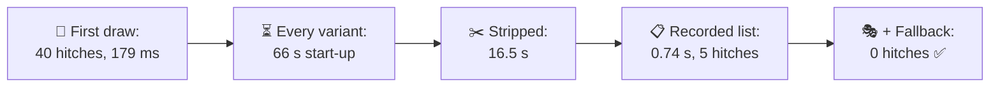
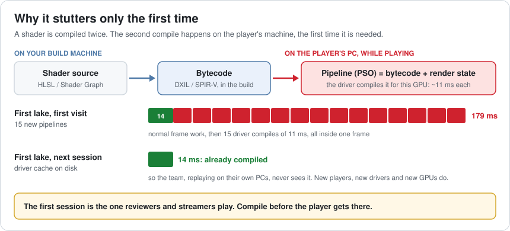
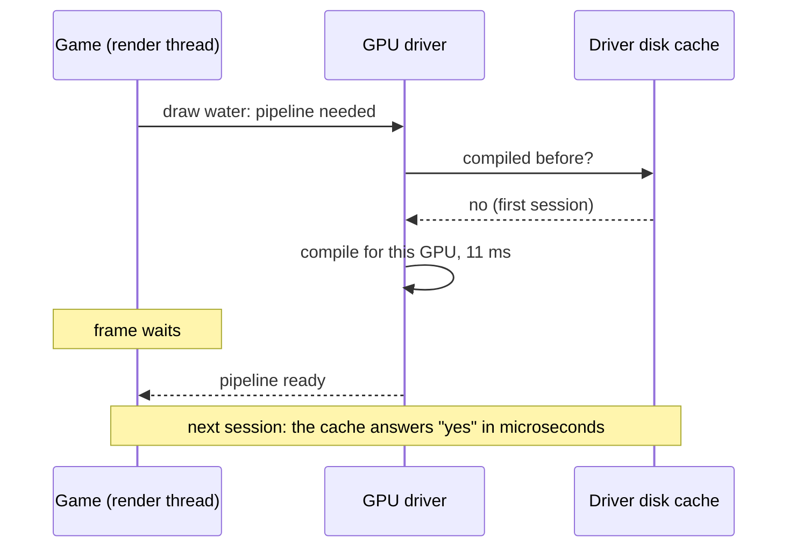
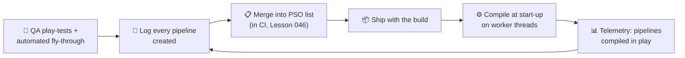
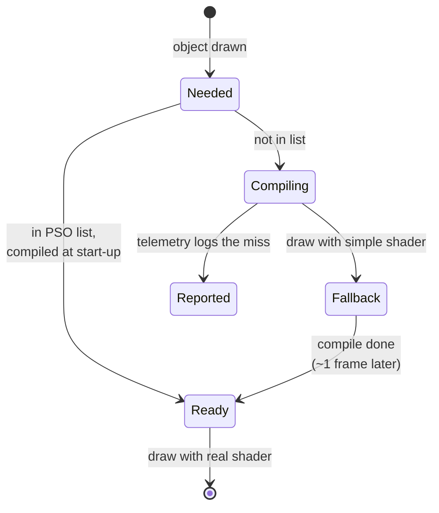
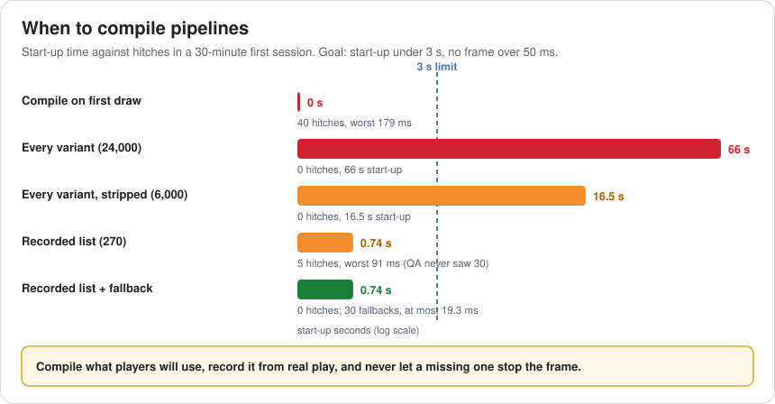

# Lesson 060 — Shader Compilation Stutter and PSO Caching: The Hitch That Only New Players Feel

> Module 6 · Platform & production performance · ~15 min read · 2026-11-01

**Today's goal:** understand why a PC game hitches the first time something new appears and never again, and plan when every graphics pipeline gets compiled: at build time, at start-up from a recorded list, or in the background with a fallback, never in the middle of a frame.

### TL;DR
- In a new player's first 30 minutes, the Reef meets **300 graphics pipelines** for the first time. The driver compiles each one, **~11 ms**, inside the frame that first needs it: **40 hitches**, and **179 ms** when the first lake appears. A second session is smooth because the driver cached them, so the team never saw it.
- Compiling **every variant** at start-up fixes the hitches but takes **66 s** (24,000 variants), or **16.5 s** after stripping to 6,000. Most of them never appear in a session anyway.
- A **recorded list** of the 270 pipelines QA actually used compiles in **0.74 s**. The 30 that QA never saw compile in the **background** with a simple **fallback** shader for at most **19.3 ms**: **0 hitches**. Then the misses go into the list for the next build.

> 🎮 **Play with it: [Frame Pipeline Lab, Lesson 060 section](https://yimo691.github.io/GameArchitect/demos/002-frame-pipeline/)** — choose when pipelines are compiled, how many variants the build has and what happens when one isn't ready, then watch a first session's 40 first-time moments. Tap **Set up** on the Lesson 060 steps to replay the lesson.



---

## 1. The problem

Frame pacing is fixed (Lesson 059). Then the PC demo goes to streamers:

```
Stream clips · Reef PC demo · day 1
00:31   first lake appears          freeze, ~0.2 s
04:02   second lake                 freeze
09:48   night falls                 short freeze
18:50   storm starts                short freeze
Team, same build, same PC model:    "can't reproduce, it's smooth"
Profiler on a freeze frame:         179 ms, mostly inside the graphics driver
```

The team can't reproduce it because they've already played the game on their PCs. The freeze happens **once per new thing, per machine**: the first time the first lake is drawn, the first night, the first storm. After that the driver has what it needs on disk.

---

## 2. Step 1 — Why the driver compiles while you play

Analogy: a restaurant that keeps recipes in a general cookbook. The first time someone orders a dish, the chef has to turn the recipe into a plan for this kitchen's ovens. The second time, the plan is pinned to the wall.

A shader is compiled **twice**:

1. **On your build machine**: from source (HLSL, Shader Graph) to **bytecode** (DXIL on DirectX 12, SPIR-V on Vulkan). This ships in the build.
2. **On the player's PC**: the GPU driver turns bytecode, plus the **render state** (blend mode, vertex layout, render target format, depth test...), into machine code for *this* GPU. The result is a **pipeline state object (PSO)**.

The second compile can't happen at build time: there are many GPUs and drivers, and the result depends on both. On DirectX 12 and Vulkan, the game decides **when** it happens. If it doesn't decide, the engine creates the pipeline at the first draw that needs it, in the middle of the frame.



The first lake brings 15 new pipelines (water, foam, the boat's wet shader, new fish, new plants). `14 ms + 15 × 11 ms = 179 ms`. Over a first session: 300 pipelines in 40 first-time moments, **every one** of them a hitch over 50 ms.



---

## 3. Step 2 — Compile everything up front? Count first

The obvious fix: compile every pipeline during start-up. The Reef's build has **24,000 shader variants** (Lesson 026's variant explosion). At 11 ms each on 4 threads: `24,000 × 11 ÷ 4 = 66 s`. No hitches, and nobody waits a minute at a loading screen.

**Stripping** the variants no material uses (keywords that are never turned on, passes for platforms you don't ship) leaves **6,000**: **16.5 s**. Better, still far too long. And of those 6,000, a first session uses **300**.

There's a second problem: a pipeline isn't one variant. It's a variant **plus** render state. One water shader drawn into the main view and into the reflection, with and without MSAA, is several pipelines. "Every combination" grows much faster than the variant count. Real engines can't enumerate them all.

---

## 4. Step 3 — Record what real play uses

The practical answer: **record** the pipelines the game actually creates, and compile that list at start-up.

- During QA play-tests and automated fly-throughs, the game logs every pipeline it creates (shader, variant and render state).
- The build merges the logs into a **PSO list** (Unreal calls it a bundled PSO cache; Unity has shader variant collections and pipeline warm-up; Vulkan has pipeline caches; Steam can pre-cache compiled shaders for some games).
- At start-up, worker threads compile the list while the title screen plays.

For the Reef: QA's runs recorded **270** of the 300 pipelines a first session uses. `270 × 11 ÷ 4 = 0.74 s`. Hitches drop from 40 to **5**, worst **91 ms**. Those 5 are the moments QA rarely reached: night falls, the golden fish, the storm, the festival lure, the late-game lake.



---

## 5. Step 4 — Never let a missing pipeline stop the frame

A list is never complete: a new driver, a rare event, a setting nobody tested. So the last rule is about what happens on a miss.

Instead of waiting, the renderer **starts the compile on a background thread** and draws the object with a **fallback** this frame: a simpler shader already compiled, or for a small effect, nothing at all. When the pipeline is ready, the real shader takes over.

The 30 misses now cost **0 hitches**. The worst fallback shows for **19.3 ms**, about one frame: the storm's rain is plain for one frame. Nobody notices.

Fallback alone is not enough, though. Without the list, all 300 pipelines go through the fallback, and at the first lake things visibly **pop in** for **41.3 ms**. The list keeps fallbacks rare; the fallback keeps misses from becoming hitches. You need both.



And close the loop: telemetry (Lesson 055) reports which pipelines were compiled during play, so each one lands in the list for the next build.



---

## 6. The architect's view

The junior says "it's smooth on my machine". The optimizer profiles the freeze and finds the driver. The architect asks: **when does every pipeline get compiled, who keeps the list complete, and what does the frame do when one is missing?**

```mermaid
flowchart TB
    subgraph Before["❌ Before: the driver decides when"]
        A1["24,000 variants"] --> A2["Pipelines created<br/>at first draw"]
        A2 --> A3["Team's PCs cached:<br/>looks smooth"]
        A3 --> A4["New players: 40 hitches"]
    end
    subgraph After["✅ After: the game decides when"]
        B1["Variants stripped (Lesson 026)"] --> B2["PSO list recorded<br/>from QA and fly-throughs"]
        B2 --> B3["Compiled at start-up<br/>on worker threads"]
        B3 --> B4["Misses: background<br/>compile + fallback"]
        B4 --> B5["Telemetry feeds misses<br/>back into the list"]
        B5 --> B6["Tests run on a<br/>cleared shader cache"]
    end
```



The architect's rules for shader compilation:

1. **No pipeline compiles in the middle of a frame.** Ever. Make it a rule the renderer enforces.
2. **Keep variants few** (Lesson 026): every variant you cut is a pipeline nobody has to compile.
3. **Record, don't guess**: build the list from real play, in CI, every build.
4. **Plan the miss**: background compile with a fallback.
5. **Test like a new player**: clear the driver's shader cache before performance tests, and test after driver updates.

### Trade-offs

| Lever | Cost | Benefit | When to use |
|---|---|---|---|
| Compile on first draw | Hitches for every new player | No work up front | Never on DX12 / Vulkan PCs |
| Every variant at start-up | Very long first start-up | No hitches | Small games with few variants |
| Variant stripping | Build-time setup, risk of stripping a needed one | Fewer pipelines everywhere | Always |
| Recorded PSO list | Recording runs, keeping the list current | Short start-up, few misses | Any PC or Android game with many shaders |
| Background compile + fallback | A frame of simpler drawing; renderer complexity | Misses never hitch | Always, behind the list |
| Compile during a loading screen per level | Longer level loads | Spreads the cost | Level-based games |

---

## 7. Common mistakes

- **Testing on warm machines.** The team's PCs have every pipeline cached; players' don't.
- **Thinking "the shaders are precompiled".** The bytecode is. The pipeline for this GPU isn't.
- **Recording the list once.** New content and new materials make it stale in weeks; record in CI.
- **Forgetting render state.** The same shader in a new pass or format is a new pipeline.
- **A fallback that's too visible.** A pink placeholder is fine in development, not in front of players.
- **Ignoring driver updates.** A new driver can clear its cache: the next session is a first session again.

---

## 8. Quiz — think about it on the lift 🎿🎣

**Q1.** Why did nobody on the team see the freezes?

<details><summary>Answer</summary>

Their drivers had already compiled and cached every pipeline from earlier sessions, so each "first time" had already happened on their machines. Streamers and new players started with an empty cache.
</details>

**Q2.** The first lake needs 15 new pipelines at 11 ms each, on a 14 ms frame. What does the frame cost with compile on first draw, and with the recorded list?

<details><summary>Answer</summary>

First draw: `14 + 15 × 11 = 179 ms`. With the recorded list, all 15 were compiled at start-up, so the frame is 14 ms.
</details>

**Q3.** Why not compile every variant at start-up after stripping?

<details><summary>Answer</summary>

6,000 variants × 11 ms ÷ 4 threads = 16.5 s, far over a 3 s budget, and a first session only uses 300 of them. Also, pipelines are variants *plus* render state, so the real number of combinations is larger still.
</details>

**Q4.** The recorded list covers 270 of 300 pipelines. What happens to the other 30, and how does the list improve?

<details><summary>Answer</summary>

They compile on a background thread while the object is drawn with a fallback shader for about one frame (at most 19.3 ms), so there are no hitches. Telemetry reports them, and they are added to the list for the next build.
</details>

---

## 9. Back at the desk (≈45 min) — your first session

> No desk today? Do it in the [Frame Pipeline Lab](https://yimo691.github.io/GameArchitect/demos/002-frame-pipeline/): predict hitches and start-up time for each Lesson 060 step, then tap.

In your own project:

1. **Clear the shader cache** (the driver's cache folder, or your engine's) and play the first 15 minutes. Log every frame over 50 ms.
2. **Count pipelines created during play**: your engine's PSO or shader logging (for example Unreal's `r.ShaderPipelineCache` logging, or Unity's shader compilation log in development builds).
3. **Count variants** in your build report (Lesson 026). How many does a session use?
4. **Record a list** from one full play-through and warm it up at start-up. Measure start-up time and the hitches again.
5. **Decide your fallback**: what draws when a pipeline isn't ready?
6. Save `journal/060-pso.md`:

| Number | Cold cache, before | With list | With list + fallback |
|---|---|---|---|
| Hitches over 50 ms (15 min) | | | |
| Worst frame | | | |
| Pipelines compiled during play | | | |
| Start-up time added | | | |
| Variants in the build | | | |

One question for your journal: which moment in your game would a new player reach that your QA runs never do?

---

## 10. Vocabulary

| Term | Meaning | 中文 |
|---|---|---|
| Pipeline state object (PSO) | Compiled shaders plus render state, ready for one GPU | 管线状态对象 |
| Shader bytecode | The shader compiled at build time, before the GPU driver sees it | 着色器字节码 |
| Render state | Blend, depth, vertex layout and target formats used with a shader | 渲染状态 |
| Driver shader cache | Compiled pipelines the driver saves on disk | 驱动着色器缓存 |
| Shader variant | One version of a shader for one set of keywords | 着色器变体 |
| Variant stripping | Removing variants the game never uses from the build | 变体剔除 |
| PSO cache / list | A recorded list of pipelines to compile ahead of time | PSO 缓存（清单） |
| Shader warm-up | Compiling pipelines before they're needed | 着色器预热 |
| Fallback shader | A simple shader drawn until the real one is ready | 后备着色器 |
| Cold cache | A machine that has never compiled the game's pipelines | 冷缓存 |

---

## 11. Further reading

- **Unreal Engine documentation — "PSO Precaching"** and **"Bundled PSO Cache"**: recording, bundling and precaching pipelines, with fallbacks.
- **Unity Manual — "Shader variant collections"** and **"Prewarming shaders"**: recording variants and warming them up before use.
- **Microsoft Learn — "Managing graphics pipeline state in Direct3D 12"** and **`ID3D12PipelineLibrary`**: what a PSO is and how to store compiled ones.
- **Khronos — Vulkan documentation on pipeline caches** (`VkPipelineCache`): saving and reusing compiled pipelines.

---

**Tomorrow — Lesson 061: Console and store certification: what architects must plan for.** The Reef is ready for consoles, and the first submission comes back failed: the game doesn't pause when the controller disconnects on the save screen, and it shows the wrong button names on one controller. We learn what platform holders check, and how to build those rules into the architecture instead of fixing them a week before launch.
