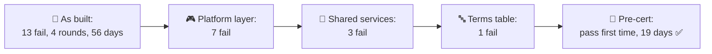
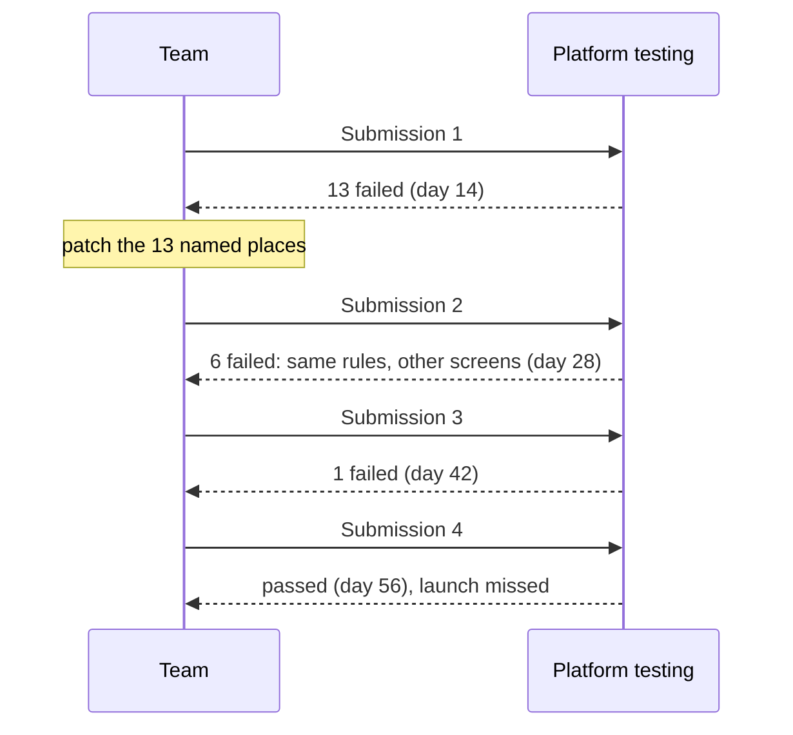
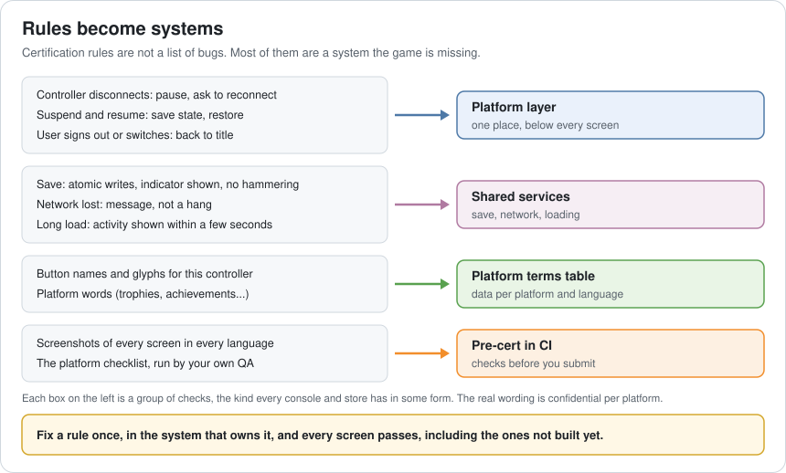
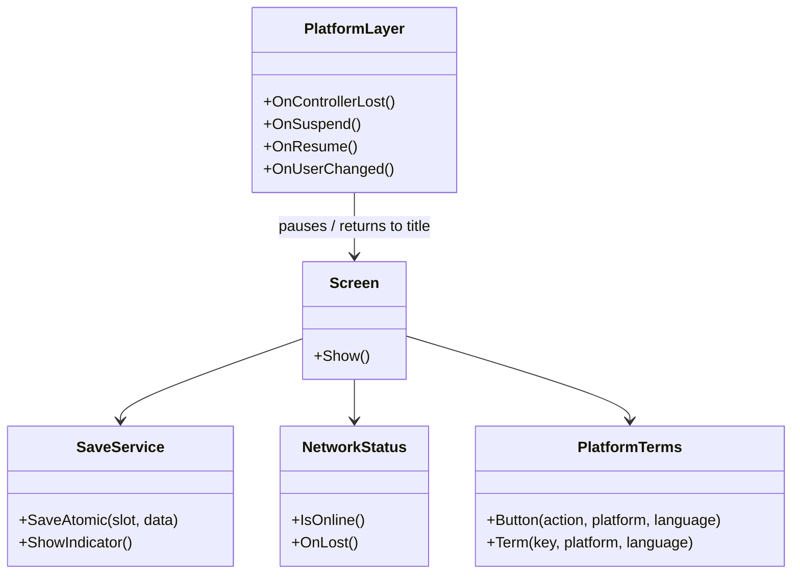
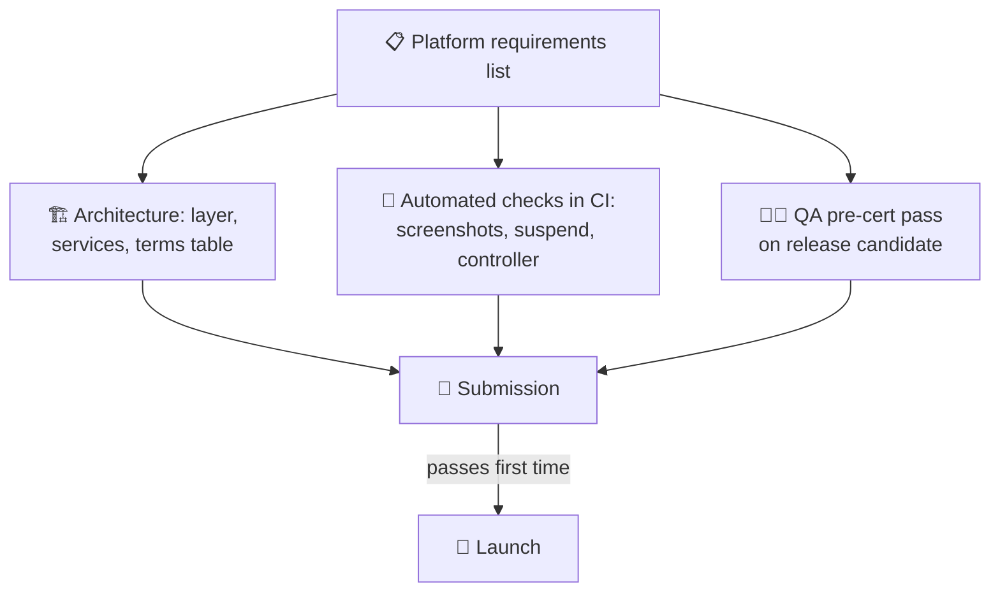
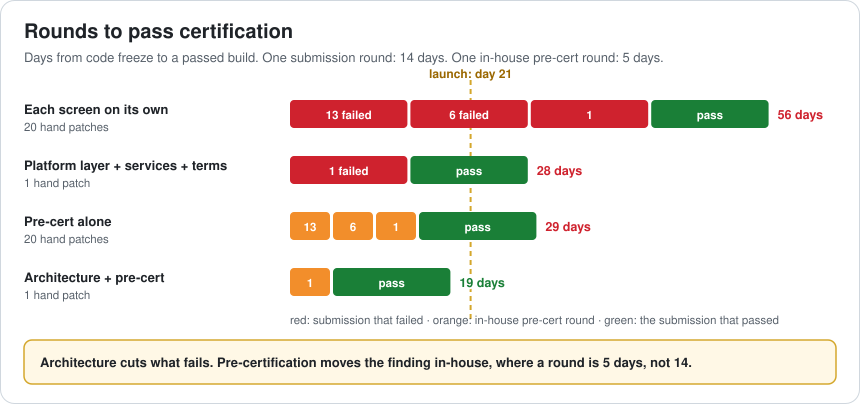

# Lesson 061 — Console and Store Certification: What Architects Must Plan For

> Module 6 · Platform & production performance · ~15 min read · 2026-11-01

**Today's goal:** understand what platform holders check before a game may ship, see why most failures come from missing systems rather than single bugs, and plan the architecture (a platform layer, shared services, a terms table and in-house pre-certification) so the first submission passes.

### TL;DR
- The Reef's first console submission fails **13 checks**: freezes when the controller disconnects during a save, the wrong button names in one language, no message when the network drops, and more. Each round is about **14 days** from sending the build to a fixed build ready again.
- Fixing only the screens named in the report leaves the same problems on other screens: **6** fail next time, then **1**. **4 submissions, 56 days**, 20 one-off patches, and a missed launch.
- Building the rules into the architecture (**one platform layer**, **shared save, network and loading services**, a **platform terms table**) leaves 1 failure, and **in-house pre-certification** finds it in a 5-day round. The real submission passes first time: **19 days**, inside the 21-day launch window.

> 🎮 **Play with it: [Cert Lab](https://yimo691.github.io/GameArchitect/demos/061-cert-lab/)** — choose which platform rules live in the architecture and whether the team runs its own pre-certification, and watch what each round finds and how many days it costs. Tap **Set up** on the steps to replay the lesson.



---

## 1. The problem

Before a game can be sold on a console, the platform holder tests it against a list of **technical requirements**: Sony calls theirs TRCs, Microsoft has the Xbox Requirements (XRs), Nintendo runs Lotcheck. App stores have review guidelines too. The exact rules are confidential and change over time, but they all cover the same ground: the game must behave well as a guest on the player's machine.

The Reef's first submission report:

```
Certification result · Reef 1.0 · FAILED · 13 issues
- Controller disconnected on save screen: game keeps running, no prompt
- Controller disconnected during cut-scene: no prompt (and 1 more place)
- Resume from rest mode: online session lost, game stuck on loading (2 places)
- User signed out: game continues with the old user's save
- Power cut during save: save file corrupted (2 cases)
- Network cable pulled in the shop: infinite spinner
- Loading screen with no activity for 12 s
- Button named "A" on a controller where that button is "Cross" (2 places)
- Italian: the "Continue" text overflows its button
```

The team has a launch date in 3 weeks. Each round trip takes about **14 days**: the platform's test time plus fixing and sending a new build.

---

## 2. Step 1 — Why the same failure comes back

Analogy: a building inspector notes that the fire exit on floor 2 is blocked. You clear floor 2. Next visit, the inspector checks floor 5.

The team fixed exactly what the report named: a reconnect prompt on the save screen, another in the cut-scene player. The testers in the next round checked other places: the map, the shop. Then the credits. Testers sample; they don't list every screen. A rule like "the game must pause and ask for the controller whenever it disconnects" applies to **every** screen, including the ones written next month.

In the lab, fixing only reported screens costs: **13** failures, then **6**, then **1**, then a pass. **4 submissions, 56 days**, and **20 hand patches** scattered across screens, each one a place to forget next time.



---

## 3. Step 2 — Turn rules into systems

Look at the report again. Nearly every line is a rule about something **every screen** must do. That's an architecture problem, not 13 bugs.



**A platform layer.** One layer, below gameplay and UI, owns the things the platform can do to the game at any moment:

- **Controller lost**: the layer pauses the game, shows the platform's reconnect prompt, and resumes. No screen handles it on its own.
- **Suspend and resume**: the layer sends `OnSuspend` / `OnResume` events (Lesson 014); online systems re-connect, timers are corrected, saves are flushed.
- **User signs out or switches**: the layer returns to the title screen and unloads the old user's data.

With the platform layer, the first submission fails **7**, then 2: **3 submissions, 42 days**.

**Shared services.** The save system from Lesson 047 gets the platform's rules: write to a temporary file and swap (so a power cut never leaves half a file), show the save indicator, don't write more than needed. A network service reports "offline" to every feature instead of each one waiting forever. Loading screens get an activity indicator by default. Now **3** fail, all in text: **2 submissions, 28 days**.



---

## 4. Step 3 — Platform words are data

"Press A to continue" is wrong on a controller whose button is called Cross, and platforms check the exact names: the button names, the glyphs, and the words for things like trophies or achievements. Writers shouldn't type them at all.

The Reef's text says `Press {button:confirm} to continue`. A **terms table**, per platform and per language, fills in the name or glyph at runtime. The same goes for platform words: `{term:achievements}`. It's Lesson 019's data-driven design applied to text. Changing platforms changes a table, not 400 lines of dialogue.

With the terms table, only **1** failure is left: the Italian "Continue" overflows its button. Still **2 submissions, 28 days**, because the platform finds it two weeks after you send the build.

---

## 5. Step 4 — Find it before they do

The last lever isn't about what fails, but **who finds it and how fast**. Every platform gives developers its requirements list. The team runs it themselves, before submitting:

- **In CI** (Lesson 046): screenshot tests of every screen in every language, flagging text that overflows its box; the save service's power-cut test; "pull the controller" and "suspend" tests in automated runs.
- **By QA**: the platform's checklist, item by item, on a release candidate.

An in-house round takes **5 days**, not 14. It finds the Italian line, the team fixes it, and the real submission passes first time: `5 + 14 = 19 days`, inside the launch window.



Pre-cert alone isn't enough: without the architecture, the team still needs 3 in-house rounds and 20 patches, **29 days**. It finds problems faster; it doesn't make fewer of them.



---

## 6. The architect's view

The junior fixes the reported screen. The optimizer writes a checklist. The architect asks: **which systems does the platform expect every game to have, where in the architecture does each rule live, and how do we know before submitting?**

```mermaid
flowchart TB
    subgraph Before["❌ Before: rules as bugs"]
        A1["Each screen handles<br/>controller, saving, network"] --> A2["Report names 13 places"]
        A2 --> A3["Patch those places"]
        A3 --> A4["Same rules fail elsewhere:<br/>4 rounds, 56 days"]
    end
    subgraph After["✅ After: rules as systems"]
        B1["Read the requirements<br/>in pre-production"] --> B2["Platform layer + services<br/>+ terms table"]
        B2 --> B3["Automated checks in CI"]
        B3 --> B4["QA pre-cert pass"]
        B4 --> B5["First submission passes:<br/>19 days"]
    end
```



The architect's rules for certification:

1. **Read the requirements in pre-production**, not in the last month. Many of them shape the architecture.
2. **Every "at any time" rule belongs to one layer** (controller, suspend, users, network), not to screens.
3. **Platform words and buttons are data**, per platform and language.
4. **Test the rules continuously**: what can be automated runs in CI; the rest is a QA checklist.
5. **Plan the calendar with rounds**: submission dates, platform test time and a buffer for one failure.

### Trade-offs

| Lever | Cost | Benefit | When to use |
|---|---|---|---|
| Platform layer | Up-front design, every screen must use it | Whole groups of checks pass everywhere | Any console or store game |
| Shared save / network / loading services | Features lose some freedom | Consistent behaviour, one place to fix | Always |
| Terms table | Writers use tokens, not words | Correct names on every platform and language | Multi-platform games |
| In-house pre-cert | QA time, CI tests to build | 5-day rounds instead of 14, first-time pass | Before every submission |
| Patch reported screens only | Little today | Nothing lasting | Only for a true one-off |
| Waivers / exceptions | Negotiation, not always granted | Ship with a known minor issue | Rare, minor, well-argued cases |

---

## 7. Common mistakes

- **Reading the requirements a month before launch.** Some of them change how the game is built.
- **Fixing the screen, not the rule.** The tester will find the next screen.
- **Hard-coding button names in text.** One platform, one language, one wrong glyph.
- **Assuming the game always has a controller, a user and a network.** On a console, all three can disappear at any moment.
- **No buffer in the schedule.** Plan for at least one failed submission.
- **Treating certification as QA's problem.** QA finds failures; architecture prevents them.

---

## 8. Quiz — think about it on the lift 🎿🎣

**Q1.** The report says "controller disconnected on the save screen: no prompt". Why is adding a prompt to the save screen the wrong fix?

<details><summary>Answer</summary>

The rule applies to every screen at any time. Testers sample other screens next round and find the same failure there. The fix belongs in one platform layer that pauses the game and shows the prompt wherever the player is.
</details>

**Q2.** With architecture done, 1 failure remains. Why does pre-certification change the date from 28 to 19 days?

<details><summary>Answer</summary>

Without pre-cert, the platform finds the failure in submission 1 (14 days), and submission 2 passes (14 more): 28. With pre-cert, the team finds it in a 5-day in-house round, then submission 1 passes: `5 + 14 = 19`.
</details>

**Q3.** A power cut during saving corrupted the file. What should the save service do?

<details><summary>Answer</summary>

Write the new save to a temporary file, check it, then replace the old file in one step (or keep two slots and switch). A cut at any moment leaves either the old save or the new one, never half a file. Lesson 047's versioned saves still apply.
</details>

**Q4.** Why does "pre-cert alone" take 29 days?

<details><summary>Answer</summary>

It finds the same 13, 6 and 1 failures as before, just in 5-day rounds instead of 14: `3 × 5 + 14 = 29`. Without the architecture, each round still patches only the screens it found.
</details>

---

## 9. Back at the desk (≈45 min) — your certification map

> No desk today? Do it in the [Cert Lab](https://yimo691.github.io/GameArchitect/demos/061-cert-lab/): predict failures and days for each step, then tap.

In your own project:

1. **List the "at any time" events** your target platforms can send: controller lost, suspend, user change, network lost, low storage. Who handles each one today?
2. **Pull the controller** on five different screens, including a cut-scene and a loading screen. What happens?
3. **Search your text** for hard-coded button names and platform words.
4. **Check your save**: what happens if the game is killed halfway through writing?
5. **Pick three checks you could automate** in CI.
6. Save `journal/061-cert.md`:

| Rule group | Handled where today | Should live in | Automated check? |
|---|---|---|---|
| Controller lost | | | |
| Suspend / resume | | | |
| User change | | | |
| Saving | | | |
| Network lost | | | |
| Button names / terms | | | |

One question for your journal: if a platform added a new "at any time" rule tomorrow, in how many places would you have to change code?

---

## 10. Vocabulary

| Term | Meaning | 中文 |
|---|---|---|
| Certification | The platform holder's tests before a game may ship | 认证（过审） |
| Technical requirements | The platform's list of rules a game must follow | 技术要求 |
| Submission | Sending a build to the platform for testing | 提交 |
| Pre-certification | Running the platform's checks yourself first | 预认证 |
| Platform layer | The part of the game that handles platform events for everyone | 平台层 |
| Suspend / resume | The console or phone pausing the game and bringing it back | 挂起 / 恢复 |
| Atomic save | A save that is either fully written or not at all | 原子保存 |
| Button glyph | The picture of a controller button in the UI | 按键图标 |
| Terms table | Platform words and button names per platform and language | 术语表 |
| Waiver | Permission to ship with a known minor issue | 豁免 |

---

## 11. Further reading

- **Apple — "App Store Review Guidelines"** and **Google Play — "Developer Program Policy"**: the public store rules, a good model of what platform reviews look for.
- **Microsoft — "Xbox Accessibility Guidelines"** (public): how a platform turns quality expectations into testable rules.
- **Apple Developer Documentation — "Managing your app's life cycle"** and **Android Developers — "The activity lifecycle"**: suspend and resume, as phones do it.
- Your platform's developer portal: console requirements (TRCs, XRs, Lotcheck guidelines) are available to registered developers under NDA. Read them in pre-production.

---

**Tomorrow — Lesson 062: Performance budgets as a team process.** The Reef has budgets for memory (Lesson 057), frame time and energy. Yet three weeks after launch, the frame time is over budget again and nobody knows whose job it is. We learn how to give every budget an owner, a review and a way to trade.
