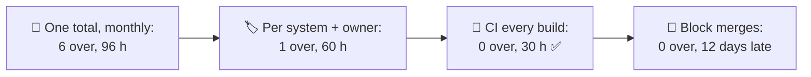
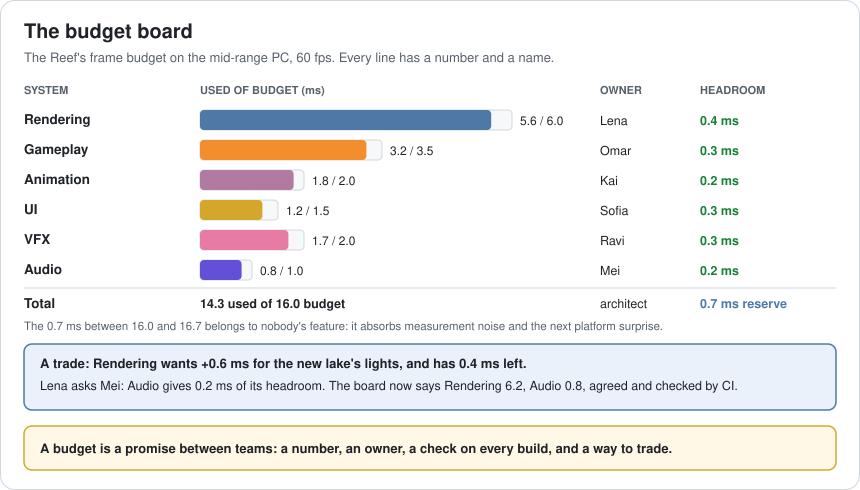
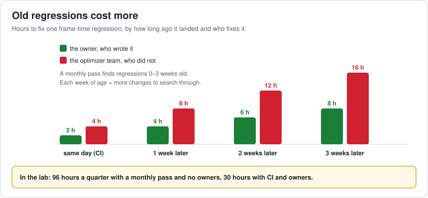
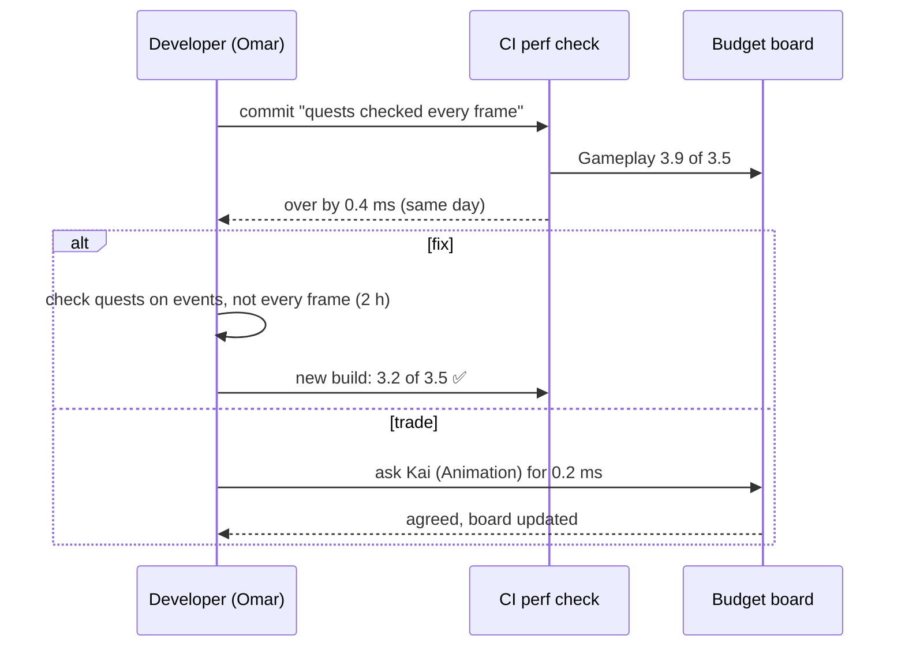
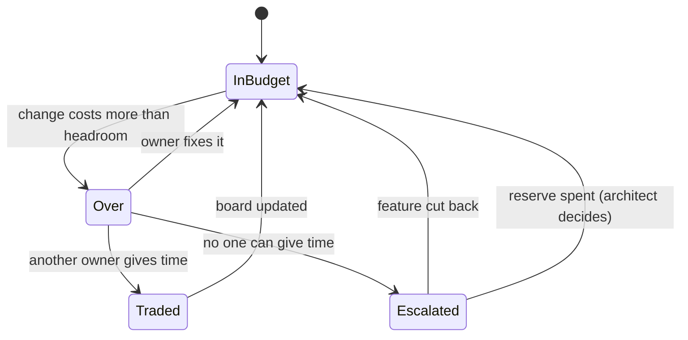
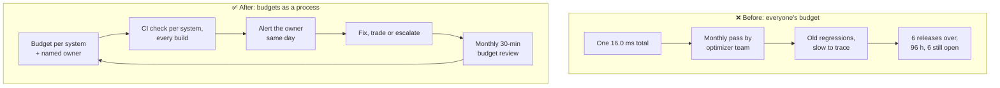

# Lesson 062 — Performance Budgets as a Team Process: The Frame Time Nobody Owned

> Module 6 · Platform & production performance · ~15 min read · 2026-11-01

**Today's goal:** turn a performance budget from a number in a document into a team process: a budget per system with a named owner, a check on every build, a way to trade, and a clear rule for what happens when a change goes over.

### TL;DR
- After launch, the Reef ships a weekly update. Six teams each add features, and each feature costs a little frame time (0.3–0.7 ms). There is one **16.0 ms** budget that's everybody's, and a 2-person **optimizer team** does a performance pass **once a month**.
- In 12 weeks: **6 releases over budget**, the last two **dropping frames** at 16.8 ms, **96 hours** of optimizer time, and **6 regressions still open**. Regressions found weeks late are slow to trace, and the people fixing them didn't write the code.
- A **budget per system with an owner** gets it to 60 hours and 0 open. Adding a **CI check on every build** that tells the owner the same day: **0 releases over budget, 30 hours**. **Blocking** every over-budget merge is even safer but delays features **12 days**; a **trade** between owners is often the better answer.

> 🎮 **Play with it: [Budget Board Lab](https://yimo691.github.io/GameArchitect/demos/062-budget-board-lab/)** — choose who owns the budget, how fast regressions are found and whether CI alerts or blocks, and watch 12 weekly releases against the budget. Tap **Set up** on the steps to replay the lesson.



---

## 1. The problem

The Reef launched at **14.3 ms** a frame on the mid-range PC, under a **16.0 ms** budget (16.7 ms is a dropped frame at 60 fps). Twelve weeks later:

```
Weekly update 12 · performance report
Frame time (harbour, mid-range PC):   16.8 ms   ← drops frames
Changes since launch that cost time:  12, from 6 teams
Who is fixing it:                     optimizer team (2 people), 6 items in their queue
Oldest open regression:               week 8 (sharper water reflections)
Question in the team chat:            "whose job is this?"
```

Everyone respected "the budget". Nobody owned any part of it. Each team's change was small, each one looked fine on its own, and together they took the game over the line.

Lesson 057 put memory budgets into CI. Today is about the **people side**: budgets only work when someone owns each number.

---

## 2. Step 1 — A budget per system, and a name next to each

Analogy: a shared flat with one electricity bill. Everyone uses "a bit more", and at the end of the month nobody knows who to ask. Give each room its own meter and its own limit, and the conversation changes.

The 16.0 ms is split into **one budget per system**, each with an **owner**: the person who says yes or no to changes that cost time in that system, and who fixes regressions in it.



The 0.7 ms between 16.0 and 16.7 is a **reserve**, owned by the architect. It isn't for features: it absorbs measurement noise, a slower driver, a hot summer day.

With owners, each regression is fixed by the person who wrote it, who knows the code: in the model, `2 h + 2 h per week of age`, against `4 h + 4 h per week` for the optimizer team, and nothing waits in a 32-hour-a-month queue. **60 hours** instead of 96, **0** left open. But regressions are still found **monthly**, so week 3 still ships at **16.1 ms**.

---

## 3. Step 2 — Find it the day it lands

A regression found a month later is a detective case: 20 other changes landed since, the author has moved on, and the profile is mixed with everything else. Found the same day, it's a 2-hour fix.



So CI measures every build (tomorrow's lesson is about how), **per system**, against the board:

```
CI · build 4127 · perf check · mid-range PC, harbour, 60 s
Rendering   5.6 / 6.0  ok
Gameplay    3.9 / 3.5  OVER by 0.4 ms   ← owner: Omar
            biggest change: commit 9f3a "quests checked every frame"
UI          1.2 / 1.5  ok
...
Total      14.8 / 16.0
```

The alert goes to the **owner**, not to a channel. In the lab, owners fix within the week, except in live-event weeks (2, 6 and 10), when they're busy and fix the following week. Even then, releases stay under budget: **0 weeks over, 30 hours** in 12 weeks.

Notice what doesn't work: the same CI alerts sent to nobody in particular. In the lab that's **48 hours** and week 3 over budget again, because alerts wait for the monthly pass. **A tool without an owner is noise.**



---

## 4. Step 3 — Trade, don't sneak

Sometimes a feature is worth the time. The new lake's lights cost 0.6 ms, and Rendering has 0.4 ms of headroom. The options:

- **Fix**: make the lights cheaper (Lesson 030).
- **Trade**: Lena (Rendering) asks Mei (Audio) for 0.2 ms of Audio's headroom. If Mei agrees, the board changes: Rendering 6.2, Audio 0.8. It's written down, and CI checks the new numbers from then on.
- **Escalate**: if no one can give time, the architect and the producer decide between the feature and the reserve.

What's not allowed is **sneaking**: shipping the 0.6 ms and hoping the total holds. That's how the Reef reached 16.8 ms.

A short **budget review** every month (30 minutes, owners and the architect) looks at the board: who is close to their limit, which trades were made, whether the platform targets changed (a new console mode, a new minimum PC).



---

## 5. Step 4 — Alert or block?

CI can **alert** the owner or **block** the merge until the change fits.

- **Block** every over-budget change: every release stays at 14.3 ms, and fixing is cheapest (24 hours), but each of the 12 changes waits until it fits: **12 feature-days delayed**. Designers wait; nightly playtests miss features.
- **Alert** with owners: changes land, owners fix or trade within the week, and releases stay in budget: **0 over, 30 hours, 0 days delayed**.

Many teams mix them: **block** big regressions (say, over 1 ms or over the total budget), **alert** on small ones. Measurements are noisy; a gate that blocks on noise teaches people to ignore it.

---

## 6. The architect's view

The junior asks "who made it slow?". The optimizer fixes the biggest regression. The architect asks: **does every millisecond have an owner, how soon does the owner find out, and what is the agreed way to spend more?**



The architect's rules for budgets as a process:

1. **Every line has a number and a name.** "The team" is not an owner.
2. **The architect owns the reserve**, and spending it is a decision, not an accident.
3. **Measure per system, per build**, and send results to owners, not channels.
4. **Over budget means fix, trade or escalate.** Never sneak.
5. **Review the board monthly**, and update it when platforms or targets change.

### Trade-offs

| Lever | Cost | Benefit | When to use |
|---|---|---|---|
| Per-system budgets | Time to split and agree the numbers | Clear owners, early warnings | Any team bigger than a few people |
| Central optimizer team | A small team becomes a queue | Deep expertise | For hard problems, not every regression |
| CI per-build checks | Test hardware and stable scenes | Same-day, cheap fixes | Always, once the game runs |
| Block on regression | Delayed features, pressure on noisy tests | Nothing over budget lands | Big regressions, release branches |
| Alert on regression | Some regressions live a few days | Features keep flowing | Small regressions, main branch |
| Budget trades | A conversation and a board update | Features worth the time can ship | When headroom exists somewhere |

---

## 7. Common mistakes

- **A budget with no owner.** Everyone respects it; nobody defends it.
- **Budgets only for the total.** You know you're over, not where.
- **Sending alerts to a channel.** Ten people see it, nobody acts.
- **Leaving fixes to the optimizer team.** They don't know the code, and they become a queue.
- **Spending the reserve on features.** Then the first driver update drops frames.
- **Never revisiting the numbers.** New platforms, modes and content change what's fair.

---

## 8. Quiz — think about it on the lift 🎿🎣

**Q1.** Why did the monthly optimizer pass cost 96 hours and still leave 6 regressions open?

<details><summary>Answer</summary>

Regressions were 0–3 weeks old when found, so each took `4 + 4 × age` hours to trace through all the changes since, and the team only had 32 hours a month. The oldest ones were fixed first, and the newer ones queued up.
</details>

**Q2.** CI sends alerts, but with no owners the result is 48 hours and a release over budget. Why?

<details><summary>Answer</summary>

Nobody is responsible for acting on an alert, so they wait until the monthly pass. CI made each fix cheaper (it named the change), but didn't make it sooner.
</details>

**Q3.** Rendering has 0.4 ms of headroom and wants a 0.6 ms feature. What are the options?

<details><summary>Answer</summary>

Fix it (make it cost 0.4 ms or less), trade (another owner gives 0.2 ms of their headroom and the board is updated), or escalate (the architect and producer decide whether to cut the feature or spend the reserve). Shipping it silently is not an option.
</details>

**Q4.** Blocking every over-budget merge kept every release at 14.3 ms. Why isn't it the goal-meeting choice?

<details><summary>Answer</summary>

Each of the 12 changes had to wait until it fit: 12 feature-days delayed, over the 5-day limit. Alerting owners kept releases in budget without delaying features. Blocking is better kept for large regressions.
</details>

---

## 9. Back at the desk (≈45 min) — your budget board

> No desk today? Do it in the [Budget Board Lab](https://yimo691.github.io/GameArchitect/demos/062-budget-board-lab/): predict weeks over budget and hours for each step, then tap.

In your own project:

1. **Split your frame budget** into 5–7 systems, using a profile of your heaviest scene.
2. **Write a name** next to each system. Ask each person if they agree.
3. **Decide the reserve** and who may spend it.
4. **Find your last three regressions**: how old were they when found, and who fixed them?
5. **Write the rule** for "over budget": fix, trade, escalate, and who decides.
6. Save `journal/062-budget-board.md`:

| System | Budget (ms) | Now (ms) | Owner | Last regression (age when found) |
|---|---|---|---|---|
| | | | | |
| | | | | |
| Reserve | | | | |
| Total | | | | |

One question for your journal: if your game got 0.5 ms slower tomorrow, who would be the first person to know, and how?

---

## 10. Vocabulary

| Term | Meaning | 中文 |
|---|---|---|
| Performance budget | The time or memory a system may use | 性能预算 |
| Budget owner | The person who approves and defends a system's budget | 预算负责人 |
| Regression | A change that makes the game slower or bigger | 性能回退 |
| Headroom | Unused budget left in a system | 余量 |
| Reserve | Budget held back for surprises, owned by the architect | 预留量 |
| Budget trade | Moving budget from one system to another by agreement | 预算交换 |
| Performance gate | A CI check that blocks or alerts on regressions | 性能门禁 |
| Escalation | Taking a decision to a higher level when owners can't agree | 升级处理 |
| Budget review | A regular meeting to check and adjust budgets | 预算评审 |
| Bisecting | Searching through changes to find which one caused a problem | 二分查找（定位问题提交） |

---

## 11. Further reading

- **Unity — Performance Testing package (`com.unity.test-framework.performance`)** documentation: measuring the same scenes on every build.
- **Unreal Engine documentation — "Performance and Profiling" / "Stat commands"** and **Unreal Insights**: per-system timing that maps onto budget lines.
- **Google SRE Book — "Service Level Objectives"** (free online): owners, targets and error budgets, the same idea from web services.
- **Jason Gregory, *Game Engine Architecture* (3rd ed.)**: profiling and the per-subsystem view of frame time.

---

**Tomorrow — Lesson 063: Automated performance testing.** The budget board needs numbers on every build. But the first CI performance test flags a "regression" on 4 builds out of 10 that turn out to be noise. We learn how to build performance tests that are repeatable enough to trust: fixed scenes, fixed hardware, warm-up, and statistics.
