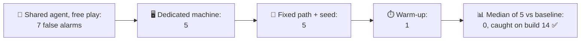
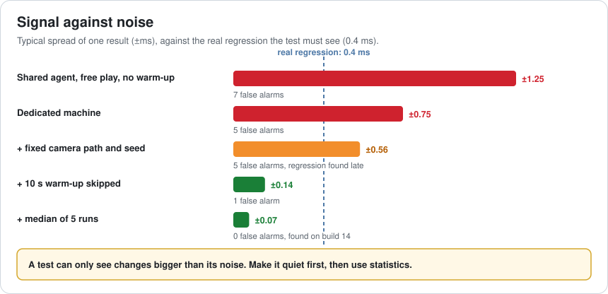
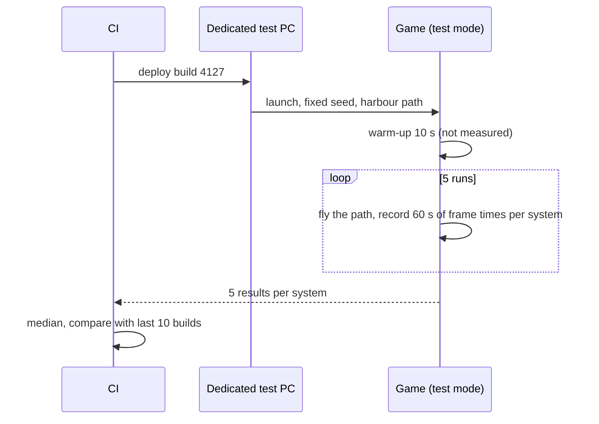
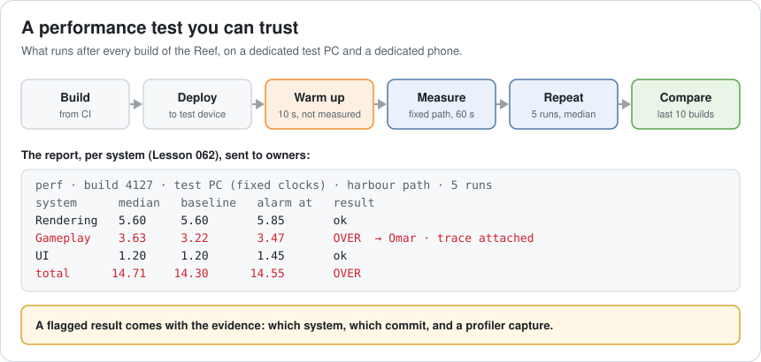
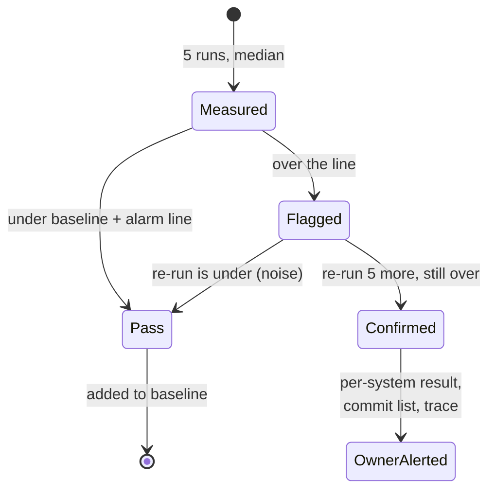

# Lesson 063 — Automated Performance Testing: The Alarm That Cried Wolf

> Module 6 · Platform & production performance · ~15 min read · 2026-11-01

**Today's goal:** build a performance test that runs on every build and that people trust: remove noise at its source (machine, scene, warm-up), then compare a median of several runs with a rolling baseline, so a real 0.4 ms regression is flagged on the day it lands and noise isn't.

### TL;DR
- The Reef's first CI performance test runs once per build on a **shared CI agent**, in **free play**, measuring **from the first second**, and alarms if the result is **0.3 ms** above the last build. In 13 builds with no real change, it raises **7 false alarms**. When a real **0.4 ms** regression lands on build 14, nobody can tell it apart.
- Removing noise at the source: a **dedicated machine with fixed clocks** (7 → 5 false alarms), a **fixed camera path and seed**, and a **10 s warm-up** before measuring (→ 1). Typical spread of one result drops from **±1.25** to **±0.14 ms**.
- Then statistics: the **median of 5 runs**, compared with the **median of the last 10 builds**, with the alarm at **3 × the measured noise** (at least 0.25 ms). **0 false alarms**, the regression flagged **on build 14**, **13.5 minutes** per build. Statistics on a noisy test do the opposite: the regression is **never flagged**.

> 🎮 **Play with it: [Perf Test Lab](https://yimo691.github.io/GameArchitect/demos/063-perf-test-lab/)** — choose the test machine, the scene, the warm-up and the decision rule, and watch 20 builds go through the test. Tap **Set up** on the steps to replay the lesson.



---

## 1. The problem

Lesson 062 gave every system a budget and an owner, and asked CI to check every build. The first version of that check:

```
perf-check.yml (first version)
- runs on: any free CI agent
- launches the game, plays the harbour in free play for 60 s
- average frame time vs the previous build
- alarm if more than 0.3 ms slower

Results, builds 1–13 (no performance changes at all):
ALARM ALARM ok ALARM ok ALARM ok ALARM ok ALARM ok ok ALARM
```

Seven alarms in thirteen builds, and nothing changed. Owners get pinged, look, find nothing, and after a week they mute the channel. Then build 14 adds a real 0.4 ms (the quests check every frame), and the alarm looks exactly like the others.

**A performance test is only useful if it's quiet when nothing changes.**

---

## 2. Step 1 — Where the noise comes from

Analogy: weighing yourself on a different scale each morning, sometimes after breakfast, sometimes holding the cat. The number changes a lot, and none of it is you.

The Reef's test has four sources of noise:

| Source | What happens | Typical effect on one 60 s result |
|---|---|---|
| Shared CI agent | Other jobs compete for CPU and disk; clocks boost and drop with temperature | ±0.6 ms, and now and then +2 ms when a big job starts |
| Free play | Weather, AI and fish are random; the camera goes somewhere different each time | ±0.5 ms |
| No warm-up | The first seconds include loading, streaming and shader compiling (Lesson 060), and how much varies | +0 to +2 ms |
| One run | Even a quiet test varies a little from run to run | what's left |



The rule of thumb: **a test can only see changes clearly bigger than its noise**. With ±1.25 ms of noise, a 0.4 ms regression is invisible, and a 0.3 ms threshold fires on noise all the time.

---

## 3. Step 2 — Remove noise at the source

Each source has a fix, and each is cheap compared to engineers chasing false alarms:

- **A dedicated test machine** (and a dedicated phone for mobile): nothing else runs on it, clocks fixed (turbo off, high-performance power plan, or the console's development mode with fixed clocks), the same OS and driver version, pinned. In the lab: 7 → **5** false alarms.
- **A fixed test scene**: the camera follows a recorded path through the harbour, the random seed is fixed, AI and weather are deterministic (Lesson 017's command replays are perfect for this). Still 5, because the start is still noisy.
- **A warm-up**: load the scene, play 10 seconds without measuring, then measure 60 s. Loading and shader compiling happen in the warm-up. Now **1** false alarm, and one result varies by only **±0.14 ms**.



But one run compared with one other run is still two noisy numbers: the real regression is flagged only on build **17**, three builds late.

---

## 4. Step 3 — Compare against a baseline, with statistics

Two changes to the decision rule:

1. **Repeat and take the median.** Run the path 5 times and take the middle result. The median ignores a single odd run (a background update, a hiccup) that an average would include.
2. **Compare with a rolling baseline, not the last build.** The baseline is the median of the last 10 builds' results. One noisy build no longer moves the bar.

And the alarm line is set from the data: **3 × the measured noise** of the baseline (measured as the spread of those 10 results), but never less than **0.25 ms**. A quiet test gets a tight line, a noisy one a wide line.

Result: **0 false alarms** in builds 1–13, and the 0.4 ms regression flagged **on build 14**. Five runs of 2.7 minutes: **13.5 minutes** per build, inside the 20-minute limit.



**Statistics are not a replacement for a quiet test.** Use the same 5-run median on the shared agent in free play, and the alarm line becomes so wide (3 × a large noise) that the real 0.4 ms regression never crosses it, while 3 false alarms still get through. The test looks calm and sees nothing.



A **confirmation re-run** before alerting an owner is a cheap extra filter: if a flagged build is under the line on 5 more runs, it was noise.

---

## 5. Step 4 — What a good test reports

A number alone ("+0.4 ms") starts a hunt. A good report ends it:

- **Per system**, matching the budget board (Lesson 062), so the right owner gets it.
- **The commits** since the last passing build.
- **A profiler capture** of the flagged run (Lesson 033's GPU tools, or the engine's CPU profiler), attached automatically.
- **A trend graph**, so slow creep (0.05 ms a week for 10 weeks) is visible even when no single build crosses the line.

Keep the test set small and stable: a few **representative paths** (the busiest harbour, the biggest lake, the UI-heavy shop), each on each **device class** (Lesson 057). Changing a path resets its baseline, so change paths on purpose, not by accident.

---

## 6. The architect's view

The junior adds "measure frame time" to CI. The optimizer argues about each alarm. The architect asks: **what is the test's noise, what is the smallest regression it must catch, and is it quiet enough that owners believe it?**

```mermaid
flowchart TB
    subgraph Before["❌ Before: a noisy number"]
        A1["Any CI agent"] --> A2["Free play from the start"]
        A2 --> A3["One run vs last build"]
        A3 --> A4["7 false alarms,<br/>channel muted"]
    end
    subgraph After["✅ After: a test people trust"]
        B1["Dedicated, fixed-clock<br/>machine per device class"] --> B2["Fixed path, fixed seed"]
        B2 --> B3["Warm-up, then measure"]
        B3 --> B4["5 runs, median"]
        B4 --> B5["Rolling baseline,<br/>3 × noise line, re-run"]
        B5 --> B6["Per-system report<br/>to owners, with trace"]
    end
```



The architect's rules for automated performance tests:

1. **Know your noise.** Run the same build 20 times; the spread tells you the smallest change you can catch.
2. **Remove noise at the source** before adding statistics: machine, scene, warm-up.
3. **Compare against a baseline**, not against one other build.
4. **Make the game testable**: a test mode with fixed seeds, recorded paths and per-system timings.
5. **Report evidence**, per system, to owners: commits, trace, trend.

### Trade-offs

| Lever | Cost | Benefit | When to use |
|---|---|---|---|
| Dedicated test machines | Hardware, someone to maintain them | Removes the biggest noise source | Always, one per device class |
| Fixed path and seed | A test mode in the game | Every run measures the same thing | Always |
| Warm-up before measuring | 10 s a run | Loading and compiling don't pollute results | Always (test loading separately) |
| More runs per build | Test time grows linearly | Smaller noise in the median | Until the noise is under ⅓ of what you must catch |
| Rolling baseline | Slow drift can hide in it | One noisy build doesn't move the bar | Always; add a trend view for drift |
| Block merges on perf | Developer waiting time | Nothing slow lands | Only once false alarms are near zero |

---

## 7. Common mistakes

- **Running perf tests on shared CI agents.** Other jobs become your "regressions".
- **Measuring from the first frame.** You test loading and shader compiling, a little differently each time.
- **Comparing with the previous build only.** Two noisy numbers, twice the noise.
- **Adding statistics to a noisy test.** The alarm line gets so wide it misses real regressions.
- **Averaging instead of taking the median.** One bad run moves the average.
- **No trend view.** A slow creep never crosses the line in a single build.

---

## 8. Quiz — think about it on the lift 🎿🎣

**Q1.** Why did the first test raise 7 false alarms with nothing changing?

<details><summary>Answer</summary>

One run on a shared agent in free play, measured from the start, has about ±1.25 ms of noise. Comparing it with one other noisy run and alarming at 0.3 ms means noise alone crosses the line about half the time.
</details>

**Q2.** Why does skipping a 10 s warm-up help so much?

<details><summary>Answer</summary>

The first seconds include loading, streaming and shader compiling, which take a different amount of time on each run (0–2 ms extra on average over the test). Measuring after the warm-up removes that whole source of noise.
</details>

**Q3.** With a quiet test, why do 5 runs and a rolling baseline catch the regression on build 14 when one run vs the last build catches it on 17?

<details><summary>Answer</summary>

One run against one run compares two noisy numbers, so a real 0.4 ms change can be hidden by a lucky low run. The median of 5 has less noise, and the median of 10 earlier builds is a steady baseline, so 0.4 ms clearly crosses a line set at 3 × the (now small) noise.
</details>

**Q4.** Why does the same statistical rule never flag the regression on the noisy setup?

<details><summary>Answer</summary>

The alarm line is 3 × the measured noise. On the noisy setup the noise is large, so the line is far above the baseline, and a 0.4 ms change stays under it. Statistics adapt to the noise; they don't remove it.
</details>

---

## 9. Back at the desk (≈45 min) — know your noise

> No desk today? Do it in the [Perf Test Lab](https://yimo691.github.io/GameArchitect/demos/063-perf-test-lab/): predict the false alarms and the build where the regression is flagged for each step, then tap.

In your own project:

1. **Pick one scene** and record a camera path through it (or script one).
2. **Run the same build 10 times** on your usual test machine. Note each result. The spread is your noise.
3. **Fix one source**: warm-up, fixed seed, or a quiet machine. Run 10 more and compare the spread.
4. **Work out the smallest regression** you can reliably catch (about 3 × the noise of your median).
5. **Write the decision rule**: runs per build, baseline, alarm line, re-run.
6. Save `journal/063-perf-test.md`:

| Setup | Runs | Spread (ms) | Smallest catchable change (ms) | Minutes per build |
|---|---|---|---|---|
| As today | 1 | | | |
| + warm-up | 1 | | | |
| + fixed path / seed | 1 | | | |
| + median of 5 | 5 | | | |

One question for your journal: what's the smallest regression your players would notice, and can your test see it?

---

## 10. Vocabulary

| Term | Meaning | 中文 |
|---|---|---|
| Performance test | An automatic run that measures speed or memory | 性能测试 |
| Noise | Changes in results that come from the test, not the game | 噪声 |
| False alarm | A test failure with no real problem behind it | 误报 |
| Warm-up | Time run before measuring, to get past loading | 预热 |
| Fixed seed | A fixed start for random numbers, so runs repeat | 固定随机种子 |
| Median | The middle value of a sorted list | 中位数 |
| Baseline | The reference value results are compared with | 基线 |
| Rolling baseline | A baseline from the last N builds | 滚动基线 |
| Threshold | The difference that counts as a regression | 阈值 |
| Dedicated device | A test machine used for nothing else | 专用测试设备 |

---

## 11. Further reading

- **Unity — Performance Testing package (`com.unity.test-framework.performance`)**: measuring frame times in automated tests, with warm-up and repeated measurements.
- **Unreal Engine documentation — "Gauntlet Automation Framework"** and **"Automation System"**: running the game on devices from CI and collecting results.
- **Google — "Benchmarking" guides for Android (Macrobenchmark / Jetpack Benchmark)**: warm-up, clock locking and repeated runs on phones.
- **Brendan Gregg, *Systems Performance* (2nd ed.)**: methodology for measurement, variance and avoiding benchmarking mistakes.

---

**Tomorrow — Lesson 064: Crash analysis and stability engineering.** The Reef's crash rate is 1.8% of sessions, and the crash dashboard shows 276 different crash signatures, none bigger than 1.2%. We learn to read a crash report, group crashes by cause, and fix the few that matter most.
