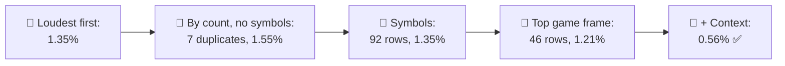
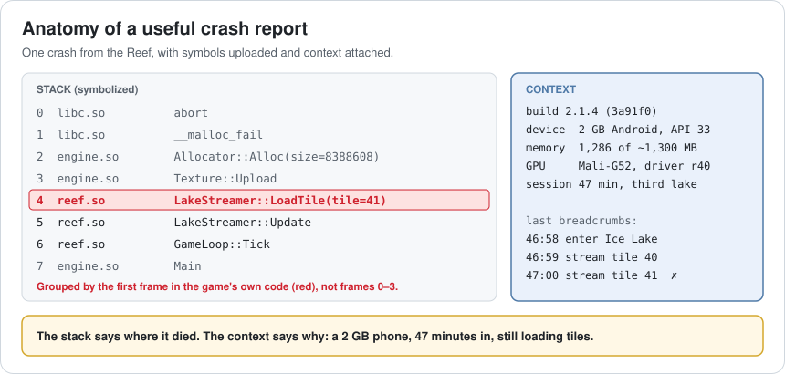
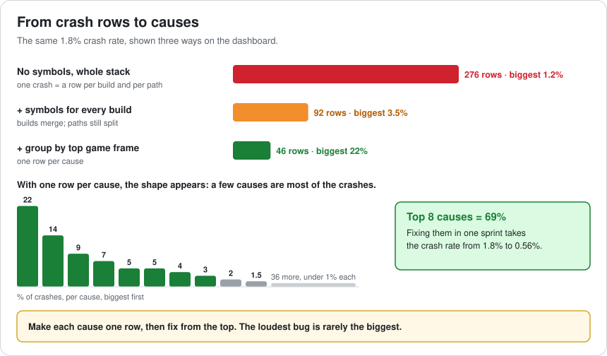
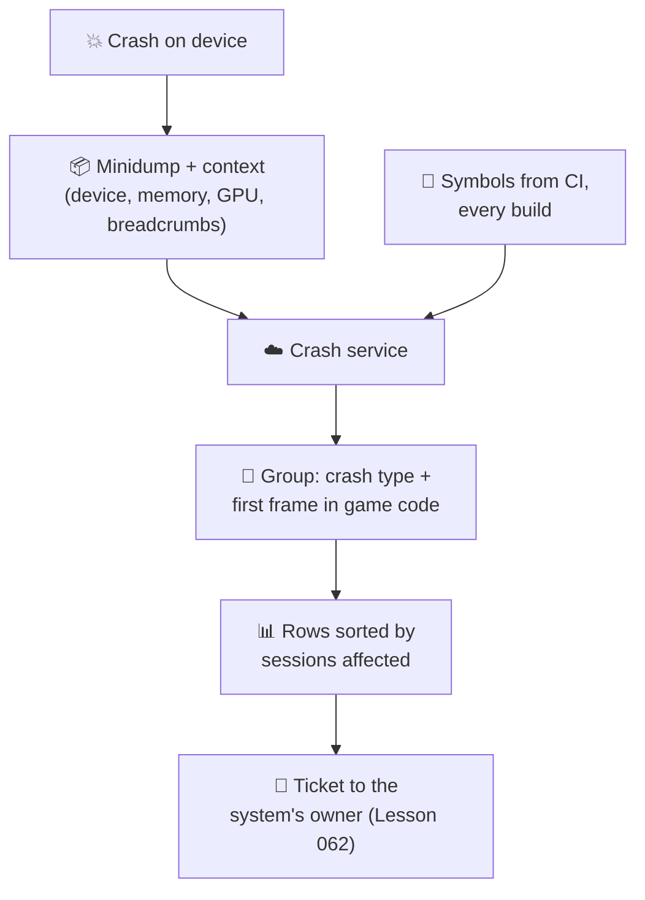
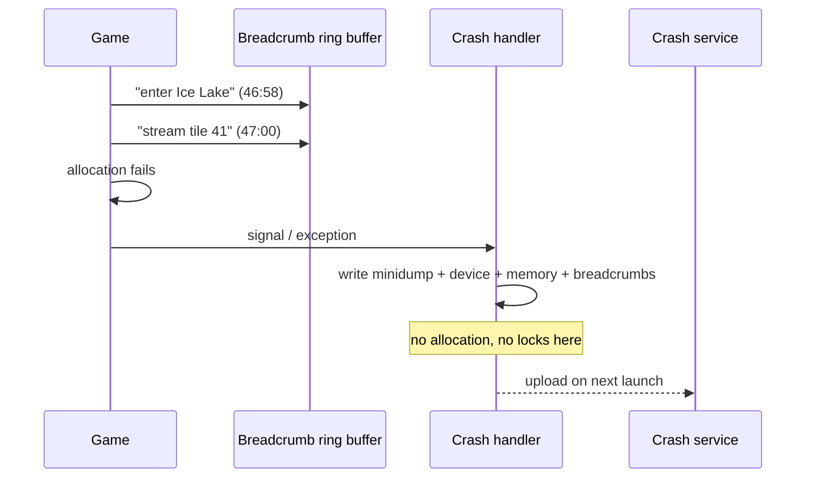
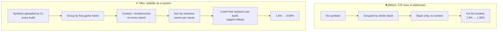

# Lesson 064 — Crash Analysis and Stability Engineering: The 276 Crashes That Were Really 46

> Module 6 · Platform & production performance · ~15 min read · 2026-11-01

**Today's goal:** turn a crash dashboard full of addresses into a short list of causes: upload symbols for every build, group crashes by the first frame in your own code, attach the context that makes a crash reproducible, and fix in order of sessions affected, not of noise.

### TL;DR
- **1.8%** of the Reef's sessions end in a crash. The dashboard shows **276** crash signatures, none bigger than **1.2%**. The team has one sprint and time for **8 fixes**, and picks what players post about: all fixed, but only **25%** of crashes (**1.35%**).
- Sorting by sessions doesn't help yet: without **symbols**, the same crash is a different row in each of the 3 live builds and each call path. The top 8 rows are **one crash**. Uploading symbols merges builds (**92** rows); grouping by the **top game frame** (skipping allocator and engine frames) gives **46 rows, one per cause**, and the biggest is **22%**.
- Three of the top causes (out of memory, a GPU driver crash, a streaming race) can't be fixed from a stack. With **context** on every report (device, memory, GPU and driver, breadcrumbs), the sprint fixes the **top 8 causes, 69% of crashes**: **1.8% → 0.56%**.

> 🎮 **Play with it: [Crash Triage Lab](https://yimo691.github.io/GameArchitect/demos/064-crash-triage-lab/)** — choose symbols, grouping, report context and how the 8 fixes are picked, and watch the crash dashboard and the crash rate after the sprint. Tap **Set up** on the steps to replay the lesson.



---

## 1. The problem

Three months after launch, the store page shows "crashes often" in reviews. The numbers:

```
Crash dashboard · Reef · last 7 days
Sessions:               2.1 million
Sessions with a crash:  1.8%
Distinct signatures:    276
Biggest signature:      0x7ff6a000... in libc.so   1.2% of crashes
Forum top threads:      "Turkish text crash", "friends list crash", "huge lake freeze"
```

The team has one two-week stability sprint and capacity for about **8 fixes**. Where do they start? The dashboard looks like 276 small problems. The forums point at three specific bugs. Neither tells them where most crashes come from.

Crash rate matters beyond annoyance: stores watch stability (Google Play's Android vitals flag apps with high crash rates, and that can affect how the game is shown), reviews mention it, and a crash usually loses the player's progress since the last save.

---

## 2. Step 1 — Symbols: from addresses to names

Analogy: a list of house numbers with no street names. "Number 41" could be anywhere until someone tells you which street.

A release build has no function names in it. A crash report from a player's device contains **addresses**: `0x7ff6b40a`. To turn them into `LakeStreamer::LoadTile`, you need the **symbol files** (PDB on Windows, dSYM on iOS, unstripped `.so` / mapping files on Android) of **that exact build**.

Without symbols uploaded for every build, two problems appear:

- Rows are unreadable: nobody can tell what a crash is.
- **The same crash is a different row in every build**, because addresses move whenever code changes. With 3 builds live at once, every crash appears 3 times.

The fix is a pipeline step, not a person: **CI uploads the symbols of every build it produces** to the crash service (Lesson 046), and keeps them for as long as that build can be played. In the lab: 276 → **92** rows.

---

## 3. Step 2 — Group by cause, not by whole stack

92 rows is still too many, because most crash services group by the **whole stack** by default. The out-of-memory crash happens wherever the game allocates: loading a texture, a mesh, an audio bank, a UI atlas. Twelve different stacks, twelve rows of 1.8% each. None of them looks important.



The fix is a **grouping rule**: skip frames that aren't the game's own code (the C library, the allocator, engine internals) and group by the **first frame in your code**, plus the crash type. Most crash services let you set this with "fingerprint" or "grouping" rules.

Now the dashboard has **46 rows, one per cause**, and the shape appears:



The top cause is **22%** of all crashes, the top 8 are **69%**, and 36 causes share the last 27.5%. This shape, a few causes making most of the crashes, is normal, and it's the reason sorting matters.



---

## 4. Step 3 — Context makes a crash fixable

With one row per cause, the team takes the top 8. Five get fixed: the hooked fish despawned during a scene change, the save version not migrated (Lesson 047), the audio voice pool (Lesson 052), the friends list, the network double free. Three don't:

- **Out of memory**: the stack says *where* the last allocation failed, not *why* memory was full.
- **GPU driver crash**: the stack ends inside the driver. Which GPU? Which driver version?
- **Streaming race**: the stack is the moment of the crash; the bug happened earlier, in another thread.

What's missing is **context**, collected before the crash and sent with the report:

- **Device**: model, OS version, total memory, GPU and driver version.
- **State**: memory used, current scene, session length, settings (quality tier).
- **Breadcrumbs**: the last 50 notable events ("enter Ice Lake", "stream tile 41", "open shop").

Now the out-of-memory row says: *2 GB phones, 47 minutes in, third lake, 1,286 MB of ~1,300 used, while loading lake tiles*. That's Lesson 057's budget being slowly exceeded by a streaming cache that never shrinks: fixable. The GPU row turns out to be one older GPU family on one driver version: a workaround for that driver. The streaming race shows two tiles loading in an order that never happens on fast devices.

With context, all 8 picks are fixed: the top 8 causes, **69%** of crashes. **1.8% → 0.56%**.



A crash handler runs when the process is already broken, so it must be simple: write to memory reserved in advance, no allocation, no locks, and send the report on the **next launch**.

---

## 5. Step 4 — Pick by sessions, and keep it fixed

Good data only helps if you sort by it. In the lab, with symbols, grouping and context all in place but the team still picking by forum noise, the crash rate ends at **1.35%**. The out-of-memory crash never appears on forums: for the player, the game just closes. Loud bugs are real, but rarely the biggest.

To keep stability from sliding back:

- **Track crash-free sessions** (and crash-free users) per build and per device class, on the same dashboard as performance (Lesson 055's telemetry).
- **Watch new builds**: compare a new build's top causes with the previous one in the first hours of a staged rollout; stop the rollout if a new cause jumps to the top.
- **Give each cause an owner**, the owner of the system its top frame belongs to (Lesson 062).
- **Keep the "fixed" promise**: a cause marked fixed should be gone in the next build; if it comes back, it reopens.

---

## 6. The architect's view

The junior fixes the crash on the forum. The optimizer opens the biggest row. The architect asks: **does each row on the dashboard mean one cause, does each report carry enough to fix it, and are we fixing in order of players affected?**



The architect's rules for crash analysis:

1. **Symbols for every build, automatically.** A build without symbols uploaded is not a release candidate.
2. **One row per cause**: group by crash type and first frame in your code.
3. **Context is part of the crash system**: device, memory, GPU, state, breadcrumbs.
4. **Fix by sessions affected**, and give each cause an owner.
5. **Watch every rollout**: crash-free sessions per build, with a stop button.

### Trade-offs

| Lever | Cost | Benefit | When to use |
|---|---|---|---|
| Symbol upload in CI | Storage, build time | Readable stacks, builds merge | Always |
| Custom grouping rules | Setup, occasional wrong merge | One row per cause | When default grouping splits crashes |
| Breadcrumbs | A little memory and CPU, privacy review | Crashes become reproducible | Always, without personal data |
| Full memory dumps | Large uploads, privacy | Every variable at the crash | Internal builds, rare hard crashes |
| Staged rollout | Slower release to everyone | New crashes caught at 5% of players | Every release |
| Fixing by forum volume | Little analysis | Visible goodwill | For communication, not for priorities |

---

## 7. Common mistakes

- **Not uploading symbols for a hotfix build.** Every crash from it becomes an unreadable new row.
- **Trusting default grouping.** One allocator crash split into twelve rows looks like twelve small problems.
- **Allocating in the crash handler.** The process is already broken; the handler crashes too, and you get nothing.
- **Logging personal data in breadcrumbs.** Events, not names, chat text or emails.
- **Fixing the loudest crash first.** The biggest crash often has no forum thread.
- **Marking "fixed" without checking the next build.** Some fixes only move the crash.

---

## 8. Quiz — think about it on the lift 🎿🎣

**Q1.** Without symbols, why did sorting by count pick 8 rows that were one crash?

<details><summary>Answer</summary>

Addresses differ in each build, so the hooked-fish crash appeared once per live build (3) and once per call path (4): 12 rows of about 1.2% each, the biggest rows on the dashboard. The top 8 were all the same cause, so 7 picks were duplicates.
</details>

**Q2.** With symbols, why was the out-of-memory crash still not in the top rows?

<details><summary>Answer</summary>

It was grouped by whole stack, and it fails in 12 different allocation paths (textures, meshes, audio...), so it was 12 rows of 1.8% each. Grouping by the first frame in game code (skipping allocator and engine frames) makes it one row of 22%.
</details>

**Q3.** What context turned the out-of-memory crash from "can't reproduce" into a fix?

<details><summary>Answer</summary>

Device (2 GB phones), memory used (1,286 of about 1,300 MB), session length (47 minutes) and breadcrumbs (loading lake tiles in the third lake). Together they pointed to a streaming cache that keeps growing over a long session.
</details>

**Q4.** Why should a crash handler not allocate memory or take locks?

<details><summary>Answer</summary>

The process is already in a broken state: the heap may be corrupted (or full, for out-of-memory), and another thread may hold the lock. Allocating or locking can crash or deadlock the handler, and no report is written. It should write to memory reserved in advance and upload on the next launch.
</details>

---

## 9. Back at the desk (≈45 min) — your crash map

> No desk today? Do it in the [Crash Triage Lab](https://yimo691.github.io/GameArchitect/demos/064-crash-triage-lab/): predict the crash rate after each step, then tap.

In your own project:

1. **Check symbols**: are they uploaded for your last three builds? Is it automatic?
2. **Open your top 20 crash rows**. How many are the same cause? Group them by hand.
3. **Find your grouping rule** in your crash service, and list the frames that should be skipped.
4. **Pick your three biggest causes** and write what context would have made each one reproducible.
5. **Add five breadcrumbs** at important moments (scene change, save, purchase, streaming, settings change).
6. Save `journal/064-crashes.md`:

| Cause (after grouping) | % of crashes | Rows it was split into | Context needed | Owner |
|---|---|---|---|---|
| | | | | |
| | | | | |
| | | | | |

One question for your journal: what is the biggest crash in your game that no player has ever posted about?

---

## 10. Vocabulary

| Term | Meaning | 中文 |
|---|---|---|
| Crash rate | Share of sessions (or users) that end in a crash | 崩溃率 |
| Crash-free sessions | Share of sessions with no crash | 无崩溃会话率 |
| Stack trace | The list of functions active when the crash happened | 调用栈 |
| Debug symbols | Files that map addresses to function names | 调试符号 |
| Symbolication | Turning addresses into function names and lines | 符号化 |
| Crash signature | How the crash service identifies "the same crash" | 崩溃签名 |
| Grouping / fingerprint | The rule that decides which crashes are one row | 聚类规则（指纹） |
| Minidump | A small file with the crash state of a process | 小型转储 |
| Breadcrumbs | Recent events recorded to explain a crash | 面包屑（事件轨迹） |
| Staged rollout | Releasing a build to a small share of players first | 分阶段发布 |

---

## 11. Further reading

- **Firebase Crashlytics documentation** — "Get readable crash reports" (uploading symbols / mapping files) and "Customize your crash reports" (custom keys, logs, breadcrumbs).
- **Sentry documentation — "Issue Grouping"** and **"Fingerprint Rules"**: how crashes become rows, and how to change it.
- **Google Play Console Help — "Android vitals"**: crash rate, ANR rate, and how stores look at stability.
- **Microsoft Learn — "Using the WinDbg debugger"** and **"Minidump files"**: reading a minidump with symbols on Windows.

---

**Tomorrow — Lesson 065: Managing technical debt and refactoring legacy code.** The Reef's fishing code is 4 years old: every new lure takes two weeks and breaks something else. A full rewrite is proposed. We learn how to measure debt, pay it down while still shipping, and replace old code piece by piece instead of all at once.
