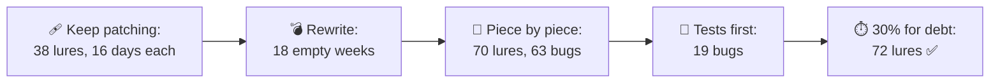
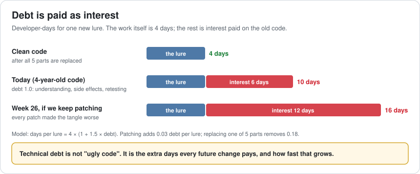
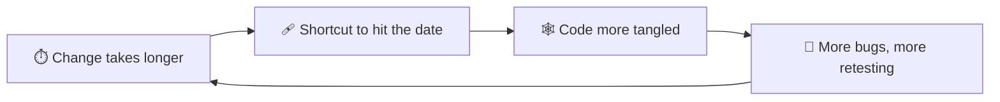
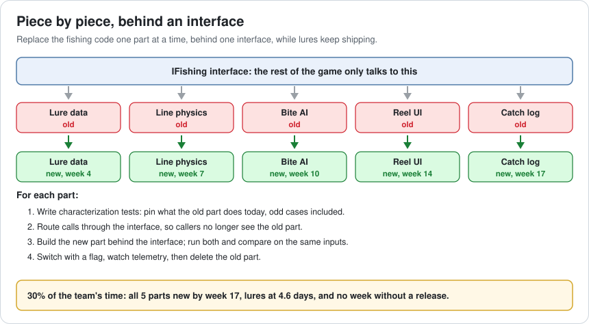
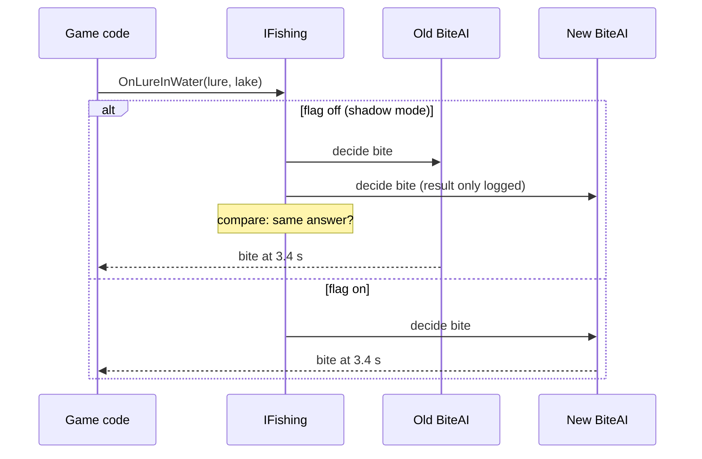
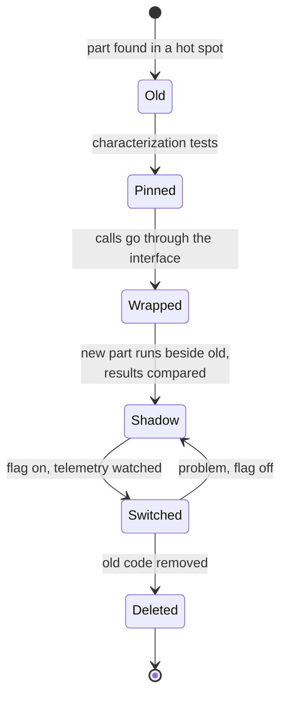
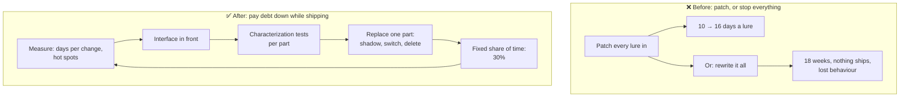

# Lesson 065 — Managing Technical Debt and Refactoring Legacy Code: The Rewrite That Shipped Nothing for 18 Weeks

> Module 6 · Platform & production performance · ~15 min read · 2026-11-01

**Today's goal:** measure technical debt as the extra time every change costs, see why patching forever and rewriting everything both lose, and pay debt down piece by piece: characterization tests first, an interface in front, one part replaced at a time, with a fixed share of the team's time.

### TL;DR
- The Reef's fishing code is 4 years old. A new lure takes **10 developer-days** of which only **4** are the lure itself; the other 6 are **interest** paid on tangled code. Patching on top makes it worse: in 26 weeks the team ships **38 lures**, a lure costs **16 days** by the end, and **48 bugs** reach players.
- The proposed **rewrite**, estimated at 120 days, takes **240**: hidden behaviour must be rediscovered, and 30% of the team still runs the live game. **18 weeks with nothing new**, 34 lures, and **15 behaviours players relied on** gone.
- **Piece by piece** behind an interface, with **characterization tests** first and **30%** of the time for debt: all 5 parts replaced by **week 17**, lures at **4.6 days**, **72 lures**, **20 bugs**, and not one empty week.

> 🎮 **Play with it: [Debt Lab](https://yimo691.github.io/GameArchitect/demos/065-debt-lab/)** — choose patching, a rewrite or piece-by-piece replacement, tests or none, and the share of time for debt, and watch 26 weeks of the fishing team. Tap **Set up** on the steps to replay the lesson.



---

## 1. The problem

The fishing code is where the Reef began, four years ago, as a prototype that never stopped growing:

```
fishing/ · 4 years old · 31,000 lines
FishingController.cs         6,800 lines, 140 public methods
Changes in the last 6 months touching ≥ 5 files: 82%
Average time for a new lure: 10 dev-days (estimate was 3)
Bugs found after release in fishing: 2 per new lure, on average
Team proposal: "Let's rewrite it. 6 weeks, then everything is fast."
```

The team is right that the code is costing them. The question is what to do about it without stopping the game. Live updates go out every week, and players expect new lures.

---

## 2. Step 1 — Measure debt as interest

Analogy: a loan. You still have the money you borrowed (the game works), but every month you pay interest. Technical debt is the same: the code works, and every change pays extra.

"The code is ugly" isn't a measurement. These are:

- **Time per typical change**: a lure, today 10 days, of which about 4 are the lure itself (design data, a model, a behaviour). The other 6 are understanding the code, working around side effects and retesting.
- **Change spread**: how many files a typical change touches (82% of changes touch 5 or more).
- **Bugs after release per change**, and where they come from.
- **Hot spots**: files that change most *and* are most complex. Version control history shows them in minutes.



And interest compounds. Every patch on top of the tangle adds a little more: in the model, 0.03 debt per lure. After 26 weeks of patching, a lure costs **16 days**. The team gets slower every month without anyone deciding it should.



---

## 3. Step 2 — Why the big rewrite loses

The rewrite proposal says 6 weeks (120 developer-days for the team of 4). Three things happen to most rewrites of live code:

- **Hidden behaviour.** Four years of fixes are encoded in odd lines: the bite timer that waits 0.2 s longer in rain, the reel that ignores input during a cut-scene. Nobody wrote them down; the new code must rediscover them, usually from bug reports. The estimate doubles: **240 days**.
- **The old code still runs the game.** Live events need fixes and small features *in the old code*: 30% of the team is never on the rewrite.
- **Nothing ships until it's all done.** The new code can't go live until it does everything the old one did.

In the lab: **18 weeks with nothing new**, then lures cost 4.6 days, but only **34** ship in the half-year, and **15** behaviours players relied on are missing at launch. With tests written first, the rewrite is safer (9 bugs) but even later: 19 empty weeks, 30 lures.

Rewrites aren't always wrong: for a small, well-understood part, or when the platform underneath changes completely, they can be the right call. But "the whole system, all at once, while live" is the riskiest version.

---

## 4. Step 3 — Piece by piece, behind an interface

The alternative is often called the **strangler fig** pattern (after a plant that grows around a tree until it replaces it):

1. Put an **interface** in front of the whole fishing system (`IFishing`). The rest of the game only talks to the interface.
2. Split the old code behind it into parts: lure data, line physics, bite AI, reel UI, catch log.
3. Replace **one part at a time**: build the new part behind the interface, switch to it with a flag, delete the old part.
4. Keep shipping lures the whole time, using whichever part is current.



With 20% of the team's time on this, all 5 parts are replaced during the half-year, and lures ship every week: **70 lures**, 4.6 days each by the end. But **63 bugs** reach players. Each swap changed behaviour nobody knew about, the same problem as the rewrite, in smaller pieces.



---

## 5. Step 4 — Pin behaviour first, and budget the time

**Characterization tests** (a name from Michael Feathers) don't check what the code *should* do. They record what it *does* today: given this lure, this lake, this weather, the bite comes at 3.4 s. Write them before touching a part, including the odd cases. Then the new part must pass the same tests, or someone decides on purpose that the behaviour changes.

Running old and new side by side on the same inputs (**shadow mode**, as in the diagram above) catches what the tests missed, using real play.

Tests make each part cost 20 days instead of 16, and bugs drop from 63 to **19**. But with 20% of the time, the debt work pays back late: **59 lures**, just short of the goal.

The last lever is **how much time debt gets**, decided up front, not "when there's time". With **30%**: parts are replaced at weeks 4, 7, 10, 14 and 17; lures cost 4.6 days from week 17 on; **72 lures, 20 bugs**. More lures than patching, and not one week without a release.



**Delete** the old part when the new one is live. Two implementations kept "just in case" double the debt.

---

## 6. The architect's view

The junior patches the next lure in. The optimizer proposes a rewrite. The architect asks: **what does the debt cost per change, which parts cost most, and how do we replace them while still shipping every week?**



The architect's rules for technical debt:

1. **Measure debt as interest**: time per typical change, change spread, bugs per change, hot spots.
2. **Pay down where you change most**: debt in code nobody touches costs nothing.
3. **Pin behaviour before changing it**: characterization tests, then shadow mode.
4. **Replace piece by piece behind an interface**, and delete the old part.
5. **Give debt a fixed share of time**, agreed with production, and show the payback in days per change.

### Trade-offs

| Lever | Cost | Benefit | When to use |
|---|---|---|---|
| Keep patching | Interest grows every change | No up-front cost | Code that will be retired soon |
| Big rewrite | Long gap, lost behaviour, estimate risk | Clean design in one go | Small, well-understood parts; platform changes |
| Strangler / piece by piece | An interface, some duplicate work during the switch | Shipping never stops; risk in small steps | Large live systems |
| Characterization tests | Days per part | Behaviour changes become decisions | Before touching any legacy part |
| Shadow mode | Running both, comparing results | Real-world check before switching | Logic with many hidden cases |
| Fixed debt share | Fewer features at first | Faster features later | When interest is a large part of each change |

---

## 7. Common mistakes

- **"We'll clean it up when there's time."** There never is; give it a share of every sprint.
- **Measuring debt by how ugly the code looks.** Measure the days it adds to real changes.
- **Rewriting a live system all at once.** The gap and the lost behaviour cost more than the debt.
- **Refactoring without tests.** Every behaviour change becomes a bug report.
- **Keeping the old code "just in case".** Now there are two systems to maintain.
- **Paying debt in code nobody changes.** Start with hot spots.

---

## 8. Quiz — think about it on the lift 🎿🎣

**Q1.** A lure is 4 days of real work and costs 10. What does the model say it costs after 20 more patched lures?

<details><summary>Answer</summary>

Debt grows by 0.03 per lure: `1.0 + 20 × 0.03 = 1.6`. Cost = `4 × (1 + 1.5 × 1.6) = 13.6` days. Interest went from 6 to 9.6 days per lure.
</details>

**Q2.** The rewrite was estimated at 120 days. Why did it take 240, and why did nothing ship for 18 weeks?

<details><summary>Answer</summary>

Four years of hidden behaviour had to be rediscovered, which doubled the work, and 30% of the team stayed on the live game, so only 14 developer-days a week went to the rewrite: `240 ÷ 14 ≈ 17.1`, finishing in week 18. The new code couldn't ship until it did everything the old code did.
</details>

**Q3.** What is a characterization test, and why did it cut bugs from 63 to 19?

<details><summary>Answer</summary>

A test that records what the code does today (not what it should do), including odd cases. Replacing a part must keep those results, so behaviour that players relied on isn't lost by accident. Changes in behaviour become decisions instead of bugs.
</details>

**Q4.** Why does 30% of the time for debt ship more lures in 26 weeks than 20%?

<details><summary>Answer</summary>

The parts get replaced sooner (all 5 by week 17 instead of later), so lures cost 4.6 days for more of the half-year. The extra time spent early is paid back by cheaper lures in the remaining weeks: 72 lures instead of 59.
</details>

---

## 9. Back at the desk (≈45 min) — your debt map

> No desk today? Do it in the [Debt Lab](https://yimo691.github.io/GameArchitect/demos/065-debt-lab/): predict lures, cost and bugs for each step, then tap.

In your own project:

1. **Find hot spots**: list the 10 files changed most in the last 6 months (`git log --format= --name-only | sort | uniq -c | sort -rn | head`). Mark the ones that are also large or complex.
2. **Time one typical change** in a hot spot: how much was the feature, how much was the code around it?
3. **Pick one part** and write five characterization tests for it.
4. **Design the interface** that would sit in front of it.
5. **Propose a debt share** and the payback you expect in days per change.
6. Save `journal/065-debt.md`:

| Hot spot | Changes in 6 months | Days per typical change | Interest (days) | First part to replace |
|---|---|---|---|---|
| | | | | |
| | | | | |
| | | | | |

One question for your journal: which part of your code would you be most afraid to change today, and what test would make you less afraid?

---

## 10. Vocabulary

| Term | Meaning | 中文 |
|---|---|---|
| Technical debt | Extra cost every future change pays because of past shortcuts | 技术债 |
| Interest | The extra days a change takes because of the debt | 利息 |
| Legacy code | Old code that is hard to change safely | 遗留代码 |
| Refactoring | Changing code's structure without changing what it does | 重构 |
| Rewrite | Replacing a whole system with new code at once | 重写 |
| Strangler fig pattern | Replacing a system piece by piece behind an interface | 绞杀者模式 |
| Characterization test | A test that records what code does today | 特征测试 |
| Shadow mode | Running new code beside old and comparing results | 影子模式 |
| Feature flag | A switch that turns a code path on or off without a new build | 功能开关 |
| Hot spot | Code that changes often and is complex | 热点代码 |

---

## 11. Further reading

- **Michael Feathers, *Working Effectively with Legacy Code*** (2004): characterization tests and how to get legacy code under test.
- **Martin Fowler, "Strangler Fig Application"** (bliki): replacing a system piece by piece.
- **Martin Fowler, *Refactoring* (2nd ed., 2018)**: small, safe structural changes.
- **Joel Spolsky, "Things You Should Never Do, Part I"** (2000): the classic warning about rewriting from scratch.
- **Ward Cunningham, "The WyCash Portfolio Management System"** (OOPSLA 1992 experience report): where the debt metaphor comes from.

---

**Tomorrow — Lesson 066: Review, Module 6.** Ten lessons on platforms and production: memory, heat, pacing, shaders, certification, budgets, tests, crashes and debt. We put them together on one launch week of the Reef and see which problems each tool would have caught first.
