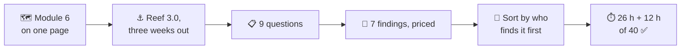
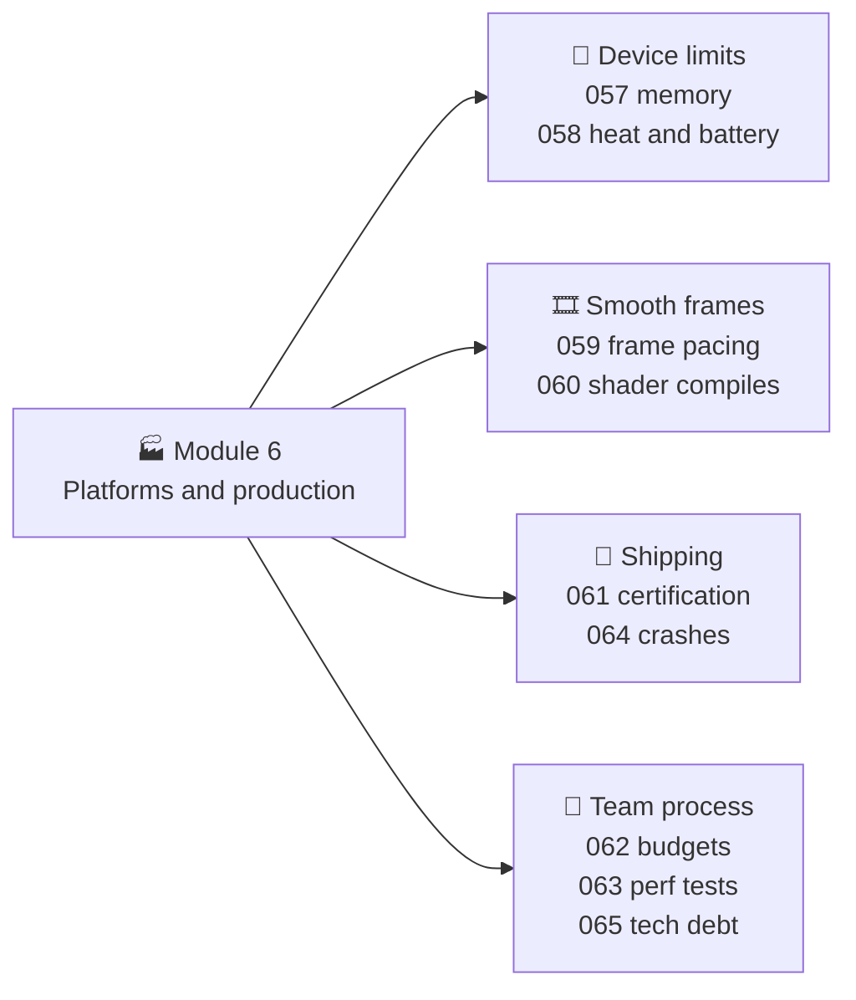
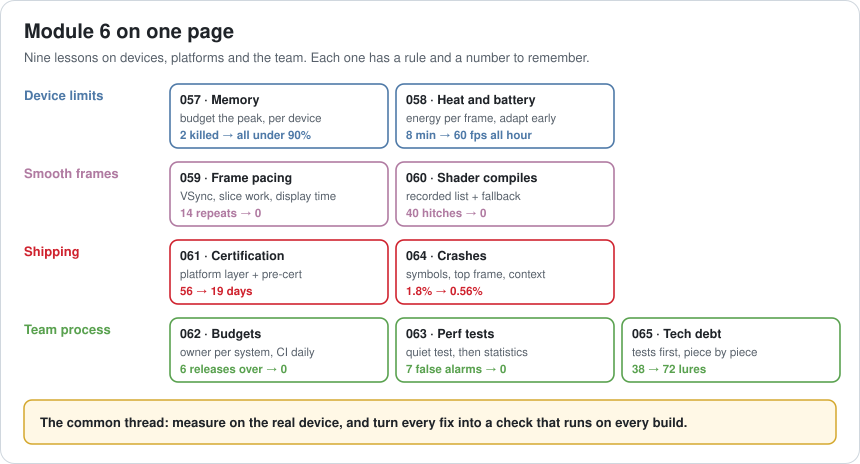
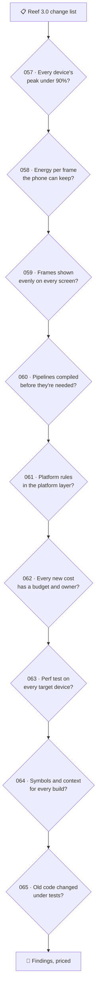
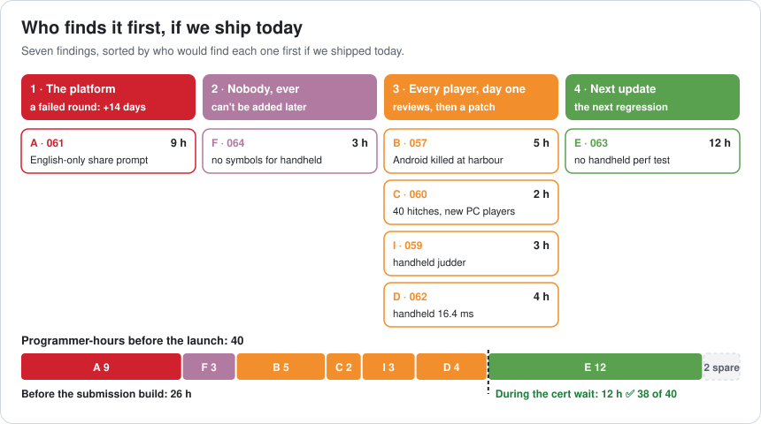
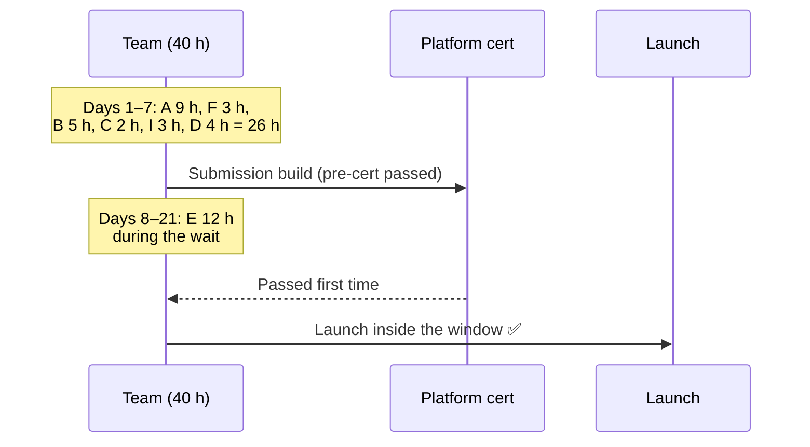
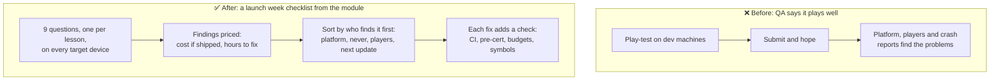

# Lesson 066 — Review: Module 6 + Launch Week Exercise: The Reef Comes to the Handheld

> Module 6 · Platforms and production · ~20 min read · 2026-11-01

**Today's goal:** put the nine Module 6 lessons on one page, then use them as a checklist on one launch: find every problem in the Reef's handheld and harbour release, price each one, and sort the work by **who would find it first** if we shipped today.

### TL;DR
- Every Module 6 lesson gives you **one rule and one number**: budget the peak per device (2 phones killed → all under 90%, 057), spend energy per frame you can keep (60 fps for the whole hour, 058), fix what the screen shows (14 repeats → 0, 059), compile pipelines before they're needed (40 hitches → 0, 060), and so on.
- Today's case: **Reef 3.0**, the harbour update and the first handheld console release, three weeks before launch. Nine questions find **seven findings** and two clean answers.
- Sort by who finds it first. The **platform** would find one (a failed round costs **14 days**). **Nobody** could ever fix one later (crashes without symbols). **Every player** would find four on day one. One only hurts the **next update**. In that order: **26 hours** before the submission build, **12 hours** during the certification wait, **38 of 40** ✅.

> 🎮 **Play with it:** the [Memory Budget Lab](https://yimo691.github.io/GameArchitect/demos/057-memory-budget-lab/), [Budget Board Lab](https://yimo691.github.io/GameArchitect/demos/062-budget-board-lab/), [Perf Test Lab](https://yimo691.github.io/GameArchitect/demos/063-perf-test-lab/) and [Crash Triage Lab](https://yimo691.github.io/GameArchitect/demos/064-crash-triage-lab/) each have a new **Lesson 066 · Challenge** group: read the step, predict the numbers, then tap **Set up** and check.



---

## 1. Module 6 on one page

Module 5 was about systems: builds, servers, runtime systems, tools. Module 6 was about the places a game actually runs and the team that keeps it running: **real devices** with memory and heat limits, **real screens** that show frames on a fixed rhythm, **platforms** with their own rules, and a **team process** that keeps all of it true week after week.





| Lesson | Story | Rule | Number |
|---|---|---|---|
| 057 | The build that died on two phones | Budget the peak, per device class; tiers and render scale; budgets in CI | 2 devices killed → all under 90% |
| 058 | The phone that got slow after 8 minutes | Energy per frame is the budget; adapt before the phone throttles | 60 fps for 8 min → for the whole hour |
| 059 | The "60 fps" that felt choppy | VSync, slice heavy work, move by display time | 14 repeated frames → 0 |
| 060 | The hitch only new players feel | Recorded pipeline list at start-up, background compile with a fallback | 40 hitches → 0, in 0.74 s |
| 061 | What certification checks | Platform layer, shared services, terms table, pre-cert in-house | 4 rounds, 56 days → 1 round, 19 days |
| 062 | The frame time nobody owned | A budget per system with an owner; CI tells them the same day | 6 releases over budget → 0 |
| 063 | The alarm that cried wolf | Quiet the test first, then median of 5 against a rolling baseline | 7 false alarms → 0; caught on build 14 |
| 064 | 276 crashes that were really 46 | Symbols, group by top game frame, context, sort by sessions | 1.8% → 0.56% |
| 065 | The rewrite that shipped nothing | Characterization tests, an interface, one part at a time, 30% of time | 38 → 72 lures, 48 → 20 bugs |

The common thread: **measure on the real device, and turn every fix into a check that runs on every build.** A fix without a check is a finding that comes back.

---

## 2. The case: Reef 3.0, three weeks out

Reef 3.0 adds a **harbour** (a new scene you sail into), a **photo mode** with a share button, and the Reef's first release on a **handheld console**, at the same time as the PC and phone updates. The platform's launch window opens in 21 days.

**Lena**, the producer: "QA says the harbour plays well on every device. Can we submit next week?" The team has **40 programmer-hours** left before launch. The submission build must be ready in 7 days; the platform's check takes about 14 days after that.

The facts the review finds, one per lesson:

```
Reef 3.0 launch review · facts
057  Harbour streams in while the lake is still loaded       Android peak 1,386 MB of 1,300
058  Harbour reuses the lake water shader                    46 mJ a frame; adaptive quality on
059  Handheld: VSync on, camera moves by the CPU clock        25 uneven steps a second
060  New PC build target: default pipeline settings          no recorded list: 40 hitches, 179 ms
061  Photo mode: "Press A to share" typed into the screen    terms table not used
062  Harbour boats on the handheld: 0.6 ms, no budget line    frame 16.4 ms of 16.0
063  Performance tests run on PC only                         no handheld test machine
064  Handheld build: no symbol upload step                    crashes arrive as addresses
065  Harbour shop goes through the new inventory interface   characterization tests pass
```

---

## 3. Step 1 — Walk the checklist

Each lesson becomes one question. Ask **all nine**, and write down the "no" answers too.



| # | Finding | Cost if shipped | Fix | Hours |
|---|---|---|---|---|
| A · 061 | Photo mode types "Press A to share" instead of asking the terms table | A failed certification round: **+14 days**, past the 21-day window | Use the terms table; run in-house pre-cert on the handheld build | 3 + 6 = 9 |
| B · 057 | Harbour loads while the lake is still loaded | Android peak `1,086 + 300 = 1,386 MB` of 1,300 (107%): killed on every harbour trip | Transition scene, unload first: `1,086 + 60 = 1,146 MB` (88%); add the harbour route to the CI peak check | 5 |
| C · 060 | New PC build target lost the recorded pipeline list | 40 hitches for every new PC player, 179 ms at the first lake | Restore the list and background compile; CI fails if the shipped list has fewer than 270 entries | 2 |
| D · 062 | Harbour boats cost 0.6 ms on the handheld, with no budget line | 16.4 ms of 16.0: dropped frames in the harbour | Harbour team owns a 0.4 ms line; they pool boats (0.6 → 0.4) and the VFX owner trades 0.2 ms | 4 |
| E · 063 | No performance test on the handheld | The next handheld regression ships unseen | A dedicated devkit with fixed path, warm-up, median of 5 | 12 |
| F · 064 | Handheld build uploads no symbols | Every crash from the launch build stays an address, forever | Add the upload; the build fails if it fails | 3 |
| I · 059 | Handheld camera moves by the CPU clock | 25 uneven steps a second: the judder 059 fixed on PC is back | Move by the display time from the platform layer | 3 |

Two "no" answers: 058, because the harbour water costs the same 46 mJ a frame as the lake and adaptive quality already holds 2.2 W; and 065, because the harbour shop goes through the new inventory interface and the characterization tests pass.

---

## 4. Step 2 — Sort by who finds it first

Lesson 056 sorted by what **can't be undone**. That still matters, but Module 6 adds a sharper question: **if we ship today, who finds each problem first, and what does it cost when they do?**

1. **The platform.** A failed certification round costs about **14 days**, and the launch window is 21. One finding (A) moves the date, so it goes first even though it's the most expensive.
2. **Nobody, ever.** Symbols must come from the exact build that shipped. If the launch build has none, its crashes can never be grouped or read. (F) is cheap, but it can't be added later.
3. **Every player, on day one.** Android players killed at the harbour (B), new PC players hitching (C), handheld judder (I) and dropped frames (D). Crashes first, then the cheapest.
4. **The next update.** A missing handheld performance test (E) doesn't hurt this launch. It lets the next regression through.





Total: **38 h** of the 40 available ✅. If the estimate is wrong by 20%, what slips is E, the one finding that doesn't touch this launch's players, and it can be finished in the first week after launch.

Notice that every fix comes with its **check**: a pre-cert run, a symbol upload that fails the build, the harbour route in the memory check, a minimum size for the pipeline list, a budget line on the board, a test machine. That's what makes Reef 3.1 cheaper to review than 3.0.

---

## 5. The architect's view

The junior asks "does it work on my machine?". The optimizer asks "which system is slowest?". The architect asks: **who will find this first, what will it cost them, and which check will catch it on the next build without anyone remembering?**



### Trade-offs

| Choice | Cost | Benefit | When to use |
|---|---|---|---|
| Fix what the platform would find first | Players' problems wait a few days | The date holds | Any certified platform |
| Fix "can't add later" items early | Small items jump the queue | No blind launch week | Symbols, save formats, telemetry |
| Test on every target device | Devkits, machine time | Device-only problems found in CI | Every new platform |
| Submit after in-house pre-cert | ~5 days and a few hours | Pass the first round | Every submission |
| Leave the guardrail for the cert wait | Risk if the estimate is wrong | Launch fixes first | When hours are tight |

---

## 6. Common mistakes

- **Testing on the dev machine only.** Memory, heat, pacing and shader compiles are all device problems.
- **Treating a new platform as "just another build".** It needs its own symbols, perf test, budgets and platform layer entries.
- **Fixing what QA noticed first.** QA plays warm builds on fast hardware; new players and cheap phones find different problems.
- **Assuming last module's fixes carry over.** The 059 fix was PC-only; the 060 fix lived in a build setting a new target didn't copy.
- **A fix without a check.** The same finding returns in 3.1.
- **Skipping the "no" answers.** Then nobody knows if thermal was checked or forgotten.

---

## 7. Quiz — ten questions on the ferry ⛴️

**Q1 (057).** The harbour scene is 300 MB. Why does a transition scene bring Android from 1,386 to 1,146 MB?

<details><summary>Answer</summary>

With the lake still loaded, the peak is `1,086 + 300 = 1,386 MB`. Unloading the lake first and showing a small transition scene costs only 60 MB: `1,086 + 60 = 1,146 MB`, 88% of 1,300. The steady state never changed; the peak did.
</details>

**Q2 (057).** CI already checks memory budgets per device. Why didn't it catch finding B?

<details><summary>Answer</summary>

The check loads the heaviest scenes it knows about, and the lake-to-harbour route wasn't on its list. A budget check only covers the peaks you tell it about, so new scene changes must be added to it.
</details>

**Q3 (058).** The harbour water costs 46 mJ a frame, the same as the lake. Why is this a "no" answer, and what would make it a "yes"?

<details><summary>Answer</summary>

Adaptive quality trims render scale by 20%: `46 × 0.8 ≈ 36.7 mJ`, and `36.7 mJ × 60 = 2.2 W`, what the phone can cool. If the harbour cost 52 mJ, the same trim gives `41.6 mJ × 60 ≈ 2.5 W`, over 2.2 W, and the phone throttles again.
</details>

**Q4 (059).** The handheld has VSync on and no missed refreshes. Why does the camera still judder?

<details><summary>Answer</summary>

The camera moves by the CPU clock, which wakes up a little late by a different amount each frame, while the screen shows frames exactly 16.7 ms apart: 25 uneven steps a second. Moving by the display time makes each step match what the screen shows.
</details>

**Q5 (060).** Why didn't anyone on the team see the 40 hitches?

<details><summary>Answer</summary>

The driver caches compiled pipelines, so everyone who had played before had them already. Only a new player, or a test that clears the cache, sees the first-time compile. That's why the fix includes a CI check on the list itself.
</details>

**Q6 (061).** Finding A is one hard-coded string. Why fix it with the terms table and a pre-cert run instead of just changing the string?

<details><summary>Answer</summary>

The string is a symptom: a screen bypassed the platform layer. Changing the text fixes one screen; using the terms table fixes the class of problem, and pre-cert (a 5-day in-house round) finds the next one before the platform's 14-day round does.
</details>

**Q7 (062).** The harbour costs 0.6 ms on the handheld and nobody owns it. Why not just ask the optimizer team to find 0.4 ms somewhere?

<details><summary>Answer</summary>

Then the cost has no owner and comes back next update. A budget line owned by the harbour team means they pay for their own feature (0.6 → 0.4 ms), and the 0.2 ms from VFX is a trade both owners agreed, recorded on the board.
</details>

**Q8 (063).** The handheld test runs once and compares with the last build. Why might a real 0.4 ms regression only be flagged three builds late?

<details><summary>Answer</summary>

One run against one other run still swings by a few tenths of a millisecond, so the regression can hide in that noise for a while. The median of 5 runs against the median of the last 10 builds sees it on the day it lands. (Try it in the Perf Test Lab challenge.)
</details>

**Q9 (064).** Why is "no symbols for the handheld build" sorted before the day-one player problems?

<details><summary>Answer</summary>

Symbols must match the exact build that shipped. If the launch build has none, every crash from it stays an unreadable address forever, and the first week's crash data is wasted. Player problems can still be patched; this can't be added later.
</details>

**Q10 (065).** The harbour shop is new code on top of the inventory. Why is it a "no" answer?

<details><summary>Answer</summary>

It goes through the new inventory interface from Lesson 065, and the characterization tests pass, so the old behaviour players rely on is checked on every build. That's what the debt work bought: a new feature that doesn't need its own investigation.
</details>

---

## 8. Back at the desk (≈60–90 min) — review your own launch

> No desk today? Do the **Lesson 066 · Challenge** steps in the Memory Budget, Budget Board, Perf Test and Crash Triage Labs: predict every number before you tap.

For your next release (or the last one you shipped):

1. **List every target device** and every platform you ship on.
2. **Ask the nine questions** from section 3 on each device. Write every answer, including "no".
3. **Price each finding**: cost if shipped, hours to fix.
4. **Name who finds it first**: the platform, nobody (can't be added later), players on day one, or the next update.
5. **Order** by that, then by cost, and check it fits before your submission or release build.
6. For each fix, **name the check** that stops it coming back.
7. Save `journal/066-launch-week.md`:

| # | Finding | Who finds it first | Cost if shipped | Hours | Check added |
|---|---|---|---|---|---|
| | | | | | |
| | | | | | |
| | | | | | |

One question for your journal: which of your target devices has no automatic test at all, and what is the cheapest check you could add for it?

---

## 9. Vocabulary

| Term | Meaning | 中文 |
|---|---|---|
| Target device | A device class the game must run well on | 目标设备 |
| Submission build | The build sent to the platform for certification | 提审版本 |
| Launch window | The dates when the platform will release the game | 上线窗口 |
| Pre-certification | Checking platform rules in-house before submitting | 预认证 / 内部预审 |
| Guardrail | An automatic check that stops a known mistake | 护栏 / 防线 |
| Device-only problem | A problem that only appears on real hardware | 真机问题 |
| Symbol file | Data that turns crash addresses into function names | 符号文件 |
| Triage | Sorting problems by who is hurt and how much | 分诊 / 分级处理 |
| Go / no-go | The final decision to ship or wait | 上线决策 |
| Checklist | A fixed list of questions asked every time | 检查清单 |

---

## 10. Further reading

- **Atul Gawande — "The Checklist Manifesto"** (2009): why short checklists catch what experts forget.
- **Google — "Site Reliability Engineering"** (sre.google/books), chapters "Release Engineering" and "Launch Coordination Engineering": launch checklists for live services.
- **Lessons 057–065** of this course: each "architect's view" section is one entry of today's checklist.

---

**Tomorrow — Lesson 067: Writing technical design documents.** Module 7 begins: leading as an architect. The harbour started as a two-line request in chat, and three teams built three different ideas of it. We write one short design document that answers what, why, how and what it costs, before anyone writes code.
