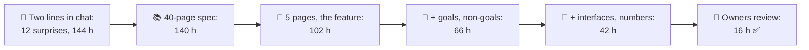
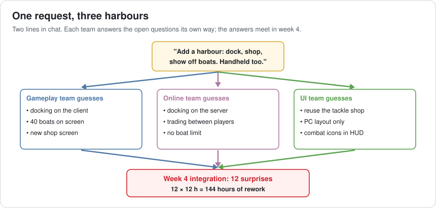
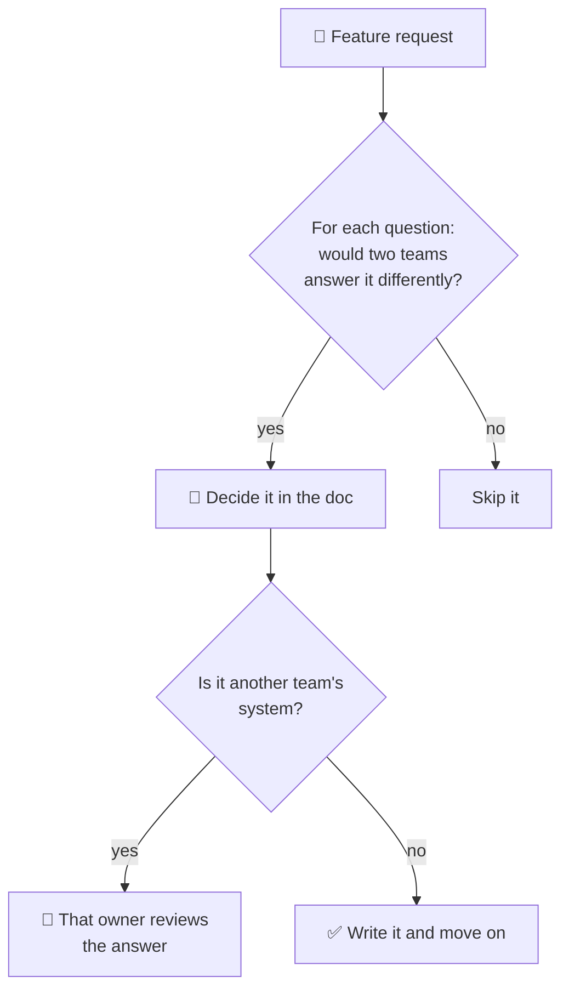
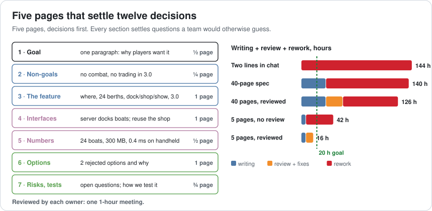
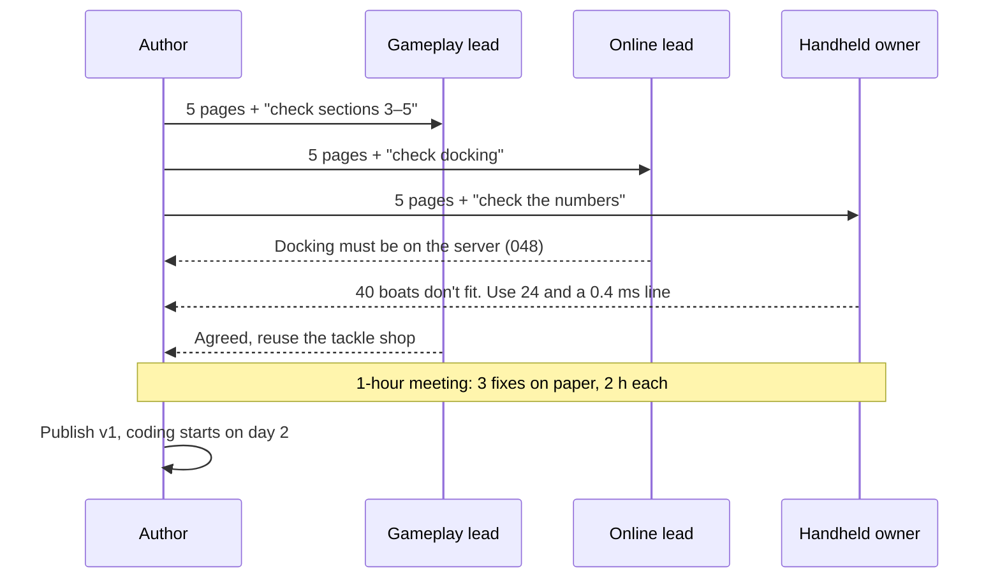
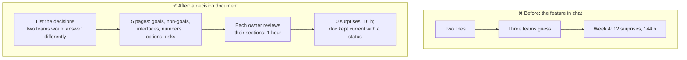

# Lesson 067 — Writing Technical Design Documents: Two Lines in Chat, Three Different Harbours

> Module 7 · The architect's craft · ~15 min read · 2026-11-01

**Today's goal:** learn to write a short technical design document that settles the decisions a feature needs before three teams build it: goals and non-goals, interfaces and numbers, the options you rejected, and a one-hour review by the owners of every system it touches.

### TL;DR
- The harbour for Reef 3.0 started as **two lines in chat**. Three teams (gameplay, online, UI) each filled the gaps their own way. The harbour needed **12 decisions**; at integration in week 4 every one of them was a **surprise**: **144 hours** of rework.
- A **40-page spec** answers all 12, but readers find only 6, and 3 of the answers are the author's wrong guesses about other teams' systems: **140 hours**. Reviewing it takes 10 days and still leaves 6 surprises: **126 hours**, and coding waits **14 days**.
- A **5-page document**, decisions first, with **goals and non-goals**, **interfaces and numbers**, and a **one-hour review by each owner**: **0 surprises, 16 hours** in all, coding starts after **2 days**.

> 🎮 **Play with it: [Design Doc Lab](https://yimo691.github.io/GameArchitect/demos/067-design-doc-lab/)** — choose no document, a 40-page spec or a 5-page doc, what goes in it, and whether owners review it, and see which of the harbour's 12 decisions are settled on paper and which become surprises. Tap **Set up** on the steps to replay the lesson.



---

## 1. The problem

Lena, the producer, posts in the team chat on a Monday:

```
Lena: Next big thing is a harbour! Players dock, shop and show off their boats.
      Handheld too. Can we have it playable in 4 weeks?
```

Three teams start that afternoon. Nobody is careless. Each team reads the same two lines and answers the questions they don't answer:

- **Gameplay** puts docking on the client (it feels instant), allows 40 boats on screen, and builds a new shop screen.
- **Online** puts docking on the server (Lesson 048: one decider per fact), adds trading between players because "showing off" sounds social, and sets no boat limit.
- **UI** reuses the tackle shop, lays out for PC only, and adds combat icons because every other zone has them.



In week 4 the parts meet. Every disagreement becomes rework: one team's code is thrown away or rebuilt to match another's. The harbour had **12** decisions to make, and every one turned into a surprise. At about **12 hours** each to untangle, that's `12 × 12 = 144 hours`, almost a programmer-month, and the harbour is late.

The obvious lesson is "write it down". The less obvious lesson is **what** to write, **how much**, and **who has to read it**.

---

## 2. Step 1 — List the decisions, not the feature

A design document isn't a description of a feature. It's a list of **decisions** that other people would otherwise make for you, differently. For the harbour there are twelve, in three groups:

| Group | Decisions |
|---|---|
| The feature (4) | Where is it? How many berths? What can players do there? When does it ship? |
| Goals and non-goals (3) | Combat in the harbour? Trading between players? Handheld in scope? |
| Interfaces and numbers (5) | Who decides docking? Boats on screen? Memory budget? Frame budget? Which shop screen? |

The first group is what everyone thinks of. It's also the group where teams are least likely to disagree: "a harbour where you dock and shop" already says most of it.

The second and third groups are where the 144 hours came from. **Non-goals** stop a team from building something nobody asked for (trading, combat). **Interfaces** say who owns which part and how the parts talk: docking is decided on the server, the client asks. **Numbers** turn "it should run well" into 24 boats, 300 MB and 0.4 ms on the handheld, the budgets Lessons 057 and 062 taught us to set.



The test for whether something belongs in the document is simple: **would two teams answer this question differently?** If yes, decide it on paper. If no, leave it out.

---

## 3. Step 2 — Why the 40-page spec loses

After the harbour, a senior programmer volunteers to write "the complete spec" for the next feature. It takes **32 hours** and **4 days**, and it's 40 pages long. Every one of the 12 decisions is in there.

Then people read it, or don't. In a 40-page document, a decision on page 31 is found by the people who read to page 31. In our model, readers find **6 of the 12** decisions. The other 6 are written but invisible. The author also guessed **3** answers about systems they don't own (docking on the client, 40 boats, no frame budget), and nobody who owns those systems read closely enough to object.

```
40-page spec · no review
written:       12 decisions       32 h, 4 days
not read:       6 surprises       6 × 12 = 72 h
wrong guesses:  3 surprises       3 × 12 = 36 h
total:                            32 + 108 = 140 h
```

The fix seems to be a review. Owners are asked to read all 40 pages and comment. That costs each of 4 owners about 4 hours (**16 hours**), and finding 4 hours in four busy calendars takes **10 days**. They catch the 3 wrong guesses (2 hours each to fix on paper), but they skim the rest too: the 6 buried decisions still go unread.

```
40-page spec · reviewed
writing 32 h + review 16 h + fixes 3 × 2 h = 54 h
rework 6 × 12 h = 72 h
total 126 h · coding starts after 4 + 10 = 14 days
```

Long documents fail in two ways: they're **expensive to write**, and they **hide decisions in detail**. A reader can't tell which sentence is a decision and which is background.

---

## 4. Step 3 — Five pages, decisions first

The harbour document gets rewritten in a different shape: **five pages**, about **6 hours** to write, and every section exists to settle decisions.



| Section | What it settles | Length |
|---|---|---|
| 1. Goal | Why players want it; how we'll know it worked | ½ page |
| 2. Non-goals | No combat, no player trading in 3.0 | ¼ page |
| 3. The feature | East shore, 24 berths, dock / shop / show, ships in 3.0 | 1 page |
| 4. Interfaces | Server decides docking; the shop reuses the tackle shop screen | 1 page |
| 5. Numbers | 24 boats, 300 MB with unload first, 0.4 ms on the handheld | ½ page |
| 6. Options considered | Two rejected designs and why | 1 page |
| 7. Risks and tests | Open questions; how we'll test it | ¾ page |

Watch what each part adds:

- **The feature alone** (sections 1 and 3): everyone reads it, and the 4 feature decisions are settled. But scope and connections aren't: **8 surprises**, `6 + 8 × 12 = 102 hours`.
- **Plus goals and non-goals**: no combat, no trading, the handheld is in. **5 surprises**: `6 + 60 = 66 hours`. A quarter of a page saved 36 hours.
- **Plus interfaces and numbers**: all 12 decisions on paper. But 3 are still the author's guesses about other teams' systems: **3 surprises**, `6 + 36 = 42 hours`.

**Options considered** doesn't add a decision in the lab, but it does real work: it shows reviewers what was rejected and why ("docking on the client: feels faster, but two players could dock in the same berth"), so the same idea doesn't come back in every meeting. Lesson 068 turns this section into a permanent record.

---

## 5. Step 4 — Owners review, briefly

The last 3 surprises are wrong guesses about systems the author doesn't own. Only the owners can catch them. So each team lead (gameplay, online, UI, the platform owner for the handheld) gets the 5 pages and one rule: **comment on the decisions that touch your system**, then one 1-hour meeting.



```
5-page doc · goals · interfaces · owners review
writing 6 h + review 4 h + fixes 3 × 2 h = 16 h
surprises 0 · rework 0 h
total 16 h · coding starts after 2 days   ✅
```

From **144 hours** to **16 hours**. The review is short because the document is short, and because each owner is asked about **their** sections, not the whole thing.

Two more habits keep the document useful after day 2:

- **One owner and a status at the top**: draft, in review, approved, replaced by. When the design changes, the document changes, or it says it's out of date.
- **Link, don't copy**: the memory budget lives on the budget board (Lesson 062); the document links to it, so there's one number, not two.

---

## 6. The architect's view

The junior asks "what should the harbour do?". The optimizer asks "how fast will it run?". The architect asks: **which decisions will three teams make differently if nobody makes them first, and who has to agree?**



A design document is cheap insurance with a known price. It's worth writing when **more than one team** builds the feature, when a decision is **hard to reverse** (a save format, a server protocol), or when it touches a **budget**. It's not worth it for a one-person, one-week change: a good commit message and a short chat thread do the job.

### Trade-offs

| Choice | Cost | Benefit | When to use |
|---|---|---|---|
| No document | Nothing up front | Fast start | One person, small, reversible |
| Long, complete spec | 32 h writing, days of review | Every answer exists somewhere | Contracts, external partners, certification evidence |
| Short decision doc | ~6 h writing | Gets read; settles what teams would guess | Most features that cross teams |
| Owners' review | ~1 h per owner, 1 day | Wrong guesses fixed on paper (2 h, not 12) | Whenever the doc touches someone else's system |
| Options considered section | ~1 page | Rejected ideas don't come back | Any decision people will question later |

---

## 7. Common mistakes

- **Describing the feature instead of deciding it.** "Players can dock" isn't a decision; "the server decides who docks in which berth" is.
- **No non-goals.** Every team adds what it imagines; non-goals are the cheapest lines in the document.
- **Writing everything.** Background, history and every edge case hide the 12 decisions that matter.
- **Asking everyone to review everything.** Point each owner at the sections that touch their system.
- **Guessing about other teams' systems and not asking.** The 3 wrong guesses are always outside the author's own code.
- **Letting the document go stale.** A wrong document is worse than none; keep a status line at the top.

---

## 8. Quiz — think about it on the ferry ⛴️

**Q1.** Why does every undecided question become a surprise when three teams build one feature?

<details><summary>Answer</summary>

Each team must answer it to write code, so it gets answered three times, usually differently. The answers only meet at integration, when one or two of them have to be thrown away: 12 hours each in the model.
</details>

**Q2.** The 40-page spec contains all 12 decisions. Why does it still produce 9 surprises?

<details><summary>Answer</summary>

Readers find only 6 of the 12 in 40 pages, so 6 are effectively undecided. Of the decisions they do read, 3 are the author's wrong guesses about other teams' systems, and nobody who owns those systems checked: `6 + 3 = 9`.
</details>

**Q3.** Goals and non-goals take a quarter of a page. How many hours do they save in the lab, and why?

<details><summary>Answer</summary>

102 → 66 hours: 36 hours, three decisions at 12 hours each. Without non-goals, teams build what they imagine (trading, combat, PC-only layouts); one sentence each stops that.
</details>

**Q4.** Why should the online lead review the docking section but not the shop screen?

<details><summary>Answer</summary>

Owners catch wrong guesses about **their** system; that's where the author is most likely to be wrong. Asking everyone to review everything makes the review long and shallow, the same problem as the 40-page spec.
</details>

**Q5.** Compute the total cost of the reviewed 5-page doc.

<details><summary>Answer</summary>

Writing 6 h, review 4 h (one 1-hour meeting, four owners), 3 wrong guesses fixed on paper at 2 h each: `6 + 4 + 6 = 16 hours`, with 0 rework.
</details>

**Q6.** When is no design document the right choice?

<details><summary>Answer</summary>

When one person builds a small, reversible change in a week or less, with no other team's system or budget involved. Then there's nobody to guess differently, and the document costs more than the surprises it would prevent.
</details>

---

## 9. Back at the desk (≈45 min) — your next feature's decision list

> No desk today? Do it in the [Design Doc Lab](https://yimo691.github.io/GameArchitect/demos/067-design-doc-lab/): predict surprises and total hours for each step, then tap.

Pick a feature your team will build soon (or one that went badly):

1. **List every question** someone must answer to write its code.
2. For each, ask: **would two teams answer it differently?** Keep only those.
3. Sort them into **feature**, **goals and non-goals**, **interfaces and numbers**.
4. Mark which ones touch **another team's system**, and name that owner.
5. Write the **non-goals** first: three sentences.
6. Save `journal/067-design-doc.md`:

| Decision | Group | Two teams would differ? | Owner who must review | Answer |
|---|---|---|---|---|
| | | | | |
| | | | | |
| | | | | |

One question for your journal: which past surprise at integration would one sentence in a design document have prevented?

---

## 10. Vocabulary

| Term | Meaning | 中文 |
|---|---|---|
| Technical design document | A short document that settles how a feature will be built | 技术设计文档 |
| Goal | What the feature must achieve, and how we'll know | 目标 |
| Non-goal | Something deliberately left out of scope | 非目标 |
| Interface | How two systems talk, and who owns which side | 接口 |
| Integration | Joining the parts built by different teams | 集成 |
| Rework | Work thrown away or redone because of a mismatch | 返工 |
| Owner | The person responsible for a system and its decisions | 负责人 |
| Review | Owners checking the parts of a design that touch their system | 评审 |
| Options considered | Alternatives that were rejected, and why | 备选方案 |
| Stakeholder | Anyone whose work or goals the design affects | 利益相关方 |

---

## 11. Further reading

- **Malte Ubl, "Design Docs at Google"** (industrialempathy.com, 2020): goals and non-goals, alternatives considered, and when a design doc is worth it.
- **Will Larson, *Staff Engineer: Leadership Beyond the Management Track*** (2021): writing designs and getting them reviewed as a senior engineer.
- **Jeff Bezos, 2017 Letter to Amazon Shareholders**: why Amazon replaced slide decks with six-page narrative memos.
- **Tim Ryan, "The Anatomy of a Design Document"** (Gamasutra, 1999): a game-industry view of design documents and their audiences.

---

**Tomorrow — Lesson 068: Architecture decision records.** Six months later, a new programmer asks why docking runs on the server and proposes moving it to the client "because it would feel faster". The design document has been rewritten twice and the reason is gone. We keep one short record per decision, so the reason outlives the people and the documents.
