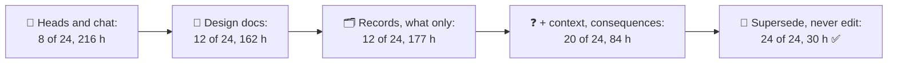
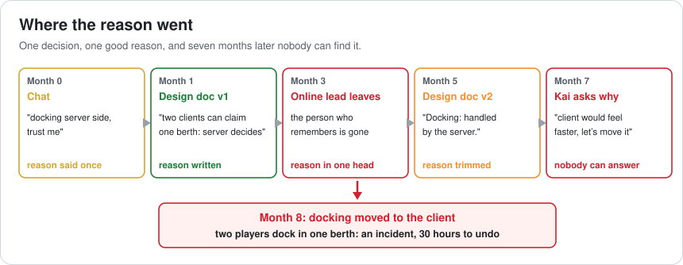
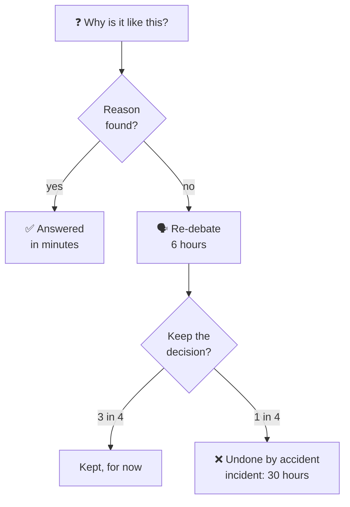
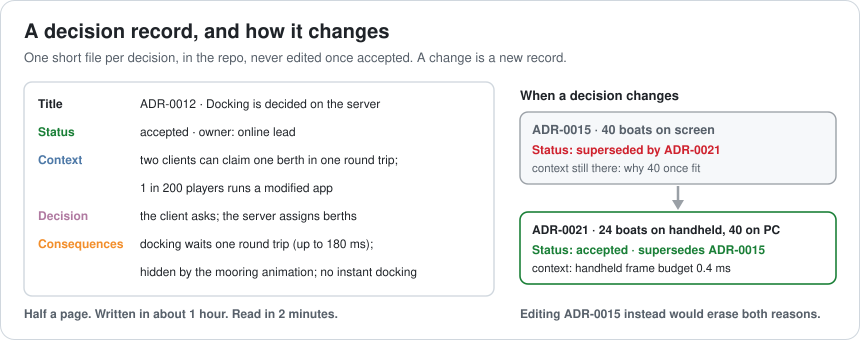
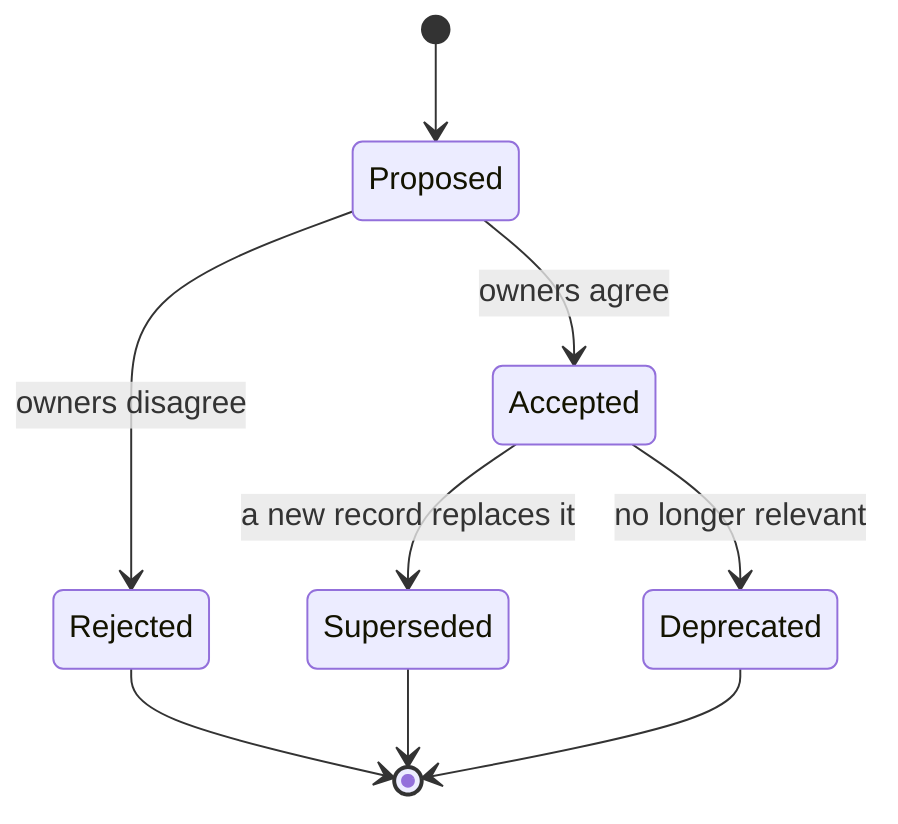
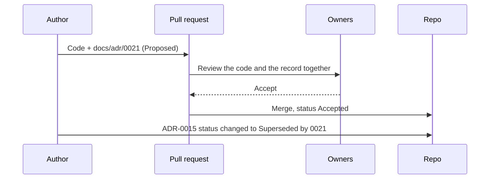
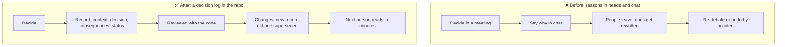

# Lesson 068 — Architecture Decision Records: The Reason That Left With the Online Lead

> Module 7 · The architect's craft · ~15 min read · 2026-11-01

**Today's goal:** keep the reason for every important decision where the next person will find it: one short record per decision in the repo, with its context and its consequences, never edited after it's accepted, and replaced by a new record when the decision changes.

### TL;DR
- In month 7, Kai, a new programmer, asks why harbour docking runs on the server and proposes moving it to the client. The reason (two clients can claim one berth) was in chat and in a design document that has since been **rewritten twice**. The online lead who made the call **left in month 3**. Docking moves; two players dock in one berth; **30 hours** to undo.
- Over a year the team makes **30 decisions** and asks **24** "why is it like this?" questions. With reasons in heads and chat, **8** get an answer, the rest cost **96 hours** of re-debating and **4** decisions get undone by accident: **216 hours**.
- An **architecture decision record** (ADR) per decision, with **context and consequences**, and a **new record that supersedes** the old one when a decision changes: **24 of 24** answered, **0** reversals, **30 hours** of writing in a year.

> 🎮 **Play with it: [Decision Log Lab](https://yimo691.github.io/GameArchitect/demos/068-decision-log-lab/)** — choose where reasons live, what a record says, and how changed decisions are kept, and watch a year of "why?" questions. Tap **Set up** on the steps to replay the lesson.



---

## 1. The problem

Lesson 067's harbour shipped. Seven months later, Kai joins the online team and reads the docking code:

```
// HarbourServer.cs
public BerthId AssignBerth(PlayerId p, BerthRequest r) { ... }   // 80 lines

// HarbourClient.cs
void RequestDock(BerthRequest r) { net.Send(r); PlayMooringAnim(); }
```

Kai asks in chat: "Why does docking wait for the server? On the client it would feel instant." Nobody on the current team knows. The design document says only **"Docking: handled by the server."** That's true, but it's a description, not a reason.



The reason did exist. In month 0 the online lead said "docking server side, trust me" in chat. In month 1 the design document said why: two clients can claim the same berth within one round trip, so one place must decide (Lesson 048). In month 5 the document was rewritten for version 2 and the sentence was trimmed as "background". The online lead had left in month 3.

So the team debates it again, agrees it would feel faster, and moves docking to the client in month 8. In the first busy weekend, two players dock in the same berth. Undoing it, fixing the saves and answering support costs **30 hours**, all to rediscover a reason that was once one sentence long.

This isn't a one-off. Over a year:

```
Reef team · one year
decisions with real trade-offs        30
"why is it like this?" questions       24
people who leave / join                3 / 3
```

Every question without an answer costs a **re-debate**: about 6 hours of digging through chat and code and a meeting. And about 1 in 4 of those debates ends like Kai's: a good decision gets **undone by accident**, and an incident follows.

---

## 2. Step 1 — Count what lost reasons cost

Where do the reasons live today?

- **In heads and chat.** Answered while the person who decided is around and remembers. In the model that's **8 of 24**. The other 16 cost `16 × 6 = 96 hours` of re-debating, and 4 of them end in reversals: `4 × 30 = 120 hours`. **216 hours**, more than a programmer-month.
- **In design documents.** Better: the first version often says why. But a design document describes the system **as it is now**. Each rewrite trims reasons that look like history. **12 of 24** answered: `12 × 6 + 3 × 30 = 162 hours`.



The point isn't that design documents are bad. Lesson 067's document did its job: it got three teams to build one harbour. It's the wrong place to keep reasons for years, because its job is to be **current**.

---

## 3. Step 2 — One record per decision, with the why

An **architecture decision record** (ADR) is a short file, one per decision, kept in the repo next to the code. Michael Nygard's original format has five parts, and fits on half a page:



```
docs/adr/0012-docking-is-decided-on-the-server.md

# ADR-0012: Docking is decided on the server
Status: accepted · owner: online lead
Context: Two clients can claim the same berth within one round trip.
  1 in 200 players runs a modified app (Lesson 056).
Decision: The client asks; the server assigns berths.
Consequences: Docking waits one round trip (up to 180 ms from Sydney),
  hidden by the mooring animation. We give up instant docking.
```

The team tries a cheaper version first: records with only the **title and decision**, half an hour each (`30 × 0.5 = 15 hours` a year). Kai would find "the server assigns berths" and still not know why. The debate starts again: still **12 of 24** answered, 3 reversals, plus the writing: **177 hours**, worse than the design documents. A record of **what** without **why** is a list of rules nobody understands.

With **context** (the forces that made the decision necessary) and **consequences** (what it costs, including what we gave up), each record takes about **1 hour**: `30 × 1 = 30 hours` a year. Now **20 of 24** questions are answered by reading, in minutes: `4 × 6 + 1 × 30 + 30 = 84 hours`.

Consequences matter as much as context. "We give up instant docking" tells Kai the team **knew** it would feel slower and chose it anyway. That turns "nobody thought of this" into "they thought of it, here's why it lost".

---

## 4. Step 3 — Supersede, never edit

Why only 20 of 24? The 4 remaining questions are about decisions that **changed** during the year. For example, ADR-0015 said "40 boats on screen". Then the handheld arrived with a 0.4 ms budget for harbour boats (Lessons 062 and 066), and someone **edited** ADR-0015 to say "24 on handheld, 40 on PC".

Now the record says what's true, but the history is gone: why 40 was fine once, what changed, who decided. When someone asks "can we go back to 40 on the handheld? The new devkit is faster", the answer isn't there.

The rule from the original ADR format: **an accepted record is never edited.** When a decision changes, write a **new** record and change only the old one's status:

```
ADR-0015 · 40 boats on screen            Status: superseded by ADR-0021
ADR-0021 · 24 boats on handheld, 40 on PC Status: accepted · supersedes ADR-0015
           Context: handheld frame budget for harbour boats is 0.4 ms;
           40 boats cost 0.6 ms (Lesson 066).
```



Rejected records are kept too. "We considered moving docking to the client in month 8 and rejected it: see ADR-0012" is exactly what Kai needed in month 7.

With superseding: **24 of 24** answered, **0** reversals, **30 hours** of writing in a year ✅. Roughly one hour per decision, against 216 hours of lost reasons.

---

## 5. Step 4 — Make records easy to find and cheap to write

A record nobody finds is a record that doesn't exist. Four habits keep the cost at an hour and the answers in minutes:

1. **In the repo, next to the code**: `docs/adr/NNNN-title.md`, numbered, reviewed in the same pull request as the change. The record is versioned with the code it explains.
2. **Link from the hot spot**: one comment where people will ask the question: `// Server decides berths: see docs/adr/0012`. Kai would have found it in the first file.
3. **Write it when you decide, not later**: the "options considered" section of the design document (Lesson 067) is the first draft. Copying it into a record takes minutes while everyone still remembers.
4. **Only real decisions**: a record is for choices that are expensive to reverse or that someone will question later. Naming a variable isn't one; the save format, the authority model, the threading model and the budget split are.



---

## 6. The architect's view

The junior asks "what does this code do?". The optimizer asks "is it fast enough?". The architect asks: **when I'm gone, will the next person know why this is the way it is, and what it would cost to change it?**



An ADR log is also an architect's best onboarding tool. A new team member who reads the 30 records of the last year learns the system's shape, its constraints and its history in an afternoon.

### Trade-offs

| Choice | Cost | Benefit | When to use |
|---|---|---|---|
| Reasons in chat | Nothing | Fast | Small, easily reversed choices |
| Design document | Hours per feature | Gets teams aligned now | Before building (Lesson 067) |
| ADR, decision only | 0.5 h each | A list of rules | Rarely: without "why" it doesn't end debates |
| ADR with context and consequences | ~1 h each | Reasons outlive people and rewrites | Decisions that are costly to reverse |
| Supersede, never edit | A new file per change | Full history of why things changed | Always, once a record is accepted |
| Link from the code | One comment | Found where the question is asked | Hot spots people will want to "fix" |

---

## 7. Common mistakes

- **Recording only the decision.** "We use server docking" ends no debate. Write the context and what it cost.
- **Editing accepted records.** The new version erases the old reason. Supersede instead.
- **Writing records months later.** Nobody remembers the options any more. Write it in the same pull request.
- **Recording everything.** Fifty records a month bury the ten that matter. Only costly-to-reverse choices.
- **Keeping records outside the repo.** Wikis drift from the code and get lost in migrations.
- **Treating a record as permanent law.** A record explains a decision; it doesn't forbid changing it. It tells you what the change must answer.

---

## 8. Quiz — think about it on the ferry ⛴️

**Q1.** With reasons in heads and chat, 8 of 24 questions are answered. Compute the year's cost.

<details><summary>Answer</summary>

16 unanswered × 6 h = 96 h of re-debating. 1 in 4 of them ends in a reversal: 4 × 30 h = 120 h. Total `96 + 120 = 216 hours`, with no writing cost.
</details>

**Q2.** Why do design documents lose reasons even when the first version had them?

<details><summary>Answer</summary>

A design document's job is to describe the system as it is now. When it's rewritten, sentences that explain past choices look like history and get trimmed. Reasons need a place whose job is to keep the past.
</details>

**Q3.** Records with only the decision cost 15 hours a year. Why is the total (177 h) worse than design documents (162 h)?

<details><summary>Answer</summary>

They answer no more questions than the design documents (12 of 24), because a decision without a reason doesn't end a debate. So the re-debating and reversals stay the same, and the 15 hours of writing are added on top.
</details>

**Q4.** What's the difference between context and consequences, and which one would have stopped Kai?

<details><summary>Answer</summary>

Context is the forces that made a decision necessary (two clients, one berth, modified apps). Consequences are what the decision costs (a round trip of waiting, no instant docking). Both: context shows why the server must decide, and consequences show the team already knew it would feel slower.
</details>

**Q5.** Someone edits ADR-0015 from "40 boats" to "24 on handheld, 40 on PC". What's lost, and what should they do instead?

<details><summary>Answer</summary>

The reason 40 was once fine, and the reason it changed. Write ADR-0021 with the new decision and its context (0.4 ms budget, 40 boats cost 0.6 ms), and mark ADR-0015 "superseded by ADR-0021".
</details>

**Q6.** Which of these deserves a record: the save format version scheme, a helper function's name, the number of worker threads, the colour of the docking UI?

<details><summary>Answer</summary>

The save format scheme and the number of worker threads: both are costly to reverse and someone will question them. A helper's name and a UI colour are cheap to change and belong in code review or the art team's decisions.
</details>

---

## 9. Back at the desk (≈45 min) — your first five records

> No desk today? Do it in the [Decision Log Lab](https://yimo691.github.io/GameArchitect/demos/068-decision-log-lab/): predict answers, reversals and total hours for each step, then tap.

In your own project:

1. **List five decisions** someone has asked "why?" about, or that a new person might try to "fix".
2. For each, find the **reason**. Note where you found it (or that you couldn't).
3. Write **one ADR** in full: title, status, context, decision, consequences. Keep it under half a page.
4. Add a **comment in the code** where the question would be asked, pointing to the record.
5. Find one decision that **changed**, and write it as a superseding pair.
6. Save `journal/068-decision-log.md`:

| Decision | Where the reason was | Found in (minutes) | Costly to reverse? | Record written |
|---|---|---|---|---|
| | | | | |
| | | | | |
| | | | | |

One question for your journal: which decision in your project would most likely be undone by the next new person, and what would it cost?

---

## 10. Vocabulary

| Term | Meaning | 中文 |
|---|---|---|
| Architecture decision record (ADR) | A short file recording one decision and why | 架构决策记录 |
| Context | The forces and facts that made a decision necessary | 背景 |
| Consequences | What the decision costs and gives up | 后果 / 影响 |
| Status | Proposed, accepted, rejected, superseded or deprecated | 状态 |
| Supersede | Replace a decision with a new record that points back | 取代 |
| Decision log | The numbered list of all records | 决策日志 |
| Re-debate | Arguing a settled question again because its reason is lost | 重复争论 |
| Accidental reversal | Undoing a good decision without knowing why it was made | 意外推翻 |
| Onboarding | Helping a new team member learn the system | 入职引导 |
| Institutional memory | What a team knows beyond any one person | 组织记忆 |

---

## 11. Further reading

- **Michael Nygard, "Documenting Architecture Decisions"** (2011, Cognitect blog): the original ADR format with title, status, context, decision and consequences.
- **adr.github.io**: templates (including MADR) and tools for keeping ADRs in a repo.
- **Joel Parker Henderson, "architecture-decision-record"** (GitHub repository): many example records and templates.
- **Thoughtworks Technology Radar, "Lightweight Architecture Decision Records"**: why keeping records in source control works better than wikis.

---

**Tomorrow — Lesson 069: A framework for evaluating trade-offs.** The team must choose how the Reef's new fishing tournaments run: on the existing game servers, on a new service, or in a managed cloud product. Everyone has an opinion and a favourite number. We turn the opinions into a small table of weighted criteria, and see how the "obvious" choice changes when you write down what you actually care about.
