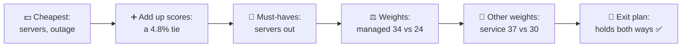
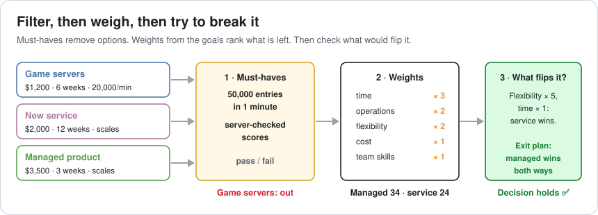
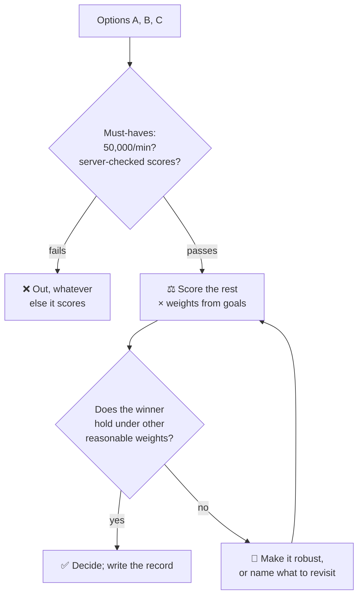
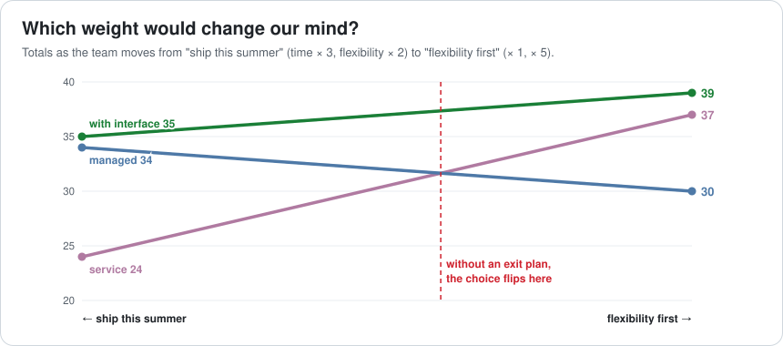
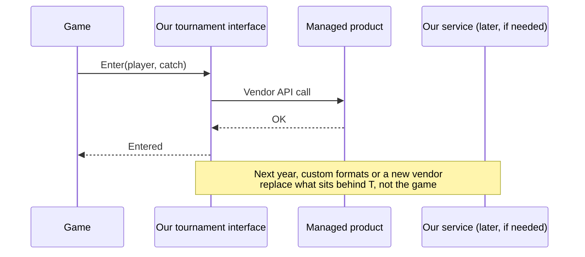
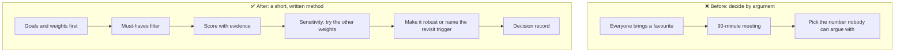

# Lesson 069 — A Framework for Evaluating Trade-offs: The Cheapest Option That Failed at the Final Whistle

> Module 7 · The architect's craft · ~15 min read · 2026-11-01

**Today's goal:** learn a small, repeatable way to choose between technical options: separate must-haves from scores, weight what's left by the team's real goals, then try to break your own answer by changing the weights you're unsure about, and make the winner robust to them.

### TL;DR
- The Reef wants **fishing tournaments**: thousands of players, one deadline, **50,000 entries in the last minute**. Three options: extend the **game servers**, build a **new service**, or use a **managed cloud product**. The meeting goes in circles, and the cheapest wins: game servers at **$1,200 a month**. They handle **20,000 entries a minute**.
- **Adding up 1–5 scores** gives managed 22, servers 21, service 20: a **4.8%** tie, with an option that fails at peak still in it. Treating peak load as a **must-have filter** removes the servers. **Weights from the team's goals** (ship this summer, two online engineers) give managed **34** to service **24**.
- But under the online lead's weights (**flexibility first**), the service wins **37 to 30**. Adding an **exit plan** (our own tournament interface in front of the managed product: +1 week) makes managed win **both ways: 35 to 24 and 39 to 37**. The decision holds, and it goes into a decision record with the condition to revisit it.

> 🎮 **Play with it: [Trade-off Lab](https://yimo691.github.io/GameArchitect/demos/069-tradeoff-lab/)** — choose how the team decides, whether must-haves filter first, which weights to use, and whether the managed product gets an exit plan, and see whether the winner holds. Tap **Set up** on the steps to replay the lesson.



---

## 1. The problem

Tournaments are the Reef's big feature for the summer: players fish for 30 minutes, the best catch wins, results at the final whistle. Three options are on the table:

```
Fishing tournaments · options
A  Extend the game servers     $1,200/month   ships in 6 weeks   handles 20,000 entries/min
B  Build a tournament service  $2,000/month   ships in 12 weeks  scales with load
C  Managed cloud product       $3,500/month   ships in 3 weeks   scales; vendor's rules and API
Peak: 50,000 entries in the last minute of a big tournament
Online team: 2 engineers
```

The meeting lasts 90 minutes. The finance lead likes A ("we already pay for those servers"). The online lead likes B ("we'll want custom formats next year"). The producer likes C ("summer is in 10 weeks"). Everyone is right about something. Nobody can say why their thing matters more.

The team picks A, because it's cheapest and nobody could argue against a number. In the first big tournament, 50,000 entries arrive in the last minute; the servers handle 20,000. Results are late for everyone, and many entries time out. It happened at the moment every player was watching.

Picking by one favourite number isn't a decision method. It's a way of ending a meeting.

---

## 2. Step 1 — Must-haves are a filter, not a score

The team's next attempt is a decision matrix: six criteria, each option scored 1–5, add them up.

| Criterion | Servers | Service | Managed |
|---|---|---|---|
| Peak load (50,000/min) | 1 | 5 | 5 |
| Cost per month | 5 | 4 | 2 |
| Time to ship | 3 | 1 | 5 |
| Operations (2 engineers) | 3 | 2 | 5 |
| Flexibility (custom formats) | 4 | 5 | 2 |
| Team skills | 5 | 3 | 3 |
| **Sum** | **21** | **20** | **22** |

Managed wins with 22, but by `(22 − 21) ÷ 21 = 4.8%`. That's a tie; one score changed by one point flips it. Worse, the servers are still second, even though they **fail** at peak. A score of 1 for peak load is just one point fewer, and good scores elsewhere cover it.

Some criteria aren't "more is better". They're **pass or fail**: if an option can't take 50,000 entries in a minute, or can't check scores on the server (Lesson 048), nothing else about it matters. Those are **must-haves**, and they come **first**, as a filter:



With peak load as a filter, the servers are out. Without that row, managed 17, service 15: a 13.3% lead, still close. That's because every criterion still counts the same.



---

## 3. Step 2 — Weights come from goals, not opinions

Equal scores say "cheaper by $800 a month" matters as much as "ships 9 weeks sooner". Nobody believes that. **Weights** make the team say what matters, and they must come from **goals** written down before anyone scores, not from whichever option someone already likes.

The Reef's goals for the summer:

- **Ship before the summer season** (10 weeks away): time to ship × **3**.
- **Two online engineers** already on call for the game servers: operations × **2**.
- **Custom tournament formats** are planned for next year: flexibility × **2**.
- Cost and team skills matter, but less: × **1** each.

```
Weighted (peak load is a must-have)
                 cost×1  time×3  ops×2  flex×2  skills×1   total
New service        4       3       4     10       3         24
Managed            2      15      10      4       3         34
```

Managed wins **34 to 24**, a **41.7%** lead. The matrix now says something the meeting didn't: the summer deadline and the small online team outweigh the monthly cost and the lock-in.

Two rules keep weights honest:

1. **Write the weights before the scores.** Otherwise people tune weights until their favourite wins.
2. **Scores need evidence.** "Handles 50,000/min" comes from a load test or the vendor's published limits, not from a feeling. Each score in the table has its reason under it.

---

## 4. Step 3 — Try to break your answer

The online lead isn't convinced: "Custom formats are the whole point of tournaments next year. Flexibility should be × 5, and time × 1 because we can ship a simple version late."

That's a reasonable view, so test it:

```
Weighted · "flexibility first"
                 cost×1  time×1  ops×2  flex×5  skills×1   total
New service        4       1       4     25       3         37
Managed            2       5      10     10       3         30
```

The service wins **37 to 30**. The decision **flips** on a weight the team honestly disagrees about. This is the most useful moment in the whole process: the argument was never about servers or vendors. It was about **how much next year's flexibility is worth against this summer's deadline**.



Moving smoothly from one set of weights to the other, the managed line falls and the service line rises; they cross a little past halfway. Without more information, the choice depends on where the truth is on that line.

This is a **sensitivity check**: change the weights or scores you're least sure of, and see if the winner changes. If it doesn't, decide. If it does, you have two good moves:

- **Get the missing fact.** How sure is "custom formats next year"? Ask the producer.
- **Change the option** so it doesn't depend on that weight.

---

## 5. Step 4 — Make the winner robust

The managed product scores 2 on flexibility because the game would call the vendor's API directly. Switching later means rewriting every call. That's a **one-way door**: hard to walk back through.

So the team adds an **exit plan**: its own small tournament interface (create, enter, submit, results), with the managed product behind it as one implementation. It costs about **1 week** (time to ship 3 → 4 weeks, score 5 → 4), and raises flexibility from 2 to **4**: custom formats can be built behind the same interface later, and the vendor can be replaced without touching the game.

```
Managed + our interface (time 4, flexibility 4)
"ship this summer"   2 + 12 + 10 + 8 + 3  = 35   vs service 24
"flexibility first"  2 + 4 + 10 + 20 + 3  = 39   vs service 37
```

Managed wins **both ways** ✅. The team didn't have to settle who was right about next year. It changed the option so the answer doesn't depend on it. This is the same move as Lesson 065's interface in front of old code: an interface turns a one-way door into a two-way door, at a known price.



The last step is the decision record (Lesson 068): context (the goals, the must-haves), the decision (managed product behind our interface), consequences ($3,500 a month, vendor limits, 1 extra week), and **when to revisit**: if custom formats need something the vendor can't do, or if the bill passes $5,000 a month.

---

## 6. The architect's view

The junior asks "which option is best?". The optimizer asks "which option is fastest?". The architect asks: **what must be true, what matters how much, and what would change my mind?**



A matrix doesn't make the decision for you. Its job is to make the **disagreement visible**: here, one weight. Then the team argues about the right thing, for ten minutes instead of ninety.

### Trade-offs

| Choice | Cost | Benefit | When to use |
|---|---|---|---|
| One favourite number | Nothing | Ends the meeting | Never alone; it hides must-haves |
| Equal-weight matrix | 30 minutes | Everything on one page | First pass, to see the criteria |
| Must-have filter | Agreeing what's pass/fail | Removes options that would fail | Always, before scoring |
| Weights from goals | Writing goals first | Shows what really matters | Any decision with competing goals |
| Sensitivity check | 10 minutes | Finds the weight the decision hangs on | Whenever the margin is small or weights are disputed |
| Exit plan (interface) | ~1 week | Turns a one-way door into a two-way door | Vendor or platform lock-in |

---

## 7. Common mistakes

- **Scoring must-haves.** A 1 on "can it take the peak" is a fail, not one point fewer.
- **Weights after scores.** Then the weights are tuned to the favourite.
- **Scores without evidence.** "Scales well" means nothing without a number and where it came from.
- **Trusting a small margin.** 4.8% is a tie; one point changes it.
- **Never trying the other side's weights.** Then the loser's argument is never answered, only outvoted.
- **Forgetting reversibility.** Two options with equal scores aren't equal if one is a one-way door.

---

## 8. Quiz — think about it on the ferry ⛴️

**Q1.** Why did "cheapest" pick an option that failed in the first big tournament?

<details><summary>Answer</summary>

It looked at one number. The servers handle 20,000 entries a minute and the peak is 50,000. Peak load was a must-have that the favourite number never checked.
</details>

**Q2.** Compute the margin of the equal-weight matrix and say why it's not a decision.

<details><summary>Answer</summary>

Managed 22, servers 21: `(22 − 21) ÷ 21 ≈ 4.8%`. One score changed by one point flips it, and the second place fails a must-have. It's a tie, not a result.
</details>

**Q3.** With weights cost 1, time 3, operations 2, flexibility 2, skills 1, compute the service's total.

<details><summary>Answer</summary>

`4×1 + 1×3 + 2×2 + 5×2 + 3×1 = 4 + 3 + 4 + 10 + 3 = 24`.
</details>

**Q4.** Why must the weights be written before the scores?

<details><summary>Answer</summary>

If people see the scores first, they choose weights that make their favourite win. Weights from goals written beforehand say what matters independent of the options.
</details>

**Q5.** Under "flexibility first", the service wins 37 to 30. What did the team learn from that?

<details><summary>Answer</summary>

That the disagreement isn't about the options but about one weight: next year's flexibility against this summer's deadline. That's the question to resolve, either with a fact (how sure are custom formats?) or by changing an option so it doesn't matter.
</details>

**Q6.** How does an interface in front of the managed product change its scores, and why does that make the decision robust?

<details><summary>Answer</summary>

It costs a week (time 5 → 4) but raises flexibility 2 → 4, because the vendor can be replaced or extended behind it. Then managed wins under both weight sets (35 vs 24, 39 vs 37), so the decision no longer depends on who is right about the weight.
</details>

---

## 9. Back at the desk (≈45 min) — your own matrix

> No desk today? Do it in the [Trade-off Lab](https://yimo691.github.io/GameArchitect/demos/069-tradeoff-lab/): predict the winner, margin and whether it holds for each step, then tap.

Pick a technical choice your team is facing (or argued about recently):

1. **Write the goals** in three sentences, then turn them into **weights** (1–5).
2. **Name the must-haves**: pass or fail, with the number that decides.
3. List **2–4 options**. Remove any that fail a must-have.
4. **Score** the rest 1–5 with one line of evidence each.
5. Do a **sensitivity check**: use the weights of the person who disagrees most.
6. If the winner flips, find a change that makes it **robust**, or name the fact that would settle it.
7. Save `journal/069-tradeoffs.md`:

| Criterion | Weight | Option 1 | Option 2 | Option 3 | Evidence |
|---|---|---|---|---|---|
| | | | | | |
| | | | | | |
| | | | | | |

One question for your journal: which weight in your matrix are you least sure about, and who would set it differently?

---

## 10. Vocabulary

| Term | Meaning | 中文 |
|---|---|---|
| Trade-off | Getting more of one thing by giving up another | 权衡 |
| Decision matrix | A table of options scored against criteria | 决策矩阵 |
| Criterion | One thing the options are judged on | 评估标准 |
| Must-have | A pass/fail requirement that filters options | 硬性要求 |
| Weight | How much a criterion counts, from the goals | 权重 |
| Margin | How far ahead the winner is | 领先幅度 |
| Sensitivity check | Changing uncertain weights or scores to see if the winner changes | 敏感性分析 |
| One-way door | A decision that is hard to reverse | 单向门决策 |
| Lock-in | Being tied to a vendor or technology because leaving is costly | 锁定 |
| Exit plan | A way to leave a choice later at a known cost | 退出方案 |

---

## 11. Further reading

- **Rick Kazman, Mark Klein, Paul Clements, "ATAM: Method for Architecture Evaluation"** (SEI technical report, 2000): a structured way to find sensitivity points and trade-offs in an architecture.
- **Neal Ford, Mark Richards, Pramod Sadalage, Zhamak Dehghani, *Software Architecture: The Hard Parts*** (2021): trade-off analysis for real architecture decisions.
- **Jeff Bezos, 2015 Letter to Amazon Shareholders**: "Type 1" (one-way door) and "Type 2" (two-way door) decisions.
- **Daniel Kahneman, Olivier Sibony, Cass Sunstein, *Noise*** (2021): why structured, independent assessments make better judgments than open discussion.

---

**Tomorrow — Lesson 070: Reviewing code as an architect.** A pull request with 1,400 lines adds the tournament interface. Three reviewers leave 61 comments about names and brace style, approve it, and miss that every entry allocates on the hot path and that the interface leaks the vendor's types. We learn what an architect looks for first, and how to review large changes without reading every line the same way.
