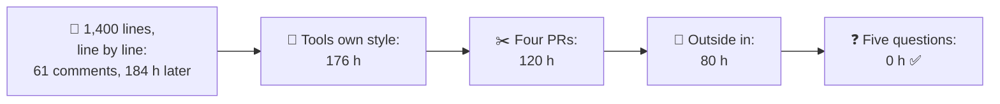
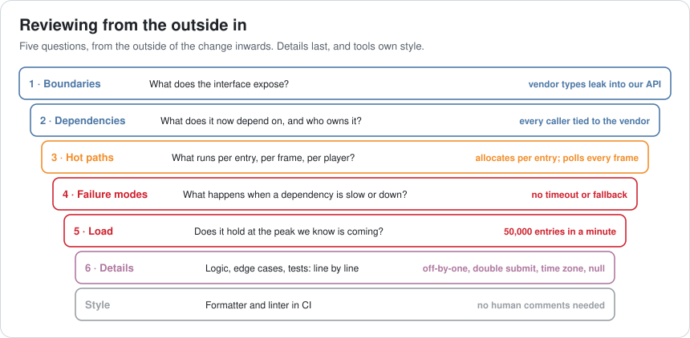
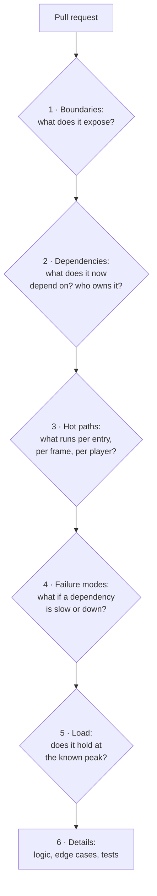
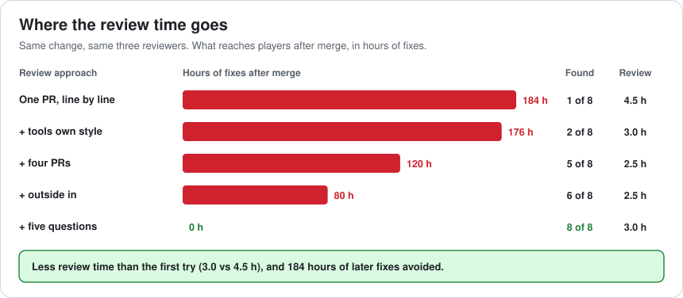
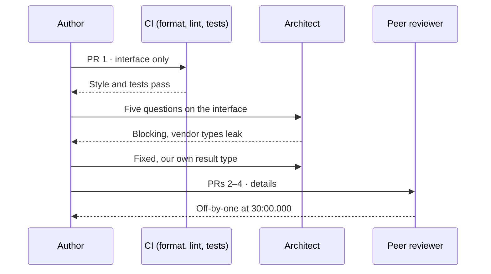
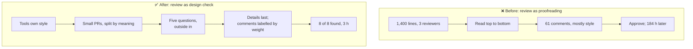

# Lesson 070 — Reviewing Code as an Architect: 61 Comments and Nothing That Mattered

> Module 7 · The architect's craft · ~15 min read · 2026-11-01

**Today's goal:** review code the way an architect does: let tools own style, keep changes small enough to read, start from the outside of a change (boundaries, dependencies, hot paths, failure modes, load) and only then read the details, so review time goes to the problems that cost the most later.

### TL;DR
- The tournament interface from Lesson 069 arrives as **one 1,400-line pull request**. Three reviewers read it top to bottom and leave **61 comments**, **60** about names, braces and imports. They find **1 bug** and **0** of the **4 architecture problems**. After merge, the misses cost **184 hours**.
- **Tools own style** (formatter and linter in CI): 0 style comments, 1.5 hours saved, 1 more bug found. **Four smaller PRs** (~350 lines each) let reviewers find all 4 bugs. Still, 3 design problems slip through, because they don't live in any one line.
- **Reading outside in** and a **five-question checklist** (boundaries, dependencies, hot paths, failure modes, load) find all 4: **8 of 8** real problems, **0 hours** of fixes after merge, and **3.0 hours** of review, less than the 4.5 the first review took.

> 🎮 **Play with it: [Review Lab](https://yimo691.github.io/GameArchitect/demos/070-review-lab/)** — choose the change size, who owns style, the reading order and whether reviewers use the checklist, and see what's found and what reaches players. Tap **Set up** on the steps to replay the lesson.



---

## 1. The problem

The pull request is titled "Tournaments: managed backend". It's 1,400 lines across 23 files: the new tournament interface, an adapter for the vendor's API, a results screen, and some fixes found along the way.

Three reviewers each spend about an hour and a half. The comments look like this:

```
TournamentAdapter.cs:41    rename `tmp` to `entryBuffer`
TournamentAdapter.cs:58    brace on the same line, please
TournamentScreen.cs:12     unused import
TournamentScreen.cs:90     this line is 131 characters
ITournament.cs:7           typo in comment: "recieve"
... 56 more like these ...
TournamentClock.cs:33      should this be <= instead of <?   ✅ real bug
```

Everyone approves. Two weeks later, in the first big tournament:

- Every entry **allocates** a new list on the hot path: 50,000 entries in the last minute cause garbage-collection spikes on the server.
- The interface returns the **vendor's types** (`VendorScoreDto`), so 40 call sites now depend on the vendor directly. The exit plan from Lesson 069 is gone.
- Vendor calls have **no timeout**. When the vendor is slow, results hang for everyone.
- The results screen **polls every frame** without a cache.
- Plus three bugs: a retried submission counts a catch twice, the end time uses local time (Sydney ends early), and an empty player name crashes the results.

```
After merge: 3 bugs × 8 h + 4 design problems × 40 h = 24 + 160 = 184 hours
```

Nobody was lazy. Three people read every line. The problem is **what** they looked at and **in what order**.

---

## 2. Step 1 — Let tools own style

Sixty comments about style means attention spent on things a machine can check. Worse, they make review feel thorough: 61 comments looks like a careful review.

A **formatter** (that rewrites code into the house style) and a **linter** (that flags unused imports, long lines, naming rules) run in CI on every pull request (Lesson 046). If they pass, style isn't a review topic. The six style issues are fixed with **no comments at all**.

```
Tools own style (still one PR, line by line)
style comments     60 → 0
review time        4.5 → 3.0 hours
bugs found         1 → 2      (attention moved to behaviour)
architecture       0 of 4
after merge        2 × 8 + 4 × 40 = 176 hours
```

It's better, but the expensive problems are all still there. Line-by-line reading in a big change doesn't find them.

---

## 3. Step 2 — Keep changes small enough to read

Studies of code review keep finding the same thing: reviewers find far fewer problems per line in large changes. The SmartBear study at Cisco suggests reviewing no more than about **200–400 lines** at a time. In 1,400 lines, attention runs out long before the end, and the last files get a glance.

The tournament change splits naturally into four pull requests of about **350 lines** each, ordered so each one makes sense alone:

1. **The interface** (`ITournament`) and its tests, with no implementation.
2. **The vendor adapter** behind the interface.
3. **The results cache** and server endpoints.
4. **The results screen**.

```
Four PRs (tools own style, line by line)
bugs found         4 of 4
architecture       1 of 4    (the allocation shows up in the small adapter diff)
review time        2.5 hours
after merge        3 × 40 = 120 hours
```

Splitting by **meaning** matters as much as size. Reviewing the interface alone, with no implementation to distract, is where design problems are cheapest to see. That's the next step.

---

## 4. Step 3 — Read from the outside in

The remaining design problems don't live in any one line. "The interface exposes vendor types" is visible only if you look at the interface as a whole and ask what it promises. "No timeout" is the **absence** of a line. Line-by-line reading can't find what isn't there.

An architect reads a change **from the outside in**: first what it exposes, then what it depends on, then where it runs often, then how it fails, then whether it holds at the expected load, and only then the details.





Reading outside in **without** writing the questions down finds the two problems that are visible in the code: the leaked vendor types (boundaries) and the per-entry allocation (hot path). 2 of 4, **80 hours** after merge.

The last two need a **question** to be asked: "what happens when the vendor takes 5 seconds?" and "what does the results screen do at 50,000 players?". That's what the checklist is for.

---

## 5. Step 4 — Five questions, every time

The architect's checklist is the six layers above as five questions (details are the normal review). It takes about **half an hour** on a change this size, usually by one reviewer who owns the design:

| # | Question | What it found here |
|---|---|---|
| 1 | **Boundaries**: what does the public interface expose, and could the implementation change behind it? | `VendorScoreDto` in `ITournament`: return our own `TournamentResult` |
| 2 | **Dependencies**: what new dependency did we take on, who owns it, and does it point the right way? | Game code depended on the vendor SDK: only the adapter may |
| 3 | **Hot paths**: what runs per entry, per frame, per player? Does it allocate, lock or call the network? | New list per entry: pool it; results polled per frame: cache for 2 s |
| 4 | **Failure modes**: what happens when a dependency is slow, down or wrong? | No timeout: 2 s timeout, then "results coming" and retry in the background |
| 5 | **Load**: does it hold at the peak we know is coming, and is there a test? | 50,000 entries a minute: add a load test (Lesson 063's rules) |

```
Four PRs, tools own style, outside in, five questions
real problems found   8 of 8
review time           2.5 + 0.5 = 3.0 hours
after merge           0 hours   ✅
```



The review is **shorter** than the first one (3.0 vs 4.5 hours) and finds everything. The same people, with the same skills, spent their attention on different things.

Two habits make it stick:

- **Comment on the why, label the weight.** "Blocking: vendor types in the interface break our exit plan (ADR-0023)" vs "Nit: could be clearer". Authors know what must change.
- **Review the design before the code exists.** The best time to ask the five questions is on the design document (Lesson 067) or the interface-only PR, when changing the answer costs minutes.



---

## 6. The architect's view

The junior reviews by asking "would I have written it this way?". The optimizer asks "is this line fast?". The architect asks: **what does this change promise to the rest of the system, what does it now depend on, and how will it behave on the worst day?**



Code review is also where an architect **teaches**. A comment that says "this leaks the vendor type; here's why our exit plan needs our own type (ADR-0023)" makes the next interface better. Sixty comments about braces teach nothing.

### Trade-offs

| Choice | Cost | Benefit | When to use |
|---|---|---|---|
| Formatter and linter in CI | Setup, one style argument | Zero style comments forever | Always |
| Small PRs, split by meaning | More PRs, some ordering work | Reviewers find far more per line | Any change over ~400 lines |
| Interface-only PR first | One extra review round | Design problems found before code depends on them | New systems, new dependencies |
| Five-question checklist | ~0.5 h per change | Finds what isn't in any one line | Changes that cross boundaries or touch hot paths |
| Labelled comments (blocking / nit) | Discipline | Authors know what must change | Always |
| Architect reviews everything | Architect becomes a bottleneck | Consistency | Never: review boundaries, teach the rest |

---

## 7. Common mistakes

- **Counting comments as quality.** 61 comments about style is a weak review.
- **Reviewing huge changes.** Attention runs out after a few hundred lines; ask for a split.
- **Reading top to bottom.** The design problems are in the shape, not the lines.
- **Only reviewing what's there.** Missing timeouts, missing tests and missing limits are absences; a checklist asks for them.
- **Unlabelled comments.** The author can't tell a blocking design issue from a preference.
- **Reviewing only after the code is done.** The cheapest review is of the interface, before the implementation depends on it.

---

## 8. Quiz — think about it on the ferry ⛴️

**Q1.** Compute the cost after merge of the first review.

<details><summary>Answer</summary>

1 of 4 bugs found, 0 of 4 design problems: `3 × 8 + 4 × 40 = 24 + 160 = 184 hours`.
</details>

**Q2.** Tools take over style. Why does that also help find bugs?

<details><summary>Answer</summary>

Attention is limited. Without 60 style comments to write, reviewers spend the same hour on behaviour, and find one more bug. It also saves 1.5 hours of review.
</details>

**Q3.** Why does splitting into four PRs find all 4 bugs but only 1 of 4 design problems?

<details><summary>Answer</summary>

Bugs live in lines, and small diffs get read carefully. Design problems live in the shape of the change (what the interface exposes, what's missing) and line-by-line reading doesn't look at the shape.
</details>

**Q4.** Which of the five questions finds the missing timeout, and why can't line-by-line reading find it?

<details><summary>Answer</summary>

Failure modes: "what happens when the vendor is slow or down?". There's no line to read; the timeout simply isn't there. Only a question about behaviour finds an absence.
</details>

**Q5.** Why should the interface be its own pull request, reviewed first?

<details><summary>Answer</summary>

Boundary and dependency problems are cheapest to fix before code depends on them. An interface-only PR is small and has nothing else to distract the reviewer from what it promises.
</details>

**Q6.** The final review takes 3.0 hours and the first took 4.5. Where did the time go?

<details><summary>Answer</summary>

1.5 hours of style comments disappeared (tools), smaller PRs took 0.5 hours less to read, and the checklist added 0.5 hours: `4.5 − 1.5 − 0.5 + 0.5 = 3.0`.
</details>

---

## 9. Back at the desk (≈45 min) — review one change the architect's way

> No desk today? Do it in the [Review Lab](https://yimo691.github.io/GameArchitect/demos/070-review-lab/): predict comments, problems found and hours after merge for each step, then tap.

Take a recent pull request in your project (yours or someone else's):

1. **Count its comments** by kind: style, bug, design.
2. Check whether a **formatter and linter** could have made the style comments unnecessary.
3. Note its **size**, and how you would have split it by meaning.
4. Ask the **five questions**: boundaries, dependencies, hot paths, failure modes, load. Write one line each.
5. Write the comments you'd leave, **labelled** blocking or nit.
6. Save `journal/070-review.md`:

| Question | What I found | Blocking? | Cost if merged |
|---|---|---|---|
| Boundaries | | | |
| Dependencies | | | |
| Hot paths | | | |
| Failure modes | | | |
| Load | | | |

One question for your journal: which of the five questions does your team almost never ask in review?

---

## 10. Vocabulary

| Term | Meaning | 中文 |
|---|---|---|
| Code review | Teammates reading a change before it merges | 代码评审 |
| Pull request (PR) | A proposed change, reviewed before merging | 合并请求 |
| Formatter | A tool that rewrites code into a fixed style | 格式化工具 |
| Linter | A tool that flags suspicious or non-standard code | 静态检查工具 |
| Nit | A small, non-blocking comment | 细节建议 |
| Blocking comment | A problem that must be fixed before merging | 阻塞性意见 |
| Boundary | Where one system's interface meets another's | 边界 |
| Hot path | Code that runs very often, per frame or per entry | 热路径 |
| Failure mode | How a system behaves when something it depends on fails | 失效模式 |
| Timeout | A limit on how long to wait for a response | 超时 |

---

## 11. Further reading

- **Google Engineering Practices, "How to do a code review"** (google.github.io/eng-practices): what to look for, in what order, and how to write comments.
- **Jason Cohen, *Best Kept Secrets of Peer Code Review*** (SmartBear, 2006): the Cisco study on review size and speed.
- **Alberto Bacchelli and Christian Bird, "Expectations, Outcomes, and Challenges of Modern Code Review"** (ICSE 2013): what code review finds in practice, and what it doesn't.
- **Michael Nygard, *Release It!* (2nd ed., 2018)**: timeouts, circuit breakers and the failure modes a reviewer should ask about.

---

**Tomorrow — Lesson 071: Working with designers and artists.** The harbour's art team delivers boats with 120,000 triangles each, and the designers add a weather system the frame budget never heard of. Nobody broke a rule, because nobody told them the rules in their own terms. We turn budgets into tools, previews and conversations that designers and artists can use while they create.
