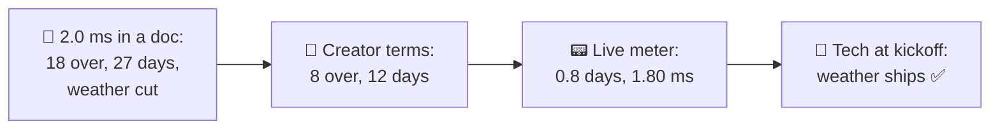
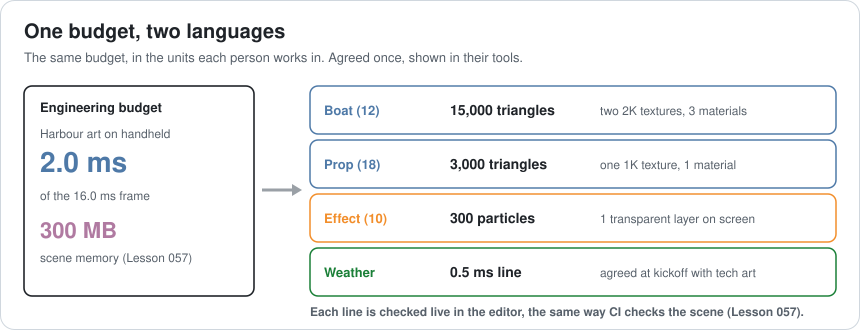
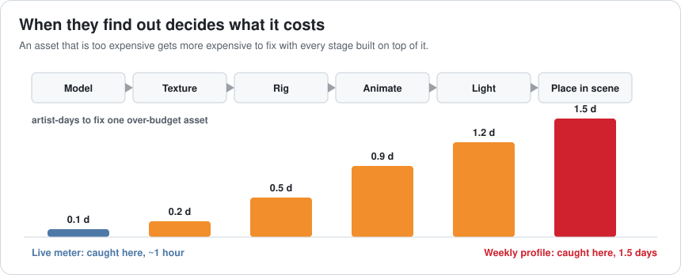
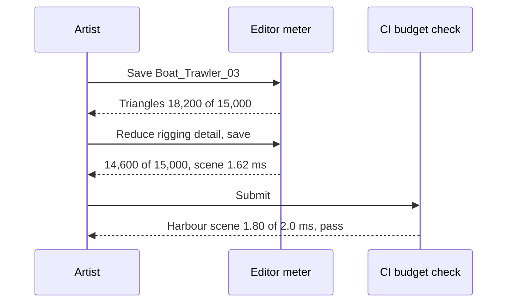
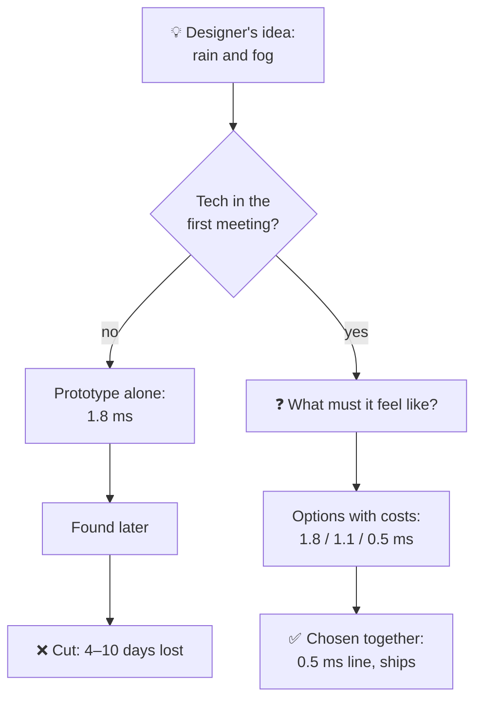
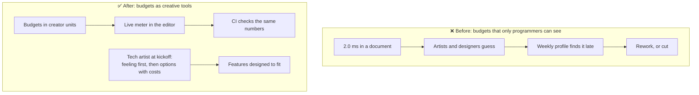

# Lesson 071 — Working with Designers and Artists: The Budget Nobody Could See

> Module 7 · The architect's craft · ~15 min read · 2026-11-01

**Today's goal:** turn technical budgets into something designers and artists can use while they create: budgets written in their units, cost shown live in their tools, and a technical person in the room when a feature is first imagined, so good ideas fit the frame instead of being cut from it.

### TL;DR
- The harbour's art team has six weeks for **40 assets**, inside a **2.0 ms** art budget on the handheld. The budget lives in an engineering document as "2.0 ms, 300 MB". The first boat arrives with **120,000 triangles**. **18 of 40** assets go over, found at the **weekly profile**: **27 artist-days** of rework, still **2.25 ms** at week 6. The designers' **weather** system (1.8 ms) is cut in week 5: **10 designer-days** lost.
- **Budgets in creator terms** (a boat: 15,000 triangles and two 2K textures) cut the over-budget assets to **8**. A **live meter in the editor** that shows those same numbers catches them while they're made: **0.8 artist-days** of rework, **1.80 ms**.
- A **technical artist at the weather kickoff** shapes the idea before it's built: screen-space rain and post-process fog, **0.5 ms** in its own budget line. The weather ships.

> 🎮 **Play with it: [Content Budget Lab](https://yimo691.github.io/GameArchitect/demos/071-content-budget-lab/)** — choose how the budget is told, when artists find out, and when tech joins the design, and see what's reworked and what's cut. Tap **Set up** on the steps to replay the lesson.



---

## 1. The problem

The harbour's art budget was set carefully. Lesson 066 gave harbour art **2.0 ms** of the handheld's 16.0 ms frame, and Lesson 057 gave the scene **300 MB**. Both numbers are on the budget board, and the CI check (Lesson 062) fails the build when the harbour scene goes over.

None of that reaches the person making a boat. An artist works in a modelling tool that shows triangles, materials and texture sizes. "2.0 ms" isn't a unit there. So the first boat arrives at **120,000 triangles** with four 4K textures. It's beautiful, and it's about eight times what the harbour can afford for one boat.

```
Harbour art · six weeks · handheld
assets           12 boats, 18 props, 10 effects
budget           2.0 ms, 300 MB (engineering document)
feedback         programmers profile the harbour build every Friday
weather          designers prototype rain + fog in parallel
```

Every Friday, a programmer profiles the build and posts a list: "these assets are too expensive". By the time an artist sees it, the boat has been rigged, animated, lit and placed. Fixing it means redoing most of that.

By week 6: **18 of 40** assets were over, **27 artist-days** went to rework, and 9 still weren't fixed: the harbour runs at **2.25 ms**. The designers' weather (4,000 rain particles and volumetric fog) measured **1.8 ms** on its own in week 5. With no time to redesign, it was cut, and 10 designer-days of work went with it.

Nobody broke a rule. Nobody **could see** the rule.

---

## 2. Step 1 — Write the budget in their units

The architect's first job is translation. The 2.0 ms and 300 MB don't change, but they get split into numbers each creator controls directly:



| Asset type | Budget per asset | Count | Why this number |
|---|---|---|---|
| Boat | 15,000 triangles, two 2K textures, 3 materials | 12 | Up to 24 on screen (Lesson 067), LOD for distant ones |
| Prop | 3,000 triangles, one 1K texture, 1 material | 18 | Many instances, batched (Lesson 024) |
| Effect | 300 particles, 1 transparent layer on screen | 10 | Overdraw is the handheld's weak spot (Lesson 025) |
| Weather | 0.5 ms, its own line | 1 | A system, not an asset: agreed at kickoff |

Getting these numbers takes a technical artist or programmer about a day: build a test scene with 24 boats at different triangle counts, measure, and work back from 2.0 ms with some headroom. It's the same budget, just divided the way the work is divided.

With budgets in creator terms, artists aim at the right target from the start. In the model, **8** assets go over instead of 18: artists still misjudge some (a sail with too many layers, a rope with a dense mesh), but they're no longer guessing from a frame time.

```
Creator terms, still found at the weekly profile
over budget       8 of 40
rework            8 × 1.5 = 12 artist-days
unfixed at week 6 4 → 1.8 + 4 × 0.05 = 2.00 ms
weather           still cut in week 5
```

Better, but the 8 are still found weeks late, when fixing is expensive.

---

## 3. Step 2 — Show the cost where they work

The cost of fixing an asset grows with every stage built on top of it:



A boat that's too heavy at the modelling stage takes about an hour to fix. The same boat found after rigging, animation, lighting and placement takes **1.5 days**. The fix isn't harder, but everything that depends on it has to be redone.

So the budget must be visible **while creating**. A small **budget meter** in the editor (or as a validator in the export step, like Lesson 054's tools) shows each asset's numbers against its type's budget:

```
Boat_Trawler_03                         budget   status
  triangles            18,200          15,000    ⚠ +21%
  textures             2 × 2K           2 × 2K   ✅
  materials            3                3        ✅
  harbour scene total  1.62 ms          2.0 ms   ✅
```

The artist sees the warning the moment the mesh is saved, and fixes it in the tool they're already in.

**The units matter here too.** A meter that shows only "+0.04 ms" tells the artist it's too expensive but not what to change. In the model, an ms-only meter catches all 18 over-budget assets at once but each takes **0.5 days** of trial and error: 9 days. A meter in creator terms points at the knob: **8 × 0.1 = 0.8 artist-days**, and harbour art finishes at **1.80 ms** ✅.



The meter and CI check the **same budget**: the editor helps the artist, and CI is the safety net when the editor's estimate is wrong.

---

## 4. Step 3 — Join the design before it's built

The weather system isn't an asset; it's a feature. The designers prototyped it alone: 4,000 rain particles and volumetric fog, because that's how rain looks in the games they love. With the live meter, they'd see **1.8 ms** in week 2 instead of week 5. That saves 6 days, but the weather is still cut, because the only way they know to make it cheaper is to make it uglier.

The difference comes from asking a different question at the **kickoff**. A technical artist in the first weather meeting doesn't say "that's too expensive". They ask **what the rain must make players feel**: "the harbour feels wet and closed in; boats appear out of the mist". Then they offer ways to get that feeling that fit:

| Idea | Cost on handheld | Keeps the feeling? |
|---|---|---|
| 4,000 rain particles + volumetric fog | 1.8 ms | Yes |
| 1,000 particles + volumetric fog | 1.1 ms | Mostly; sparse rain |
| Screen-space rain layer + fog in the post-processing pass | 0.5 ms | Yes: wet lens, misty distance |

The designers choose the third, and the weather gets its own **0.5 ms line** on the budget board (traded from the reserve, Lesson 062). It ships.



The pattern: **designers and artists own what the player feels; the architect owns what it costs.** Both are needed in the same conversation, early, when changing the plan costs nothing.

---

## 5. The architect's view

The junior says "that's too expensive" after the fact. The optimizer makes the expensive thing cheaper after it's built. The architect asks: **can every creator see the budget, in their own units, while they're creating, and is someone who knows the costs in the room when a feature is first imagined?**



Two habits help the relationship more than any tool:

- **Say "here's how" instead of "no".** Every "too expensive" should come with an option that keeps what matters to the creator.
- **Budgets are agreements, not orders.** Creators help set them (the 15,000-triangle boat was tested with the art lead), and trades are open: a hero boat can have 25,000 triangles if two props give some back.

### Trade-offs

| Choice | Cost | Benefit | When to use |
|---|---|---|---|
| Budgets in engineering units only | Nothing extra | Precise for programmers | Never alone |
| Budgets in creator units | ~1 day to measure and split | Creators aim at the right target | Every asset type with real volume |
| Live meter in the editor | Tool work (days) | Problems found when fixing is cheapest | Teams producing many assets |
| Validator at export | Less than a meter | Blocks the worst cases early | When a full meter is too much work |
| Tech artist at kickoffs | Their time in meetings | Features shaped to fit, not cut | New systems: weather, VFX, crowds |
| Open trades between assets | Bookkeeping | Hero assets possible within the total | When some assets matter more |

---

## 6. Common mistakes

- **Publishing budgets in ms to people who work in triangles.** Translate them.
- **Finding problems at the weekly profile.** Every stage built on top makes the fix more expensive.
- **A meter without the knob.** "+0.04 ms" says it's bad, not what to change.
- **Saying "no" without an option.** Creators hear "your idea is wrong" instead of "here's how it fits".
- **Joining after the prototype.** By then the idea and its cost are fixed together.
- **Budgets set without creators.** Numbers they didn't help choose feel arbitrary and get worked around.

---

## 7. Quiz — think about it on the ferry ⛴️

**Q1.** Why did a correct 2.0 ms budget still produce 18 over-budget assets?

<details><summary>Answer</summary>

Artists can't see ms in their tools. They had no target in their own units (triangles, textures, materials), so they guessed, and 18 of 40 guesses were too high.
</details>

**Q2.** Compute the rework when 8 assets go over and are found at the weekly profile, and when they're found by a meter in creator terms.

<details><summary>Answer</summary>

Weekly: `8 × 1.5 = 12 artist-days`. Live meter in creator terms: `8 × 0.1 = 0.8 artist-days`. The same 8 problems, 15 times cheaper to fix.
</details>

**Q3.** Why does an ms-only meter still cost 9 days of rework?

<details><summary>Answer</summary>

It catches problems early but doesn't say what to change. With 18 assets over (engineering terms) and 0.5 days of trial and error each: `18 × 0.5 = 9 days`.
</details>

**Q4.** With 4 assets unfixed at week 6, what's the harbour's art cost? With 9?

<details><summary>Answer</summary>

Base 1.8 ms plus 0.05 ms each: `1.8 + 4 × 0.05 = 2.00 ms` and `1.8 + 9 × 0.05 = 2.25 ms`.
</details>

**Q5.** The live meter shows the weather at 1.8 ms in week 2. Why is it still cut?

<details><summary>Answer</summary>

The designers now know it's too expensive, but they only know how to make it cheaper by making it worse (fewer particles). Nobody offers a different technique that keeps the feeling. That takes someone who knows the costs, at the start.
</details>

**Q6.** What question does the technical artist ask first at the kickoff, and why?

<details><summary>Answer</summary>

"What must it make players feel?" The feeling is what the designer owns and can't give up; the technique is open. Starting from the feeling opens options (screen-space rain, post-process fog) that keep it at 0.5 ms.
</details>

---

## 8. Back at the desk (≈45 min) — translate one budget

> No desk today? Do it in the [Content Budget Lab](https://yimo691.github.io/GameArchitect/demos/071-content-budget-lab/): predict over-budget assets, rework and the weather for each step, then tap.

In your own project:

1. Pick **one budget** in engineering units (a frame-time or memory line).
2. List the **asset types** that spend it, and the units their creators work in.
3. Build a **test scene** and measure how the cost grows with those units.
4. Write a **budget per asset type** in creator units, with some headroom.
5. Sketch the **meter**: what an artist would see on save.
6. Save `journal/071-content-budgets.md`:

| Asset type | Creator units | Budget per asset | Count | Total (ms / MB) |
|---|---|---|---|---|
| | | | | |
| | | | | |
| | | | | |

One question for your journal: which feature in your project was cut late, and who should have been in its first meeting?

---

## 9. Vocabulary

| Term | Meaning | 中文 |
|---|---|---|
| Content budget | A limit per asset in units creators control | 内容预算 |
| Triangle count | How many triangles a mesh has | 三角面数 |
| Technical artist | Someone who bridges art and engineering | 技术美术 |
| Budget meter | A live display of an asset's cost against its budget | 预算仪表 |
| Validator | A check that runs on save or export | 校验器 |
| Kickoff | The first meeting where a feature is planned | 启动会 |
| Overdraw | Pixels drawn more than once per frame | 过度绘制 |
| Screen-space effect | An effect drawn as a layer over the image | 屏幕空间效果 |
| Hero asset | An important asset allowed a bigger budget | 主角资产 / 重点资产 |
| Trade | Moving budget from one owner to another, by agreement | 预算交换 |

---

## 10. Further reading

- **Jason Gregory, *Game Engine Architecture* (3rd ed., 2018)**: the chapters on tools and the asset pipeline, where budgets become checks.
- **Unity Manual, "Rendering Statistics window"** and **Unreal Engine documentation, "Data Validation"**: built-in ways to show triangle counts and run checks on assets.
- **Ed Catmull, *Creativity, Inc.*** (2014): how Pixar's technical and creative people give each other candid, early feedback.
- **Lessons 054, 057 and 062** of this course: tools, memory budgets and budget owners, the systems this lesson puts in front of creators.

---

**Tomorrow — Lesson 072: Estimating technical risk.** The team is asked to estimate cross-play between the handheld and PC. The answer is "six weeks", the same answer it gives for everything. We learn to estimate the parts nobody has done before as ranges, find the riskiest unknown first with a cheap spike, and give a date with a confidence instead of a number with a hope.
