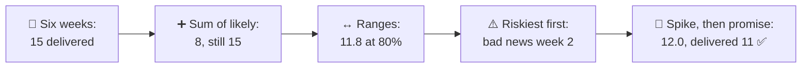
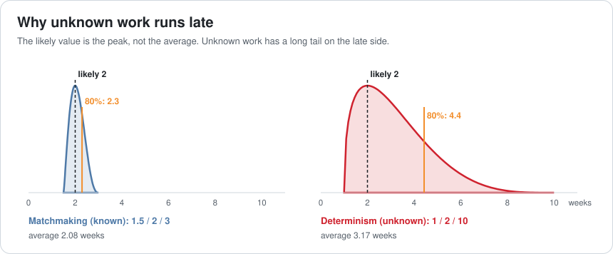
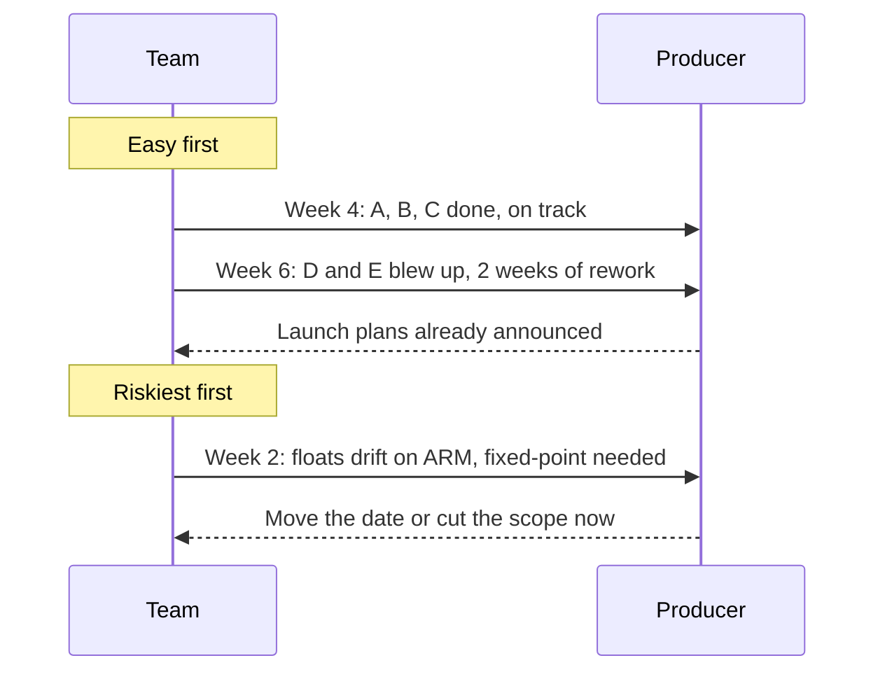
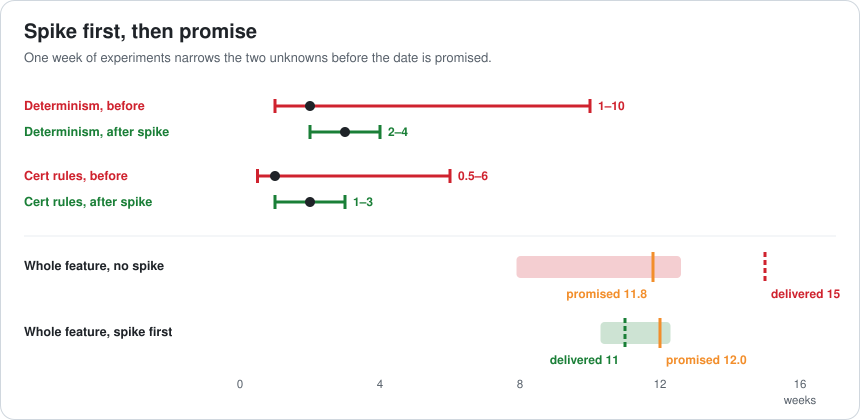
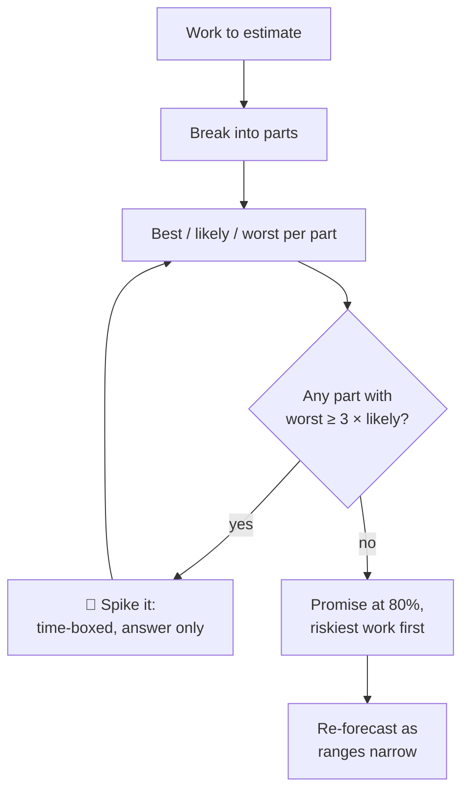
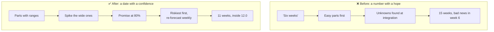

# Lesson 072 — Estimating Technical Risk: "Six Weeks", Again

> Module 7 · The architect's craft · ~15 min read · 2026-11-01

**Today's goal:** estimate work that nobody has done before without pretending to know: break it into parts, give each part a range instead of a number, promise a date at a stated confidence, and spend a little time first on the riskiest unknowns so the range gets narrow before the promise is made.

### TL;DR
- The producer asks for **cross-play** between the handheld and PC. The team says **"six weeks"**, the answer it gives for everything. It takes **15**. Two parts nobody had done before (keeping the simulation identical on x86 and ARM, and the platform's cross-play certification rules) blew up, and the bad news arrived in **week 6**.
- Summing each part's **likely** value says 8 weeks: still 7 late, with about an **11%** chance of making it. **Ranges** (best / likely / worst) give an honest promise of **11.8 weeks at 80%**, and point straight at the two unknowns: 1–10 weeks and 0.5–6.
- **Doing the riskiest part first** brings the bad news to week 2. A **one-week spike** (the same replay on both CPUs, and one call with the platform holder) narrows the unknowns to 2–4 and 1–3. The promise becomes **12.0 weeks at 80%**, and cross-play ships in **11**.

> 🎮 **Play with it: [Risk Estimate Lab](https://yimo691.github.io/GameArchitect/demos/072-risk-estimate-lab/)** — choose how the team estimates, how it handles the unknowns and what goes first, and compare the promise with the delivery. Tap **Set up** on the steps to replay the lesson.



---

## 1. The problem

Lena, the producer: "Players on the handheld want to fish with friends on PC. How long for cross-play?"

The online lead thinks for a moment: "Six weeks." It sounds reasonable. It's also what the team said for the tournaments, the harbour and the photo mode. Six weeks is the team's way of saying "a medium-sized thing".

Here's what cross-play actually needs:

```
Cross-play · handheld + PC
A  One matchmaking queue for both platforms            done similar work before
B  Account linking between platform accounts            done similar work before
C  Input fairness: controller vs mouse aiming           some tuning
D  Same simulation on x86 (PC) and ARM (handheld)      never done
E  The platform holder's cross-play certification rules never done
```

Parts A–C go as expected. Part D doesn't: the fishing physics uses floating point, and the handheld's ARM CPU and the PC's x86 CPU produce slightly different results for the same inputs. Over a 30-minute session the line positions drift apart, and the rollback netcode from Lesson 049 keeps "correcting" fish that never misbehaved. The fix (fixed-point maths for the physics state) takes **7 weeks**. Part E: the platform holder requires a cross-play on/off setting, text filtering for messages from other platforms and a different friends flow: **3 weeks**, found when the first submission is prepared.

Both are discovered at integration in **week 6**, when the team expected to be done, and they cause **2 weeks** of rework in parts already finished. Cross-play ships in **15 weeks**.

The estimate wasn't lazy. It was a single number for work with two big unknowns inside it.

---

## 2. Step 1 — Break it down, then don't trust the sum

The first improvement is obvious: estimate each part. Using the most likely value for each:

```
A 2 + B 2 + C 1 + D 2 + E 1 = 8 weeks
```

Eight weeks feels careful. It's still 7 weeks late. The problem is that the **likely value is the peak of the curve, not its middle**. For a part you've done before, the curve is narrow and nearly symmetric. For a part you haven't, there's a hard limit on the early side (it can't take less than about a week) and almost no limit on the late side.



Matchmaking: likely 2, average about 2.1. Determinism: likely 2, average about **3.2**, and a 1 in 5 chance of more than 4.4. Adding up likely values adds up five peaks, and assumes nothing in the tail ever happens. Something in the tail almost always happens.

---

## 3. Step 2 — Estimate ranges, promise a confidence

For each part, the team gives three numbers: **best** (everything goes right), **likely**, and **worst** (the bad case they can honestly imagine, not the apocalypse):

| Part | Best | Likely | Worst | Known? |
|---|---|---|---|---|
| A · Matchmaking queue | 1.5 | 2 | 3 | yes |
| B · Account linking | 1 | 2 | 4 | mostly |
| C · Input fairness | 0.5 | 1 | 2 | mostly |
| D · Determinism, x86 vs ARM | 1 | 2 | **10** | **no** |
| E · Cross-play cert rules | 0.5 | 1 | **6** | **no** |

A simple, long-used way to combine them is the **PERT** estimate: for each part, the average is about `(best + 4 × likely + worst) ÷ 6`, and the spread about `(worst − best) ÷ 6`. Add the averages; add the squares of the spreads and take the square root.

```
average   2.08 + 2.17 + 1.08 + 3.17 + 1.75 = 10.25 weeks
spread    √(0.25² + 0.5² + 0.25² + 1.5² + 0.92²) ≈ 1.86 weeks
80% date  10.25 + 0.84 × 1.86 ≈ 11.8 weeks
```

Now the promise has a confidence: **"11.8 weeks, and we're 80% sure"**. Compare the earlier promises: "6 weeks" had about a **1%** chance; "8 weeks" about **11%**.

The table does something even more useful: it shows **where the risk is**. Almost all the spread comes from D and E (`1.5² + 0.92² ≈ 3.1` of the total `3.5`). Those two rows are the plan's real content.

It still isn't enough. With ranges but the same plan, D and E are found at integration in week 6, and cross-play ships in 15. The range was honest; the plan didn't use it.

---

## 4. Step 3 — Riskiest first

If D and E are where the surprises live, do them **first**. The team starts with determinism: run one recorded session on both CPUs and compare the line positions every frame. The drift shows up in **week 2**, before anything depends on the physics code, and the date can be re-forecast while the producer can still change the plan.



Riskiest first doesn't make the work smaller (determinism still takes 7 weeks, certification 3). But nothing has to be redone, so it ships in **13** instead of 15, and the bad news arrives **4 weeks earlier**, in week 2 instead of week 6. "Easy first" feels better for the first month because there's visible progress. It's progress on the parts that were never in doubt.

---

## 5. Step 4 — Spike, then promise

A **spike** is a short, time-boxed experiment whose only output is **information**. Not production code, not a feature: an answer to the question that makes a range wide. The team spends **one week** before promising anything:

- **Determinism spike**: build the fishing physics for both CPUs, replay one 30-minute session, log positions every frame. Result: float drift after about 4 minutes; physics state needs fixed-point maths, the rendering doesn't. A known 2–4 weeks.
- **Certification spike**: read the platform holder's cross-play requirements and book one call with their account manager. Result: a cross-play toggle, text filtering, a friends flow. A known 1–3 weeks.



```
After the spike (weeks)
D · Determinism   2 / 3 / 4    (was 1 / 2 / 10)
E · Cert rules    1 / 2 / 3    (was 0.5 / 1 / 6)
average           1 (spike) + 2.08 + 2.17 + 1.08 + 3.00 + 2.00 = 11.33
spread            ≈ 0.77
80% date          11.33 + 0.84 × 0.77 ≈ 12.0 weeks
80% range         10.3 – 12.3 weeks
```

The promise is barely later than before (12.0 vs 11.8), but it's a **different kind** of promise: the range is less than half as wide, and the work that made it wide is understood. Cross-play ships in **11 weeks**, inside the promise ✅.



Spikes are worth it when the information is cheap compared to the risk. One week to remove most of a 1–10 week range is a bargain. A spike that costs more than the uncertainty it removes isn't.

---

## 6. The architect's view

The junior gives a number to be helpful. The optimizer estimates the code they'd write. The architect asks: **which parts have we never done, how wide is our ignorance about each, and what's the cheapest way to make it narrower before we promise?**



Two habits make estimates trustworthy over time:

- **Say the confidence out loud.** "12 weeks, 80% sure; 10 if everything goes right." Producers can plan around a range; they can't plan around a surprise.
- **Compare estimates with actuals.** If your 80% promises are met only half the time, your worst cases are too optimistic. Fix that, not just the next estimate.

### Trade-offs

| Choice | Cost | Benefit | When to use |
|---|---|---|---|
| Single number | Nothing | Fast, sounds confident | Small, familiar work only |
| Sum of likely values | A breakdown | Shows the parts | Never as a promise: ignores the tail |
| Ranges + PERT, 80% promise | ~1 hour | Honest confidence, shows where risk is | Any multi-week work |
| Riskiest first | Less visible early progress | Bad news while plans can change | Whenever there are unknowns |
| Spike before promising | Days to a week | Narrow ranges, real plans | When a part's worst is ≫ its likely |
| Track estimate vs actual | A spreadsheet | Calibrated estimates over time | Always |

---

## 7. Common mistakes

- **Giving the same number for everything.** "Six weeks" is a size, not an estimate.
- **Summing likely values.** That's the sum of the best-shaped guesses, not the expected total.
- **Worst cases that aren't.** If "worst" never happens, it was a "slightly bad" case.
- **Easy work first.** Progress on the certain parts hides the uncertain ones until it's too late.
- **Spikes that turn into features.** A spike's output is an answer; time-box it and throw the code away if needed.
- **Promising without a confidence.** Every date is a probability; say which.

---

## 8. Quiz — think about it on the ferry ⛴️

**Q1.** Compute the PERT average for determinism (1 / 2 / 10) and explain why it's higher than the likely value.

<details><summary>Answer</summary>

`(1 + 4 × 2 + 10) ÷ 6 = 19 ÷ 6 ≈ 3.17 weeks`. The range is lopsided: it can be at most 1 week early but up to 8 weeks late, so the average sits well to the right of the peak.
</details>

**Q2.** Why does "sum of likely values" (8 weeks) have only about an 11% chance of being met?

<details><summary>Answer</summary>

It assumes every part lands on its peak, and unknown parts have long late tails. The expected total is 10.25 weeks with a spread of about 1.86, so 8 weeks is more than one spread below the average.
</details>

**Q3.** Which two parts produce most of the spread, and what does that tell the team?

<details><summary>Answer</summary>

Determinism (spread 1.5) and certification rules (about 0.92): `2.25 + 0.84 ≈ 3.1` of the total variance of about 3.5. That's where to spend investigation time first.
</details>

**Q4.** Riskiest-first still delivers in 13 weeks, past the 11.8 promise. Why is it still better than easy-first?

<details><summary>Answer</summary>

The problems show up in week 2 instead of week 6, so there's no rework on finished parts (13 instead of 15) and the producer hears it while dates and scope can still change.
</details>

**Q5.** After the spike, compute the new 80% date.

<details><summary>Answer</summary>

Average: `1 + 2.08 + 2.17 + 1.08 + 3.00 + 2.00 ≈ 11.33`. Spread: about 0.77. 80%: `11.33 + 0.84 × 0.77 ≈ 12.0 weeks`.
</details>

**Q6.** When is a spike not worth doing?

<details><summary>Answer</summary>

When it costs more than the uncertainty it removes: for example, a part whose range is already 2–3 weeks, or a question that can only be answered by building the whole thing.
</details>

---

## 9. Back at the desk (≈45 min) — estimate one feature honestly

> No desk today? Do it in the [Risk Estimate Lab](https://yimo691.github.io/GameArchitect/demos/072-risk-estimate-lab/): predict the promise, delivery and confidence for each step, then tap.

Pick a feature you're about to estimate (or recently missed):

1. **Break it into 4–8 parts**. Mark each "done before", "similar", or "never".
2. Give each a **best / likely / worst**. Make the worst case something that has happened to someone.
3. Compute the **PERT average and spread**, and the **80% date**.
4. Find the parts that produce **most of the spread**.
5. For each, design a **spike** of a few days whose output is an answer.
6. Save `journal/072-estimate.md`:

| Part | Known? | Best | Likely | Worst | PERT avg | Spike that would narrow it |
|---|---|---|---|---|---|---|
| | | | | | | |
| | | | | | | |
| | | | | | | |

One question for your journal: look at your last three estimates. Were they met? If not, which part ran over, and was it one you'd never done before?

---

## 10. Vocabulary

| Term | Meaning | 中文 |
|---|---|---|
| Estimate | A forecast of how long work will take, with uncertainty | 估算 |
| Three-point estimate | Best, likely and worst case for one task | 三点估算 |
| PERT | Combining three-point estimates into an average and spread | 计划评审技术 |
| Confidence | The chance that a promise will be met | 置信度 |
| Long tail | Rare outcomes far from the likely value | 长尾 |
| Spike | A short, time-boxed experiment to answer a question | 技术探针 / 预研 |
| Unknown | Work the team has never done before | 未知项 |
| Re-forecast | Updating the estimate as you learn | 重新预测 |
| Determinism | Getting identical results from identical inputs | 确定性 |
| Calibration | How often your 80% estimates are actually met | 校准 |

---

## 11. Further reading

- **Steve McConnell, *Software Estimation: Demystifying the Black Art*** (2006): ranges, the cone of uncertainty, and how to present estimates.
- **Tom DeMarco and Timothy Lister, *Waltzing with Bears: Managing Risk on Software Projects*** (2003): uncertainty diagrams and promising with a confidence.
- **Douglas Hubbard, *How to Measure Anything*** (3rd ed., 2014): calibrated estimates and the value of information.
- **Kent Beck, *Extreme Programming Explained*** (1999): where the "spike" comes from.

---

**Tomorrow — Lesson 073: Leading a vertical slice.** The Reef's next big idea, deep-sea fishing, needs a yes or no from the studio. The team spends ten weeks building every system halfway and has nothing playable to show. We plan a vertical slice instead: one dive, every system working end to end at final quality, chosen to answer the riskiest questions first.
