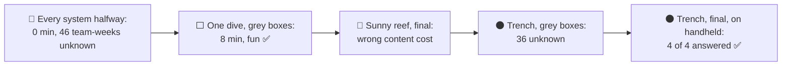
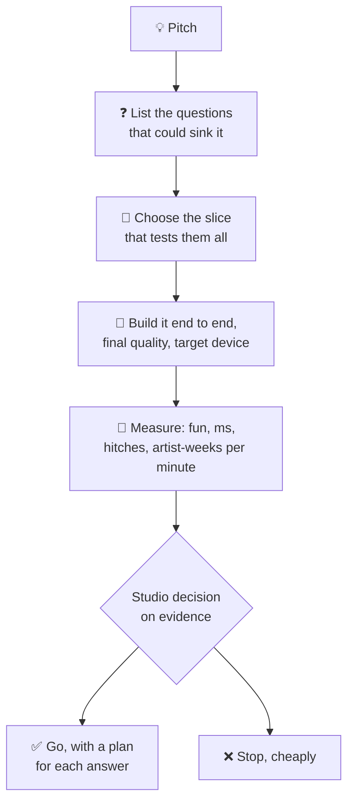
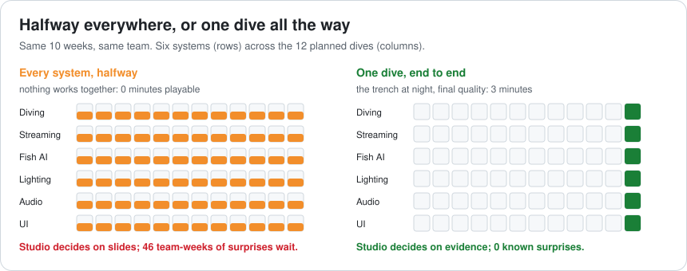
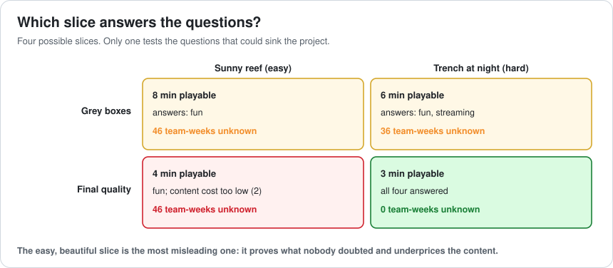
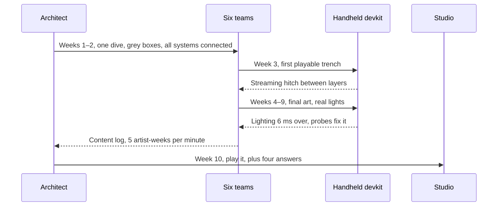
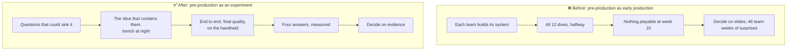

# Lesson 073 — Leading a Vertical Slice: Ten Weeks and Nothing to Play

> Module 7 · The architect's craft · ~15 min read · 2026-11-01

**Today's goal:** plan and lead a vertical slice: a small piece of the game with every system working end to end at final quality, on the target device, chosen so it answers the questions that could sink the project, not the ones nobody doubts.

### TL;DR
- The Reef's next big idea is **deep-sea fishing**: dive in a small submarine, fish in the dark. The studio wants a yes or no in **10 weeks**. Six teams each build their system (diving, depth streaming, fish AI, lighting, audio, UI) for all **12** planned dives. At week 10 every system is about half done and **nothing is playable**. The studio greenlights on slides, and **46 team-weeks** of unanswered risk wait in production.
- A **vertical slice** builds **one dive** with every system working together. Built in grey boxes on the sunny reef, it's playable (8 minutes) and shows diving is fun. But daylight in shallow water tests none of the real risks, and at final quality the easy dive **underprices content** (2 artist-weeks a minute instead of 5).
- The slice that answers the questions is the **hardest dive** (the trench at night) at **final quality** on the **handheld**: 3 minutes, all **4** questions answered, **0** known surprises. The lighting doesn't fit (switch to baked light probes), streaming hitches (preload one layer ahead), and the art budget covers **5 dives, not 12**. The studio decides on evidence.

> 🎮 **Play with it: [Slice Lab](https://yimo691.github.io/GameArchitect/demos/073-slice-lab/)** — build every system halfway or one dive end to end, choose its quality and which dive, and see what's playable and which questions are answered at week 10. Tap **Set up** on the steps to replay the lesson.



---

## 1. The problem

The pitch is exciting: the Reef's players have fished every lake and shore, and now they can go **down**. A little submarine, depth and oxygen to manage, fish that glow in the dark. The studio head: "Show me in ten weeks whether this is a game, and what it will cost."

The team does what teams naturally do: each discipline builds its part.

```
Deep-sea fishing · 10 weeks · plan as run
Diving and movement     gameplay team    all 12 dives' controls
Depth streaming         engine team      every depth layer
Deep-sea fish AI        AI team          24 fish species
Lighting in the dark    rendering team   new dynamic light model
Underwater audio        audio team       full soundscape system
Depth and oxygen UI     UI team          all screens
```

Every team works hard. At week 10, each system is about **half done**, built for 12 dives, and they've never run together. There's a fly-through video, concept art and a schedule. The studio greenlights the project on the strength of the slides.

Six months into production, the surprises arrive:

- The dynamic lighting in darkness costs about **6 ms more** than the handheld can afford: **16 team-weeks** to replace it.
- Streaming depth layers **hitches** during a continuous descent: **10 team-weeks**.
- A minute of finished dark, deep dive takes **5 artist-weeks** to build, not the 2 the schedule assumed: **20 team-weeks** of slip, or cut content.

That's **46 team-weeks** of risk that ten weeks of pre-production could have found. The team spent the time **building**, when the studio needed **answers**.

---

## 2. Step 1 — Name the questions first

A vertical slice isn't a demo. It's an experiment, and an experiment starts with its questions. Before building anything, the architect writes down what the studio actually needs to know, and what each wrong guess would cost in production:

| Question | Why it matters | Cost if wrong, found in production |
|---|---|---|
| Is diving fun? | No fun, no game | The project (but cheapest to test) |
| Does lighting in darkness fit the handheld frame? | New light model, weakest platform | 16 team-weeks |
| Does depth streaming hold during a continuous descent? | New streaming pattern (Lesson 043) | 10 team-weeks |
| What does a minute of finished dive cost to make? | Sets the whole content plan | 20 team-weeks |

This list is Lesson 072's risk table in another form: the parts with the widest ranges are the ones to answer first. It also defines **done** for the slice: the slice is finished when these four have answers, not when a feature list is complete.



---

## 3. Step 2 — Thin and complete beats wide and half-done

A **vertical slice** cuts through every system for a small amount of content: one dive, with diving, streaming, fish, lighting, audio and UI all working together, at the quality the final game will have.



The first attempt is a grey-box slice of the easiest dive, the **sunny reef**:

```
Slice: sunny reef, grey boxes
playable              8 minutes
fun?                  yes, once the oxygen timer is 50% longer
lighting on handheld  not tested: daylight, no dark scenes
streaming             not tested: shallow, one layer
content cost          not tested: grey boxes aren't final art
unknown               16 + 10 + 20 = 46 team-weeks
```

That's already worth more than the horizontal plan: the studio can **play** it, and the oxygen timer change came from 20 people playing it, not from a meeting. But three of the four questions are still open.

So the team builds the sunny reef at **final quality** on the handheld. It looks wonderful. And it gives a content cost of **2 artist-weeks per minute**, which is right for a sunny reef and wrong for the game: most dives are dark and deep, with glowing fish, particles and custom lighting, at 5 weeks a minute. **A slice can mislead.** The beautiful, easy slice proves what nobody doubted and underprices what everybody needed to know.

---

## 4. Step 3 — Choose the hardest slice

The slice that answers the questions is the one that **contains** them: the **trench at night**. It's the deepest dive (continuous descent through every depth layer), the darkest (the new lighting at its worst), with the most glowing fish and effects (the most expensive content).



In grey boxes, the trench answers two questions: diving is fun, and the continuous descent shows the streaming hitch (representative sizes are enough for that). It can't answer lighting or content cost: those need real art on the real device.

At **final quality on the handheld**, in 10 weeks, the team gets **3 minutes** of the trench, and all four answers:

| Question | Answer | What production plans for |
|---|---|---|
| Fun? | Yes, with a 50% longer oxygen timer | Tuned timer; dives of 3–5 minutes |
| Lighting? | Dynamic lights 6 ms over budget | Baked light probes + a few dynamic lights for glowing fish |
| Streaming? | Hitches between depth layers | Preload one layer ahead during the descent |
| Content cost? | 5 artist-weeks a minute | The art budget covers **5 dives, not 12** |

Three minutes of play is less than eight. It's also the only slice that leaves **0** known surprises for production. The studio can now make a real decision: greenlight deep-sea fishing with 5 dives and the lighting change, or stop now, having spent 10 weeks instead of a year.



---

## 5. Step 4 — Lead it like an experiment

Leading a slice is different from leading production. Four habits keep it honest:

1. **Connect everything in week 2.** A grey-box version of the whole dive should run end to end very early. Integration problems are the slice's first findings.
2. **Measure on the target device from the start.** The handheld, not a fast PC. Lighting and streaming answers mean nothing on the wrong hardware (Lesson 057).
3. **Log the real cost of content.** Every artist logs hours per asset and per minute of finished dive. That log is the content-cost answer.
4. **Cut scope, never quality.** If week 6 looks tight, make the dive shorter, not uglier. A grey-box corner in a final-quality slice hides exactly the cost you're trying to measure.

And one rule about what the slice is **not**: it's not the first piece of production code. Some of it will be thrown away (the dynamic lighting path was). Decide up front which parts are prototypes and which carry into production, and write it down (Lesson 068).

---

## 6. The architect's view

The junior builds their part of the feature. The optimizer makes their part fast. The architect asks: **what do we need to know before we commit, and what's the smallest complete thing that would tell us?**



### Trade-offs

| Choice | Cost | Benefit | When to use |
|---|---|---|---|
| Every system in parallel | Nothing playable for weeks | Each team busy and independent | Production, after the risks are answered |
| Grey-box vertical slice | Some throwaway work | Playable early; tests fun and flow | First weeks of any new feature |
| Final-quality slice | Fewer minutes of content | Real performance and content costs | Before a go / no-go decision |
| Easiest content in the slice | Misleading numbers | A nice demo | Marketing, never decisions |
| Hardest content in the slice | Less polish, harder weeks | Tests the real risks | Pre-production |
| Cut scope, keep quality | Shorter slice | Honest measurements | When the slice runs late |

---

## 7. Common mistakes

- **Starting with features instead of questions.** Then the slice is "done" without answering anything.
- **Building horizontally in pre-production.** Half of every system can't be played, measured or judged.
- **Choosing the easy, pretty dive.** It proves what nobody doubted and underprices content.
- **Measuring on a dev PC.** The handheld is where the lighting question lives.
- **Grey boxes for questions about art.** Content cost and lighting need final art.
- **Treating the slice as production code.** Some of it should be thrown away; plan which.

---

## 8. Quiz — think about it on the ferry ⛴️

**Q1.** Why did ten weeks of hard work produce nothing to play?

<details><summary>Answer</summary>

Each team built its own system for all 12 dives in parallel. Every system was half done and none had ever run with the others. A game is the systems working together; none of them did yet.
</details>

**Q2.** Add up the surprises the horizontal plan left for production.

<details><summary>Answer</summary>

Lighting 16 + streaming 10 + content cost 20 = **46 team-weeks**. Fun was the only question with no production cost, and it was also unanswered.
</details>

**Q3.** The final-quality sunny reef gives 2 artist-weeks per minute. Why is that number dangerous?

<details><summary>Answer</summary>

It's correct for the sunny reef and wrong for most of the game, whose dark, deep dives cost 5 weeks a minute. A schedule built on 2 would plan 12 dives the art budget can't pay for.
</details>

**Q4.** Which questions can a grey-box trench answer, and which need final quality?

<details><summary>Answer</summary>

Grey boxes answer fun and streaming (the continuous descent with representative sizes). Lighting on the handheld and content cost need final art on the real device.
</details>

**Q5.** The art budget pays for 48 minutes at 2 artist-weeks a minute (12 dives of 4 minutes). How many dives fit at 5?

<details><summary>Answer</summary>

`48 × 2 = 96 artist-weeks`. At 5 a minute, `96 ÷ 5 ≈ 19 minutes`, about **5 dives** of 4 minutes.
</details>

**Q6.** The slice runs late in week 6. What should the team cut?

<details><summary>Answer</summary>

Scope: make the dive shorter. Not quality: a corner left in grey boxes hides the lighting and content costs the slice exists to measure.
</details>

---

## 9. Back at the desk (≈45 min) — plan a slice

> No desk today? Do it in the [Slice Lab](https://yimo691.github.io/GameArchitect/demos/073-slice-lab/): predict playable minutes, answers and surprises for each step, then tap.

For a feature or game idea of your own:

1. Write the **3–5 questions** that could sink it, and the production cost of each wrong guess.
2. List the **systems** involved.
3. Choose the **piece of content** that contains all the questions. It's usually the hardest one, not the prettiest.
4. Decide what must be **final quality** and what can stay grey.
5. Name the **target device** and what you'll measure on it.
6. Save `journal/073-slice.md`:

| Question | Cost if wrong | Slice content that tests it | Measured how | Answer |
|---|---|---|---|---|
| | | | | |
| | | | | |
| | | | | |

One question for your journal: what's the most beautiful demo you've seen fail to predict a project's real problems, and which question did it avoid?

---

## 10. Vocabulary

| Term | Meaning | 中文 |
|---|---|---|
| Vertical slice | A small piece of the game with every system at final quality | 垂直切片 |
| Pre-production | The phase that decides what to build and how | 预制作阶段 |
| Greenlight | The decision to fund a project into production | 立项批准 |
| Grey box | Placeholder geometry used to test layout and flow | 灰盒 |
| Horizontal development | Building each system separately, across all content | 横向开发 |
| End to end | From player input to output, through every system | 端到端 |
| Target device | The hardware the game must run on | 目标设备 |
| Content cost | Time to produce a unit of finished content | 内容成本 |
| First playable | The first build where the core loop can be played | 首个可玩版本 |
| Go / no-go | The decision to continue or stop | 继续 / 终止决策 |

---

## 11. Further reading

- **Mark Cerny, "The Method"** (D.I.C.E. Summit, 2002): pre-production as finding the game before committing to production.
- **Clinton Keith, *Agile Game Development with Scrum*** (2010): vertical slices and potentially shippable increments in games.
- **Jason Schreier, *Blood, Sweat, and Pixels*** (2017): real projects where demos and vertical slices shaped what shipped.
- **Lessons 043, 057 and 072** of this course: streaming, device budgets and estimating risk, the questions this slice answers.

---

**Tomorrow — Lesson 074: Directing AI coding tools as an architect.** An AI assistant writes the deep-sea fish behaviour in an afternoon: 2,000 lines that compile, pass its own tests, and allocate in every update, ignore the AI LOD system and duplicate three utilities the codebase already has. We learn to give an AI tool what a new team member would need (the architecture, the budgets, the rules) and to review its work the way Lesson 070 taught.
