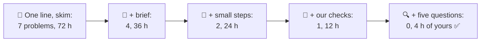
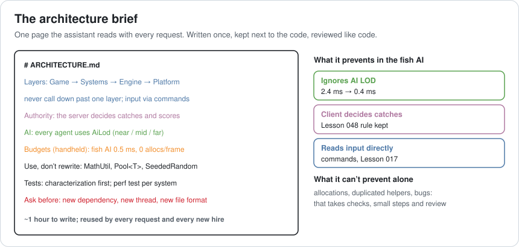
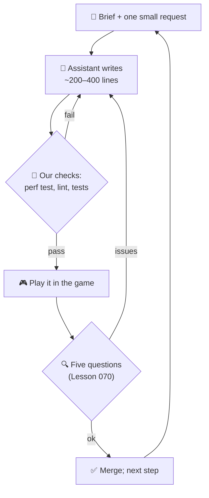
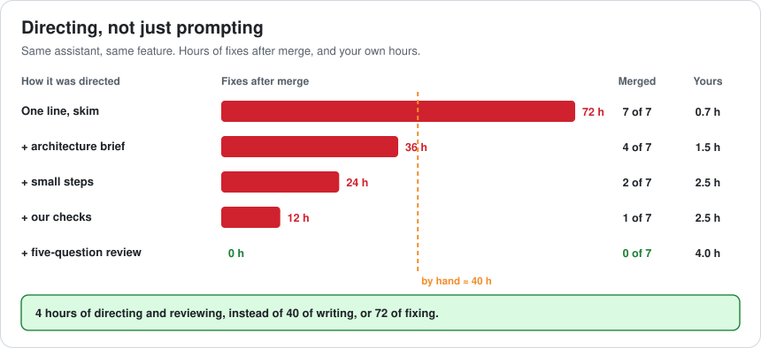
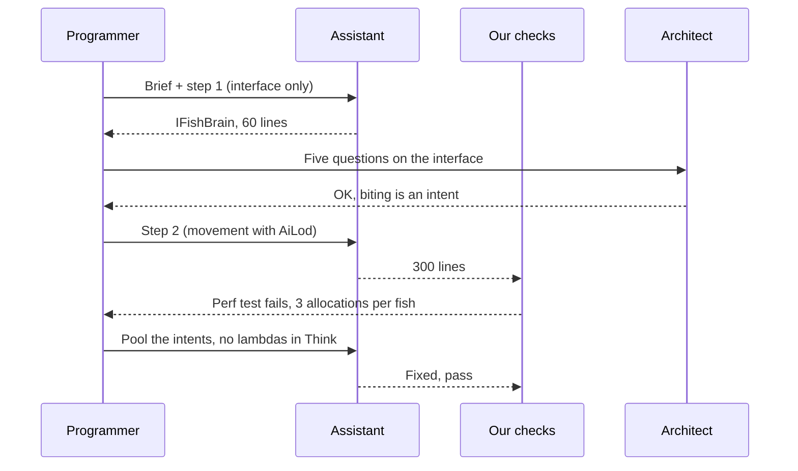
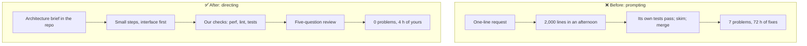

# Lesson 074 — Directing AI Coding Tools as an Architect: 2,000 Lines in an Afternoon

> Module 7 · The architect's craft · ~15 min read · 2026-11-01

**Today's goal:** use AI coding assistants the way an architect uses a fast new team member: give them the architecture in writing, ask for small steps you can run, hold their code to the same checks as everyone else's, and review it with the same five questions, so the speed doesn't turn into weeks of fixes.

### TL;DR
- A programmer asks an AI assistant to "write deep-sea fish AI". In an afternoon it produces **2,000 lines** that compile and pass the tests it wrote. A skim, a merge, and **7 problems** reach the game: it allocates every update, ignores the AI LOD system, duplicates three utilities, lets the client decide catches, reads input directly, and has two bugs. Fixing them costs **72 hours**, more than the **~40 hours** it would have taken to write by hand.
- A one-page **architecture brief** (layers, authority, AI LOD, budgets, existing utilities) means 3 problems are never written. **Small steps** you can play (interface first, then one behaviour at a time) catch both bugs. **Our own checks** (the perf test and an architecture lint) catch the allocation.
- A **five-question review** (Lesson 070) on each step finds the duplicated helpers. **0 problems** merged, **4 hours** of the programmer's time, fish AI at **0.4 ms** on the handheld.

> 🎮 **Play with it: [AI Pairing Lab](https://yimo691.github.io/GameArchitect/demos/074-ai-pairing-lab/)** — choose what the assistant is told, how big each request is, which checks its code must pass and how it's reviewed, and see what reaches the game. Tap **Set up** on the steps to replay the lesson.



---

## 1. The problem

The deep-sea slice from Lesson 073 is approved, and the fish need behaviour: swimming in schools, avoiding light, reacting to the submarine, biting. A programmer opens an AI coding assistant and types:

```
Write deep-sea fish AI for our Unity-style game: schooling, light avoidance,
reaction to the player's submarine, and biting behaviour.
```

By the end of the afternoon there are 2,000 lines across 14 files. They compile. The assistant wrote 40 unit tests and they all pass. The fish swim nicely in the editor. A quick look at the diff, and it's merged.

Over the next two weeks, the team finds:

```
Deep-sea fish AI · what merged
1  new List<> and lambdas in every Update: GC spike every few seconds     12 h
2  every fish thinks every frame: no AiLod (Lesson 053): 2.4 ms            12 h
3  its own Vector3 helpers, random and pooling: 3 utilities duplicated    12 h
4  the client decides when a fish bites (Lesson 048)                      12 h
5  reads the controller directly instead of commands (Lesson 017)         12 h
6  bug: fish slip through the seabed below 200 m                          6 h
7  bug: fish keep moving while the game is paused                         6 h
                                                                total     72 h
```

None of these are unusual mistakes. They're what a capable programmer would write on their **first day**, before anyone told them how the Reef works. The assistant knows how fish AI is usually written. It doesn't know how **this** codebase is written, what it's allowed to depend on, or what the handheld can afford, unless someone tells it.

And unlike a new hire, it writes 2,000 lines before anyone gets a chance to say so.

---

## 2. Step 1 — Write the architecture down once

Everything the assistant got wrong is something an architect knows and a newcomer doesn't. So write it down in one page that the assistant reads with every request, in the repo, next to the code. Many tools look for such a file automatically (for example `CLAUDE.md` or `AGENTS.md`); any name works if it's included every time.



A good brief is short and concrete. It isn't a style guide (the formatter owns that, Lesson 070). It holds:

- **Layers and dependency rules**: what may call what (Lesson 018).
- **Authority**: what the server decides (Lesson 048).
- **System conventions**: every agent uses `AiLod`; input arrives as commands.
- **Budgets on the weakest device**: fish AI 0.5 ms on the handheld, no allocations per frame.
- **Utilities that already exist**: so it uses them instead of writing new ones.
- **When to stop and ask**: new dependencies, threads, file formats.

With the brief, the assistant never writes problems 2, 4 and 5: it follows rules it can see. Problems 1, 3, 6 and 7 still merge: **36 hours**. Writing the brief took about **an hour**, and it's reused for every request after this one, by people too.

That's the first lesson: **an assistant's output is only as architectural as its input.** The brief is the cheapest piece of architecture you'll ever write, because it's read thousands of times.

---

## 3. Step 2 — Small steps you can run

2,000 lines in one request is the 1,400-line pull request from Lesson 070, but worse: nobody even wrote it slowly. So ask in **small steps**, each one small enough to read and run:

1. **The interface first**: `IFishBrain` with `Think(in FishContext, ref FishIntent)`. Review it alone; it's where design problems are cheapest (Lesson 070).
2. **Movement** behind the interface, using `AiLod`. Play it in the trench.
3. **Pausing and depth limits**. Play it: the pause bug and the seabed bug show up here, in the step that made them.
4. **Schooling**, then **light avoidance**, then **biting** (as an intent the server decides).



Small steps cost the programmer about an hour more of prompting and reading. Both bugs are found by playing each step: **24 hours** left (the allocation and the duplicated helpers).

There's a second benefit: in small steps, the programmer stays the **author**. They decide the order, see each piece and can explain the whole. With one big request, they're a reviewer of a stranger's code, and a tired one.

---

## 4. Step 3 — Same checks, same review

The assistant's 40 tests all passed. They tested what it **meant** to write: "schooling keeps fish within 3 m of the leader". They couldn't test what it didn't know mattered: allocations, frame time on the handheld, dependency rules.

So its code goes through **our** checks, the same ones every human change passes:

- The **performance test** from Lesson 063 on the trench scene: fails on the GC spikes (problem 1).
- An **architecture lint** (a dependency check in CI): "Gameplay may not reference `Platform.Input`; client code may not write `CatchResult`". It would also have caught 4 and 5 without the brief.

After checks: **1 problem**, **12 hours**. What's left is the kind of thing only a person sees: the assistant wrote `FishMath.Lerp`, `FishRandom` and a little pool when `MathUtil`, `SeededRandom` and `Pool<T>` already exist. The code works, and now there are two of everything, with slightly different behaviour.

The **five-question review** (Lesson 070) catches it at question 2, **dependencies**: "what does this add, and does it duplicate something we own?". In small steps the review takes about **2 hours** in total.

```
Brief + small steps + our checks + five-question review
problems merged     0 of 7
programmer's time   1 (brief) + 1 (steps) + 2 (review) = 4 hours
fish AI, handheld   0.4 ms of 0.5
by hand             ≈ 40 hours
```



---

## 5. Step 4 — What changes for the architect

AI tools change the **cost** of writing code, and so they change where an architect's time is worth the most:

- **Writing code** gets cheap. **Knowing what code should exist** doesn't. The brief, the interfaces and the budgets are worth more than ever, because they now steer far more code.
- **Checks become the contract.** When code arrives faster than people can read it, the perf test, the dependency lint and characterization tests (Lesson 065) are what keep the architecture true.
- **Review moves outward.** Line-by-line reading of generated code is slow and unreliable. The five questions (boundaries, dependencies, hot paths, failure modes, load) are exactly what generated code gets wrong.
- **Small steps beat big asks.** The assistant is fastest when the human is still steering every few hundred lines.



Two cautions. First, **you own what you merge**: "the assistant wrote it" isn't an answer in a postmortem. Second, the brief can go stale like any document (Lesson 068): when a rule changes, change the brief in the same pull request.

---

## 6. The architect's view

The junior asks the tool for a feature and checks that it compiles. The optimizer asks it to make one function faster. The architect asks: **does the tool know our architecture, is it working in steps I can steer, and does its code pass the same checks and review as everyone's?**



### Trade-offs

| Choice | Cost | Benefit | When to use |
|---|---|---|---|
| One-line request, big output | Minutes | Fast first draft | Throwaway prototypes only |
| Architecture brief | ~1 h once, kept current | Rules followed from the first line | Always, for any codebase that matters |
| Small, playable steps | ~1 h more steering | Bugs found where they're made; you stay the author | Features, not one-liners |
| Our checks on generated code | CI time | Budgets and dependencies enforced automatically | Always |
| Five-question review | ~2 h per feature | Finds duplication and design problems | Every merge |
| Writing it by hand | ~40 h | Full understanding | Core systems you must know line by line |

---

## 7. Common mistakes

- **Trusting the assistant's own tests.** They check its intentions, not your requirements.
- **Asking for whole features.** Big outputs get skimmed; small ones get understood.
- **Explaining the architecture in every prompt.** Write it once, in the repo, and keep it current.
- **Lower standards for generated code.** Same checks, same review, same owner.
- **Letting the tool choose dependencies.** New libraries, threads and formats are architecture decisions; the brief says "ask first".
- **Skipping the interface step.** Without it, the assistant designs the boundary by accident.

---

## 8. Quiz — think about it on the ferry ⛴️

**Q1.** Why did 2,000 lines that compile and pass 40 tests still cost 72 hours?

<details><summary>Answer</summary>

The assistant didn't know the Reef's architecture: the AI LOD system, the authority rule, the command input, the existing utilities, the handheld budget. Its tests checked what it intended, not those rules. Five architectural problems at 12 h and two bugs at 6 h: `60 + 12 = 72 hours`.
</details>

**Q2.** Which three problems does the brief prevent, and why not the other four?

<details><summary>Answer</summary>

No AI LOD, client-decided catches and direct input: they're rules it can follow once it sees them. Allocations and duplicated helpers still slip in (it can't measure, and doesn't always find the existing code), and bugs are bugs.
</details>

**Q3.** Why do small steps catch both bugs?

<details><summary>Answer</summary>

Each step is played in the game. Pausing and depth limits are added in their own step, so the pause bug and the seabed bug show up right when that step runs, instead of somewhere in 2,000 lines.
</details>

**Q4.** Which check catches the allocation problem, and why couldn't the assistant's tests?

<details><summary>Answer</summary>

The performance test on the trench scene (Lesson 063): it measures allocations and frame time on real hardware. Unit tests check results, not how much memory or time producing them costs.
</details>

**Q5.** Which of the five review questions catches the duplicated utilities?

<details><summary>Answer</summary>

Dependencies: "what does this add, and does it duplicate something we own?". `FishMath`, `FishRandom` and the private pool repeat `MathUtil`, `SeededRandom` and `Pool<T>`.
</details>

**Q6.** Compute the programmer's time in the final setup, and compare it with writing by hand.

<details><summary>Answer</summary>

Brief 1 h + small-step steering 1 h + review 2 h = **4 hours**, against about 40 hours by hand, with 0 problems merged.
</details>

---

## 9. Back at the desk (≈45 min) — write your brief

> No desk today? Do it in the [AI Pairing Lab](https://yimo691.github.io/GameArchitect/demos/074-ai-pairing-lab/): predict merged problems and hours for each step, then tap.

For a codebase you work in:

1. Write a **one-page architecture brief**: layers and dependency rules, authority, key conventions, budgets on the weakest device, existing utilities, and "ask before" items.
2. Pick a **small feature** and split it into **steps**, interface first.
3. List the **checks** generated code must pass. Mark the ones you don't have yet.
4. Ask an assistant for **step 1 only**, with the brief. Review it with the **five questions**.
5. Save `journal/074-ai-directing.md`:

| Step | Lines | Checks passed | Review findings | Fixed before merge? |
|---|---|---|---|---|
| | | | | |
| | | | | |
| | | | | |

One question for your journal: which rule in your codebase would an assistant (or a new hire) be most likely to break, and is it written down anywhere?

---

## 10. Vocabulary

| Term | Meaning | 中文 |
|---|---|---|
| AI coding assistant | A tool that writes or edits code from instructions | AI 编程助手 |
| Prompt | The instruction given to an assistant | 提示词 |
| Architecture brief | A short document of rules an assistant reads with every request | 架构说明 |
| Context | Everything the assistant can see while it works | 上下文 |
| Architecture lint | An automated check of dependency and layering rules | 架构检查 |
| Generated code | Code written by a tool rather than a person | 生成代码 |
| Small steps | Asking for a feature in pieces you can run and review | 小步迭代 |
| Hallucination | Confident output that doesn't match reality | 幻觉 |
| Duplicate utility | A second version of a helper that already exists | 重复工具函数 |
| Owner | The person who answers for the code once it's merged | 负责人 |

---

## 11. Further reading

- **Anthropic, "Claude Code: Best practices for agentic coding"** (anthropic.com/engineering, 2025): project instruction files, small steps, and checks for AI-written code.
- **AGENTS.md** (agents.md): an open convention for giving coding agents a project's rules in the repo.
- **Birgitta Böckeler, "Exploring Generative AI"** (martinfowler.com, 2023–2025): notes on where AI coding assistants help and where they mislead.
- **Google DORA, "Accelerate State of DevOps Report 2024"**: AI adoption and its measured effects on delivery speed and stability.

---

**Tomorrow — Lesson 075: Case study: anatomy of a commercial engine runtime.** We open up what happens inside a commercial engine in one frame, from input to present: the game thread, the render thread, the job system and the GPU, and map every part back to the lessons of this course, so you can read any engine's profiler and know where you are.
