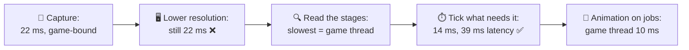
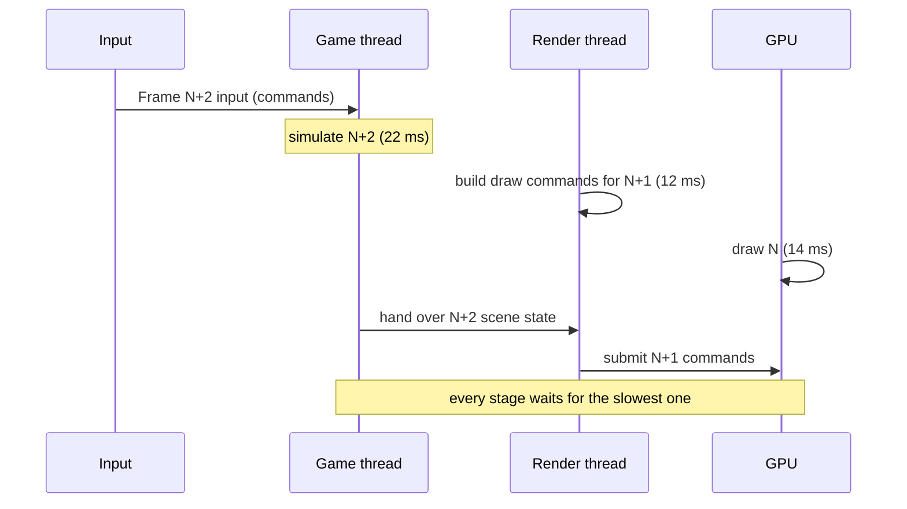
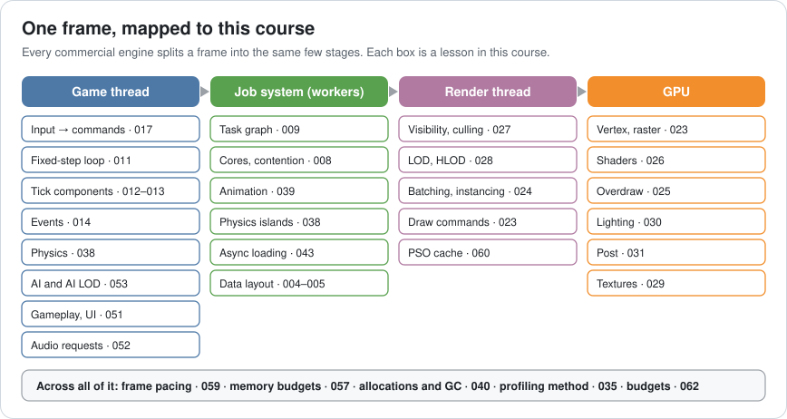
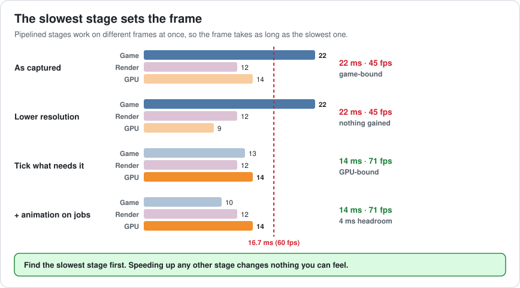
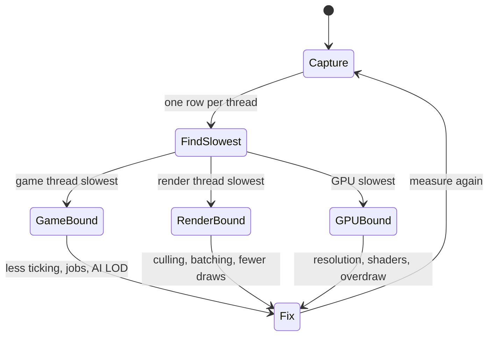
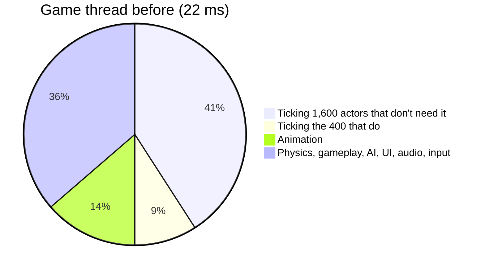
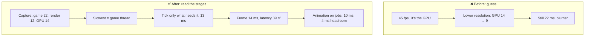

# Lesson 075 — Case Study: Anatomy of a Commercial Engine Runtime: The 22 ms Frame Where the GPU Was Waiting

> Module 7 · The architect's craft · ~15 min read · 2026-11-01

**Today's goal:** open up one frame of a commercial engine, from input to the finished image, and learn to read it the way the engine runs it: a game thread, worker threads, a render thread and a GPU, working on different frames at the same time. Then use that picture to find the real bottleneck before anyone changes a line.

### TL;DR
- The Reef's harbour runs at **22 ms (45 fps)** on a mid-range PC. The goal is **60 fps (16.7 ms)** and **input to finished frame under 40 ms**. The team's first guess is "the GPU", so they lower the resolution. The GPU drops from **14 to 9 ms**, and the frame stays at **22 ms**.
- A commercial engine **pipelines** its stages: while the GPU draws frame N, the render thread prepares N+1 and the game thread simulates N+2. So the frame takes as long as the **slowest stage**, not the sum (which would be 22 + 12 + 14 = **48 ms**). The capture shows the **game thread** at 22 ms is the slowest.
- **2,000 actors tick every frame**, and **1,600** of them don't need to. Stop those and the game thread drops to **13 ms**. The GPU is now the slowest stage: **14 ms, 71 fps**, latency **39 ms**. Goal met.
- Moving **animation to worker threads** takes the game thread to **10 ms**: same frame, latency **36 ms**, and **4 ms of headroom** for the next feature.

> 🎮 **Play with it: [Engine Frame Lab](https://yimo691.github.io/GameArchitect/demos/075-engine-frame-lab/)** — switch pipelining, resolution, ticking and where animation runs, and watch three frames flow through the game thread, workers, render thread and GPU. Tap **Set up** on the steps to replay the lesson.



---

## 1. The problem

The Reef is coming to PC. The harbour at dusk is the busiest scene in the game: boats, gulls, market stalls, lanterns, fishermen, crates, nets, and about two thousand things the designers placed over three years. On the team's mid-range test PC it runs at 45 fps, and the target is 60.

The first meeting goes like this:

```
"It's a big scene with lots of lights. It's the GPU."
"Drop the resolution to 75% and see."
```

They try it. The GPU time drops from 14 ms to 9 ms. The frame counter doesn't move: still 22 ms, still 45 fps. Now the harbour is blurrier *and* just as slow. Someone suggests turning shadows down next.

The architect asks for a capture instead, from the engine's own profiler, with one row per thread:

```
Harbour at dusk · mid-range PC · one frame
Game thread     22 ms   input, tick 2,000 actors, physics, gameplay, animation, UI, audio
Render thread   12 ms   visibility, LOD, batching, building draw commands
GPU             14 ms   (native resolution) shadows, lighting, post
Input → finished frame: 48 ms
Goal: 16.7 ms per frame, under 40 ms input → finished frame, native resolution
```

Three numbers, and none of them is 22 ms except one. To read this capture, you need a picture of how a commercial engine runs a frame. You already know every part of it from this course; today we put the parts in one place.



---

## 2. Step 1 — Know the stages

Look at the public documentation of any big engine and you find the same shape. Unreal Engine describes a **game thread**, a **render thread**, an **RHI thread** that talks to the graphics API, and a **task graph** of worker threads. Unity describes a **main thread**, a **render thread**, and a **job system** with worker threads. Names differ; the jobs are the same.



**The game thread** (Unity: main thread) owns the world. It turns input into commands (Lesson 017), steps the simulation, often with a fixed timestep (Lesson 011), ticks components (Lessons 012–013), sends events (Lesson 014), runs physics (Lesson 038), AI (Lesson 053), gameplay, UI (Lesson 051) and audio requests (Lesson 052). Most gameplay code you write runs here, which is why it's so often the bottleneck.

**The job system** (Unreal: task graph) runs work in parallel on the other cores: animation (Lesson 039), physics islands, async loading (Lesson 043), anything you can split into independent chunks. Lessons 008 and 009 apply in full: contention, false sharing, and jobs too small to pay for themselves.

**The render thread** takes a copy of what the game thread decided and turns it into GPU work: what's visible (Lesson 027), which LOD (Lesson 028), how to batch (Lesson 024), which pipeline states it needs (Lesson 060). In Unreal, an RHI thread then submits those commands to the driver.

**The GPU** draws: vertex and raster work (Lesson 023), shaders (Lesson 026), overdraw (Lesson 025), lighting (Lesson 030), post-processing (Lesson 031), all fed by texture memory (Lesson 029).

Across all of it sit frame pacing (Lesson 059), memory budgets (Lesson 057) and allocations (Lesson 040). If you have taken this course, there's no part of a commercial engine you have never seen. What's new is how the parts run **together**.

---

## 3. Step 2 — Stages overlap, so the slowest one wins

If one thread did everything in order, a frame would cost the **sum**: 22 + 12 + 14 = **48 ms**, 21 fps. No commercial engine works that way. Instead, the stages form a **pipeline**, like a car wash with three bays. While the GPU draws frame N, the render thread builds commands for frame N+1, and the game thread simulates frame N+2. To make that safe, the game thread hands the render thread a **copy** of the scene state it needs, so the two never read and write the same data at the same time.

Because the stages overlap, a new frame comes out every time the **slowest** stage finishes:

```
frame time (pipelined) = max(game 22, render 12, GPU 14) = 22 ms   → 45 fps
frame time (one thread) = 22 + 12 + 14              = 48 ms   → 21 fps
```

That explains the failed experiment. Lowering the resolution made the GPU 5 ms faster, but the GPU was already waiting 8 ms a frame for the game thread. Making a waiting stage faster just makes it wait longer.





Pipelining has a price. It buys **throughput** (frames per second), not **responsiveness**. An input still has to pass through every stage before you see it: the game thread reads it, the render thread prepares it, the GPU draws it. So input to finished frame is the **sum** of the stages, here **48 ms**, and the display adds its own time on top. That's why the goal has two numbers: frame time *and* latency. Lowering the resolution cut latency to 43 ms, still over 40, and the frame time didn't change at all.

The architect's rule from Lesson 035 applies, in engine form: **find the slowest stage first, then look inside it.**

---

## 4. Step 3 — Look inside the slowest stage

The profiler's game-thread row, opened up:

```
Game thread · 22 ms
Tick: 2,000 actors every frame                 11 ms
   of which 1,600 never change between frames   9 ms
Animation (300 characters)                       3 ms
Physics, gameplay, AI, UI, audio, input          8 ms
```

Most engines let any object run code every frame: Unreal's actor and component **Tick**, Unity's `Update()`. It's the easiest thing in the world to use, so after three years almost everything does: lamp posts check the time of day, benches check if anyone sits on them, distant boats bob even when nobody can see them, crates check if they've fallen into the water. Each costs a few microseconds. Two thousand of them cost 11 ms.

The fix uses tools the engines already provide, and ideas from earlier lessons:

- **Don't tick at all** if nothing changes. A lamp turns on with one event at dusk (Lesson 014), not a check every frame. Unreal lets a component say it never ticks; in Unity, a script without `Update()` costs nothing per frame.
- **Tick less often** when slow is fine. Distant boats and gulls tick at 10 Hz with an **AI LOD** (Lesson 053), or an engine tick interval.
- **Tick in bulk.** Hundreds of similar objects are updated by one manager over a tight array (Lessons 005 and 013), not by hundreds of tiny calls.

After the change, **400 actors** tick every frame, the rest on a timer or on events. The game thread drops from 22 to **13 ms**.

Now read the capture again, because the bottleneck has moved:

```
Game thread 13 · Render thread 12 · GPU 14  → frame = 14 ms, 71 fps (GPU-bound)
Input → finished frame: 13 + 12 + 14 = 39 ms   (goal: under 40)
```

Both goals are met, at native resolution. The resolution change can be reverted: it was never the problem, and now it would only help if the GPU needed headroom.

---

## 5. Step 4 — Use the other cores, and keep headroom

The goal is met, but the game thread at 13 ms is only 1 ms behind the GPU. The next feature (the festival fireworks, say) will land on the game thread and make it the bottleneck again.

Animation is a good job candidate: each character's pose depends only on its own state, so 300 characters split cleanly across worker threads (Lesson 039 for the cost, Lesson 009 for the job graph). The game thread starts the jobs early, does other work, and collects the results before it hands the frame to the render thread.

```
Game thread 10 · Workers 3 (in parallel) · Render thread 12 · GPU 14
Frame = 14 ms, 71 fps · input → finished frame = 36 ms
Game-thread headroom before it's slowest again: 14 − 10 = 4 ms
```

The frame time doesn't change, because the GPU is still slowest. What changed is the **budget**: the game thread now has 4 ms of room, and latency is 3 ms better. That's the architect's reason to move work off the game thread before it's urgent.



Two cautions from Module 1. Jobs aren't free: tiny jobs cost more to schedule than they save (Lesson 009), and jobs that touch shared data fight over it (Lesson 008). And the game thread still has to **wait** for the animation jobs before it can hand off the frame; if they finish late, that wait shows up as game-thread time.

---

## 6. The architect's view

The junior sees 45 fps and lowers the settings. The optimizer opens the slowest function and makes it faster. The architect asks: **which stage is the slowest, why does the work live there, and how much headroom will each stage have after the next feature?**



Knowing the runtime's shape also changes design reviews. When a designer asks for "every lamp flickers on its own", you now hear "two hundred more ticks on the game thread", and you can offer a flicker in the shader instead, which costs GPU time on a stage with room. When an artist asks for more lights, you check the GPU row, not the frame counter. This is the budget conversation of Lesson 062, with the engine's real stages as the columns.

### Trade-offs

| Choice | Cost | Benefit | When to use |
|---|---|---|---|
| Lower resolution | Image quality | GPU time drops | Only when the GPU is the slowest stage |
| Tick everything every frame | Game-thread time grows with content | Easiest to write | Prototypes, and a small set of objects that really change every frame |
| Events, tick intervals, managers | Some design work per system | Game thread scales with what changes, not what exists | Any scene with thousands of objects |
| Move work to jobs | Job setup, data must be split safely | Uses idle cores, frees the game thread | Large, independent work: animation, physics islands, loading |
| Deeper pipeline (more frames in flight) | More input latency and memory | Higher frame rate | When frame rate matters more than responsiveness |
| One thread for everything | Frame time is the sum | Simple to debug | Tiny games and tools |

---

## 7. Common mistakes

- **Reading only the frame counter.** fps tells you that something is slow, not which stage.
- **Fixing the stage you know best.** Graphics programmers lower GPU cost; gameplay programmers tune gameplay. The capture decides.
- **Expecting pipelining to fix latency.** Overlapping stages raise fps; every input still passes through every stage.
- **Ticking by default.** In a big world, "runs every frame" should be the exception that needs a reason.
- **Moving tiny work to jobs.** Scheduling costs real time; batch it into chunks worth the trip (Lesson 009).
- **Stopping when the goal is met.** Note the headroom on every stage; the next feature will use it.

---

## 8. Quiz — think about it on the ferry ⛴️

**Q1.** Why didn't lowering the resolution change the frame time?

<details><summary>Answer</summary>

The stages are pipelined, so the frame takes as long as the slowest one. The game thread took 22 ms; the GPU at 14 ms was already waiting for it. Making the GPU 9 ms just made it wait longer: `max(22, 12, 9) = 22 ms`.
</details>

**Q2.** If one thread did all the work in order, what would the frame time be, and why don't commercial engines do this?

<details><summary>Answer</summary>

`22 + 12 + 14 = 48 ms`, about 21 fps. Pipelining lets the game thread, render thread and GPU work on different frames at once, so the frame costs only the slowest stage: 22 ms.
</details>

**Q3.** What is the input-to-finished-frame time after ticking only what needs it, and why is it a sum and not a maximum?

<details><summary>Answer</summary>

`13 + 12 + 14 = 39 ms`. One input still has to go through every stage in order, game thread, then render thread, then GPU. Pipelining overlaps *different* frames; it doesn't shorten the path of one frame.
</details>

**Q4.** After the tick fix, which stage is the bottleneck, and what would you try next if the PC goal were 90 fps?

<details><summary>Answer</summary>

The GPU at 14 ms. For 90 fps (11.1 ms) the GPU must drop by about 3 ms (shaders, overdraw, lighting, or resolution scaling, Module 3), and the render thread at 12 ms must drop too. The game thread at 10 ms (after jobs) already fits.
</details>

**Q5.** Why move animation to jobs if the frame time stays at 14 ms?

<details><summary>Answer</summary>

Headroom and latency. The game thread goes from 13 to 10 ms, so the next feature can add 4 ms before the game thread becomes slowest again, and input to finished frame improves from 39 to 36 ms.
</details>

**Q6.** A designer wants 200 lamps that flicker on their own. Give a cheaper design than 200 ticking actors.

<details><summary>Answer</summary>

Flicker in the material or shader, with a per-lamp random offset, so it costs a little GPU time and nothing on the game thread. Or one manager that updates all 200 in a tight loop, a few times a second.
</details>

---

## 9. Back at the desk (≈45 min) — read your engine's frame

> No desk today? Do it in the [Engine Frame Lab](https://yimo691.github.io/GameArchitect/demos/075-engine-frame-lab/): predict the frame time, the bottleneck and the latency for each step, then tap.

In an engine you use (Unreal Insights, Unity Profiler, or your own tools):

1. Capture one busy frame with **one row per thread**. Name your engine's game thread, render thread, worker threads and GPU timing.
2. Write down each stage's time and mark the **slowest**.
3. Compute the **pipelined frame time** (max) and the **input-to-frame latency** (sum).
4. Open the slowest stage and list its **top three** costs.
5. Count how many objects **run code every frame**. How many really need to?
6. Save `journal/075-engine-frame.md`:

| Stage | Time (ms) | Slowest? | Top cost inside | Headroom vs. slowest |
|---|---|---|---|---|
| Game thread | | | | |
| Workers | | | | |
| Render thread | | | | |
| GPU | | | | |

One question for your journal: which of your team's last three performance fixes were made on a stage that wasn't the slowest?

---

## 10. Vocabulary

| Term | Meaning | 中文 |
|---|---|---|
| Game thread / main thread | The thread that owns the world and runs gameplay | 游戏线程 / 主线程 |
| Render thread | The thread that turns the scene into GPU commands | 渲染线程 |
| RHI thread | Unreal's thread that submits commands to the graphics API | RHI 线程 |
| Worker thread | A thread that runs jobs from the job system | 工作线程 |
| Pipelining | Stages working on different frames at once | 流水线 |
| Bottleneck | The slowest stage, which sets the frame time | 瓶颈 |
| Tick | Code an object runs every frame | 每帧更新 (Tick) |
| Tick interval | Running an object's tick less often than every frame | Tick 间隔 |
| Frames in flight | How many frames are in the pipeline at once | 在途帧数 |
| Input latency | Time from an input to seeing its result | 输入延迟 |
| Headroom | Time a stage can grow before it becomes the bottleneck | 余量 |

---

## 11. Further reading

- **Jason Gregory, *Game Engine Architecture*, 3rd edition** (CRC Press, 2018): the game loop, the runtime engine architecture, and parallelism in a commercial engine.
- **Unreal Engine documentation, "Threaded Rendering"** and **"Unreal Insights"** (dev.epicgames.com/documentation): the game, render and RHI threads, and how to read them in a trace.
- **Unity Manual, "Job system overview"** and **"Profiler overview"** (docs.unity3d.com): the main thread, render thread and worker threads in the Unity Profiler.
- **Unreal Engine documentation, "Actor Ticking"**: tick groups, disabling ticks and tick intervals.

---

**Tomorrow — Lesson 076: Case study: optimizing an open world.** We take the Reef's whole archipelago, many islands, a day-night cycle and a free camera, and optimize it end to end: streaming, culling, LOD, simulation distance and memory, using every tool from Modules 3 to 6, in the order an architect would reach for them.
