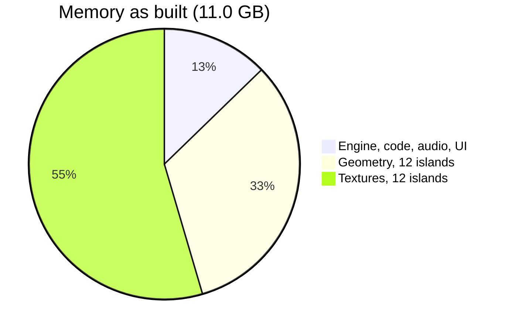
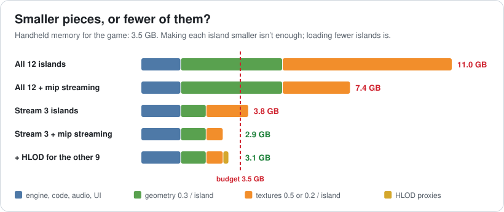
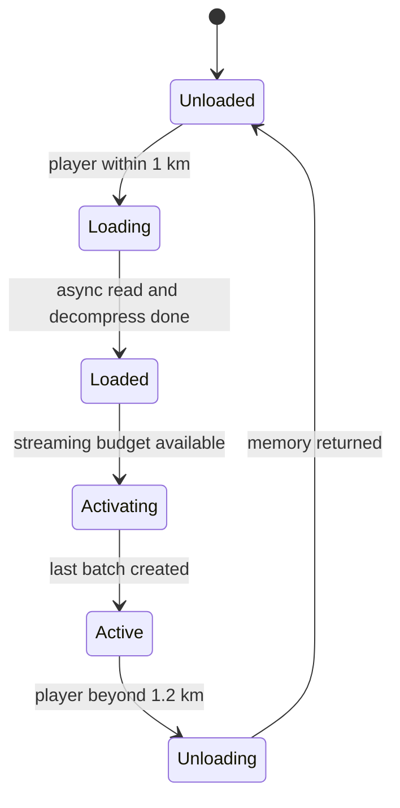
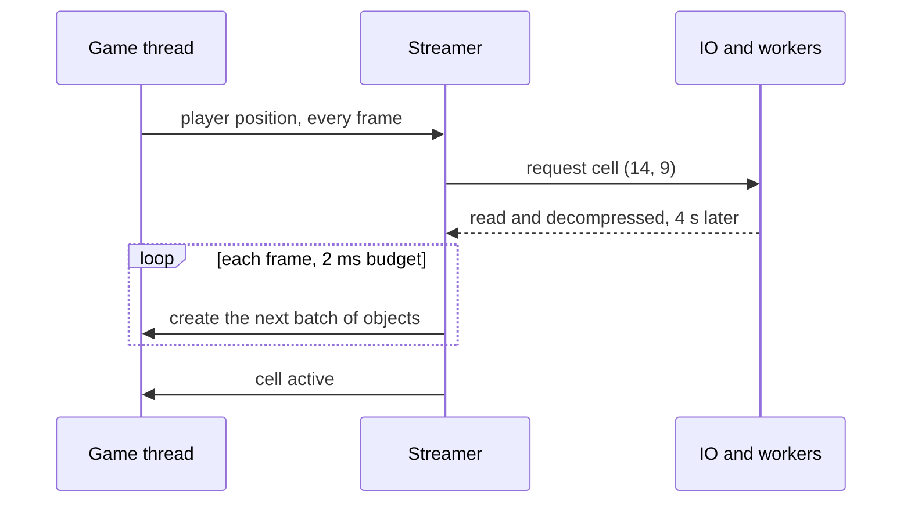
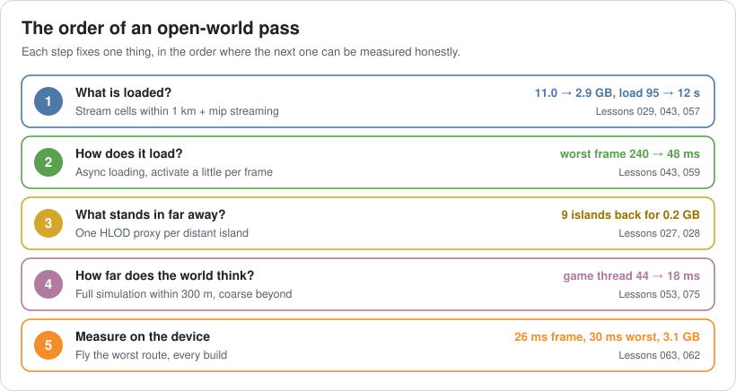

# Lesson 076 — Case Study: Optimizing an Open World: The Archipelago That Needed 11 GB

> Module 7 · The architect's craft · ~15 min read · 2026-11-01

**Today's goal:** take a world that was built like one big level and make it run as an open world on a small device, in the order an architect works: decide what is loaded, make loading invisible, give far-away things a cheap stand-in, limit how far the world thinks at full detail, and measure it on the real device.

### TL;DR
- The Reef's **Archipelago** update has **12 islands**. Built the same way as the first island, it loads everything and simulates all **6,000 agents** in full. On the dev kit: **11.0 GB**, **44 ms** a frame, **95 s** to load. The handheld has **3.5 GB** for the game and must run at **30 fps (33.3 ms)**.
- Smaller textures (mip streaming) still leave **7.4 GB**: the problem is *how much* is loaded, not how big each piece is. **Streaming** only the 3 islands within 1 km: **2.9 GB**, **12 s** to load. But blocking loads cause a **240 ms** frame at every cell boundary; **async** loading brings the worst frame to **48 ms**.
- Nine islands vanished from the horizon. **HLOD proxies** bring them back for **0.2 GB** (**3.1 GB** total).
- The frame is still **44 ms** because the game thread simulates the whole world. **Full simulation within 300 m, coarse beyond**: game thread **18 ms**, frame **26 ms (38 fps)**, worst frame **30 ms**. Goal met, with 7 ms and 0.4 GB of headroom.

> 🎮 **Play with it: [Open World Lab](https://yimo691.github.io/GameArchitect/demos/076-open-world-lab/)** — choose what is loaded, how it streams, how textures and distant islands are handled and how far the world is simulated in full, and watch memory, frame time, the worst frame and loading time on the handheld. Tap **Set up** on the steps to replay the lesson.


---

## 1. The problem

The first Reef island was a level: load it, play it, and everything in it exists the whole time. It fit easily. For the Archipelago update, the team built eleven more islands the same way and connected them with open sea. You can sail anywhere, or fly the photo camera over the whole map.

On the dev kit it works. The dev kit has extra memory for debugging (Lesson 057), so nobody noticed what the profiler said:

```
Archipelago · handheld dev kit · sailing between islands
Memory           11.0 GB    engine 1.4 · geometry 3.6 · textures 6.0
Game thread      44 ms      6,000 agents (fish, boats, gulls, villagers), all in full
Render thread    41 ms      every island, full detail
GPU              38 ms
Loading          95 s       to the first frame
Goal (retail handheld): 3.5 GB · 33.3 ms (30 fps) · no frame over 50 ms
                        loading under 20 s · every island visible on the horizon
```

Two weeks before the content lock, someone tries the retail unit. The game doesn't get past the loading screen: it runs out of memory.

This is the open-world problem in one capture. Every system works. Each island on its own would fit. The architecture assumes that the world is small enough to exist all at once, and that assumption broke when the world grew by twelve times.



---

## 2. Step 1 — Decide what is loaded

The first suggestion in the meeting is the familiar one: textures are the biggest slice, so make them smaller. **Mip streaming** (Lesson 029) keeps only the mip levels the camera needs, and cuts textures from 0.5 to 0.2 GB per island:

```
12 islands × (0.3 geometry + 0.2 textures) + 1.4 = 7.4 GB    still 2× the budget
```

It helps, but it can't win. Every per-asset saving is multiplied by **12 islands**, and the budget only has room for about three. The memory problem is about **how many things exist**, not how big each one is.



So the architect changes the structure. The world is cut into a **grid of cells**, and only the cells near the player are loaded. Commercial engines have this built in: Unreal Engine's **World Partition** loads grid cells around streaming sources; in Unity, teams build the same thing with additive scenes or Addressables. For the archipelago, a 1 km radius keeps **3 islands** loaded:

```
3 islands × (0.3 + 0.2) + 1.4 = 2.9 GB     loading: 95 s → 12 s
```

Loading falls too, because the first frame only needs the cells around the starting harbour (Lesson 043).

Check the radius against speed before you trust it. The fastest boat sails at 20 m/s, and the worst cell load on the handheld's storage is about 6 s. A cell must start loading at least `20 × 6 = 120 m` before you reach it. A 1 km radius gives about 50 s of warning, so even the photo camera, capped at the same speed, can't outrun the streamer.

Two new problems appear at once. Nine islands have **vanished from the horizon**, and every time you cross into a new cell, the game freezes for **240 ms**.

---

## 3. Step 2 — Make loading invisible

The 240 ms frame comes from **blocking loads**: when the player crosses a cell boundary, the game thread reads the cell from disk, decompresses it and creates every object in it before the frame can continue. That's the same mistake as the island that froze for 9.5 seconds in Lesson 043, made smaller and repeated every few hundred metres.

The fix has two halves:

1. **Read in the background.** File reads and decompression run on IO and worker threads (Lesson 075). The game thread never waits for the disk.
2. **Activate a little per frame.** Even with the data in memory, creating 3,000 objects in one frame is a spike. A cell is activated over several frames, with a time budget (say 2 ms per frame for streaming work).



The 1.2 km unload distance is bigger than the 1 km load distance on purpose. Without that gap, a boat sailing along a cell edge would load and unload the same cell again and again.

With async loading, the streaming cost becomes a few milliseconds spread over many frames. The worst frame while sailing drops from **240 ms to 48 ms** (the 44 ms frame plus about 4 ms of streaming work). The frame pacing rules of Lesson 059 apply: a steady 44 ms is still bad, but a 240 ms spike is what players remember.



---

## 4. Step 3 — Give far-away things a cheap stand-in

Players sail toward what they can see. An empty horizon breaks the whole idea of an open world. But loading the far islands is exactly what we just removed.

The answer is **HLOD** (Lesson 028): for each island, an offline build step merges its buildings, rocks and trees into **one simple mesh with one material**. Far away, the whole island is a single draw call and a few thousand triangles. The proxies for all 9 distant islands together take **0.2 GB**, and they're always loaded.

```
Streamed, no horizon:  render thread 12 ms · GPU 22 ms    (9 islands missing)
Streamed, HLOD:        render thread 16 ms · GPU 26 ms    (every island visible)
Everything, full:      render thread 41 ms · GPU 38 ms
Memory: 2.9 + 0.2 = 3.1 GB
```

The horizon costs 4 ms on the render thread and the GPU compared with nothing, and saves 25 ms on the render thread compared with drawing every island in full. That's the trade an open world is built on: things far away get **a cheap version of themselves**, never nothing and never everything.

Look at the frame time, though: still **44 ms**. Streaming fixed memory, async fixed hitches, HLOD fixed the horizon, and none of them touched the slowest stage. Lesson 075's rule: find the slowest stage first.

---

## 5. Step 4 — Limit how far the world thinks

The game thread is the slowest stage, at 44 ms, because **all 6,000 agents** on all 12 islands run in full every frame: fish schooling, boats following routes, villagers walking to the market. Only the ones near the player can be seen.

This is AI LOD (Lesson 053), applied to the whole world:

- **Within 300 m**: full simulation, every frame. This is what the player sees and touches.
- **Beyond 300 m**: **coarse simulation**, once a second. A fishing boat on a far island moves along its route as a point; a school of fish is a number that grows and shrinks. No animation, no physics, no pathfinding.
- **On unloaded islands**: the coarse state lives as **data**, not as game objects. When the island streams in, the objects are created from that data (the save system's job, Lesson 047), so the boat you saw leave the harbour is still out at sea when you arrive.

```
Game thread: 44 ms → 18 ms
Frame = max(game 18, render 16, GPU 26) = 26 ms (38 fps), the GPU is slowest
Worst frame while sailing: 26 + 4 = 30 ms
```



---

## 6. Step 5 — Measure on the device, on the worst route

Every number so far has to hold on the **retail handheld**, not the dev kit. The team adds an automated test (Lesson 063) that flies the camera along the worst route at full speed: across the most cell boundaries, past the busiest harbour, at dusk. Every build records memory, frame time, worst frame and loading time.

```
Archipelago · retail handheld · worst route
Memory         3.1 GB   (budget 3.5, headroom 0.4)
Frame          26 ms    (budget 33.3, headroom 7.3)
Worst frame    30 ms    (budget 50)
Loading        12 s     (budget 20)
Horizon        12 of 12 islands
```

The headroom is the architect's real output. The next update wants a thirteenth island and a festival: with these numbers, the team knows that one more island costs nothing permanent (it's streamed), and that the festival has 7 ms of frame and 0.4 GB of memory to spend (Lesson 062).

---

## 7. The architect's view

The junior sees "out of memory" and shrinks textures. The optimizer profiles the busiest harbour and speeds up its hottest function. The architect asks: **what has to exist right now, what can be a cheaper version of itself, and what can wait on disk?**


Notice that each step uses a lesson you already know: mip streaming (029), async loading (043), HLOD (028), AI LOD (053), save data (047), the slowest stage (075), the perf test (063), budgets (062). An open world doesn't need new techniques. It needs them applied **to the whole world at once**, in the right order, as architecture rather than as fixes.

### Trade-offs

| Choice | Cost | Benefit | When to use |
|---|---|---|---|
| Load everything | Memory and load time grow with the world | Simple; no streaming bugs | Small worlds that fit with headroom |
| Mip streaming | Texture pop-in if IO is slow | Textures sized to what the camera needs | Almost always, on top of world streaming |
| Cell streaming (blocking) | A hitch at every boundary | Memory bounded by the radius | Never on its own in a shipped game |
| Cell streaming (async, time-sliced) | Streaming code, load/unload bugs, IO budget | Bounded memory, no hitches | Any world bigger than memory |
| HLOD proxies | Build time, a bake step for every content change | Full horizon for a few draws | Anything visible from far away |
| Coarse simulation far away | Two versions of each system's logic | Game thread scales with what's near | Worlds with thousands of agents |

---

## 8. Common mistakes

- **Testing on the dev kit only.** Its extra memory hides the one budget that kills the game.
- **Fixing size instead of count.** Per-asset savings multiply by the world's size; streaming changes the multiplier.
- **Blocking loads.** Streaming that runs on the game thread just moves the loading screen into the middle of play.
- **Same load and unload distance.** Without a gap, cells thrash at the edge.
- **Nothing on the horizon.** A cheap stand-in is part of the design, not a polish item.
- **Keeping the world's truth in loaded objects.** If unloading an island deletes its boats, the world forgets. Keep state as data.

---

## 9. Quiz — think about it on the ferry ⛴️

**Q1.** Why can't mip streaming alone fit the archipelago into 3.5 GB?

<details><summary>Answer</summary>

It shrinks each island's textures from 0.5 to 0.2 GB, but all 12 islands are still loaded: `1.4 + 12 × (0.3 + 0.2) = 7.4 GB`. The budget has room for about three islands, so the number of loaded islands has to change.
</details>

**Q2.** Compute memory with streaming (3 islands), mip streaming and HLOD proxies.

<details><summary>Answer</summary>

`1.4 + 3 × (0.3 + 0.2) + 0.2 = 3.1 GB`, leaving 0.4 GB of headroom under 3.5.
</details>

**Q3.** The fastest boat sails at 20 m/s and the worst cell load takes 6 s. What is the minimum lead distance, and why is the unload distance larger than the load distance?

<details><summary>Answer</summary>

`20 × 6 = 120 m`; the 1 km radius is far more than enough. Unloading at 1.2 km instead of 1 km leaves a gap, so a boat moving along a cell edge doesn't load and unload the same cell over and over.
</details>

**Q4.** After async streaming and HLOD, why is the frame still 44 ms?

<details><summary>Answer</summary>

The game thread is the slowest stage: it still simulates all 6,000 agents in full. Render (16 ms) and GPU (26 ms) are already under the budget, so improving them changes nothing (Lesson 075).
</details>

**Q5.** What is the final frame time and worst frame, and which stage sets it?

<details><summary>Answer</summary>

`max(18, 16, 26) = 26 ms` (38 fps), set by the GPU. Worst frame while sailing: `26 + 4 = 30 ms`, under the 50 ms limit.
</details>

**Q6.** A designer wants boats you saw leave a harbour to still be at sea when you sail out to meet them. How does the design support this when their island is unloaded?

<details><summary>Answer</summary>

Their state is kept as data in the coarse simulation (position along the route, cargo), updated about once a second. When the cell streams in, the boat objects are created from that data. The world's truth lives in data, not in loaded objects.
</details>

---

## 10. Back at the desk (≈45 min) — size your world

> No desk today? Do it in the [Open World Lab](https://yimo691.github.io/GameArchitect/demos/076-open-world-lab/): predict memory, frame, worst frame and loading for each step, then tap.

For a game with a large world (yours, or one you know well):

1. Write the **memory per area** (geometry, textures, audio, agents) and the **budget** on the weakest device.
2. Compute how many areas fit at once, and choose a **streaming radius**. Check it against the **fastest movement** and the **worst load time**.
3. Decide what stands in for **far-away** things, and what it costs.
4. Decide the **simulation distance**, and where far-away state lives when nothing is loaded.
5. Choose the **worst route** for your perf test.
6. Save `journal/076-open-world.md`:

| Budget | As built | After streaming | After HLOD | After sim distance |
|---|---|---|---|---|
| Memory (GB) | | | | |
| Frame (ms) | | | | |
| Worst frame (ms) | | | | |
| Loading (s) | | | | |

One question for your journal: which assumption in your game is true only because the world is still small?

---

## 11. Vocabulary

| Term | Meaning | 中文 |
|---|---|---|
| Open world | A large world the player can move through without loading screens | 开放世界 |
| World streaming | Loading and unloading parts of the world as the player moves | 世界流式加载 |
| Cell | One square of the world grid that streams as a unit | 网格单元 |
| Streaming radius | How far from the player cells stay loaded | 流式加载半径 |
| Hysteresis | Using a larger unload distance than load distance to avoid thrashing | 迟滞 |
| Time-sliced activation | Creating a loaded cell's objects over several frames | 分帧激活 |
| HLOD | A merged, simplified stand-in for a whole area seen from far away | 层次细节 (HLOD) |
| Simulation distance | How far from the player the world runs in full detail | 模拟距离 |
| Coarse simulation | A cheap, low-rate version of a system for far-away things | 粗粒度模拟 |
| Dev kit | A development version of a device, usually with extra memory | 开发机 |

---

## 12. Further reading

- **Unreal Engine documentation, "World Partition"** and **"World Partition: Hierarchical Level of Detail"** (dev.epicgames.com/documentation): grid streaming and HLOD in a commercial engine.
- **Unity Manual, "Mipmap Streaming"** (docs.unity3d.com): loading only the texture mips the camera needs.
- **Jason Gregory, *Game Engine Architecture*, 3rd edition** (CRC Press, 2018): resource management and world streaming.
- **Insomniac Games, "Streaming in Sunset Overdrive's Open World"** (GDC 2015, GDC Vault): how a shipped open world organized streaming.

---

**Tomorrow — Lesson 077: Interview prep: architecture questions.** We turn this course into answers: how to take an open-ended question like "design the save system for an online game" and walk an interviewer through requirements, constraints, a design, its trade-offs and how you'd measure it, in 30 minutes, without freezing or rambling.
