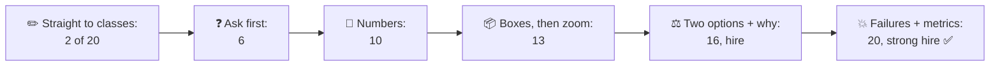
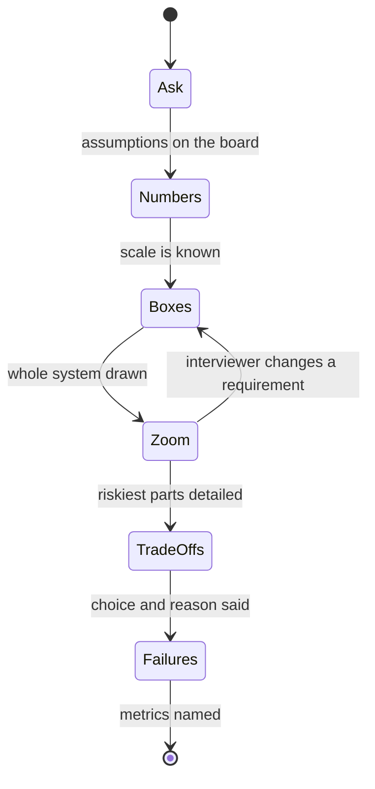
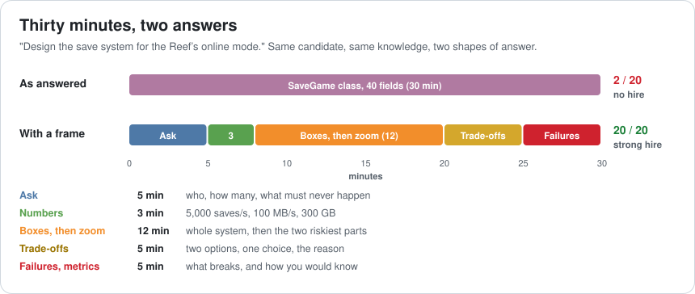
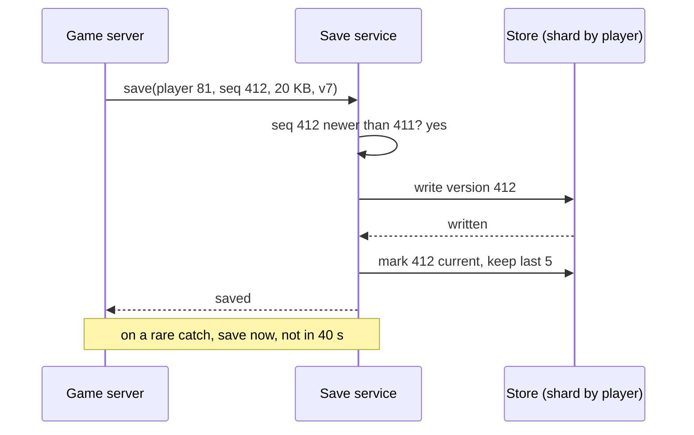
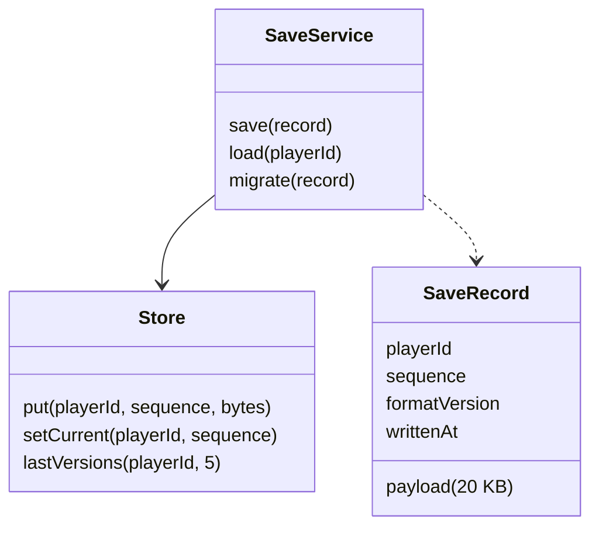
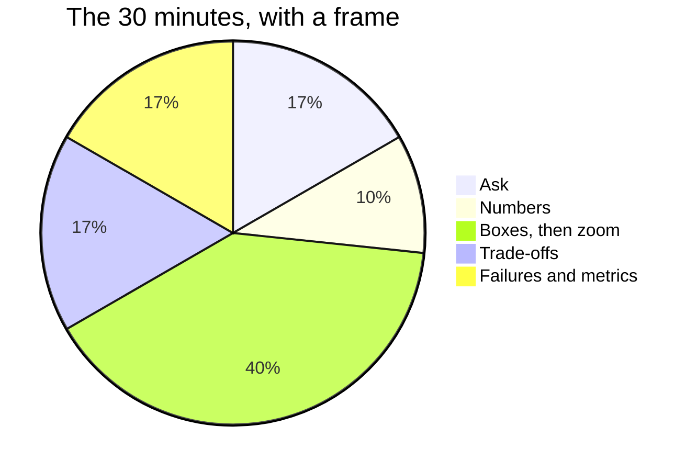
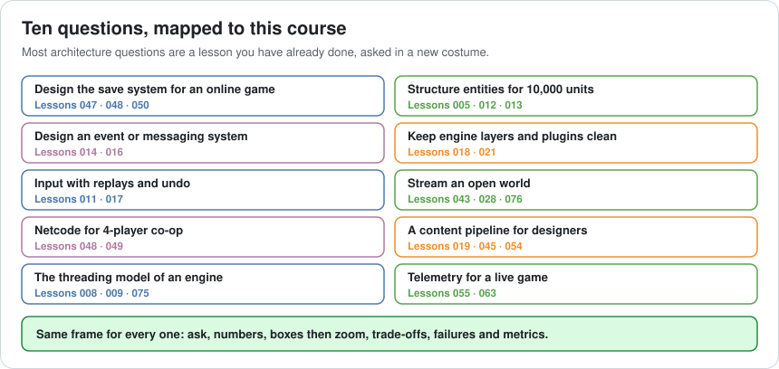

# Lesson 077 — Interview Prep: Architecture Questions: Thirty Minutes of Class Fields

> Module 7 · The architect's craft · ~15 min read · 2026-11-01

**Today's goal:** answer an open architecture question in an interview the way you'd run a real design: ask what the problem is, put numbers on it, draw the whole system before any detail, say the trade-off out loud, and finish with what breaks and how you'd know. One frame, five parts, thirty minutes.

### TL;DR
- A strong programmer is asked: "Design the save system for the Reef's online mode. You have 30 minutes." They start a `SaveGame` class and spend **30 minutes** on its **40 fields**. The design saves to a local file for one player; the game has **200,000 players online**. Score: **2 of 20**, no hire.
- The interviewer wasn't testing fields. They were listening for five things: **requirements**, **numbers**, **design shape**, **trade-offs**, and **failures and measurement**, each worth 4 points.
- The same knowledge in a **frame**: ask (**5 min**), estimate (**3 min**: 5,000 saves a second, 100 MB/s, 300 GB), boxes then zoom (**12 min**), two options and a reason (**5 min**), failures and metrics (**5 min**). Score: **20 of 20** in exactly 30 minutes.
- Most architecture questions are lessons from this course in a new costume. The frame is the same for all of them.

> 🎮 **Play with it: [Architecture Interview Lab](https://yimo691.github.io/GameArchitect/demos/077-interview-lab/)** — choose how the answer opens, whether you estimate, the design order, whether you name trade-offs and how you close, and see the 30 minutes and the scorecard. Tap **Set up** on the steps to replay the lesson.



---

## 1. The problem

Sam has shipped two games and knows the Reef's code better than almost anyone. They apply for a senior role at a studio making an online game. The architecture interview starts:

> "Design the save system for our online fishing game. Take 30 minutes. Think out loud."

Sam is good at save systems. They wrote the Reef's. So they go straight to the whiteboard:

```
class SaveGame {
    int version;
    string playerName;
    int coins;
    List<FishRecord> caughtFish;
    Dictionary<string, int> baitInventory;
    ...                    // 36 more fields, each one discussed
}
```

At minute 20 they're explaining how `FishRecord` stores weight. At minute 30 the interviewer stops them. The design writes one JSON file to the player's device. The interviewer's notes:

```
Requirements    0/4   never asked: assumed single player, local file
Numbers         0/4   no idea of scale ("it should be fine")
Design          2/4   a reasonable data class, but no system
Trade-offs      0/4   one answer, presented as obvious
Failures        0/4   never reached
Total           2/20  no hire
```

Sam knew everything needed for a great answer: versioning (Lesson 047), server authority (Lesson 048), server architecture (Lesson 050). The problem wasn't knowledge. It was **shape**. An architecture interview doesn't test whether you can write a class. It tests whether you think like the person who decides which classes should exist.

---

## 2. Step 1 — Ask before you draw

A design question is vague **on purpose**. The first thing the interviewer wants to see is whether you find the real problem before you solve one. Spend the first **5 minutes** asking, and write the answers on the board:

- **Who and how many?** "How many players, how many online at once?" → *3 million players, 200,000 at peak.*
- **What must never happen?** "What's the worst failure?" → *Losing a rare catch. Players will forgive a lost minute of walking, not a lost legendary fish.*
- **Who decides?** "Is the server authoritative?" → *Yes, catches are decided on the server (Lesson 048).*
- **Where do players play?** "Several devices per player?" → *Phone and handheld, same account.*
- **What changes?** "How often do we patch?" → *Every two weeks, sometimes changing the save data.*

Five questions, and the problem is a different one. It's not "a class to serialize", it's "**an online service that never loses a catch, across devices and versions**". Sam's local JSON file would fail four of those five answers.

If the interviewer says "you decide", that's fine: state your assumption out loud and write it down. **Assumed** is good; **silent** is what costs points.



---

## 3. Step 2 — Put numbers on it

Three minutes of arithmetic turns "it should scale" into a design that can be checked. Do it on the board, rounded, where the interviewer can see it:

```
Saves per second  = 200,000 players online ÷ one save per 40 s on average = 5,000 / s
Write bandwidth   = 5,000 × 20 KB per save                                 = 100 MB/s
Storage           = 3,000,000 players × 20 KB × 5 versions kept            = 300 GB
```

These three numbers already make design decisions. 5,000 writes a second is too many for one ordinary database server to take comfortably, so writes are **spread over shards** by player ID (Lesson 050). 300 GB is small: storage isn't the problem, write rate is. And 20 KB is small enough that sending the whole save is reasonable, which matters in Step 4.

Interviewers rarely care whether your guess is 4,000 or 6,000. They care that you **estimate at all**, and that the estimate changes the design.

---

## 4. Step 3 — Boxes first, then zoom

Draw the **whole system** in a few boxes before any one box gets detail. It takes two minutes and it shows you can see the system. Then pick the **two riskiest parts** and zoom into those.



The boxes for the save system:

- **Game servers** already own the truth (server authority). They send a save when it matters: every 40 seconds, and **immediately** after a rare catch.
- A **save service**: stateless, checks the version, assigns a sequence number.
- A **key-value store**, sharded by player ID, keeping the last 5 versions.
- **Clients** never write saves. They read their profile at login.

Then zoom into the two parts where a mistake loses a catch:

**The write path.** Each save carries the player ID and a **sequence number**. The service writes the new version first and only then marks it current, so a crash mid-write leaves the old version valid. A save with an older sequence number than the current one is rejected, which stops a slow server from overwriting a newer save.



**The format.** Every save has a **version number** (Lesson 047). On load, old versions are migrated forward step by step; the service never writes an older format than it reads. With a patch every two weeks, this isn't optional.



Notice what's missing: the 40 fields. If the interviewer wants them, they'll ask, and you'll have time.

---

## 5. Step 4 — Two options, pick one, say why

The most architect-like sentence in an interview has three parts: **two options, one choice, the reason.** It shows you saw the alternative and chose on purpose (Lesson 069).

For the save system, the big choice is what a save **is**:

| Option | For | Against |
|---|---|---|
| **Full snapshot** every save | Simple; restore = read one record; easy to migrate | Sends 20 KB even when one coin changed |
| **Event log** (every change appended) | Tiny writes; full history | Restore means replaying; logs need compaction; migration is harder |

> "I'd use **full snapshots**, because a save is only 20 KB, 100 MB/s is fine for a sharded store, and simple restores and migrations matter more with a patch every two weeks. If saves grew to megabytes, I'd revisit an event log."

The last sentence matters: it says **when** you'd change your mind. That's what separates a choice from a habit.



---

## 6. Step 5 — Close with failures and metrics

Spend the last **5 minutes** on what breaks and how you'd know. Architects are hired to think about the bad day.

**What breaks**, and the answer already in the design:

- **Crash mid-write** → the old version is still current; write first, then flip.
- **Two devices at once** → sequence numbers reject the stale save; one active session per account.
- **An old client after a patch** → migrate on load; never write an older format.
- **A store shard goes down** → game servers queue saves and retry; a rare catch is held until it's confirmed.
- **A corrupted save** → keep the last 5 versions; support can roll back.

**What you'd measure** (Lesson 055): save latency at the **99th percentile**, the **failed-save rate**, and **catches lost per million**, with an alert if the last one is ever above zero.

Sam with the frame: 5 + 3 + 12 + 5 + 5 = **30 minutes**, every part reached, **20 of 20**.

---

## 7. The architect's view

The junior answers the question as asked. The optimizer answers it fast. The architect asks: **what is the real problem, how big is it, what are the parts, what did I choose and why, and what happens on the bad day?**



The frame works for every question in the map above, because they're all the same kind of question: a system with constraints. Practise it out loud, with a timer, on three of them this week. Out loud matters: the interview is a conversation, and the frame is what lets the interviewer follow you, interrupt you, and change a requirement without you losing your place.

A few habits that interviewers notice:

- **Think out loud**, including "I'm not sure; here's how I'd find out." Silence scores nothing.
- **Write as you go**: requirements, numbers, boxes. The board is your memory and their notes.
- **Welcome interruptions.** A changed requirement ("now players can trade fish") is the test, not a distraction. Go back to the boxes.
- **Use real experience.** "On the Reef we lost saves when two devices raced; that's why sequence numbers are here" is worth more than any textbook.

### Trade-offs

| Choice | Cost | Benefit | When to use |
|---|---|---|---|
| Straight to code or classes | The system is never seen | Shows coding fluency | When the question is "write this function" |
| Ask first | 5 minutes | You solve the real problem | Every open design question |
| Estimate out loud | 3 minutes, risk of a wrong guess | Numbers drive choices | Anything with users, data or load |
| Boxes, then zoom | Details come late | Whole system seen; time for what matters | Always for system design |
| Two options and a reason | 5 minutes | Shows judgement, not habit | Every big choice |
| Failures and metrics | 5 minutes | Shows you've had a bad day before | Always; never leave it for "if there's time" |

---

## 8. Common mistakes

- **Answering the question as heard.** Vague is deliberate; ask.
- **Going deep first.** The first detail you draw eats the clock.
- **"It should scale."** Without numbers, it's a wish.
- **One answer, as if obvious.** Name the alternative and why you didn't choose it.
- **Defending a choice when a requirement changes.** Update the design; that's the skill being tested.
- **Saving failures for the end "if there's time."** Plan the last 5 minutes for them.

---

## 9. Quiz — think about it on the ferry ⛴️

**Q1.** Why did Sam score 2 of 20 despite knowing save systems well?

<details><summary>Answer</summary>

The answer had no shape: no questions (a local file for one player, in an online game), no numbers, no system, no trade-offs, and time ran out before failures. Only the data class earned points: Design 2 of 4.
</details>

**Q2.** Compute saves per second, bandwidth and storage from the answers on the board.

<details><summary>Answer</summary>

`200,000 ÷ 40 = 5,000 saves/s`; `5,000 × 20 KB = 100 MB/s`; `3,000,000 × 20 KB × 5 = 300 GB`.
</details>

**Q3.** Which of those numbers changes the design most, and how?

<details><summary>Answer</summary>

The write rate, 5,000 a second: it means sharding the store by player ID. Storage at 300 GB is small, and 20 KB per save makes full snapshots reasonable.
</details>

**Q4.** How does the write path survive a crash halfway through a save?

<details><summary>Answer</summary>

It writes the new version first and only then marks it current. A crash in between leaves the old version current and valid. Sequence numbers also stop an older save from replacing a newer one.
</details>

**Q5.** Give the three-part trade-off sentence for snapshots vs an event log, including when you'd change your mind.

<details><summary>Answer</summary>

"Two options: full snapshots or an event log. I choose snapshots, because a save is 20 KB, 100 MB/s is fine sharded, and restores and migrations stay simple with a patch every two weeks. If saves grew to megabytes, I'd revisit the event log."
</details>

**Q6.** The interviewer says at minute 22: "Players can now trade fish with each other." What do you do?

<details><summary>Answer</summary>

Go back to the boxes. A trade changes two players' saves at once, so it must be atomic: both saves change or neither does. Name the option (a trade service that writes both in one transaction, or a trade record both saves reference), pick one and say why.
</details>

---

## 10. Back at the desk (≈45 min) — practise the frame

> No desk today? Do it in the [Architecture Interview Lab](https://yimo691.github.io/GameArchitect/demos/077-interview-lab/): predict the score and the time used for each step, then tap.

1. Pick **three** questions from the map above that you've never answered out loud.
2. For each, set a **30-minute timer** and answer **out loud**, on paper or a whiteboard, using the frame.
3. Record yourself, or ask a colleague to score you on the five parts, 0 to 4 each.
4. Note where the time went, and the one part you skipped.
5. Save `journal/077-architecture-interview.md`:

| Question | Ask | Numbers | Design | Trade-offs | Failures | Total | Minutes |
|---|---|---|---|---|---|---|---|
| | | | | | | | |
| | | | | | | | |
| | | | | | | | |

One question for your journal: which real failure from your own work would make the strongest story in a "what breaks?" answer?

---

## 11. Vocabulary

| Term | Meaning | 中文 |
|---|---|---|
| System design interview | An interview where you design a system out loud | 系统设计面试 |
| Requirement | What the system must do or never do | 需求 |
| Assumption | A requirement you decide and state when nobody tells you | 假设 |
| Back-of-the-envelope estimate | Quick, rounded arithmetic to find the scale of a problem | 粗略估算 |
| Sharding | Splitting data across servers by a key such as player ID | 分片 |
| Sequence number | A counter that orders saves so older ones can't overwrite newer ones | 序列号 |
| Snapshot | A complete copy of the state at one moment | 快照 |
| Event log | A list of every change, replayed to rebuild the state | 事件日志 |
| 99th percentile (p99) | The value that 99% of measurements are below | 第 99 百分位 |
| Rubric | The list of things an interviewer scores | 评分标准 |

---

## 12. Further reading

- **Alex Xu, *System Design Interview: An Insider's Guide*, Volume 1** (2020): the ask, estimate, design, deep-dive frame, with worked examples.
- **Martin Kleppmann, *Designing Data-Intensive Applications*** (O'Reilly, 2017): sharding, replication, and why write paths fail the way they do.
- **Jeff Dean, "Numbers Everyone Should Know"** (in "Designs, Lessons and Advice from Building Large Distributed Systems", LADIS 2009 keynote): latency numbers for back-of-the-envelope estimates.
- **Glenn Fiedler, "Gaffer On Games"** (gafferongames.com): networking articles that make good practice questions for game-specific design interviews.

---

**Tomorrow — Lesson 078: Interview prep: optimization questions.** The other half of the interview: "this frame takes 40 ms, the target is 16.7, go." We practise answering optimization questions the way Module 4 taught: measure before guessing, find the slowest stage, form a hypothesis, test it, and explain the numbers out loud.
