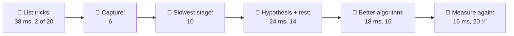
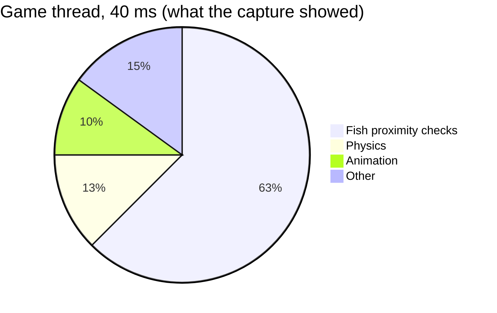
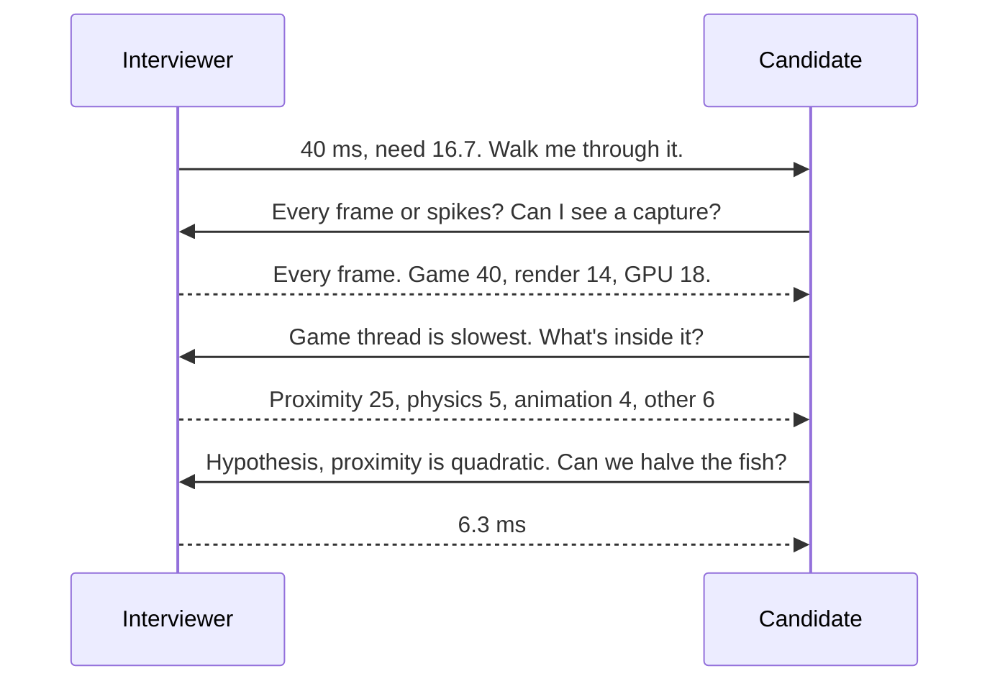
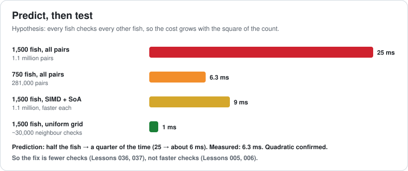
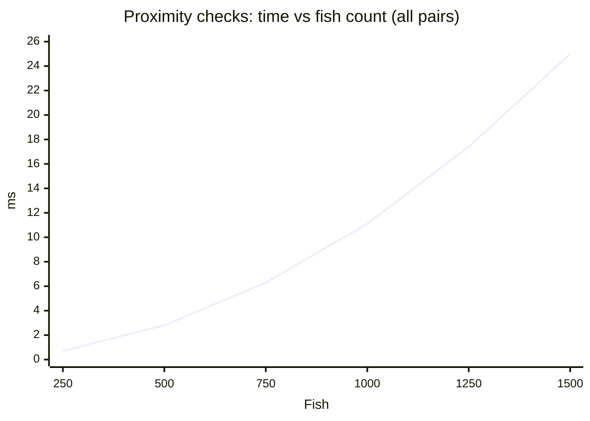
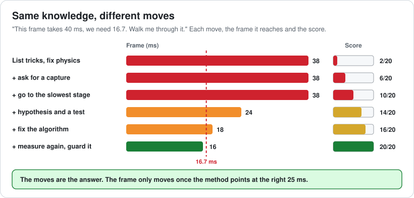
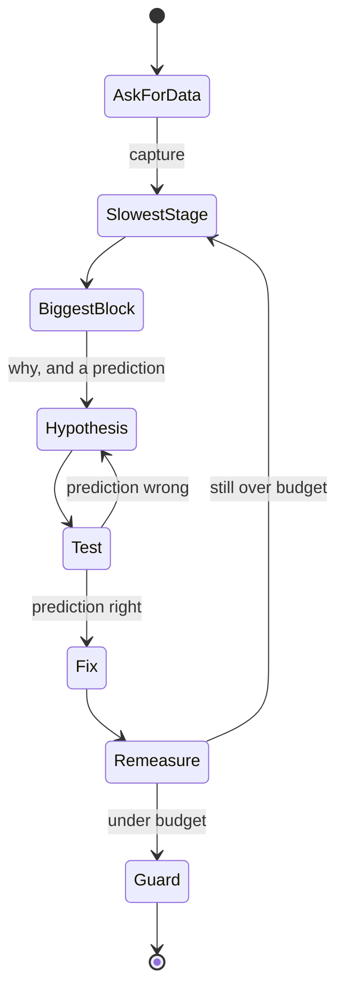

# Lesson 078 — Interview Prep: Optimization Questions: The List of Tricks

> Module 7 · The architect's craft · ~15 min read · 2026-11-01

**Today's goal:** answer "this frame is too slow, what do you do?" the way you'd fix it at work: ask for data, find the slowest stage, form a hypothesis you can test, fix the cause with the cheapest change that removes work, then measure again. Five moves, said out loud, with numbers.

### TL;DR
- Sam's second interview: "Our reef scene takes **40 ms** on the target. We need **60 fps**. Walk me through it." Sam lists tricks (pools, SIMD, LODs, threads) and then speeds up the physics code they know: **5 → 3 ms**. The frame is **38 ms**. Score: **2 of 20**.
- The interviewer had a capture ready: game thread **40 ms**, render **14**, GPU **18**. Inside the game thread, **fish proximity checks take 25 ms**. Physics was never the problem.
- **Hypothesis**: 1,500 fish check every other fish, **1.1 million pairs**, so the cost is quadratic. **Test**: halve the fish; it should drop to a quarter. It drops to **6.3 ms**. Confirmed.
- Micro-optimizing the checks gets **25 → 9 ms** (frame 24). A **uniform grid** gets **25 → 1 ms** (frame 18, now GPU-bound). **Measuring again** finds water-particle overdraw: GPU **18 → 16 ms**. Frame **16 ms**, score **20 of 20**.

> 🎮 **Play with it: [Optimization Interview Lab](https://yimo691.github.io/GameArchitect/demos/078-optimization-interview-lab/)** — choose your first move, where you look, how you find the cause, the kind of fix and what you do after it, and see the frame and the scorecard. Tap **Set up** on the steps to replay the lesson.



---

## 1. The problem

Sam passed the architecture round (Lesson 077). The second round is optimization. The interviewer turns a laptop around: the Reef running on the target device, a big school of fish swirling around a coral arch, the frame counter at 25 fps.

> "This scene takes 40 ms a frame. We need 60 fps. Walk me through what you'd do."

Sam knows a lot about performance, and it all comes out at once:

```
"I'd pool the allocations, move hot data to structure-of-arrays, use SIMD
in the inner loops, add LODs for distant fish, instance the draws, move
physics to worker threads… Physics is usually a big one, so I'd start
there: sleep bodies that aren't moving, maybe simplify colliders."
```

The interviewer plays along: "OK, you made physics faster. It went from 5 to 3 ms. Frame is 38. What now?" Sam suggests LODs. The interviewer: "The GPU isn't the bottleneck." Silence.

```
Measure first       0/4   never asked for data
Bottleneck          0/4   started with "usually a big one"
Hypothesis          0/4   no prediction, no test
Fix the cause       2/4   a real technique, on the wrong thing
Verify              0/4   no re-measure
Total               2/20  no hire
```

Every trick on Sam's list is real. That's exactly the problem. A list of tricks says "I've read about optimization." The interviewer is listening for "I've done it": a **method**, applied to **this** frame, with numbers (Lesson 035).



---

## 2. Step 1 — Ask for data before anything else

The first thing to say is a question. Interviewers almost always have more information than they give, and asking for it is the first thing they score.

- "**What device and target?**" → *the handheld, 60 fps, so 16.7 ms.*
- "**Is it slow every frame, or are there spikes?**" → *every frame.* (Spikes would point somewhere else entirely: GC, Lesson 040; shader compiles, Lesson 060; pacing, Lesson 059.)
- "**Can I see a capture with one row per thread and the GPU?**" → *yes.*

```
Reef scene · handheld · one frame
Game thread    40 ms
Render thread  14 ms
GPU            18 ms
```

If the interviewer says "there's no capture, what would you do?", the answer is the same move described out loud: "I'd capture a frame on the device with the engine's profiler and a GPU tool, and look at each stage." **Describing how you'd measure** scores the same points as measuring.



---

## 3. Step 2 — Go to the slowest stage, then the biggest block

You know this from Lesson 075: the stages run in parallel, so the frame is the **slowest** one. Here it's the game thread at 40 ms. The GPU (18) and render thread (14) don't matter yet. Anything you do to them changes nothing.

Say that out loud, because it rules out half of Sam's list in one sentence: "The GPU isn't the bottleneck, so LODs and instancing won't help yet."

Then open the slowest stage and go to its **biggest block**: proximity checks, 25 of the 40 ms. Not physics (5), not animation (4). The common mistake here is to go to the name you recognise. Sam knows physics; another candidate would guess animation, make it 4 → 2 ms, and still have a 38 ms frame.

---

## 4. Step 3 — Form a hypothesis you can test

"Proximity checks are slow" isn't a hypothesis; it's a description. A hypothesis says **why**, and predicts something you can check:

> "Each fish checks every other fish to find neighbours for schooling. With 1,500 fish that's `1,500 × 1,499 ÷ 2 ≈ 1.1 million` pairs. If that's the cause, the cost grows with the **square** of the fish count, so halving the fish should cut the time to about **a quarter**: 25 → about 6 ms."

Then ask for the test. The interviewer: "We halved the fish. Proximity took 6.3 ms." Prediction confirmed: the cost is quadratic.





Why does the test matter so much? Because it **chooses the fix**. If the time had dropped by half, the cost would be linear per fish, and the answer would be making each check cheaper. A quarter means the number of checks is the problem.

---

## 5. Step 4 — Remove work before you speed it up

There are two kinds of fix, and interviewers want to hear that you know which comes first (Lesson 036).

**Micro-optimize** the checks: structure-of-arrays so positions are contiguous (Lesson 005), SIMD to test four pairs at once (Lesson 006). Each check gets about 2.8× faster: **25 → 9 ms**. The game thread is now 24 ms, so the frame is **24 ms**. Better, but still over. It still does 1.1 million checks.

**Change the algorithm**: put the fish in a **uniform grid** with cells the size of the schooling radius (Lesson 037). Each fish checks only its own and neighbouring cells, about **20 neighbours**:

```
1,500 fish × ~20 neighbours ≈ 30,000 checks   (instead of 1.1 million)
Proximity: 25 → 1 ms
Game thread: 1 + 5 + 4 + 6 = 16 ms
Frame = max(16, 14, 18) = 18 ms
```

Say why you chose the grid over a quadtree: the fish are spread fairly evenly and move every frame, so a grid that's cheap to rebuild beats a tree that's expensive to update. That's the trade-off sentence from Lesson 077, in optimization form.

Notice the frame: **18 ms**, not 16. Something else is now the slowest stage.

---

## 6. Step 5 — Measure again, and guard it

After every fix, **measure again**, because the bottleneck moves. The game thread is 16 ms; the GPU is now the slowest at **18 ms**.

So the method starts over, on the GPU: the capture shows water particles around the arch painting some pixels **6 times** (overdraw, Lesson 025). Fewer, larger particles with a cheaper shader: GPU **18 → 16 ms**.

```
Game 16 · Render 14 · GPU 16   → frame 16 ms, 63 fps ✅
```

Then close the way an architect would: "I'd add a **performance test** on this scene so the next change that adds fish can't quietly bring back the quadratic loop (Lesson 063), and note the budget: the game thread has 0.7 ms of headroom, which is very little."





---

## 7. The architect's view

The junior lists techniques. The optimizer applies the best technique to the code in front of them. The architect asks: **what does the data say is slowest, what would prove why, which fix removes the most work, and what stops it coming back?**

Not every optimization question is a frame-time question. The same method, with different first questions:

| The question sounds like | First thing to ask | Where it leads |
|---|---|---|
| "It hitches every few seconds" | "How often, and how long?" | GC (040), streaming (043), shader compiles (060) |
| "It's fine for 10 minutes, then slow" | "Is the device getting hot?" | Thermal throttling (058) |
| "It crashes on low-end phones" | "What's the memory budget?" | Memory budgets (057), textures (029) |
| "60 fps but feels choppy" | "What do the frame times look like?" | Frame pacing (059), measurement (003) |
| "Loading takes 30 seconds" | "What's loaded, and when?" | Async IO and bundles (043) |
| "Explain a cache miss" (a knowledge question) | — | Answer it, then give a real example (004) |

### Trade-offs

| Choice | Cost | Benefit | When to use |
|---|---|---|---|
| List techniques | No time | Shows breadth | Only when asked "what techniques do you know?" |
| Ask for a capture | A minute | Every later move is aimed | Always first |
| Guess the cause | Nothing up front | Sometimes right | Never in an interview; say it as a hypothesis |
| Hypothesis + test | A minute or two | Picks the right kind of fix | Every time |
| Micro-optimize | Harder code, same work | Faster per item | After the algorithm is right |
| Better algorithm | A design change | Removes work entirely | When cost grows faster than the data |
| Measure again + guard | A minute | Catches the moved bottleneck; keeps the win | Always the last move |

---

## 8. Common mistakes

- **Answering with a list.** Breadth without a method sounds like reading, not doing.
- **Starting with the code you know.** The data picks the target, not your experience.
- **Optimizing a stage that isn't slowest.** Lesson 075's rule, and the fastest way to lose points.
- **Descriptions instead of hypotheses.** "It's slow" predicts nothing; "it's quadratic" predicts a quarter.
- **Micro-optimizing a bad algorithm.** 2.8× faster on 1.1 million checks loses to 30,000 checks.
- **Stopping after one fix.** The bottleneck moved; say you'd measure again.

---

## 9. Quiz — think about it on the ferry ⛴️

**Q1.** Why did speeding up physics from 5 to 3 ms leave the frame at 38 ms?

<details><summary>Answer</summary>

The game thread was the slowest stage at 40 ms, and physics was a small part of it. `40 − 2 = 38 ms`. The 25 ms proximity block was untouched.
</details>

**Q2.** How many pairs do 1,500 fish check if every fish checks every other, and what does halving the fish predict?

<details><summary>Answer</summary>

`1,500 × 1,499 ÷ 2 ≈ 1.1 million` pairs. Quadratic cost means half the fish gives a quarter of the pairs (about 281,000), so 25 → about 6 ms. Measured: 6.3 ms.
</details>

**Q3.** If halving the fish had cut proximity to about 12.5 ms instead, what would that tell you, and what fix would you try?

<details><summary>Answer</summary>

The cost is linear in the fish count, so the number of checks isn't the problem; each fish's work is. Make each fish's update cheaper: data layout, SIMD, or fewer updates per second for distant fish (Lessons 005, 006, 053).
</details>

**Q4.** Compute the frame after the grid fix, and name the new bottleneck.

<details><summary>Answer</summary>

Game thread `1 + 5 + 4 + 6 = 16 ms`; render 14; GPU 18. Frame `max(16, 14, 18) = 18 ms`, so the GPU is now the slowest stage.
</details>

**Q5.** Why does the grid beat a quadtree here?

<details><summary>Answer</summary>

The fish are spread fairly evenly and move every frame. A grid is cheap to rebuild every frame and its neighbour lookup is a few array reads; a tree is expensive to update when everything moves (Lesson 037).
</details>

**Q6.** The interviewer says: "No capture, imagine you're at your desk." What do you say first?

<details><summary>Answer</summary>

How you'd measure: "I'd capture a frame on the target device with the engine's profiler and a GPU tool, check whether it's every frame or spikes, and find the slowest stage before changing anything." Describing the measurement scores the same as doing it.
</details>

---

## 10. Back at the desk (≈45 min) — practise out loud

> No desk today? Do it in the [Optimization Interview Lab](https://yimo691.github.io/GameArchitect/demos/078-optimization-interview-lab/): predict the frame and the score for each step, then tap.

1. Take **three** real performance problems you've fixed (or the case studies in Lessons 044, 066 and 075).
2. For each, write the **five moves** with the real numbers: data, slowest stage, hypothesis and test, fix, re-measure.
3. Say each one **out loud** in under 5 minutes. Record it, or practise with a colleague who plays the interviewer and changes one number halfway.
4. Save `journal/078-optimization-interview.md`:

| Problem | Data asked for | Slowest stage | Hypothesis and test | Fix (algorithm or micro) | After re-measure |
|---|---|---|---|---|---|
| | | | | | |
| | | | | | |
| | | | | | |

One question for your journal: in your own last optimization, did you form a hypothesis before you changed code, or after?

---

## 11. Vocabulary

| Term | Meaning | 中文 |
|---|---|---|
| Capture | A recording of one or more frames with timings per thread and GPU | 性能捕获 |
| Bottleneck | The slowest stage, which sets the frame time | 瓶颈 |
| Hypothesis | A reason for the slowness that predicts something testable | 假设 |
| Quadratic | Cost that grows with the square of the input size | 平方级 |
| Linear | Cost that grows in proportion to the input size | 线性 |
| Uniform grid | Space split into equal cells for fast neighbour lookups | 均匀网格 |
| Micro-optimization | Making each operation faster without changing how many there are | 微优化 |
| Overdraw | Pixels drawn more than once in a frame | 过度绘制 |
| Headroom | How much a stage can grow before it breaks the budget | 余量 |
| Regression | A change that makes performance worse again | 性能回退 |

---

## 12. Further reading

- **Brendan Gregg, *Systems Performance*, 2nd edition** (Addison-Wesley, 2020): the USE method and other ways to go from symptoms to causes.
- **Mike Acton, "Data-Oriented Design and C++"** (CppCon 2014 keynote): why the data and the work, not the code style, decide performance.
- **Jon Bentley, *Programming Pearls*, 2nd edition** (Addison-Wesley, 1999): back-of-the-envelope estimates and choosing algorithms before tuning.
- **Christer Ericson, *Real-Time Collision Detection*** (Morgan Kaufmann, 2004): grids, trees and when each wins for neighbour queries.

---

**Tomorrow — Lesson 079: Building a portfolio that proves architect-level skill.** Interviews ask you to *say* how you think. A portfolio *shows* it. We turn the work from this course (journals, labs, desk exercises) into three pieces that prove architect-level skill: a design doc with its trade-offs, a measured optimization with before and after, and a decision that you can defend.
