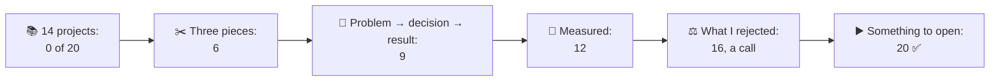
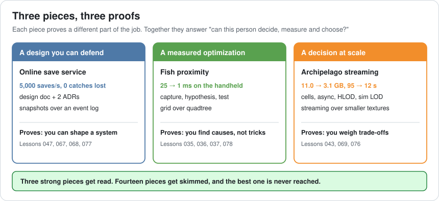
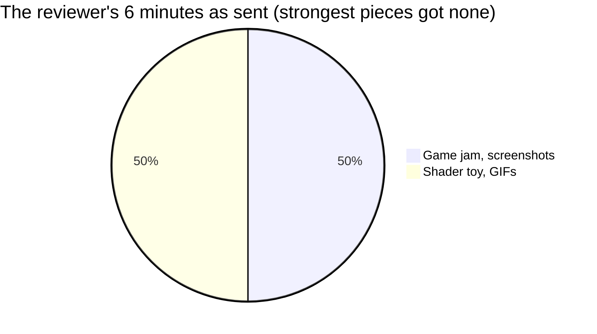
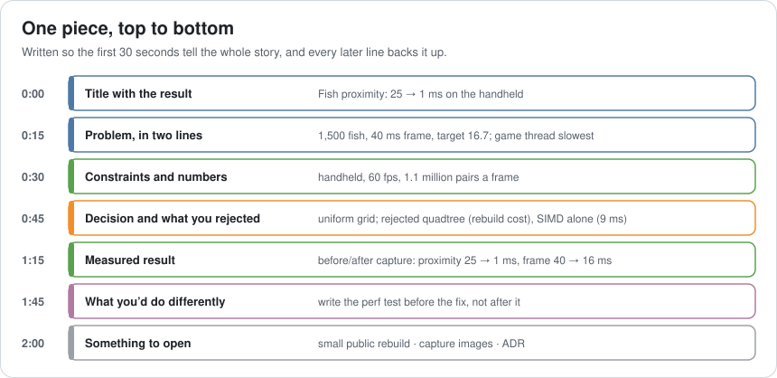
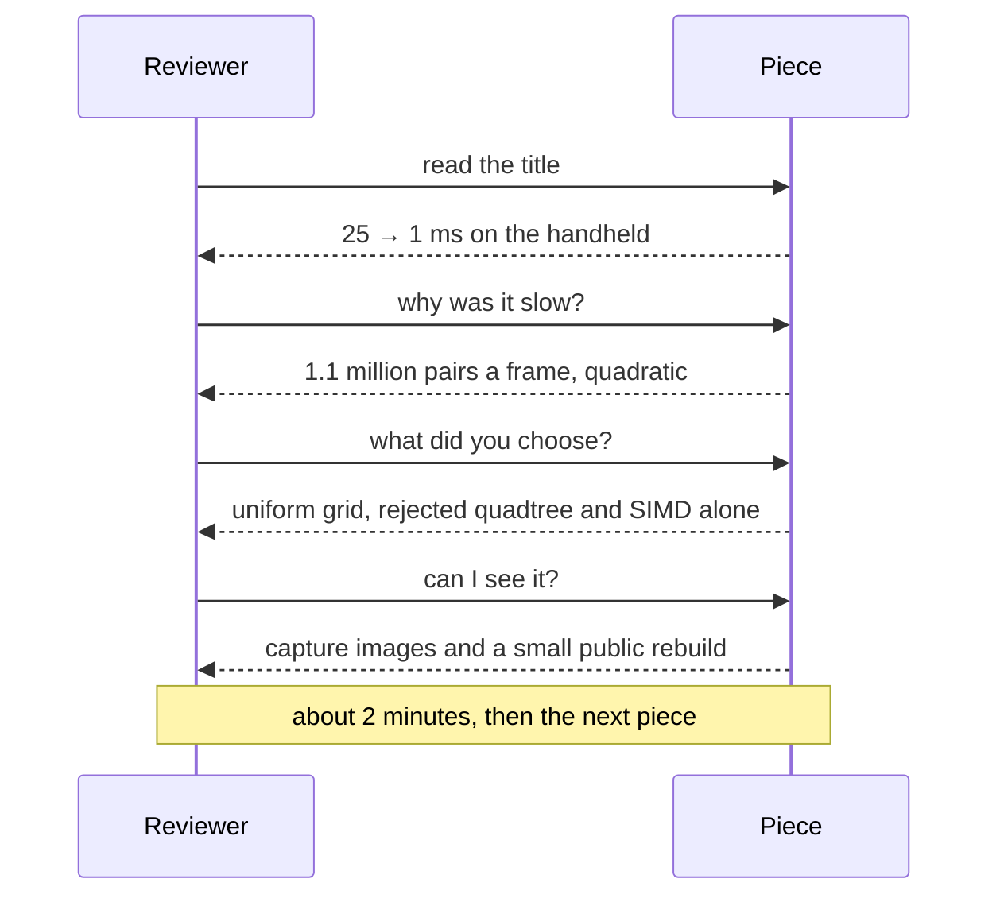
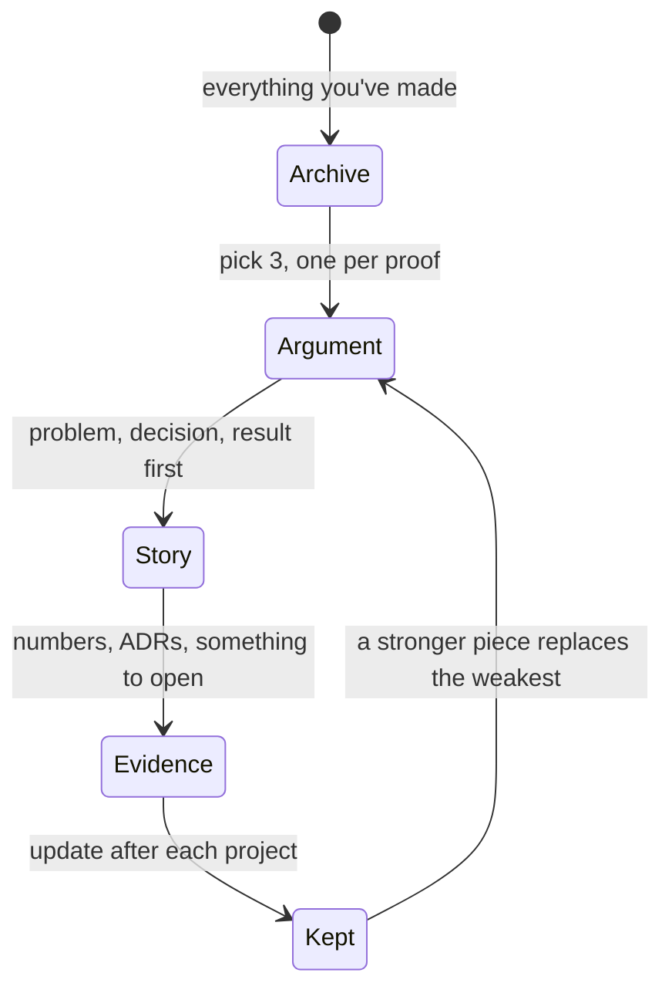
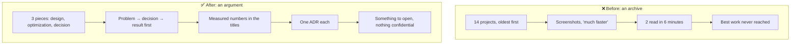

# Lesson 079 — Building a Portfolio That Proves Architect-Level Skill: The Best Work Was Number Nine

> Module 7 · The architect's craft · ~15 min read · 2026-11-01

**Today's goal:** turn your work into a portfolio that a busy reviewer can read in six minutes and come away sure you can design, measure and choose. Three pieces, each written problem → decision → result, with measured numbers, the options you rejected, and something they can open.

### TL;DR
- Sam sends a portfolio of **14 projects**, oldest first, each a page of screenshots and a tech list. A hiring lead gives it about **6 minutes**, reads **2 projects** (a game jam and a shader toy), and passes. Sam's strongest work, the archipelago streaming, the fish optimization and the save service, is numbers **9, 11 and 13**. Score: **0 of 20**.
- **Three pieces** instead of fourteen: all of the strongest work is up front. Each written **problem → decision → result** in the first lines takes **2 minutes** to read instead of 3, so all three get read.
- **Measured** results (11.0 → 3.1 GB, 25 → 1 ms, 5,000 saves a second with none lost) instead of "much faster". The first number is found at **minute 1**.
- One short **ADR** per piece showing what was rejected and why (Lesson 068), and **something to open**: a small public rebuild, a capture or a write-up with nothing confidential. Score: **20 of 20**.

> 🎮 **Play with it: [Portfolio Lab](https://yimo691.github.io/GameArchitect/demos/079-portfolio-lab/)** — choose what goes in, how each piece is written, how results are stated, whether trade-offs are shown and what can be opened, and see what the reviewer reads in six minutes. Tap **Set up** on the steps to replay the lesson.



---

## 1. The problem

After the interviews (Lessons 077 and 078), Sam applies for a lead role at another studio. The application asks for a portfolio link. Sam's portfolio has everything they've ever made:

```
Sam's portfolio (in the order on the page)
 1  Game jam 2019: a 48-hour platformer          screenshots, Unity, C#
 2  Shader toy: water caustics                   GIF, HLSL
 3  Tetris clone                                  screenshots, C++
 4  ...
 9  Reef: archipelago streaming                  screenshots, "much less memory"
11  Reef: fish schooling performance             screenshots, "much faster"
13  Reef online: save service                    architecture diagram, "scales well"
14  Engine tools: level editor plugin            screenshots
```

The hiring lead has forty applications and a meeting in an hour. They open Sam's link and give it about six minutes. The game jam page is three minutes of screenshots. The shader toy is pretty and three more minutes. Decision: no call.

Sam's best work, the work that shows an architect, was there. It was **number nine**.

```
Focus        0/4   14 projects, strongest work past what's read
Story        0/4   the strong pieces are never reached
Numbers      0/4
Trade-offs   0/4
Proof        0/4
Total        0/20  pass
```

A portfolio isn't an archive. It's an **argument**: "this person can do the job". Every piece that doesn't support the argument makes the reviewer read less of the pieces that do.

---

## 2. Step 1 — Three pieces, chosen for what they prove

An architect is hired to do three things: **shape systems**, **find and fix what's slow**, and **choose well between options**. So pick three pieces, one for each.



- **A design you can defend**: the online save service. A design doc (Lesson 067), two ADRs (Lesson 068), and the numbers that drove it: 5,000 saves a second, none lost.
- **A measured optimization**: fish proximity, 25 → 1 ms on the handheld, with the capture, the hypothesis and the test (Lessons 035 and 078).
- **A decision at scale**: archipelago streaming, 11.0 → 3.1 GB and 95 → 12 s loading, with the order of the steps and why (Lesson 076).

The game jam, the shader toy and the Tetris clone go. They were good learning, and they're not evidence for this job. If you want them online, a separate "other work" page is fine; just not in the six minutes.

With three pieces, the strongest work is the first thing the reviewer sees. Score: **6 of 20**: focus is fixed, but each piece is still a page of screenshots that takes 3 minutes to dig through, so only **two** are read.



---

## 3. Step 2 — Lead with problem → decision → result

A reviewer reads the first lines of each piece carefully and skims the rest. So the first lines must carry the whole story. The same shape as a design doc's first page (Lesson 067), or the first minute of an interview answer (Lesson 077):



- **Title with the result in it**: "Fish proximity: 25 → 1 ms on the handheld", not "Fish schooling".
- **The problem in two lines**: 1,500 fish, a 40 ms frame, a 16.7 ms target, the game thread slowest.
- **Constraints and numbers**: the device, the budget, 1.1 million pairs a frame.
- **The decision and what you rejected**: a uniform grid; not a quadtree, not SIMD alone.
- **The measured result**: before and after captures.
- **What you'd do differently**: one honest line. It shows you learn from your own work.
- **Something to open**: see Step 4.

Screenshots don't disappear; they move **below** the story, as evidence. Written this way, a piece takes about **2 minutes** to read, so all three are read in six. Score: **9 of 20**.



---

## 4. Step 3 — Measure, and show what you didn't choose

**Numbers instead of adjectives.** "Much faster" makes the reviewer ask: than what, on what device, measured how? Write the before and the after, the device and the method:

```
Archipelago streaming   11.0 → 3.1 GB · loading 95 → 12 s · retail handheld, worst route
Fish proximity          25 → 1 ms · frame 40 → 16 ms · handheld capture
Online save service     5,000 saves/s at peak · 0 catches lost in 3 months · p99 save latency
```

With numbers in the titles, the reviewer finds the first measured result at **minute 1**. Score: **12 of 20**.

**Trade-offs instead of a single path.** A piece that shows only what you built proves you can build. A piece that shows **what you rejected and why** proves you can choose, and choosing is the architect's job (Lesson 069). One short ADR per piece is enough:

```
ADR · Archipelago memory
Options:   (a) smaller textures everywhere  (b) stream cells within 1 km
Chosen:    (b), with mip streaming on top
Why:       (a) still leaves 7.4 GB of 3.5; the problem was how much is loaded
Revisit if: the world shrinks, or the device gets more memory
```

Score: **16 of 20**, enough for a call.

---

## 5. Step 4 — Give them something to open

"I can't show it, it's under NDA" is true for most professional work, and reviewers know it. But it leaves them taking your word. Three honest ways to give them something real without breaking an agreement:

1. **A small public rebuild.** Rebuild the core of the problem in a tiny project of your own: 1,500 boxes doing neighbour checks, all-pairs vs grid, with a profiler capture. It proves the skill without any company code.
2. **A write-up with nothing confidential.** The problem, the numbers (rounded if needed), the decision and the ADR, cleared with your studio if you're unsure. Many studios publish talks and blog posts about exactly this kind of work.
3. **Your public work from this course.** Your journal tables, your desk exercises, a lab you extended. They show how you think, step by step.

Never post code, assets or unreleased details you don't own. A portfolio that shows poor judgement about confidentiality is the one thing worse than an empty one.

With something to open on all three, Sam's portfolio scores **20 of 20**.



---

## 6. The architect's view

The junior shows everything they've made. The optimizer shows their best benchmark. The architect asks: **what does this reader need to believe, what is the least they must read to believe it, and how can they check it?** That's the same question behind a design doc, a review and a budget meeting. A portfolio is one more document written for a busy reader.



### Trade-offs

| Choice | Cost | Benefit | When to use |
|---|---|---|---|
| Everything you've made | Nothing to decide | Shows breadth | An "other work" page, not the front page |
| Three chosen pieces | Leaving good work out | The strongest work gets read | Always, for senior and architect roles |
| Screenshots first | Easy to make | Looks good | Art and design roles; below the story for engineering |
| Problem → decision → result | An hour of writing per piece | Readable in 2 minutes | Every engineering piece |
| Measured before and after | You need the numbers, or a rebuild to get them | Credible, comparable | Every claim about performance or scale |
| Public rebuild | A weekend per piece | Proof you can share | When the real work is under NDA |

---

## 7. Common mistakes

- **Archive instead of argument.** Fourteen pieces means the reviewer chooses which two to read, not you.
- **Burying the result.** If the number is under twelve screenshots, it's at minute 3, or never.
- **Adjectives.** "Much faster", "scalable", "robust": none of them can be checked.
- **Only the happy path.** No rejected options means no evidence of judgement.
- **Breaking confidentiality to prove a point.** Rebuild or write it up instead.
- **Never updating it.** A portfolio from three years ago describes someone else.

---

## 8. Quiz — think about it on the ferry ⛴️

**Q1.** Why did Sam's strongest work never get read?

<details><summary>Answer</summary>

It was pieces 9, 11 and 13 of 14. At about 3 minutes per screenshot page, a 6-minute look covers 2 pieces: the game jam and the shader toy. Focus (what's first) decided the outcome before quality could.
</details>

**Q2.** How many pieces does a reviewer read in 6 minutes at 3 minutes each, and at 2 minutes each?

<details><summary>Answer</summary>

`6 ÷ 3 = 2` pieces; `6 ÷ 2 = 3` pieces. Writing problem → decision → result first is what lets all three get read.
</details>

**Q3.** Rewrite "Reef fish schooling: much faster" as a title.

<details><summary>Answer</summary>

"Fish proximity: 25 → 1 ms on the handheld". The result, the size of the change, and the device, in one line.
</details>

**Q4.** What does an ADR in a portfolio prove that a measured result doesn't?

<details><summary>Answer</summary>

Judgement: that you saw other options and chose for a reason, and that you know when you'd choose differently. A result proves you can execute; an ADR proves you can decide.
</details>

**Q5.** Your best work is under NDA. Name two honest ways to give the reviewer something to open.

<details><summary>Answer</summary>

A small public rebuild of the core problem (for example 1,500 boxes, all-pairs vs a grid, with captures), or a write-up with nothing confidential, cleared with your studio. Never the original code or assets.
</details>

**Q6.** Which three pieces would you choose for an architect role, and what does each prove?

<details><summary>Answer</summary>

A design you can defend (you can shape a system), a measured optimization (you find causes, not tricks), and a decision at scale (you weigh trade-offs). One proof each.
</details>

---

## 9. Back at the desk (≈45 min) — draft your three pieces

> No desk today? Do it in the [Portfolio Lab](https://yimo691.github.io/GameArchitect/demos/079-portfolio-lab/): predict the score and pieces read for each step, then tap.

1. List everything you could show. Mark each as **design**, **optimization**, **decision** or **none**.
2. Choose the strongest **one of each**. If one is missing, plan a public rebuild for it (Lesson 080 can be that project).
3. For each, write a **title with the result** and the **first five lines**: problem, constraints, decision and what was rejected, result, what you'd do differently.
4. Mark what's confidential and how you'll give something to open instead.
5. Save `journal/079-portfolio.md`:

| Piece | Proves | Title with result | Rejected option | Something to open |
|---|---|---|---|---|
| | Design | | | |
| | Optimization | | | |
| | Decision | | | |

One question for your journal: if a reviewer read only your three titles, what would they believe about you?

---

## 10. Vocabulary

| Term | Meaning | 中文 |
|---|---|---|
| Portfolio | A small set of work chosen to show you can do a job | 作品集 |
| Case study | A write-up of one problem, what you decided and what happened | 案例研究 |
| Curation | Choosing what to leave out as much as what to include | 精选 |
| Problem → decision → result | A way to write a piece so its first lines tell the whole story | 问题 → 决策 → 结果 |
| Before and after | The same measurement taken before and after a change | 前后对比 |
| ADR | A short record of a decision, its options and the reason | 架构决策记录 |
| NDA | A non-disclosure agreement: what you may not share | 保密协议 |
| Public rebuild | A small project of your own that recreates a problem you solved | 公开复现 |
| Evidence | Something a reviewer can check rather than take on trust | 证据 |
| Hiring lead | The person who decides who gets an interview | 招聘负责人 |

---

## 11. Further reading

- **Michael Nygard, "Documenting Architecture Decisions"** (cognitect.com blog, 2011): the original short ADR format, ideal for a portfolio piece.
- **Will Larson, *Staff Engineer: Leadership Beyond the Management Track*** (2021): what senior and architect roles are judged on, and how people show it.
- **Tanya Reilly, *The Staff Engineer's Path*** (O'Reilly, 2022): writing, decisions and "big picture" work as the core of senior technical roles.
- **GDC Vault** (gdcvault.com): many talks are, in effect, public portfolio pieces: a problem, a decision and measured results, with nothing confidential.

---

**Tomorrow — Lesson 080: Capstone: plan your own architecture + optimization project.** The last lesson. You plan one project of your own that uses this whole course: a small game system with a design doc, ADRs, budgets, a measured optimization and a perf test, sized to finish in six weeks of evenings, and to become the strongest piece in your portfolio.
