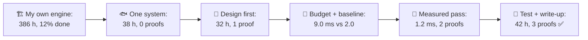
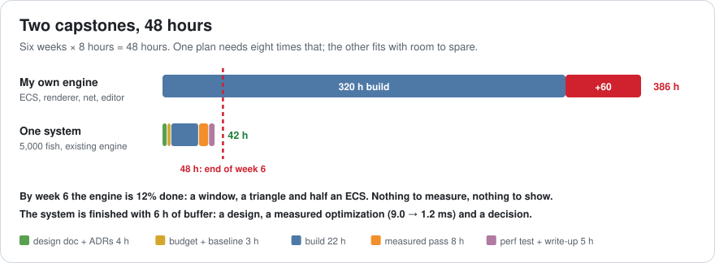
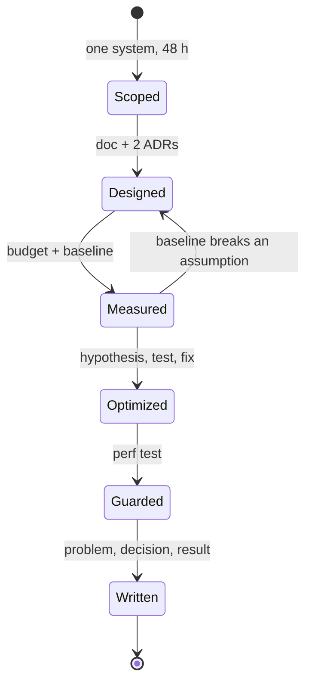
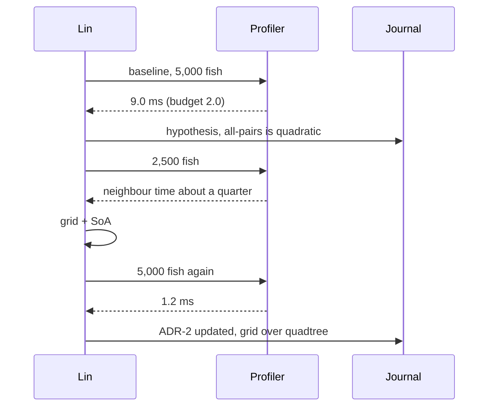
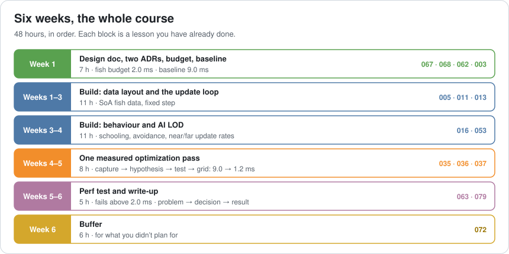
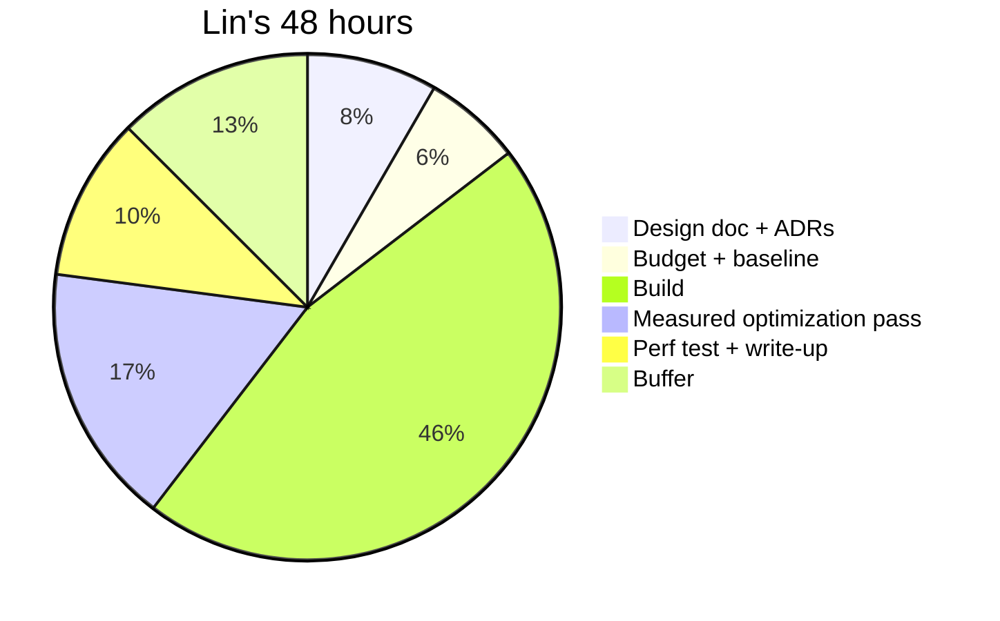
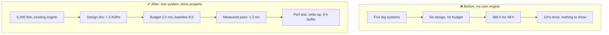

# Lesson 080 — Capstone: Plan Your Own Architecture + Optimization Project: 386 Hours in Six Weeks

> Module 7 · The architect's craft · ~15 min read · 2026-11-01

**Today's goal:** plan one project of your own that uses this whole course and that you can actually finish: one system, a design doc and ADRs before code, a budget and a baseline, one measured optimization pass, a performance test and a write-up, sized to six weeks of evenings with a buffer. It becomes the strongest piece in your portfolio.

### TL;DR
- Lin finishes the course and plans a capstone: **"my own engine"** with an ECS, a renderer, networking and an editor. Six weeks of evenings is **48 hours**. The plan needs **386**. By week 6 it's **12% done**: a window, a triangle and half an ECS, with nothing to measure and nothing to show.
- **One system** instead: 5,000 schooling fish in an existing engine. **22 hours** of build. It fits, but with no design, 10 hours go to **rework**, and nothing proves anything.
- **Design doc and ADRs first** (4 h) replace the 10 hours of rework. A **budget and baseline** (3 h): fish update **2.0 ms** budget, **9.0 ms** measured. One **measured optimization pass** (8 h): hypothesis, test, grid and SoA, **9.0 → 1.2 ms**.
- A **perf test and write-up** (5 h). Total **42 hours**, **6 hours of buffer** (13%), and all three portfolio proofs from Lesson 079: a design, a measured optimization and a decision.

> 🎮 **Play with it: [Capstone Planner](https://yimo691.github.io/GameArchitect/demos/080-capstone-planner/)** — choose the scope, whether you design first, set a budget, how you optimize and how you finish, and see whether it fits in 48 hours and what it proves. Tap **Set up** on the steps to replay the lesson.



---

## 1. The problem

Lin has done all 79 lessons, kept the journal and done the desk exercises. Now Lin wants one project that pulls it all together, something to build in the evenings and show in interviews. The plan, written in ten minutes on a Sunday:

```
Capstone: my own engine
- ECS with archetypes (Lesson 013)
- Job system (009)
- Renderer with batching and culling (024, 027)
- Networking with rollback (049)
- Editor with undo (017, 054)
Time: 8 hours a week, 6 weeks
```

It's an exciting plan, and every line is a real lesson. Now estimate it the way Lesson 072 taught, roughly, from experience:

```
ECS 60 h · jobs 40 h · renderer 90 h · netcode 70 h · editor 60 h   = 320 h of build
Rework, because there's no design and everything touches everything  = 60 h
Tinkering with performance "when it feels slow"                      = 6 h
Total                                                                = 386 h
Available: 6 weeks × 8 h                                             = 48 h
```

At week 6, Lin has **12%** of it: a window, a triangle and half an ECS. There's no performance number, because there's nothing complete enough to measure. There's no design doc, because it was going to be written "when it's clearer". The portfolio piece from Lesson 079 would read: "Own engine (in progress)". Most of these projects stop there, quietly, in week 4.

This is the last lesson's problem, and it's the first lesson's too (Lesson 001): the hard part of architecture isn't knowing the techniques. It's **choosing what to build**, in what order, inside a budget.



---

## 2. Step 1 — Choose one system, sized to the time you have

Scope is the decision that decides every other one. The capstone should be **one system**, inside an engine you don't have to write (Unity, Unreal, Godot, or a small framework you already know), with **a number you can measure** and **a decision worth defending**.

Lin's choice: **5,000 schooling fish**, each avoiding the others and the player, in an existing engine, on Lin's laptop. It uses data layout (Lesson 005), the update loop (Lesson 011), ECS or plain arrays (Lesson 013), behaviour (Lesson 016) and AI LOD (Lesson 053). It has an obvious measurement: the fish update in milliseconds.

Other capstones that fit in 48 hours:

| Capstone | The number to measure | The decision worth defending |
|---|---|---|
| 5,000 schooling fish | Fish update, ms | Grid vs tree vs all-pairs |
| A streamed island chain | Memory and worst frame while moving | Cell size, load and unload distance |
| An online save service prototype | Saves per second, p99 latency, 0 lost | Snapshots vs event log |
| A particle system on jobs | Particle update, ms, on 1 and 8 cores | Job size, data layout |
| An input recorder with replay | Replay matches live, byte for byte | Commands vs state snapshots |
| A UI screen with 2,000 items | Frame time while scrolling | Retained vs immediate, virtualization |

Build estimate for the fish: **22 hours**. Add 10 hours of rework (designing the fish data twice) and 6 hours of tinkering: **38 hours**. It fits. But nothing in it proves anything a reviewer can check. Fitting is necessary; it isn't enough.

---

## 3. Step 2 — Write the design before the code

Four hours, before any code: a design doc of the kind Lesson 067 described, short, with the constraints and a picture, and **two ADRs** for the decisions that are expensive to change (Lesson 068).

```
Design doc: 5,000 schooling fish (2 pages)
Goal:         5,000 fish schooling around the player at 60 fps on my laptop
Budget:       fish update ≤ 2.0 ms per frame
Data:         positions, velocities, school id in arrays (SoA), not one object per fish
Update:       fixed step 30 Hz for behaviour; render interpolates
Near/far:     full behaviour within 40 m; far fish update at 5 Hz (AI LOD)
Out of scope: rendering beyond instancing, networking, save
ADR-1:        SoA arrays over one GameObject per fish
ADR-2:        spatial query: start with all-pairs, measure, then decide
```

ADR-2 is deliberate: Lin doesn't yet know whether all-pairs is too slow at 5,000 fish. Writing "measure, then decide" is an honest decision, and it sets up the optimization pass.

The four hours replace the **10 hours of rework**: the fish data is designed once, and the boundaries (behaviour, spatial query, rendering) are set before the code depends on them. Total **32 hours**, and the first proof: **a design**.



---

## 4. Step 3 — Set the budget and measure the baseline

Three hours. Make the budget concrete (Lesson 062) and measure where you start (Lesson 003), on the device you named, with the engine's profiler:

```
Fish update budget:  2.0 ms per frame (of 16.7)
Baseline:            9.0 ms with 5,000 fish, all-pairs neighbour checks
                     measured over 600 frames on my laptop, median
```

Now the project has a number that can move, and a target it has to reach. Without this step, the optimization is "it feels faster", which nobody, including Lin, can check.

The tempting alternative is to skip straight to optimizing whatever feels slow. In the lab, that's 6 hours of tinkering: the number moves, but Lin can't say why or by how much. The baseline costs 3 hours and makes the next 8 count.

---

## 5. Step 4 — One measured optimization pass

Eight hours, using the method from Lessons 035 and 078:

1. **Capture**: the fish update is 9.0 ms; inside it, neighbour checks are most of the time.
2. **Hypothesis**: every fish checks every other fish, so the cost is quadratic. Prediction: 2,500 fish should take about a quarter of the neighbour time.
3. **Test**: it does. Confirmed.
4. **Fix the algorithm first**: a uniform grid with cells the size of the schooling radius (Lesson 037). Then the data: positions in contiguous arrays (Lesson 005).
5. **Measure again**: **9.0 → 1.2 ms**, under the 2.0 ms budget.

Update ADR-2 with what happened: "Uniform grid, chosen over a quadtree because fish are spread evenly and move every frame. Revisit if schools cluster tightly." That ADR is the third proof: **a decision**, with its reason and its limit.

Total so far: **37 hours**, two proofs.



---

## 6. Step 5 — Guard it, write it up, keep the buffer

Five hours to finish like an architect:

- **A performance test** (Lesson 063) that runs the 5,000-fish scene and fails above 2.0 ms. It protects the result from your own next change.
- **A write-up** in the shape from Lesson 079: a title with the result ("5,000 schooling fish: 9.0 → 1.2 ms"), the problem in two lines, the decision and what was rejected, before and after captures, and one line on what you'd do differently. Put the project in a public repository, with the design doc and ADRs next to the code.

That makes **42 hours**, and leaves **6 hours of buffer**, about 13% (Lesson 072): for the evening the engine update breaks your build, or the week you're ill. A plan with no buffer is a plan to finish late.





Look at where the hours went. Less than half is "building the thing". The rest is the work that this course has been about: deciding, measuring, guarding and explaining. That ratio isn't a waste of a hobby project's time. It's what makes it an **architect's** project.

---

## 7. The architect's view

The junior plans the most impressive project. The optimizer plans the fastest one. The architect asks: **what is the smallest project that proves the most, and how do I know it fits?** It's the same question as the vertical slice (Lesson 073), and the same answer: thin, complete, measured, on the target.



After the capstone, do another. The second one can be a different row of the table in Step 1, and it'll take less time, because the habits are now yours. Three of them, one design, one optimization and one decision at scale, are the portfolio from Lesson 079.

### Trade-offs

| Choice | Cost | Benefit | When to use |
|---|---|---|---|
| Your own engine | Hundreds of hours | Deep learning of everything | A long-term hobby, not a six-week capstone |
| One system in an existing engine | Less to show off | Finishes; can be done properly | The capstone |
| Design doc + ADRs first | 4 h before any code | No rework; the first proof | Always |
| Budget + baseline | 3 h | Every later number means something | Always |
| One measured pass | 8 h | A result you can explain | When the baseline is over budget |
| Perf test + write-up | 5 h | The result stays and can be shown | Always |
| Buffer | 10–15% of the time | You finish when you said | Every plan |

---

## 8. Common mistakes

- **Scoping to ambition, not to hours.** Estimate first; then cut until it fits with a buffer.
- **Writing an engine to learn architecture.** You'll learn more by doing one system to architect standard.
- **"I'll write the design when it's clearer."** It gets clearer by writing it.
- **No baseline.** Without a starting number, the optimization has no result.
- **Optimizing before it's over budget.** If the baseline is under 2.0 ms, spend the hours on something else.
- **Finishing without a write-up.** The work happened; nobody can see it.

---

## 9. Quiz — think about it on the ferry ⛴️

**Q1.** How many hours does Lin's engine plan need, and how much is done by the end of week 6?

<details><summary>Answer</summary>

`320 + 60 + 6 = 386 hours`. `48 ÷ 386 ≈ 12%` done after six weeks of 8 hours.
</details>

**Q2.** Why does the 4-hour design doc save time instead of costing it?

<details><summary>Answer</summary>

Without it, the fish data and boundaries are designed twice, about 10 hours of rework. `22 + 4 + 6 = 32 hours` with the doc, against `22 + 10 + 6 = 38` without. It's also the first portfolio proof.
</details>

**Q3.** What makes "9.0 → 1.2 ms" a stronger result than "much faster"?

<details><summary>Answer</summary>

A budget (2.0 ms) and a baseline (9.0 ms) measured the same way, on a named device, over 600 frames. A reviewer can see the size of the change and whether it met the target.
</details>

**Q4.** Add up the final plan and the buffer as a percentage.

<details><summary>Answer</summary>

`4 + 3 + 22 + 8 + 5 = 42 hours`. Buffer `48 − 42 = 6 hours`, `6 ÷ 48 = 12.5%`, about 13%.
</details>

**Q5.** Why is ADR-2 first written as "start with all-pairs, measure, then decide"?

<details><summary>Answer</summary>

At design time Lin doesn't know if all-pairs is too slow at 5,000 fish. Deciding to measure first is an honest decision, and it's updated after the pass: grid over quadtree, with the reason and when to revisit it.
</details>

**Q6.** Lin's baseline came in at 1.5 ms, already under the 2.0 ms budget. What should the 8 hours of the optimization pass go to instead?

<details><summary>Answer</summary>

Not to optimizing. Spend them where the project is weakest: more fish to find where the budget breaks, a second device, the AI LOD for far fish, or a better write-up. Optimizing below budget is effort without a result (Lesson 062).
</details>

---

## 10. Back at the desk (≈60 min) — write your capstone plan

> No desk today? Do it in the [Capstone Planner](https://yimo691.github.io/GameArchitect/demos/080-capstone-planner/): predict the hours, the percentage done and the proofs for each step, then tap.

This is the last desk exercise, and it's the start of your next project.

1. Write down your **time**: weeks × hours per week. Be honest.
2. Choose **one system** (from the table in Step 1, or your own) with a **number to measure** and a **decision worth defending**.
3. Estimate the **build** in hours. If build + 20 hours of the habits + a 10% buffer doesn't fit, cut scope until it does.
4. Write the **one-page design doc** and the **two ADRs** before any code.
5. Set the **budget** and name the **device** for the baseline.
6. Save `journal/080-capstone.md`:

| Week | Planned work | Hours | Lessons used | Done? | Actual hours |
|---|---|---|---|---|---|
| 1 | | | | | |
| 2 | | | | | |
| 3 | | | | | |
| 4 | | | | | |
| 5 | | | | | |
| 6 | | | | | |

Then start week 1. Fill in the last two columns as you go; at the end, compare planned and actual hours, and add that to your next estimate.

One question for your journal: of everything in this course, which habit do you most want other people to see in your work?

---

## 11. Vocabulary

| Term | Meaning | 中文 |
|---|---|---|
| Capstone | A final project that uses everything from a course | 毕业项目 / 综合项目 |
| Scope | What a project will and won't include | 范围 |
| Scope creep | A project growing beyond its plan, a little at a time | 范围蔓延 |
| Baseline | The measurement you start from | 基线 |
| Budget | The most a system may cost, agreed before building | 预算 |
| Buffer | Time held back for problems you can't predict | 缓冲时间 |
| Rework | Doing work again because the first version was wrong | 返工 |
| Out of scope | Explicitly not part of this project | 范围之外 |
| Write-up | A short document of the problem, decision and result | 总结报告 |
| Public repository | Code and documents anyone can read online | 公开代码仓库 |

---

## 12. Further reading

- **Frederick P. Brooks Jr., *The Mythical Man-Month*, anniversary edition** (Addison-Wesley, 1995): why plans slip, and why "plan to throw one away" still matters.
- **Steve McConnell, *Software Estimation: Demystifying the Black Art*** (Microsoft Press, 2006): estimating with ranges and buffers, for teams of one too.
- **Robert Nystrom, *Game Programming Patterns*** (gameprogrammingpatterns.com, free online): small, well-scoped patterns that make good capstone systems.
- **Michael Nygard, "Documenting Architecture Decisions"** (cognitect.com blog, 2011): the ADR format for your capstone's decisions.

---

**Next — the deep-dive series.** This is the end of the 80-lesson course. From here, GameArchitect continues with ten-lesson deep dives that go further into one area at a time, starting with rendering. Bring your capstone: each deep dive is a chance to take one of its numbers further.
